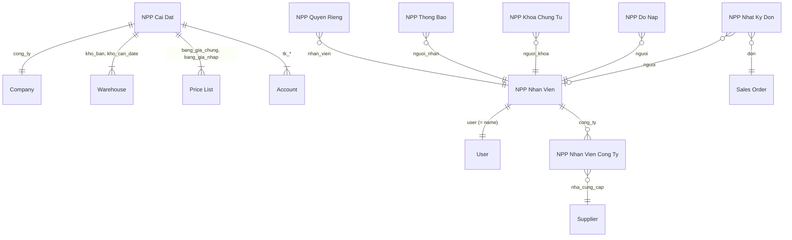
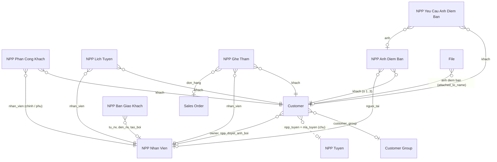
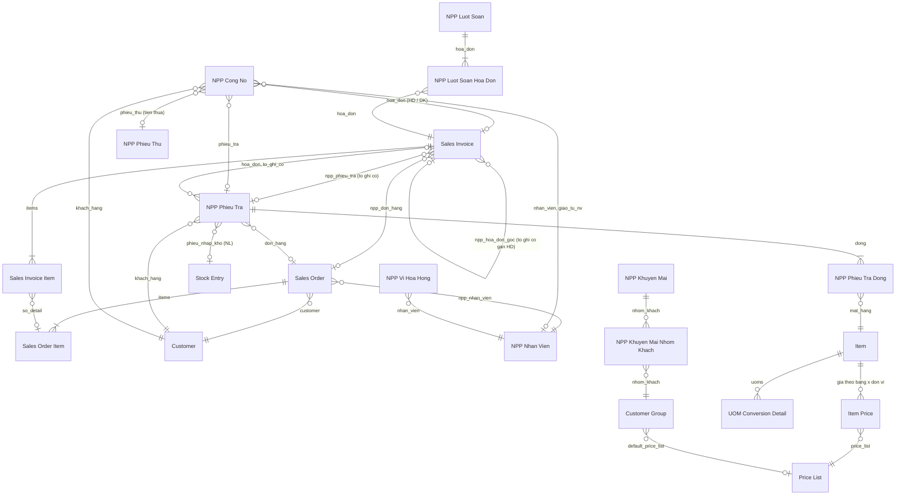
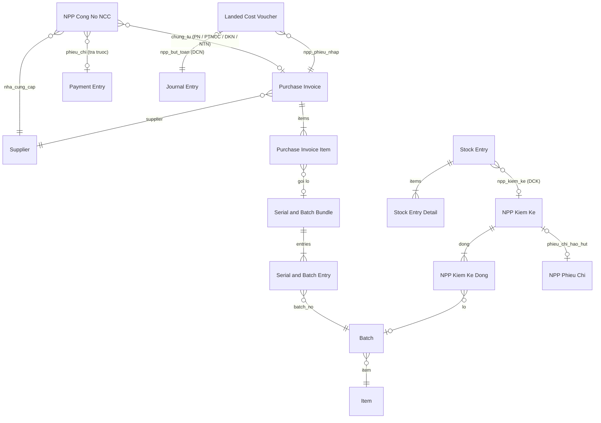
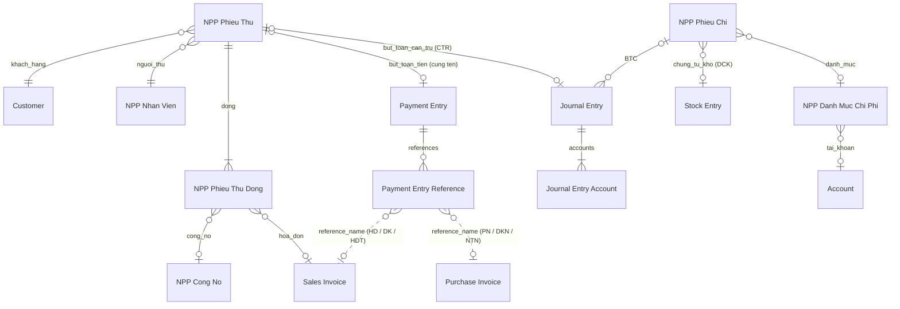
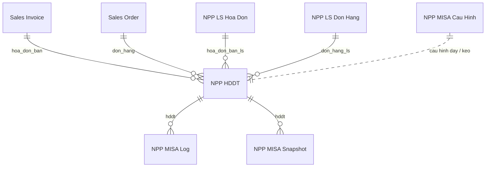
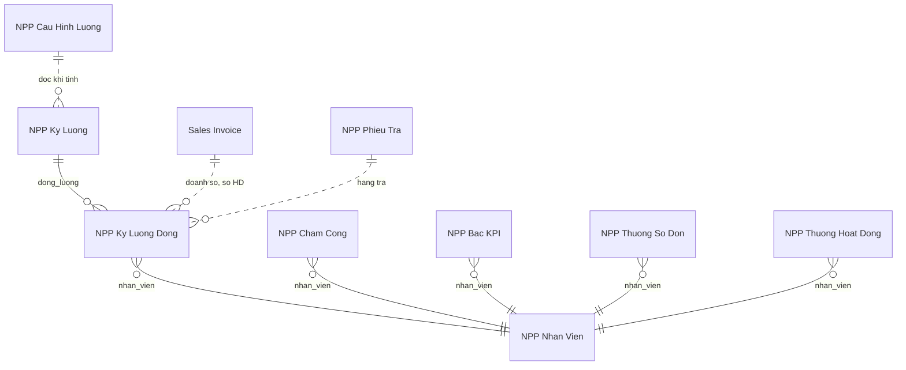
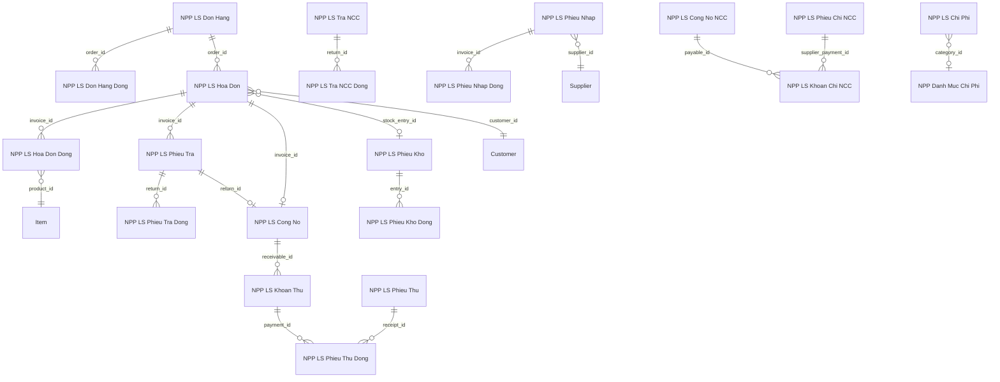

# DocType Blueprint — app nppsale

Phiên bản 1.0 · 11/11/2026 · tệp 2/6 của blueprint P1 (skill `nextcode-design`, GIAI ĐOẠN 2). Gộp bốn phần soạn song song — Hệ thống + Khách
hàng · Bán hàng · Tiền + Kho + Mua · HĐĐT + Nhân sự + Lưu trữ — thành một tệp; chỗ đã thống nhất giữa các phần ghi ở **Phụ lục B**. Đọc kèm
[`00_quyet_dinh_trien_khai.md`](00_quyet_dinh_trien_khai.md) (Q1 cổng tương thích, Q2 `NPP Cong No`, Q3 làm tròn, Q4 module, Q5 nhịp làm) và
[`01_business_model.md`](01_business_model.md).

**Nguồn.** Cột thật lấy từ chính migration 001–260 của nppsale (bản `CREATE TABLE` / `ALTER TABLE … ADD COLUMN` cuối, bỏ cột đã `DROP`; kể cả cột
thêm bằng SQL động ở mig 249); phần Hệ thống còn dựng lại schema trên một Postgres 16 thử rồi đọc `information_schema`, `pg_policies`,
`pg_indexes`, `pg_constraint`. Chính sách RLS là bản đang chạy (bản `CREATE POLICY` cuối mỗi tên, sau mig 250 / 260 — hai mig này chỉ bọc hàm
trong `(SELECT …)` / đổi sang tập tính một lần, không đổi nghĩa). Luật ở `CLAUDE.md` nppsale, `../khao-sat/03_nghiep_vu.md`, bản bàn bạc (0a,
3.2–3.11, 4, 5, 6, 8), PoC (mục 0, 2.(2), 3). Trường lõi và DocType đích của Link đối chiếu JSON DocType của bench thử (frappe 16.55.2 / erpnext
16.53.0, `apps/frappe` + `apps/erpnext`). Lời gọi giao diện đếm bằng `grep '\.from("…")'` trên `src/` của nppsale ngày 11/11/2026.

**Cách ghi tham chiếu.** `§x.y` là mục của **tệp này**. Số mục trần (`3.11`, `4.2`, `6.6`), `CFD-nn`, `câu n` là của bản bàn bạc
(`../00_ban_bac_chot.md`); `Q1`–`Q5` của `00_quyet_dinh_trien_khai.md`; `PoC n` / `PoC 2.(2)` của `../poc/00_ket_qua_poc.md`; `mig NNN` là migration
nppsale; `tệp 03` / `04` / `05` / `06` là các tệp blueprint sau (quyền · trạng thái · tích hợp lõi + RPC · fixtures).

---

## 1. Đọc trong hai phút

**66 DocType riêng** trên 8 module (Q4) — 46 DocType sống + 20 DocType lưu trữ chỉ đọc (H3); trong đó 7 bảng con và 3 Single:

| Module (Q4) | DocType riêng | Số |
|---|---|---|
| `NPP He Thong` | `NPP Cai Dat` (Single), `NPP Phien Danh Muc`, `NPP Nhan Vien` (+ bảng con `NPP Nhan Vien Cong Ty`), `NPP Quyen Vai`, `NPP Quyen Rieng`, `NPP Thong Bao`, `NPP Khoa Chung Tu`, `NPP Do Nap`, `NPP Nhat Ky Don` (nhật ký đơn — Phụ lục A), `NPP Sao Luu` | 11 |
| `NPP Khach Hang` | `NPP Tuyen`, `NPP Phan Cong Khach`, `NPP Lich Tuyen`, `NPP Ghe Tham`, `NPP Anh Diem Ban`, `NPP Yeu Cau Anh Diem Ban`, `NPP Ban Giao Khach` | 7 |
| `NPP Ban Hang` | `NPP Phieu Tra` (+ `NPP Phieu Tra Dong`), `NPP Cong No`, `NPP Luot Soan` (+ `NPP Luot Soan Hoa Don`), `NPP Khuyen Mai` (+ `NPP Khuyen Mai Nhom Khach`), `NPP Chinh Sach Hoa Hong`, `NPP Vi Hoa Hong` | 9 |
| `NPP Kho Mua` | `NPP Cong No NCC`, `NPP Kiem Ke` (+ `NPP Kiem Ke Dong`) | 3 |
| `NPP Tien` | `NPP Phieu Thu` (+ `NPP Phieu Thu Dong`), `NPP Phieu Chi`, `NPP Danh Muc Chi Phi` | 4 |
| `NPP HDDT` | `NPP HDDT`, `NPP MISA Cau Hinh` (Single), `NPP MISA Log`, `NPP MISA Snapshot` | 4 |
| `NPP Nhan Su` | `NPP Cau Hinh Luong` (Single), `NPP Thuong Thang`, `NPP Cham Cong`, `NPP Bac KPI`, `NPP Thuong So Don`, `NPP Thuong Hoat Dong`, `NPP Ky Luong` (+ `NPP Ky Luong Dong`) | 8 |
| `NPP Luu Tru` | 20 `NPP LS *` — đơn, HĐ, phiếu trả, công nợ + khoản thu, phiếu thu, phiếu nhập, trả NCC, công nợ NCC + khoản chi + phiếu chi NCC, phiếu kho, chi phí (mỗi chứng từ một DocType đầu phiếu + một DocType dòng) | 20 |
| **Tổng** | | **66** |

**138 Custom Field** trên 17 DocType lõi (kể cả bảng con lõi và `File`) — chỉ chỗ trường lõi không thay được; mọi cột còn lại đi thẳng vào
trường có sẵn ("dùng `<trường lõi>`" ở §5):

| DocType lõi | Custom Field mới | Dòng "dùng trường lõi" | Ở |
|---|---|---|---|
| Customer | 22 | 6 | §5.1 |
| Supplier | 22 | 2 | §5.2 |
| Item | 9 | 18 | §5.3 |
| UOM Conversion Detail (bảng con của Item) | — | 1 | §5.3 |
| Sales Order | 13 | 8 | §5.5 |
| Sales Order Item | 2 | 3 | §5.5 |
| Sales Invoice | 16 | 14 | §5.6 |
| Sales Invoice Item | 4 | 3 | §5.6 |
| Payment Entry | 6 | 2 | §5.7 |
| Payment Entry Reference | 2 | — | §5.7 |
| Journal Entry | 4 | 1 | §5.8 |
| Journal Entry Account | 2 | — | §5.8 |
| Purchase Invoice | 17 | 3 | §5.9 |
| Purchase Invoice Item | 3 | 1 | §5.9 |
| Landed Cost Voucher | 2 | 1 | §5.10 |
| Stock Entry | 6 | 1 | §5.11 |
| Stock Entry Detail | — | 1 | §5.11 |
| Batch | 7 | 1 | §5.12 |
| File | 1 | — | §5.14 |
| Item Price | — | 4 | §5.4 |
| Customer Group | — | 1 | §5.4 |
| User | — | 6 | §5.13 |
| **Tổng** | **138** | | |

**Sổ đăng ký cổng (Q1)**: 84 dòng — 80 bảng đang sống sau mig 260 + 4 view; 74 bảng + 3 view có lời gọi `.from()` ở giao diện, 6 bảng chỉ RPC /
trigger dùng (§6.1). Tiền, kho, trạng thái chứng từ chỉ ghi qua method / RPC; bảng nppsale cấm ghi thẳng (mig 214 / 227 / 170…) thì cổng cũng cấm
và trả đúng mã lỗi cũ (§2.10).

**Không port** (cổng trả nguồn rỗng, ghi → `LEGACY_FLOW_REMOVED`, trừ chỗ ghi khác — §6.6): `workflow_sessions`, `reports_config`, `giam_don_goc`,
`merged_orders`, `cash_collections`, `purchase_orders`, `purchase_order_lines`, `stock_line_consumptions`, `swap_stock_movements`, `v_uom_audit`,
`hr_payroll`, năm bảng chuyến giao (`deliveries`, `delivery_lines`, `driver_handovers`, `driver_handover_items`, `driver_handover_failed_orders`).
`order_status_history` / `order_activity_log` là DocType `NPP Nhat Ky Don` (module `NPP He Thong`, đặc tả ở Phụ lục A — **đã dựng**): `create_order_with_lines`,
`sua_don` / `cancel_order`, `post_invoice` / huỷ HĐ gọi `ghi_nhat_ky_don(...)` đúng chỗ trigger cũ ghi; bài vàng `test_tao_don` / `test_sua_don` / `test_xuat_hang` so
lịch sử trạng thái đọc từ DocType này với Postgres của nppsale. Không dựng từ `Version` (bàn bạc 4.2 ghi `Version` — §7.1 điểm 8, §7.3).

**Mấy điều cốt lõi của thiết kế**
- **Sổ thật là lõi ERPNext** (SO / SI / PE / PI / SE / JE / Batch); DocType riêng chỉ ở chỗ lõi không có hoặc làm khác luật nppsale. Ba DocType "bọc"
  chứng từ lõi để giữ số phiếu qua mọi lần lập lại: `NPP Phieu Tra` (tờ ghi có độc lập + phiếu nhập kho — CFD-03), `NPP Phieu Thu` (Payment Entry +
  bút toán cấn trừ — CFD-04), `NPP Kiem Ke` (phiếu điều chỉnh theo lô + phiếu chi hao hụt — CFD-09).
- **Công nợ là bản chiếu** (Q2): `NPP Cong No` / `NPP Cong No NCC` không có trường người dùng ghi; số tiền chiếu từ Payment Ledger, trạng thái nghiệp vụ
  (NV giữ nợ, dấu bàn giao, hạn, quá hạn tay) nằm trên chứng từ nguồn (§4.3.0).
- **Khoá `id` của cổng = `name`** (`KH-00042`, `DH-0042`, `HD-0042-1`, SKU…; DocType riêng không số giữ UUID cũ của nppsale); nhân viên = email kỹ thuật
  (§2.3, §2.5) — **chưa chốt** (§7.1 điểm 1).
- **25 điểm cần anh quyết** ở §7.1; nặng nhất: khoá `id` (1), nguồn đọc gộp lưu trữ H3 (2), phiếu thu bọc (13), mã lô trùng (14), tài khoản kế toán
  cho bút toán app tự lập (16), cách cấp số HĐ ở tệp 05 (25). Chỗ blueprint khác bản bàn bạc: §7.3.
- **Quyết định nền** Q1–Q5 (cổng tương thích, `NPP Cong No`, làm tròn câu 19, module, nhịp làm) ở
  [`00_quyet_dinh_trien_khai.md`](00_quyet_dinh_trien_khai.md); tệp này không lặp lại lý do của chúng.

---

## 2. Quy ước chung

### 2.1 Đặt tên
- **DocType riêng**: `NPP <Tên không dấu>` Title Case (câu 12), tên bảng `tabNPP …`, module controller `npp_<…>`. **Fieldname** ASCII
  `snake_case` tiếng Việt không dấu; cột nppsale tương ứng ghi đầu cột Notes (cổng ánh xạ theo đó).
- **Custom Field trên DocType lõi**: tiền tố `npp_` (ví dụ `npp_giao_tu_nv`); cột nào trường lõi thay được thì **dùng trường lõi** (ghi "dùng `<trường>`"),
  không đẻ trường trùng.
- **Ngoại lệ có lý do**: (a) nhóm tích hợp MISA giữ tên `misa_*` (đúng bảng cột của skill `einvoice-misa-sync`, đọc thẳng được với mã chép từ
  `src/lib/misa/*.ts`) và mã trường MISA trong snapshot (`ref_id`, `publish_status`, `einvoice_status`); (b) 20 DocType lưu trữ `NPP LS *` **giữ nguyên tên
  cột nppsale** (bản chép 1–1 chỉ đọc, hàm dòng thô UNION bằng bí danh — §4.8.0); (c) cột nppsale tên `name` đổi sang trường tiêu đề (`ten`, `ten_tuyen`,
  `item_name`, `ten_cau_hinh`…) vì `name` là khoá của Frappe. Không fieldname nào va tên thuộc tính / từ khoá của `frappe.model.document.Document`.
- **Giá trị Select = mã nppsale** (`owner`, `sales`, `primary`, `draft`, `pending`, `order_placed`…) để cổng và mã React so khớp không phải dịch; nhãn
  tiếng Việt do portal hiện như hôm nay. Bảng lưu trữ để mã giá trị ở **Data** (Select sẽ từ chối giá trị cũ như `partially_invoiced`, `closed`).

### 2.2 Module (Q4) và nơi chứa mã

| Module | DocType riêng | Custom Field trên DocType lõi (module) |
|---|---|---|
| `NPP He Thong` | cài đặt, phiên danh mục, nhân viên, quyền, thông báo, khoá chứng từ, đo nạp, nhật ký đơn (`NPP Nhat Ky Don` — Phụ lục A), sao lưu (§4.1) | — |
| `NPP Khach Hang` | tuyến, phân công, lịch tuyến, ghé thăm, ảnh điểm bán, yêu cầu ảnh, bàn giao (§4.2) | Customer, File |
| `NPP Ban Hang` | phiếu trả, công nợ, lượt soạn, khuyến mãi, hoa hồng (§4.3) | Item, Sales Order (+ Item), Sales Invoice (+ Item) |
| `NPP Kho Mua` | công nợ NCC, kiểm kê (§4.4) | Supplier, Purchase Invoice (+ Item), Landed Cost Voucher, Batch, Stock Entry |
| `NPP Tien` | phiếu thu, phiếu chi, danh mục chi phí (§4.5) | Payment Entry (+ Reference), Journal Entry (+ Account) |
| `NPP HDDT` | HĐĐT, cấu hình / nhật ký / snapshot MISA (§4.6) | — (mọi trường MISA ở `NPP HDDT`) |
| `NPP Nhan Su` | cấu hình lương, thưởng, chấm công, kỳ lương (§4.7) | — |
| `NPP Luu Tru` | 20 `NPP LS *` (§4.8) | — |

Mỗi DocType lõi **một** module (kể cả trường do module khác cần — ví dụ `Stock Entry.npp_phieu_tra` của phiếu trả thuộc `NPP Kho Mua`). Hôm nay **không ship bằng
fixtures**: `nppsale.thiet_lap` chạy ở `after_install` + `after_migrate` (lặp lại an toàn) — Custom Field từ `thiet_lap/truong_tuy_bien.json` (sinh từ các bảng §5
bằng `tools/dung_truong_tuy_bien.py`, `create_custom_fields(update=True)`, bỏ trường Link tới DocType chưa có, chưa gắn `module`), Role (`vai.dam_bao`), Property
Setter `naming_series` + Selling / Buying Settings (`mac_dinh._dat_ten_chung_tu`), DocPerm sàn (`quyen_san.dam_bao`), bản ghi mặc định; tệp 06 chốt có chuyển
sang fixtures hay không.
Module cũ `NPP Sale` bỏ. Python theo Q4: `nppsale/luat/` (luật thuần, không import frappe, có unit test), `nppsale/cong/` (cổng + sổ đăng ký bảng
`cong/bang/*.py`), `nppsale/rpc/` (74 RPC cùng tên), `nppsale/api/`, `nppsale/su_kien/` (doc_events), `nppsale/lich/` (scheduler), `nppsale/portal/`.

### 2.3 Khoá `id` của cổng và cách đặt `name`
- **`id` của cổng = `name` của bản ghi nguồn** (đề xuất — §7.1 điểm 1). Cái giá: sửa `laTrangDanhSach` (`src/lib/nav/mobile-chrome.ts:143` — hôm nay
  nhận trang chi tiết bằng đoạn UUID) ở lớp phủ `src/thay` (đã có: `portal/src/thay/lib/nav/mobile-chrome.ts`, nhận thêm trang chi tiết theo cây route).
  `ORG_PHOTO_PATH` (`src/lib/customers/photos.ts:186`, đòi khách là UUID) không phải phủ: chỉ `parseOrgPhotoPath` của route `/api/customers/photo-cleanup` dùng,
  route ấy đã thành Python (`nppsale/api/anh.py` + `tach_duong` ở `nppsale/api/tep.py`, khách `[^/]+` nên nhận `KH-00042`).
- **DocType riêng không cần số người đọc**: `autoname: "UUID"` — Frappe v16 sinh uuid7 khi `name` trống, giữ UUID truyền sẵn (`frappe/model/naming.py:165–175`);
  cột `name` và mọi cột Link trỏ tới DocType ấy thành kiểu `uuid` của MariaDB (`frappe/database/schema.py:419–428`; cần MariaDB ≥ 10.7 — bench thử
  10.11.14). Bản ghi chuyển sang **giữ nguyên UUID nppsale** → link cũ, `metadata`, URL `/…/<uuid>` vẫn đúng. Chưa DocType lõi nào dùng kiểu này → P2 thử
  Link / danh sách / báo cáo / cổng trên kiểu UUID trước; hỏng thì lùi về `hash` + trường `id_cu`.
- **Có số người đọc**: naming series đúng tiền tố nppsale (§2.4). **Khoá tự nhiên**: `format:` / `field:` / controller đặt (`NPP Nhan Vien` = `field:user`,
  `NPP Quyen Vai`, `NPP Quyen Rieng`, `NPP Khoa Chung Tu`, `NPP Vi Hoa Hong`, `NPP Thuong Thang`, `NPP Ky Luong`). **Bảng con**: `hash`.
- **DocType lõi có tên riêng** (Customer `KH-00042`, Item = SKU, Supplier `NCC-0007`): `id` = tên ấy; UUID cũ cất ở `npp_id_cu` (Customer, Item, Supplier —
  chỉ dòng chuyển sang) để chuyển hướng link cũ (`/customers/<uuid>`, Zalo, `notifications.link_url`) ở `index.py` và đối chiếu số. Chứng từ cũ không vào
  sổ lõi — nằm ở `NPP LS *` giữ UUID (§4.8.0); HĐ còn nợ ở ngày cắt thành tờ đầu kỳ **giữ mã HĐ cũ** (`insert(set_name=…)`, PoC 10).

### 2.4 Dãy số chứng từ (mọi tiền tố)

nppsale không có bảng dãy số: `seq = MAX(seq) + 1` dưới `pg_advisory_xact_lock`, `_so_chung_tu(n)` đệm tối thiểu 4 chữ số và **không cắt** khi > 9999
(mig 237). Frappe cấp số qua `tabSeries` (`getseries`: đệm theo số `#`, không cắt khi tràn) — cùng hình dạng. Trong dãy Frappe, dấu `.` là dấu ngăn phần
(`PTH-.YY.MM.DD.-.####` → `PTH-261111-0001`, đếm lại theo từng tiền tố ngày).

| Chứng từ | Dạng nppsale | Nguồn ERPNext / app | `name` | Ghi chú |
|---|---|---|---|---|
| Khách hàng | (không mã) | Customer | `KH-.#####` | Selling Settings `cust_master_name = Naming Series` (3.11); tên cửa hàng trùng nhau là thường, SĐT mới là khoá |
| Nhà cung cấp | (không mã) | Supplier | `NCC-.####` | Buying Settings `supp_master_name = Naming Series` |
| Mặt hàng | SKU | Item | `item_code` = SKU | bất biến khi đã có chứng từ (câu 18) |
| Lô | `PN-xxxx-NNN`, mã người gõ, `RESTOCK-…`, `LOT-…` | Batch | `name` = `batch_id` = mã lô | đổi mã = `rename_doc` ép (PoC 8); mã trùng — §7.1 điểm 14 |
| Đơn hàng | `DH-0001`, sửa → `DH-0001-n` (đổi tại chỗ) | Sales Order | `DH-.####` | sửa **không** đổi mã; "sửa lần n" = `npp_lan_sua` (CFD-01, 6.5) |
| Hoá đơn bán | `HD-0001`, sửa → `HD-0001-n` | Sales Invoice | `HD-.####`; sửa = amend `HD-0001-1` | Document Naming Settings `default_amend_naming = Amend Counter`; cách cấp số bớt nối đuôi chọn ở tệp 05 (§7.1 điểm 25) |
| Tờ ghi có của phiếu trả | — | Sales Invoice `is_return = 1` | `HDT-.####`; lập lại `HDT-0042-1` | app lập (6.6) |
| Tờ nợ đầu kỳ (màn Nợ đầu kỳ) | — | Sales Invoice `is_opening = Yes` | `DK-.####`; sửa số tiền `DK-0012-1` | HĐ cũ còn nợ ở ngày cắt: `insert(set_name=<mã HĐ cũ>)` |
| Phiếu trả khách | `PT-0001` (mã `TH-…` cũ đã đổi từ mig 237) | `NPP Phieu Tra` | `PT-.####` | không submit — số giữ qua mọi lần ghi nhận lại |
| Phiếu thu | `PT-YYMMDD-NNNN` (4 số ngẫu nhiên) | `NPP Phieu Thu` + Payment Entry (Receive) **cùng tên** | `PTH-.YY.MM.DD.-.####` | câu 13; PE `insert(set_name=…)` |
| Bút toán cấn trừ dư có | — | Journal Entry `Credit Note` | `CTR-.####` | |
| Phiếu chi (chi phí) | (không mã — số tham chiếu người gõ) | `NPP Phieu Chi` | `PC-.####` | 6.6 |
| Bút toán phiếu chi | — | Journal Entry | `BTC-.####`; lập lại `BTC-0012-1` | |
| Phiếu nhập NCC | `PN-0001` (cấp lúc hoàn thành) | Purchase Invoice `update_stock = 1` | `PN-.####`, cấp **lúc lập nháp** | câu 18; sửa / khôi phục `PN-0042-1` (CFD-01) |
| Phiếu trả NCC | `PTNCC-0001` | Purchase Invoice `is_return = 1` | `PTNCC-.####` | |
| Nợ đầu kỳ NCC | — | Purchase Invoice `is_opening = Yes` | `DKN-.####` | |
| Nợ NCC lập tay | — | Purchase Invoice (không kho) | `NTN-.####` | |
| Phiếu chi trả NCC | `PCNCC-0001` | Payment Entry (Pay) | `PCNCC-.####` | mig 242 |
| Ghi trả một khoản nợ NCC | (không mã) | Payment Entry (Pay) | `GTN-.####` | `record_payable_payment` |
| Bù trừ debit note NCC | — | Journal Entry `Debit Note` | `CTN-.####` | |
| Điều chỉnh nợ NCC khi sửa giá phiếu nhập đã bán | — | Journal Entry | `DCN-.####` | đi cùng LCV |
| Sửa giá phiếu nhập đã bán | — | Landed Cost Voucher | `SGN-.####` | CFD-06 |
| Nhập kho không công nợ, tồn đầu kỳ | `IN-YYYYMMDD-NNNN` | Stock Entry Material Receipt | `IN-.YYYY.MM.DD.-.####` | có NCC + tiền → phiếu nhập `PN-` (CFD-13) |
| Xuất kho lẻ | mã base36 trình duyệt sinh | Stock Entry Material Issue | `XKL-.####` | |
| Chuyển kho (cả chuyển kho date tự động) | mã base36 trình duyệt sinh | Stock Entry Material Transfer | `CKL-.####` | |
| Điều chỉnh kiểm kê | — | Stock Entry Issue / Receipt | `DCK-.####` | thẻ kho hiện mã phiếu kiểm kê |
| Nhập lại hàng trả | — | Stock Entry Material Receipt | `NL-.####` | |
| Phiếu xuất / nhập hoàn tự sinh | `XK-…`, `NK-…` | — | không còn | thẻ kho hiện chứng từ gốc (6.2) |
| Phiếu kiểm kê | `KKyyMMddNNNN` (trình duyệt sinh ngẫu nhiên) | `NPP Kiem Ke` | `KK-.YY.MM.DD.-.####` | |
| Lượt soạn hàng | `SH-dd/mm-NN` | `NPP Luot Soan` | `SH-.DD./.MM.-.##` | 6.6 — dãy Frappe **nhận** `/` (`NAMING_SERIES_PATTERN` của lõi có `/` — `frappe/model/naming.py:24`; `NamingSeries("SH-.DD./.MM.-.##")` qua `validate()`, ra `SH-13/11-01`), nên mã người dùng thấy giữ đúng mẫu `SH-dd/mm-NN`. Khác biệt còn lại: khoá đếm `SH-13/11-` không mang năm nên số đếm nối tiếp qua năm, không đếm lại theo ngày như mig 225; muốn đếm lại thì `name` không thể là mã (sang năm trùng `name`), phải dùng `name` băm + trường `ma` — §7.1 điểm 9 |
| Kỳ lương | (tháng) | `NPP Ky Luong` | `KL-YYYY-MM` (controller) | thay `UNIQUE(org_id, month)` |
| Thưởng tháng | `period` | `NPP Thuong Thang` | `field:ky` | |
| Ví hoa hồng | — | `NPP Vi Hoa Hong` | `<ky>:<nhan_vien>` | thay `UNIQUE(user_id, period)` |
| Quyền theo vai / riêng, khoá chứng từ | — | `NPP Quyen Vai` / `NPP Quyen Rieng` / `NPP Khoa Chung Tu` | `vai:mo_dun:hanh_dong` / `nhan_vien:khoa_quyen` / `loai_chung_tu:chung_tu` | khoá chính = khoá ghép duy nhất cũ |

Ngày cắt chuyển: đặt `tabSeries.current` của từng dãy = số cuối của nppsale (Document Naming Settings → khối "Update Series Counter", nút "Update Series
Number" — v16 không còn DocType `Naming Series` — hoặc câu SQL của công cụ chuyển dữ liệu) để số mới nối tiếp. Phiếu thu đổi tiền tố (`PT-` → `PTH-`) nên mã cũ chỉ còn ở lưu trữ.

### 2.5 Tham chiếu nhân viên, người tạo, trường dấu vết
- **Nhân viên = email tài khoản.** `NPP Nhan Vien` đặt tên `field:user` nên `NPP Nhan Vien.name` = `User.name` = email kỹ thuật `<sđt chuẩn hoá lúc
  tạo>@nppsale.local` (giữ miền `SYNTHETIC_EMAIL_DOMAIN` của nppsale); `users.id` của cổng = giá trị ấy. Không bao giờ đổi tên `User` (đổi SĐT không đổi
  email — như nppsale). UUID cũ ở `NPP Nhan Vien.id_cu`; công cụ chuyển dữ liệu đổi mọi cột NV cũ (kể cả trong JSON như `ban_giao_khach_log`) từ UUID
  sang email qua trường này.
- **Mọi trường NV** (`*_user_id`, `*_by`, `actor_id`, `collected_by`…) — trên DocType riêng, Custom Field của chứng từ lõi và bảng lưu trữ — là
  **Link `NPP Nhan Vien`** (chỉ nhận NV của NPP; Desk hiện họ tên). Cổng nhúng `…:users!<bảng>_<cột>_fkey(...)` như nhau.
- **Người tạo** = `owner` của Frappe (method chạy trong phiên người bấm). Dữ liệu cũ đặt `owner` **và `creation`** (= `created_by` / `created_at` cũ — màn
  Khách mới lọc `customers.created_at` theo kỳ, chuông xếp theo `notifications.created_at`; `modified` = `updated_at` cũ ở bảng có cột này) bằng
  `db_set(…, update_modified=False)` sau khi chèn (`set_user_and_timestamp` ghi đè `creation` **và** `owner` khi tạo mới, trừ lúc install / patch / migrate —
  `frappe/model/document.py:1043–1047`; cờ `in_import` của công cụ nhập (§4.8.0) không được tha — thiếu bước này thì mọi dòng chuyển sang mang `created_at` = ngày cắt). `owner` / `modified_by` là `Administrator` (việc nền) →
  cổng trả null ("Hệ thống"); email không còn NV → null (đúng nghĩa `ON DELETE SET NULL` của nppsale).
- **Trường dấu vết có sẵn**: `creation` = `created_at`, `modified` = `updated_at`, `modified_by` = `updated_by`; `track_changes` (Version) bật ở DocType người
  sửa tay, tắt ở bản chiếu / nhật ký / khoá. Lõi tự đổi `modified` khi cập nhật nợ / trạng thái tờ bằng `frappe.db.set_value` (`accounts/utils.py:2213`) →
  mốc huỷ / soạn của chứng từ lõi là trường riêng (`npp_huy_luc`, `npp_soan_luc`…), không suy từ `modified`. Bảng lưu trữ giữ `created_at` / `created_by` /
  `updated_at` thành trường thường (số liệu lịch sử).

### 2.6 `org_id`, giờ
- Một site một NPP (câu 2): **không DocType nào có trường `org_id`**; cổng trả hằng `NPP Cai Dat.org_id` (UUID = `organizations.id` cũ) cho mọi cột
  `org_id`. Lọc `.eq("org_id", x)`: `x` đúng hằng thì bỏ qua, khác thì rỗng; ghi `org_id` khác hằng → từ chối. Vế `org_id = user_org_id()` của mọi chính
  sách RLS mặc nhiên đúng.
- Giờ: Datetime theo giờ site (`time_zone = Asia/Ho_Chi_Minh`, hệ điều hành + MariaDB cùng múi giờ — 3.2 điểm 7); cổng trả ISO 8601 kèm `+07:00` như
  `timestamptz`; `timestamptz` cũ đổi sang giờ VN lúc nhập; `date` → Date; "hôm nay" (`vn_today`) = `nowdate()` của site.

### 2.7 Tiền, số lượng, thuế suất, số trống
- **Tiền**: Currency VND, `currency_precision = 0` (3.11, PoC 2.(2)). Ngoại lệ: đơn giá phiếu trả precision 2 (mig 181 — đổi quy cách 2 số lẻ); **giá vốn mỗi
  đơn vị cơ sở** (`unit_cost`) Currency precision 6 (nppsale để `numeric` không giới hạn — mig 016; 6 số lẻ là làm tròn **mới** (giá ÷ hệ số như 250.000 / 24),
  bộ so số P8 so với dung sai 1e-6); bảng lưu trữ precision 2 (giữ đúng số cũ — tiền dòng SL lẻ có `,5`).
- **Số lượng**: Float; trường của app khai precision 6 (nppsale `numeric` không giới hạn — mig 001 / 124 / 228; chỉ `conversion_factor` là `numeric(18,6)` — mig 039);
  trường lõi theo `float_precision` của site.
- **Thuế suất**: tỉ lệ 0..1 như nppsale (Float precision 4) ở trường `*thue_suat`; chứng từ lõi mang thêm Item Tax Template `VAT n% - <viết tắt>` theo dòng
  (`Item.taxes` để trống — 3.11). **%** (trần giảm, trần tăng giá, % lương): Float.
- **Số trống**: Frappe ép Currency / Float / Int / Check / Percent `NOT NULL DEFAULT 0` (`NOT_NULL_TYPES`, `frappe/database/schema.py:182`). Cột nppsale cho
  NULL mà NULL mang nghĩa: toạ độ — **0 là "không có"** (đất liền VN ở vĩ độ 8–24°, kinh độ 102–110°), cổng đổi 0 ↔ null; còn lại thêm Check đi kèm
  (`co_tran_giam`, `npp_co_han_muc`, `npp_co_thue_go_tay`, `vat_rate_theo_sp`, `co_vat_override`), dùng Data (`publish_status` — 0 là "nháp" của MISA), hoặc
  công cụ nhập tính sẵn giá trị thay thế đúng luật đọc của nppsale.

### 2.8 Khoá tìm `tim_kd`
- **Cột thật do hook ghi** (mig 249 — `CLAUDE.md` mục 3: không làm cột tính / generated). Fieldname **`tim_kd`** trên DocType riêng, **`npp_tim_kd`** trên
  DocType lõi (6.7: "khoá tìm `tim_kd` giữ nguyên").
- **Hàm**: `nppsale/luat/tim.py` chép đúng `viNormalize` / `viValueKey` / `viSearchKey` của `src/lib/search.ts` (= `khoa_tim` / `khoa_tim_ds` mig 205 / 258):
  `vi_chuan_hoa` / `khoa_tim` / `khoa_tim_ds` (+ `tu_tim`, `bo_so_0_dau`) — NFD → bỏ dấu U+0300–U+036F → `đ`/`Đ` → `d`/`D` → chữ thường → gộp
  khoảng trắng; tách từ `[^a-z0-9]+`; khoá = các từ + bản viết liền (nếu > 1 từ) + bản bỏ số 0 đầu (nếu khác); nhiều giá trị nối bằng dấu cách, bỏ giá trị
  rỗng. Unit test so từng ký tự với bản TS (`tests/test_luat_tim.py` + `tests/du_lieu/khoa_tim_mau.json`, 28 mẫu sinh từ `search.ts` — "khoá tìm vẫn phải trùng
  `viValueKey`").
- **Ai ghi**: hook `validate` / `before_save` của từng DocType, tính lại khi cột nguồn đổi (như mig 249 bước 5); cổng bỏ mọi giá trị `tim_kd` trình duyệt
  gửi. Đường không qua hook (ghi SQL hàng loạt, `db_set` của luồng kéo HĐĐT, đổi mã lô, hàm chiếu công nợ NCC) tự gọi hàm tính lại.
- **Cột nguồn** (giữ thứ tự mig 177 / 203 / 249): khách — `store_name, owner_name, phone, tax_code, address, ward, district, province`; nhân viên — `full_name,
  phone`; hàng — `sku, name, barcode`; NCC — `name, code, phone, tax_code`; lô — `batch_code`; phiếu kho / kiểm kê — `entry_code`; công nợ NCC —
  `invoice_number`; phiếu thu — `receipt_code, notes`; HĐĐT — `invoice_number, customer_name, misa_inv_no, misa_invoice_id`; phiếu trả — `return_code`;
  đơn — `order_code`; HĐ — `invoice_code`; phiếu nhập / trả NCC — mã phiếu (bổ sung, §5.9).
- **Kiểu cột — một luật**: khoá ghép có tên / địa chỉ / ghi chú (khách, nhân viên, hàng, NCC, phiếu thu, HĐĐT) → **Small Text**, không chỉ mục (dễ quá 140
  ký tự của Data; `LIKE '%…%'` của MariaDB không dùng chỉ mục B-tree — các bảng này quét cả bảng vẫn nhanh); khoá chỉ từ mã chứng từ (đơn, HĐ, phiếu trả,
  lô, phiếu kho, kiểm kê, công nợ NCC, phiếu nhập) → **Data + `search_index`**. Bảng lớn (40.000 HĐ) đo lại ở P3.
- Các bảng giao diện tìm theo `tim_kd` (`BANG_TIM_KHONG_DAU` + `BANG_TIM_KD_TINH` ở `src/lib/search/list-search.ts`): `products`, `customers`, `suppliers`,
  `sales_orders`, `sales_invoices`, `returns`, `stock_entries`, `batches`, `payables`, `cash_receipts`, `users`, `invoices` — mọi nguồn cổng của chúng có cột
  này (nguồn gộp `stock_entries` lấy từ Stock Entry, `NPP Kiem Ke`, Sales Invoice và Purchase Invoice).

### 2.9 Ràng buộc nhiều cột, duy nhất có điều kiện, collation
- UNIQUE / chỉ mục ghép khai trong `on_doctype_update()` của module controller (`frappe.db.add_unique` / `add_index` — `frappe/database/mariadb/database.py:423,
  448`). Trường `unique` để trống lưu NULL (`frappe/model/document.py:2602–2606`) nên nhiều dòng trống không vướng.
- Chỉ mục duy nhất **có điều kiện** của Postgres (`WHERE status = 'pending'`) MariaDB không có → một cột `khoa_cho` (Data, unique) controller đặt khi dòng ở
  trạng thái cần khoá và đặt NULL khi rời trạng thái ấy. "Một đơn một HĐ ghi sổ" (`uq_sales_invoices_mot_don_mot_hd`) → method khoá dòng Sales Order
  `FOR UPDATE` rồi kiểm.
- **Collation `utf8mb4_unicode_ci`** của Frappe (`frappe/database/mariadb/database.py:132`): khoá chính / `unique` **không phân biệt hoa thường và dấu
  thanh** ở mức so sánh chính — `item_code`, `Item Barcode.barcode`, tên UOM, Brand, Customer Group, `NPP Tuyen.ma_tuyen`, mã lô trùng kiểu `SP001` / `sp001`,
  `Hộp` / `hộp` sẽ đụng nhau; nppsale (Postgres) phân biệt → P8 dò trùng theo luật này trước khi nhập.

### 2.10 Ghi dữ liệu
- **Tiền, kho, trạng thái chứng từ chỉ đổi qua method / RPC** (3.2 điểm 2; `CLAUDE.md` mục Quyền): vai NPP không có quyền ghi / ghi sổ chứng từ tiền / kho
  ở lớp Frappe; method chạy dưới phiên người bấm (chủ / người sửa chứng từ đúng người), tự kiểm rồi đặt `doc.flags.ignore_permissions`.
- **DocPerm sàn** (bàn bạc 3.5; `nppsale/thiet_lap/quyen_san.py`, Custom DocPerm — chi tiết ở tệp 03): năm vai NPP được `read` + `select` trên Item, Item Group,
  Brand, UOM, Price List, Item Price, Item Tax Template, Customer, Customer Group, Warehouse, Sales Taxes and Charges Template, Payment Terms Template, Account —
  lõi tự kiểm quyền đọc danh mục trong lúc method lập chứng từ (`get_item_details` → `item.check_permission()`; cờ bỏ qua quyền của tờ không lan sang); ngoại lệ
  ghi duy nhất: Serial and Batch Bundle (`create` / `write` / `submit` / `cancel`) vì lõi tự lập và ghi sổ gói lô dưới quyền người gọi.
- **Chặn cửa chung** (bàn bạc 3.5): hook `before_request` `nppsale.portal.chan.chan_cua_chung` trả 403 cho người chỉ mang vai NPP ở mọi `/api/…`
  (`/api/resource`, `/api/v2/document`, `frappe.client.*`, `frappe.desk.*`, `run_doc_method`, `upload_file`…) và lối `?cmd=` cũ — chỉ mở `/api/method/nppsale.*`,
  `frappe.realtime.*`, `login` / `logout` / `frappe.auth.get_logged_user` (bài `test_chan_cua_chung`) — nên quyền đọc sàn không thành lối đọc của người dùng.
- Cổng `truy_van` / `rpc` khai `methods=["GET", "POST"]`; lời ghi / RPC ghi gửi không phải POST bị từ chối bên trong (`PGRST105`); method riêng chỉ ghi
  (`api.tep.tai_len`) khai `methods=["POST"]`; method chỉ đọc gọi GET (`{get: true}` như nppsale).
- Bảng nppsale **cấm ghi thẳng** từ trình duyệt (mig 214 / 227 / 170 / 244 / 246…) thì cổng cũng cấm, trả **đúng mã + câu** của trigger khoá cũ
  (`CONG_NO_KHOA`, `THU_TIEN_KHOA`, `PHIEU_THU_KHOA`, `NO_NCC_KHOA`, `CHI_NCC_KHOA`, `SO_KHO_KHOA`, `PHIEU_TRA_KHOA`, `USE_RPC`…, mã P0001); bảng không port →
  `LEGACY_FLOW_REMOVED` kèm câu tiếng Việt theo bảng (§6.6).
- Trường sửa được sau khi ghi sổ phải khai **`allow_on_submit`** (CFD-02); mọi trường AOS chỉ method ghi. Ký hiệu trong bảng: **AOS** = `allow_on_submit`,
  **RO** = `read_only`, **idx** = `search_index`.
- `select("*")` của cổng = **đúng bộ cột nppsale** khai trong sổ đăng ký, không bao giờ là mọi trường của DocType (không lộ `qr_*`, `khoa_cho`, trường lõi).

### 2.11 Luật đọc dùng chung (cổng, báo cáo, method — không phải trường)
- **Doanh thu** = Σ `grand_total` HĐ `docstatus = 1`, `is_return = 0`, `is_opening = No` theo `posting_date` (giờ VN); **doanh số thuần** = doanh thu
  − Σ `NPP Phieu Tra.tien_tra` theo `ngay_tru_doanh_so` (luật mig 192 — một luật khớp công nợ); **chênh lệch giá NV** = SL × (`rate` − giá bảng **hiện
  hành** đúng đơn vị: Item Price `Gia chuan` của đúng đơn vị dòng; chưa có thì giá cơ sở × hệ số, giá cơ sở = Item Price `Gia chuan` của đơn vị cơ sở, chưa có
  nữa thì `npp_gia_ban` (`giaNiemYetDonVi`); giá bảng = 0 thì lấy chính `rate` làm giá bảng — chênh 0 (`chenhDong`)), dòng trả = (−SL) × (`don_gia` − giá bảng
  cùng đơn vị, cùng luật) — không đọc `price_list_rate`
  chụp trên HĐ, không đọc `discount_amount` / `margin_*` của lõi (lõi tự ghi lại hai trường ấy khi đơn giá app gửi khác cách lõi tính — PoC 2.(2));
  **Thuế + làm tròn** = tiền chứng từ − Σ `amount` + giảm đơn (`thueLamTronNv`).
- **Nợ của khách / NCC** = Σ `con_no` các dòng chiếu (= Σ `amount − paid`, `status <> 'paid'`); dư có là dòng âm và dòng trả dư; tuổi nợ 0 / 1–30 / 31–60 / > 60
  (và 5 bậc của Báo cáo tổng hợp) tính từ `han_thanh_toan` theo `vn_today`.
- **Công nợ tại ngày X** (Báo cáo tổng hợp — `amount − paid + Σ khoản thu sau X`): khoản thu = dòng `NPP Phieu Thu Dong` của phiếu chưa huỷ, mốc = `creation`
  của phiếu (= `payments.collected_at`).
- **Tồn theo lô / kho** = Σ `Serial and Batch Entry.qty` của gói lô chưa huỷ theo (lô, kho) — **không** lọc `Stock Ledger Entry.batch_no` (trống ở dòng có gói lô —
  PoC mục 3 điểm 6); hàng không lô = `Bin.actual_qty`. **Giá vốn lô** = Σ `stock_value_difference` / Σ `qty` các dòng nhập của lô (bình quân trong lô — bằng giá dòng
  nhập khi mỗi dòng một lô; đổi sau LCV — PoC 4). **Giá trị tồn** = Σ theo lô (hàng có lô) + `Bin.stock_value` (hàng không lô).
- **Giá vốn bán / lãi gộp đang tạm** khi còn việc Repost Item Valuation `Queued` / `In Progress` của mặt hàng + kho (CFD-07) — màn báo cáo đếm việc theo trạng thái.
- **Dòng tiền kiểu nppsale**: thu = dòng `payment` của phiếu thu chưa huỷ (bỏ `credit_applied` / `return_credit`); chi = `payable_payments` tiền mặt / chuyển khoản
  (bỏ `offset`) + `NPP Phieu Chi.da_tra` theo `tra_luc`.
- **Lịch sử trước ngày cắt**: hàm dòng thô của báo cáo / lương UNION phần `NPP LS *` với phần ERPNext cho kỳ chạm trước `NPP Cai Dat.ngay_cat_chuyen`, áp vế
  lọc chép từ RLS bảng gốc (§4.8.0); báo cáo của app loại `is_opening = Yes` khỏi doanh thu nên tờ đầu kỳ không bị đếm hai lần.

---

## 3. ERD theo module

Chỉ quan hệ chính (Link / bảng con); quan hệ "mềm" (chữ, Dynamic Link, JSON) vẽ nét đứt. Tên trường trên nhãn là trường mang Link. Nhân viên luôn là
`NPP Nhan Vien` (§2.5).

### 3.1 `NPP He Thong`

`NPP Quyen Vai`, `NPP Phien Danh Muc`, `NPP Sao Luu` không có Link. `NPP Khoa Chung Tu.chung_tu` trỏ chứng từ bằng chữ (mọi loại chứng từ).

### 3.2 `NPP Khach Hang`

### 3.3 `NPP Ban Hang` (với chứng từ lõi Sales Order / Sales Invoice)

`NPP Chinh Sach Hoa Hong` không có Link. Nợ theo HĐ = HĐ + Σ tờ ghi có `npp_hoa_don_goc` = HĐ (âm được) — chiếu vào `NPP Cong No` (§4.3.0).

### 3.4 `NPP Kho Mua` (với Purchase Invoice / Batch / Stock Entry)

Một lô nppsale ở hai vùng = **một** Batch ở hai Warehouse; tồn / giá vốn lô đọc qua gói lô, không qua `Stock Ledger Entry.batch_no` (§2.11, §4.4.0).

### 3.5 `NPP Tien` (với Payment Entry / Journal Entry)

### 3.6 `NPP HDDT`

### 3.7 `NPP Nhan Su`

`NPP Thuong Thang` không Link (JSON chứa mã hàng).

### 3.8 `NPP Luu Tru`

Mọi trường người của bảng lưu trữ Link `NPP Nhan Vien`; danh mục (khách, hàng, NCC) Link tới bản ghi mới qua `npp_id_cu` (§2.3).

---

## 4. DocType riêng theo module

Mỗi DocType theo khuôn GIAI ĐOẠN 2 của `nextcode-design`. Cột Notes mở đầu bằng cột nppsale tương ứng; "**mới**" = trường không có cột nppsale (cần cho
luật đã chốt); default / RO / unique / chỉ mục / depends_on ghi trong Notes. Trường dấu vết `owner` / `creation` / `modified` / `modified_by` có sẵn của
Frappe không liệt kê (§2.5). Options của Select ghi `a`↵`b`↵`c` (↵ đứng đầu = cho phép để trống); Reqd / InList / InStandard đánh dấu ✓.

## 4.1 Module `NPP He Thong`

Q4: cài đặt, nhân viên, quyền, thông báo, khoá chứng từ, đo nạp, nhật ký (nhật ký đơn, sao lưu). `/api/client-error` → `frappe.log_error` (Error Log của lõi;
phải đăng nhập — không `allow_guest`, như route nppsale trả 401 cho khách; thân cắt 8 KB như route cũ; giới hạn 30 lượt / phút / người; tra được trên Desk) — không
DocType riêng. Nhật ký trạng thái / dòng đơn là DocType `NPP Nhat Ky Don` (đặc tả ở Phụ lục A — đã dựng; method bán hàng gọi `ghi_nhat_ky_don(...)`, không đọc
từ `Version`).

### DocType: NPP Cai Dat (npp_cai_dat)
- **Module**: NPP He Thong · **Naming**: Single · **Is Submittable**: No · **Is Single**: Yes · **Is Child Table**: No
- **Track Changes**: Yes · **Title Field**: — · **Search Fields**: —
- **Thay cho bảng nppsale**: `organizations` (cả dòng), `pricing_rules`, `approval_rules`; thêm hai cờ của câu 19 (Q3); thêm các nhóm kho / bảng giá / thuế / hình thức thanh toán / tài khoản / ngày cắt chuyển mà các module khác cần (gộp từ các phần)

#### Fields
| Fieldname | Label | Type | Options | Reqd | InList | InStandard | Notes |
|---|---|---|---|---|---|---|---|
| sb_don_vi | Đơn vị | Section Break | | | | | |
| org_id | Mã đơn vị (cổng) | Data | | ✓ | | | read_only, set_only_once — **chỉ ghi bằng `frappe.db.set_single_value("NPP Cai Dat", "org_id", …)`** (cả `after_install` lẫn công cụ chuyển dữ liệu): Single không bao giờ là bản mới (`load_from_db` xoá `__islocal` — `frappe/model/document.py:497–502`) nên `validate_set_only_once` chặn cả lần `save()` đặt giá trị đầu tiên (`CannotChangeConstantError`, không miễn giá trị rỗng — `:1091–1096`, `:1141–1167`); lúc cài, `save()` còn vướng các trường reqd chưa có giá trị (`cong_ty`, `ten_npp`). UUID; = `organizations.id` cũ khi chuyển dữ liệu, sinh khi cài site NPP mới. Cổng trả cho mọi cột `org_id`, cho `organizations.id`, `approval_rules.id`, `pricing_rules.org_id` |
| cong_ty | Công ty sổ sách | Link | Company | ✓ | | | Company duy nhất của site. Không đổi tên Company theo `ten_npp` (tên Company nằm trong tên tài khoản / kho) |
| ten_npp | Tên NPP | Data | | ✓ | | | `organizations.name` — tên in đầu chứng từ (`orgHeaderFrom`), `useOrg` |
| ma_npp | Mã NPP | Data | | | | | `organizations.slug` (màn `/setup` ghi; một site một NPP nên không làm khoá) |
| dia_chi | Địa chỉ | Small Text | | | | | `settings.address`; rỗng → cổng trả null (luật `pick` của `orgHeaderFrom`) |
| so_dien_thoai | Điện thoại | Data | Phone | | | | `settings.phone` |
| ma_so_thue | Mã số thuế | Data | | | | | `settings.tax_code`; on_update chép sang `Company.tax_id` |
| email | Email | Data | Email | | | | `settings.email` (màn `/setup`) |
| setup_xong_luc | Xong cài đặt lúc | Datetime | | | | | `settings.setup_completed_at` — có giá trị thì banner `/setup` ẩn |
| cai_dat_khac | Khoá cài đặt khác | JSON | | | | | khoá lạ còn lại của `settings`. Màn ghi `{...existing, …}` nên cổng gộp khi đọc, tách khi ghi, giữ nguyên khoá không biết |
| cho_ban_vuot_ton | Cho bán / xuất vượt tồn | Check | | | | | `organizations.allow_oversell`, default 0. Nghĩa mới theo CFD-05 B (cách kiểm ở §4.4.0): chỉ mặt hàng không lô có cờ tồn âm mới được vượt; hàng theo lô luôn chặn |
| sb_kho_date | Kho cận date | Section Break | | | | | |
| nguong_kho_date_ngay | Số ngày tự chuyển kho date | Int | | ✓ | | | `pricing_rules.date_warehouse_threshold_days`, default 30, validate 0..365 (CHECK cũ). Hook nhận lô gần hạn + việc đêm đọc |
| sb_canh_bao | Ngưỡng cảnh báo đơn | Section Break | | | | | `approval_rules` — chỉ cảnh báo, không chặn (`evaluateApproval`) |
| tu_duyet_toi_da | Ngưỡng giá trị đơn | Currency | | ✓ | | | `auto_approve_max`, default 20.000.000 |
| quan_ly_duyet_toi_da | Ngưỡng quản lý | Currency | | ✓ | | | `manager_approve_max`, default 50.000.000 |
| no_khach_toi_da | Nợ khách tối đa | Currency | | | | | `customer_debt_max` (0 = tắt) |
| no_qua_han_toi_da | Nợ quá hạn tối đa | Currency | | | | | `customer_overdue_max` (0 = tắt) |
| no_danh_muc_nv_toi_da | Nợ danh mục NV tối đa | Currency | | | | | `rep_portfolio_debt_max` (0 = tắt) |
| kiem_han_muc | Kiểm hạn mức khách | Check | | | | | `enforce_credit_limit`, default 1 |
| bat_canh_bao | Bật quy tắc cảnh báo | Check | | | | | `approval_rules.is_active`, default 1 |
| ghi_chu_canh_bao | Ghi chú | Small Text | | | | | `approval_rules.notes` |
| sb_lam_tron | Làm tròn (câu 19) | Section Break | | | | | |
| luat_sl_le | Tiền dòng SL lẻ | Data | | | | | read_only, default `a` — Q3: tiền từng dòng làm tròn về đồng; lõi chỉ làm được cách này, trường chỉ ghi lại lựa chọn |
| luat_vat_hddt | VAT trên HĐĐT | Select | `c`↵`e` |  |  |  | default `c` (Q3: HĐĐT làm tròn VAT từng dòng như hôm nay); `e` = module HĐĐT chia VAT sổ xuống dòng. Chỉ module HĐĐT đọc |
| sb_kho_gia | Kho, bảng giá, thuế | Section Break | | | | | **mới khi gộp** — trường các module Bán hàng / Kho Mua / Tiền dùng chung |
| kho_ban | Kho bán | Link | Warehouse | | | | vùng `sale` của nppsale (`Kho ban - <viết tắt>`); xuất hàng FIFO chỉ lấy từ kho này (mig 138); cổng đổi Warehouse ↔ `sale` ở mọi cột `*_zone` |
| kho_can_date | Kho cận date | Link | Warehouse | | | | vùng `date` (`Kho can date - <viết tắt>`); lô trong ngưỡng `nguong_kho_date_ngay` nhận thẳng vào đây lúc nhập (mig 028) |
| bang_gia_chung | Bảng giá chung | Link | Price List | | | | `Gia chuan` (selling) = bảng giá nhóm trống của `price_lists`; Selling Settings `selling_price_list` cũng trỏ bảng này (3.11) |
| bang_gia_nhap | Bảng giá nhập | Link | Price List | | | | `Gia nhap` (buying) = `purchase_price_lists`; Buying Settings `buying_price_list` cũng trỏ bảng này |
| mau_thue_ban | Mẫu thuế bán | Link | Sales Taxes and Charges Template | | | | "VAT theo mặt hàng" — method luôn tự điền bảng thuế (3.11, PoC 2.(2)) |
| mau_thue_mua | Mẫu thuế mua | Link | Purchase Taxes and Charges Template | | | | "VAT theo mặt hàng (mua)" — dòng VAT đầu vào mặc định của phiếu nhập / trả NCC |
| sb_hinh_thuc | Hình thức thanh toán | Section Break | | | | | |
| ht_tien_mat | Tiền mặt | Link | Mode of Payment | | | | `cash` của phiếu thu, phiếu chi NCC, phiếu chi — tài khoản 111 (3.11) |
| ht_chuyen_khoan | Chuyển khoản | Link | Mode of Payment | | | | `transfer` — 112; method tự điền `reference_no` / `reference_date` cho tài khoản Bank |
| ht_vi | Ví điện tử | Link | Mode of Payment | | | | `ewallet` — 113 |
| sb_tai_khoan | Tài khoản cho bút toán app tự lập | Section Break | | | | | mặc định theo mẫu TT200 của app, kế toán duyệt (§7.1 điểm 16) |
| tk_giam_gia_don | TK giảm giá cả đơn | Link | Account | | | | `additional_discount_account` của HĐ bán (`is_cash_or_non_trade_discount` — 3.11, mig 183) |
| tk_thue_dau_vao | TK thuế GTGT đầu vào | Link | Account | | | | dòng Actual thuế gõ tay của phiếu nhập; chênh VAT của bút toán `DCN-` |
| tk_giam_dau_phieu_nhap | TK giảm đầu phiếu nhập | Link | Account | | | | dòng Actual + Deduct giảm đầu phiếu (CFD-11) |
| tk_trung_gian_sua_gia_nhap | TK trung gian sửa giá nhập | Link | Account | | | | dòng chi phí của LCV `SGN-` + đối ứng bút toán `DCN-` (CFD-06) |
| tk_no_ncc_lap_tay | TK nợ NCC lập tay | Link | Account | | | | dòng hàng của tờ `NTN-` |
| tk_tam_dau_ky | TK tạm đầu kỳ | Link | Account | | | | Temporary Opening của tờ `DK-` / `DKN-` và tồn đầu kỳ |
| tk_xuat_le | TK chênh lệch xuất lẻ | Link | Account | | | | phiếu `XKL-` (nppsale tính xuất lẻ vào giá vốn — `finance_pnl`) |
| tk_nhap_kho_khong_hd | TK nhập kho không công nợ | Link | Account | | | | phiếu `IN-` |
| tk_thua_kiem_ke | TK thừa kiểm kê | Link | Account | | | | Material Receipt `DCK-` phần thừa (CFD-09: "thừa ghi thu nhập khác") |
| tk_chi_phi_phai_tra | TK chi phí phải trả | Link | Account | | | | `NPP Phieu Chi` chưa trả |
| tk_chi_phi_mac_dinh | TK chi phí mặc định | Link | Account | | | | phiếu chi không danh mục / danh mục chưa gắn tài khoản |
| sb_chuyen_doi | Chuyển dữ liệu | Section Break | | | | | |
| ngay_cat_chuyen | Ngày cắt chuyển | Date | | | | | **mới** (cần cho `NPP Luu Tru`): mốc chia nguồn lịch sử `NPP LS *` (§4.8.0) và chặn chứng từ mới ghi lùi trước mốc; đề xuất ngày 01 của tháng (§7.1 điểm 23); chốt rồi không đổi |

`organizations.created_at`, `approval_rules.created_at / updated_at / updated_by`, `pricing_rules.updated_at / updated_by`: cổng trả **null**
(`CotDef("NULL")` — `cong/bang/he_thong.py:104, 116, 131–132`): Single không giữ `creation` (dòng `creation` của `NPP Cai Dat` trong `tabSingles` là NULL; `modified`
của Single đổi theo mọi trường, không riêng nhóm ngưỡng) và không màn nào hiện các cột này (`settings/approval-rules/page.tsx` chỉ xin rồi giữ).
`organizations.completed_edit_days` không port (bản bàn bạc 6.15) — cổng trả 1 (default cũ).

#### Relationships
- Links to: Company, Warehouse, Price List, Sales Taxes and Charges Template, Purchase Taxes and Charges Template, Mode of Payment, Account.
  Linked from: không (Single).
- Hằng `org_id` được mọi registry của cổng đọc (cache trong request).

#### Computed/Auto fields
- `org_id`: `after_install` của app sinh (site NPP mới) hoặc công cụ chuyển dữ liệu ghi (site có dữ liệu cũ) — cả hai bằng `frappe.db.set_single_value`
  (không qua `save()` — xem Notes của trường). Không sửa được.
- `ma_so_thue` → `Company.tax_id` ở `on_update` (một chiều).
- Ghi qua cổng chia cột theo vai: nhóm Đơn vị chỉ chủ NPP (`organizations` — "Owners can update their org"); `nguong_kho_date_ngay`
  và nhóm Ngưỡng cảnh báo cho chủ NPP + quản lý (`pricing_rules_*`, `approval_rules_*`). Phân quyền DocPerm sàn ở tệp 03.
- Nhóm kho / bảng giá / thuế / hình thức / tài khoản: trình cài site (P2) điền theo mẫu TT200 của app; không đặt reqd để Single lưu được trước khi có
  hệ thống tài khoản — method cần trường nào mà trống thì báo lỗi tiếng Việt, không rơi về mặc định của lõi. Chỉ chủ NPP / kế toán sửa (tệp 03);
  nppsale không có màn cho các trường này (cổng không trả chúng ở `organizations`).
- Sau lưu: `frappe.clear_document_cache("NPP Cai Dat", "NPP Cai Dat")` để method đọc `get_cached_doc` thấy ngay.

#### Submission / vòng đời
Không submit — Single, luôn có một bản.

---

### DocType: NPP Phien Danh Muc (npp_phien_danh_muc)
- **Module**: NPP He Thong · **Naming**: Set by user — một bản ghi duy nhất tên `1`, `after_install` tạo · **Is Submittable**: No
- **Is Single**: No (cố ý) · **Is Child Table**: No · **Track Changes**: No · **Title Field**: — · **Search Fields**: —
- **Thay cho bảng nppsale**: `danh_muc_ban_phien`

#### Fields
| Fieldname | Label | Type | Options | Reqd | InList | InStandard | Notes |
|---|---|---|---|---|---|---|---|
| phien | Phiên danh mục hàng | Int | | ✓ | ✓ | | `phien` (mig 209), default 1 — hàng · giá · đơn vị |
| luc | Đổi hàng lúc | Datetime | | | | | `luc` |
| phien_khach | Phiên danh mục khách | Int | | ✓ | ✓ | | `phien_khach` (mig 254), default 1 |
| luc_khach | Đổi khách lúc | Datetime | | | | | `luc_khach` |

#### Relationships
Không có Link. Máy NVBH so hai số với khoá bản lưu IndexedDB (`dungLaiSanPham`, `dungLaiKhach`).

#### Computed/Auto fields
- Tăng bằng **một câu cộng dồn** trong cùng giao dịch với thay đổi danh mục:
  ``UPDATE `tabNPP Phien Danh Muc` SET phien = phien + 1, luc = NOW(6) WHERE name = '1'`` (khách: `phien_khach`, `luc_khach`).
  Câu này giữ khoá dòng tới commit — đúng như trigger mức câu lệnh của nppsale (`_tang_phien_danh_muc_ban`, `_tang_phien_khach_ban`).
- **Vì sao không để trong Single `NPP Cai Dat`** (bản bàn bạc 3.3 ghi vào đó): Single lưu ở `tabSingles` dạng chữ + có cache tài
  liệu; tăng kiểu đọc-sửa-ghi thì hai giao dịch cùng ghi N+1 → một lần đổi danh mục không làm đổi số, máy NVBH giữ danh mục cũ.
  Dòng riêng + câu cộng dồn thì như Postgres.
- Nguồn tăng `phien`: doc_events `Item`, `Item Price` **chỉ dòng bán** (`Item Price.selling = 1` — bỏ `Gia nhap`), `Price List` bán (after_insert / on_update /
  on_trash / after_rename) — đúng tập bảng của `trg_phien_danh_muc_ban` (mig 209: `products`, `price_lists`, `product_units`; không có `purchase_price_lists` của
  mig 234 — giá `Gia nhap` tự cập nhật mỗi lần phiếu nhập hoàn thành, tăng `phien` ở đó thì sau mỗi lần nhập hàng mọi máy NVBH tải lại cả danh mục, trong khi
  NVBH không được xem giá nhập) **và `Customer Group` khi đổi tên (after_rename) / đổi `default_price_list`** (cổng suy `price_lists.group_id` từ Customer Group —
  §5.4 — nên đổi nhóm là đổi bảng giá máy NVBH đã nhớ theo `phien`; thiếu bước này `unitPriceFor` không khớp `pl.group_id` mới và rơi về giá chung; nppsale
  `group_id` là UUID nên chỉ cần `phien_khach`) — hook của Item / Item Price / Price List (§5.3) và Customer Group (§5.4) gọi hàm chung `tang_phien_danh_muc()`
  (đơn vị và mã vạch là bảng con của `Item` nên đi theo `Item`).
- Nguồn tăng `phien_khach`: doc_events `Customer`, `Customer Group`, `NPP Phan Cong Khach`, `NPP Quyen Rieng`, `NPP Quyen Vai`
  (đúng tập bảng có `trg_phien_khach_ban` — mig 254) **và** mọi method ghi SQL hàng loạt vào các bảng ấy (`ban_giao_khach`,
  `cho_nhan_vien_nghi`, `claim_customer_for_me`) gọi `tang_phien_khach()` — ghi SQL thẳng không chạy doc_events.

#### Submission / vòng đời
Không submit; một dòng sống suốt đời site; không ai ghi tay (DocPerm chỉ đọc).

---

### DocType: NPP Nhan Vien (npp_nhan_vien)
- **Module**: NPP He Thong · **Naming**: `field:user` — `name` = `User.name` = email kỹ thuật (§2.5); UUID cũ ở `id_cu` · **Is Submittable**: No
- **Is Single**: No · **Is Child Table**: No · **Track Changes**: Yes · **Title Field**: `ho_ten` (show_title_field_in_link = 1)
- **Search Fields**: `ho_ten,sdt,vai`
- **Thay cho bảng nppsale**: `users`, `user_suppliers` (bảng con), `qr_login_tokens` (trường riêng tư)

#### Fields
| Fieldname | Label | Type | Options | Reqd | InList | InStandard | Notes |
|---|---|---|---|---|---|---|---|
| user | Tài khoản đăng nhập | Link | User | ✓ | | | unique, set_only_once; cũng là `name` của bản ghi. Email kỹ thuật `<sđt chuẩn hoá lúc tạo>@nppsale.local` (giữ miền hôm nay — `SYNTHETIC_EMAIL_DOMAIN`; đổi SĐT sau không đổi email, như nppsale); method tạo cùng lúc |
| id_cu | Mã cũ (nppsale) | Data | | | | | `users.id` (= `auth.users.id`) cũ; read_only, unique, no_copy — đổi tham chiếu NV trong dữ liệu cũ (H3) và chuyển hướng `/settings/users/<uuid>`, `/receivables/by-rep/<uuid>` |
| ho_ten | Họ tên | Data | | ✓ | ✓ | | `users.full_name`; đồng bộ `User.first_name` |
| vai | Vai | Select | `owner`↵`manager`↵`accountant`↵`sales`↵`warehouse`↵`driver` | ✓ | ✓ | ✓ | `users.role` (giữ mã). `driver` chỉ để giữ người cũ: validate chặn gán mới / đổi sang — `ROLE_RETIRED` (như `trg_block_driver_role`, mig 122). on_update đổi Role Frappe: owner→`NPP Chu`, manager→`NPP Quan Ly`, accountant→`NPP Ke Toan`, sales→`NPP NVBH`, warehouse→`NPP Thu Kho` |
| sdt | Số điện thoại | Data | Phone | | ✓ | | `users.phone` — lưu **nguyên văn** người gõ (hiển thị, bấm gọi). `User.mobile_no` (unique của lõi) lưu bản chuẩn hoá `normalize_phone` để đăng nhập bằng SĐT; trùng số chuẩn hoá → lỗi "Số điện thoại đã được dùng cho tài khoản khác" (như `idx_users_phone_unique`) |
| dang_hoat_dong | Đang hoạt động | Check | | | ✓ | ✓ | `users.is_active`, default 1. Đồng bộ `User.enabled`; tắt → `clear_sessions(user, force=True)` tường minh để phủ cả đường ngoài request (việc nền, `bench execute`, `frappe.db.set_value("User", …, "enabled", 0)`): lõi chỉ tự đăng xuất người bị tắt khi `User` được lưu trong request có `login_manager` — `validate` → `check_enable_disable` → `login_manager.logout(user=…)` → `clear_sessions` xoá mọi phiên của người ấy (`user.py:244, 382–389`, `auth.py:368–379`, `sessions.py:53–79`) |
| sb_gia | Giá và giảm giá | Section Break | | | | | |
| cho_sua_gia | Được sửa giá | Check | | | | | `allow_price_edit`, default 0 (owner / accountant lúc tạo = 1 — luật "free" của `/api/admin/users`) |
| tran_tang_gia | Trần tăng giá (%) | Float | | | | | `price_edit_max_increase_pct`, default 0, validate 0..100 |
| cho_giam_gia | Được giảm giá | Check | | | | | `allow_discount`, default 0 (mig 185) |
| kieu_tran_giam | Kiểu trần giảm | Select | `pct`↵`vnd` |  |  |  | `discount_max_type`, default `pct` |
| co_tran_giam | Có trần giảm | Check | | | | | 0 ⇔ `discount_max_value IS NULL` (không trần) |
| tran_giam | Trần giảm | Float | | | | | `discount_max_value`; validate ≥ 0, `pct` ≤ 100, `vnd` làm tròn đồng (CHECK `users_discount_max_value_check`); depends_on `co_tran_giam` |
| sb_nghi | Nghỉ việc | Section Break | | | | | |
| nghi_viec_luc | Nghỉ việc lúc | Datetime | | | | | `left_at` (mig 223). Chỉ method `cho_nhan_vien_nghi` ghi; "khôi phục" (chủ NPP) đặt lại null |
| nghi_viec_boi | Người cho nghỉ | Link | NPP Nhan Vien | | | | `left_by` |
| cong_ty | Công ty được làm | Table | NPP Nhan Vien Cong Ty | | | | `user_suppliers` — NVBH chỉ thấy hàng của các NCC này (RLS sản phẩm mig 081) |
| sb_qr | QR đăng nhập | Section Break | | | | | permlevel 1 cả khối; cổng không bao giờ trả |
| qr_token | Mã QR | Password | | | | | `qr_login_tokens.token` (32 byte base64url). Lưu **mã hoá** bằng `encryption_key` của site (bảng `__Auth`), method chủ NPP giải để hiện lại QR / "Đăng nhập thay" — nppsale đang hiện lại được (`GET /api/admin/users/[id]/qr`, `qr-links`). §7.1 điểm 4 |
| qr_token_bam | Băm mã QR | Data | | | | | sha256 hex của token; unique, read_only — tra lúc đăng nhập QR (Password không đánh chỉ mục được) |
| qr_cap_luc | Phát QR lúc | Datetime | | | | | `qr_login_tokens.issued_at` |
| tim_kd | Khoá tìm | Small Text | | | | | `users.tim_kd` (mig 249: `full_name`, `phone`), hook ghi (§2.8) |

`users.created_at` = `creation`; `users.org_id` = hằng. `users` **không có cột email** (nppsale cũng không — màn đã từng hỏng vì
xin cột này, `settings/users/[id]/permissions/page.tsx:42`).

#### Relationships
- Links to: User (1–1), NPP Nhan Vien (nghỉ việc), Supplier (qua bảng con).
- Linked from (Link `NPP Nhan Vien`): NPP Quyen Rieng, NPP Thong Bao, NPP Khoa Chung Tu, NPP Do Nap, NPP Phan Cong
  Khach, NPP Lich Tuyen, NPP Ghe Tham, NPP Anh Diem Ban, NPP Yeu Cau Anh Diem Ban, NPP Ban Giao Khach, Customer (`npp_duyet_anh_boi`).
  Cũng Link `NPP Nhan Vien` (§2.5): trường NV của Sales Order / Sales Invoice / tờ ghi có (§5.5, §5.6), Payment Entry, Purchase Invoice, Batch (§5),
  `NPP Phieu Tra`, `NPP Cong No`, `NPP Luot Soan`, `NPP Vi Hoa Hong`, `NPP Phieu Thu`, `NPP Kiem Ke`, nhân sự (§4.7) và lưu trữ (§4.8); `owner` của
  mọi tài liệu mang cùng giá trị.
- Role Frappe (`nppsale.thiet_lap.vai` — §2.2; tệp 06) đi theo `vai`; `Role.home_page` → `/nppsale/...` (3.5).

#### Computed/Auto fields
- `on_update` đồng bộ `User`: `first_name` ← `ho_ten`; `mobile_no` ← `normalize_phone(sdt)`; `enabled` ← `dang_hoat_dong`; roles
  ← `vai` (bỏ Role NPP cũ, thêm Role mới; `user_type` tự thành Website User vì Role NPP `desk_access = 0`).
- `tim_kd` ← `khoa_tim_ds(ho_ten, sdt)` ở `validate`.
- Tạo (`POST /api/admin/users` → `nppsale.api.nguoi_dung.tao`, chỉ chủ NPP): kiểm SĐT (`isValidPhone`), tạo `User`
  (`send_welcome_email = 0`, mật khẩu), `NPP Nhan Vien`, phát QR — một giao dịch (hỏng giữa chừng không để lại tài khoản mồ côi
  như nhánh `deleteUser` bù của bản cũ). Trả `{id, token, loginUrl}`.
- QR (`nppsale.api.qr.*`, chỉ chủ NPP): `lay` (giải `qr_token`), `phat` (token mới, ghi `qr_token` + `qr_token_bam` + `qr_cap_luc`,
  QR cũ hết hiệu lực ngay), `thu_hoi` (xoá ba trường), `ds_link` (link của mọi NV đã có mã — nút "Đăng nhập" ở danh sách NV) — bốn hàm này là xử lý route cũ
  `/api/admin/users/<id>/qr` (GET / POST / DELETE) và `/api/admin/users/qr-links` qua `nppsale.api.tuyen.goi`.
  Đăng nhập QR không phải method: renderer `nppsale.portal.qr.DangNhapQR` (hook `page_renderer`) ở `/nppsale/qr-login?t=…` — 10 lượt / phút / IP đếm bằng cache
  (như `src/app/qr-login/route.ts`), tra `qr_token_bam`, kiểm `dang_hoat_dong` + `User.enabled` + `nghi_viec_luc` trống (lõi `login_as` không tự kiểm) →
  `login_manager.login_as` → 302 `/nppsale/orders`; mã sai / NV khoá / lỗi → `/nppsale/login?qr=invalid|inactive|server`.
- Đặt lại mật khẩu: method chủ NPP (`update_password`) — email kỹ thuật không nhận thư nên "Quên mật khẩu" của lõi vô dụng (3.6).
- Nghỉ việc (`cho_nhan_vien_nghi`, chỉ chủ NPP, không tự cho mình, không cho chủ NPP): `dang_hoat_dong = 0`, `nghi_viec_luc/boi`,
  xoá phân công + lịch tuyến của người ấy, nợ chưa thu về NPP (trên chứng từ nguồn: `npp_nv_giu_no` trống, `npp_ve_npp_luc` = now, rồi chiếu lại `NPP Cong No` — §4.3.0), xoá QR,
  xoá khoá chứng từ đang giữ, `tang_phien_khach()`, trả `{khach, lich_tuyen, so_khoan_no, tien_no}`.
- Xoá (`DELETE /api/admin/users/[id]` → `nguoi_dung.xoa`): chỉ khi `so_chung_tu_nhan_vien` = 0 (đếm mọi chứng từ Link tới người
  này qua khoá ngoại `NO ACTION` của nppsale — lõi `check_if_doc_is_linked` cũng chặn); trước khi xoá dọn các bản ghi mà nppsale
  khai `ON DELETE CASCADE` tới `users` (phân công, lịch tuyến, thông báo, quyền riêng, công ty được làm, khoá chứng từ, QR, đo nạp `NPP Do Nap` — bảng mới, `nguoi`
  là Link bắt buộc nên phải xoá dòng, còn dòng (giữ 30 ngày) là `check_if_doc_is_linked` chặn xoá NV —, chấm công,
  bậc KPI / thưởng số đơn / thưởng hoạt động riêng, ví hoa hồng) và đặt null các trường nppsale khai `SET NULL`
  (`Customer.npp_duyet_anh_boi`, người xin / người duyệt yêu cầu ảnh, người của log bàn giao, người soạn hàng…; `owner` để nguyên —
  cổng trả null cho email không còn NV, đúng nghĩa `SET NULL` của `customers.created_by`);
  rồi xoá `NPP Nhan Vien` + `User`.

#### Submission / vòng đời
Không submit. Trạng thái là trường: đang làm (`dang_hoat_dong = 1`) → khoá (`0`, mở lại được) → nghỉ việc (`nghi_viec_luc`,
"khôi phục" = xoá mốc + bật lại, không trả lại khách / lịch / nợ đã chuyển).

---

### DocType: NPP Nhan Vien Cong Ty (npp_nhan_vien_cong_ty)
- **Module**: NPP He Thong · **Naming**: hash (dòng con) · **Is Submittable**: No · **Is Single**: No · **Is Child Table**: Yes
- **Track Changes**: — (theo cha) · **Title Field**: — · **Search Fields**: —
- **Thay cho bảng nppsale**: `user_suppliers`

#### Fields
| Fieldname | Label | Type | Options | Reqd | InList | InStandard | Notes |
|---|---|---|---|---|---|---|---|
| nha_cung_cap | Công ty (NCC) | Link | Supplier | ✓ | ✓ | | `supplier_id`. Cha validate không trùng (PK cũ `(user_id, supplier_id)`). **Gộp NCC** (`gop_nha_cung_cap` = `rename_doc(merge=True)`): lõi đổi thẳng cột này bằng `frappe.db.set_value` và không bỏ dòng trùng (`frappe/model/rename_doc.py:418–450`), nên NV phụ trách cả hai NCC sẽ mang hai dòng cùng NCC và lần lưu NV sau vấp luật không trùng — method gộp tự bỏ dòng trùng như mig 232 (`ON CONFLICT DO NOTHING` rồi `DELETE`). **Xoá NCC** (`xoa_nha_cung_cap`): method xoá các dòng này trước (nppsale `ON DELETE CASCADE`, mig 080), không thì `check_if_doc_is_linked` chặn. `creation` của dòng thêm sau lấy theo `creation` của cha (`frappe/model/document.py:1049–1055`), nên không phải giờ gắn NCC (màn không đọc `created_at`) |

#### Relationships
Child of NPP Nhan Vien; Links to Supplier (`NCC-.####` — §5.2).

#### Computed/Auto fields
Không. Lọc hàng theo công ty (method danh mục), `hang_khach_da_lay` và khoá bản lưu danh mục của máy NVBH đọc bảng này.

#### Submission / vòng đời
Theo cha.

---

### DocType: NPP Quyen Vai (npp_quyen_vai)
- **Module**: NPP He Thong · **Naming**: `format:{vai}:{mo_dun}:{hanh_dong}` (duy nhất ngay ở khoá chính — upsert = ghi theo tên)
- **Is Submittable**: No · **Is Single**: No · **Is Child Table**: No (bản bàn bạc 3.3 phác là bảng con — đổi vì mỗi dòng ghi
  độc lập theo khoá ghép, ~1.500 dòng; bảng con buộc lưu lại cả cha mỗi lần đổi một ô) · **Track Changes**: Yes
- **Title Field**: — · **Search Fields**: `vai,mo_dun`
- **Thay cho bảng nppsale**: `role_permissions`

#### Fields
| Fieldname | Label | Type | Options | Reqd | InList | InStandard | Notes |
|---|---|---|---|---|---|---|---|
| vai | Vai | Select | `owner`↵`manager`↵`accountant`↵`sales`↵`warehouse` | ✓ | ✓ | ✓ | `role`. Dòng `driver` cũ bỏ khi chuyển dữ liệu (vai đã ngưng, `RETIRED_ROLES`) |
| mo_dun | Mô-đun / ô quyền | Data | | ✓ | ✓ | ✓ | `module` — mô-đun hoặc khoá tính năng `a.b`; validate regex `^[a-z][a-z0-9_]*(\.[a-z][a-z0-9_]*)*$`, ≤ 64 ký tự (CHECK mig 090) |
| hanh_dong | Hành động | Select | `read`↵`create`↵`update`↵`delete`↵`approve`↵`export` | ✓ | ✓ |  | `action` |
| duoc_phep | Được phép | Check | | | ✓ | | `allowed`, default 0 |

#### Relationships
Không Link. Đọc cùng `NPP Quyen Rieng` bởi guard Python (bản chép `user_has_permission` + `laORieng` / `macDinhTinhNang` /
`kiemMuc` của `src/lib/permissions*.ts`, một bộ test so khớp TS ↔ Python).

#### Computed/Auto fields
- `after_install`: gieo 7 dòng mặc định như `_gieo_quyen_mac_dinh` (manager orders.approve/update, returns.approve,
  inventory.approve; sales orders.update; accountant receivables.create/update).
- Mọi thay đổi → `tang_phien_khach()` (quyền `customer.view_all` đổi tập khách NVBH thấy).

#### Submission / vòng đời
Không submit.

---

### DocType: NPP Quyen Rieng (npp_quyen_rieng)
- **Module**: NPP He Thong · **Naming**: `format:{nhan_vien}:{khoa_quyen}` · **Is Submittable**: No · **Is Single**: No · **Is Child Table**: No
- **Track Changes**: Yes · **Title Field**: — · **Search Fields**: `nhan_vien,khoa_quyen`
- **Thay cho bảng nppsale**: `user_permission_overrides`

#### Fields
| Fieldname | Label | Type | Options | Reqd | InList | InStandard | Notes |
|---|---|---|---|---|---|---|---|
| nhan_vien | Nhân viên | Link | NPP Nhan Vien | ✓ | ✓ | ✓ | `user_id`; search_index |
| khoa_quyen | Khoá quyền | Data | | ✓ | ✓ | | `permission_key` dạng `<mô-đun / ô>.<hành động>` (ví dụ `customers.handover.read`, `customer.view_all`). Tách ở **dấu chấm cuối** như `user_has_permission` (mig 058) |
| duoc_phep | Được phép | Check | | | ✓ | | `granted` (NOT NULL ở nppsale) |

`created_at` / `updated_at` = `creation` / `modified`.

#### Relationships
Links to NPP Nhan Vien. Quyền riêng **thắng** ma trận vai; chủ NPP luôn được trừ khi có dòng riêng cấm.

#### Computed/Auto fields
Mọi thay đổi → `tang_phien_khach()`. Validate qua cổng: quản lý không ghi được dòng của chủ NPP (`org_iso_upo_write`).

#### Submission / vòng đời
Không submit; "xoá ghi đè" = xoá dòng (`.delete().eq("user_id")…`).

---

### DocType: NPP Thong Bao (npp_thong_bao)
- **Module**: NPP He Thong · **Naming**: `autoname: UUID` (giữ `notifications.id`) · **Is Submittable**: No · **Is Single**: No · **Is Child Table**: No
- **Track Changes**: No · **Title Field**: `tieu_de` · **Search Fields**: `nguoi_nhan,loai`
- **Thay cho bảng nppsale**: `notifications`

#### Fields
| Fieldname | Label | Type | Options | Reqd | InList | InStandard | Notes |
|---|---|---|---|---|---|---|---|
| nguoi_nhan | Người nhận | Link | NPP Nhan Vien | ✓ | ✓ | ✓ | `user_id` |
| loai | Loại | Select | `order_pending_approval`↵`order_approved`↵`order_cancelled`↵`order_completed`↵`order_edited`↵`invoice_cancelled`↵`return_completed`↵`payment_received`↵`receivable_overdue`↵`visit_logged`↵`customer_photo_missing`↵`customer_route_missing`↵`customer_photo_review`↵`info` | ✓ | ✓ | ✓ | `type` — đúng 14 giá trị CHECK hiện hành (mig 244) |
| tieu_de | Tiêu đề | Data | length 500 | ✓ | ✓ | | `title` (text không giới hạn ở nppsale; tiêu đề có tên cửa hàng) |
| noi_dung | Nội dung | Small Text | | | | | `body` |
| duong_dan | Đường dẫn | Data | length 500 | | | | `link_url` (đường dẫn trong app, không tiền tố `/nppsale`) |
| da_doc | Đã đọc | Check | | | ✓ | ✓ | `is_read`, default 0 |
| doc_luc | Đọc lúc | Datetime | | | | | `read_at` |
| du_lieu | Dữ liệu kèm | JSON | | | | | `metadata` (`customer_id`, `request_ids`, `ban_giao_id`…) |

`created_at` = `creation`. Chỉ mục `(nguoi_nhan, da_doc, creation)` và `(nguoi_nhan, creation)` qua `on_doctype_update` (như
`idx_notifications_user_unread` / `_recent`).

#### Relationships
Links to NPP Nhan Vien. Không Link chứng từ (đường dẫn là chữ, như nppsale).

#### Computed/Auto fields
- `after_insert` / `on_update` (đổi `da_doc`) → `frappe.publish_realtime("npp_cong", {bang: "notifications", su_kien, id},
  user=<nguoi_nhan — email>, after_commit=True)` — thay `postgres_changes` của chuông (§6.3). Gói chỉ mang `id`: khi nối socket portal đọc lại dòng qua cổng
  (đúng vế lọc) rồi phát `payload.new` / `payload.old` như hôm nay; portal hôm nay chưa nghe socket mà hỏi `notifications` qua cổng mỗi 30 giây (§6.3).
- Nguồn ghi: method (thu tiền, xuất / huỷ HĐ, hoàn thành phiếu trả, duyệt ảnh, bàn giao…), việc đêm (nhắc ảnh thứ Hai, nhắc tuyến
  hạ nhiệt 3 ngày), và trình duyệt qua cổng (`visit_logged`, `payment_received` — `lib/notifications.ts`).
- **Vì sao không dùng `Notification Log` lõi**: loại là Link `Notification Type`, người nhận là `User` (email), không có `read_at`
  / JSON kèm theo, và `after_insert` của nó gửi email theo cài đặt người dùng (`notification_log.py:60–65`); bản bàn bạc 3.3 đã
  chọn DocType riêng.
- Chuyển dữ liệu: viết lại id khách trong `duong_dan` (`/customers/<uuid>` → `/customers/KH-…`) và `du_lieu.customer_id(s)` nếu
  chọn khoá theo §2.3.

#### Submission / vòng đời
Không submit; người nhận đánh dấu đọc / xoá.

---

### DocType: NPP Khoa Chung Tu (npp_khoa_chung_tu)
- **Module**: NPP He Thong · **Naming**: `format:{loai_chung_tu}:{chung_tu}` — khoá chính chính là UNIQUE `(entity_type, entity_id)`;
  "giành khoá" = chèn, trùng tên = người khác đang giữ (nguyên tử như `uniq_entity_lock`)
- **Is Submittable**: No · **Is Single**: No · **Is Child Table**: No · **Track Changes**: No · **Title Field**: — · **Search Fields**: `nguoi_khoa`
- **Thay cho bảng nppsale**: `entity_locks`

#### Fields
| Fieldname | Label | Type | Options | Reqd | InList | InStandard | Notes |
|---|---|---|---|---|---|---|---|
| loai_chung_tu | Loại chứng từ | Data | | ✓ | ✓ | | `entity_type` — chuỗi tự do như nppsale (`LockEntityType`); hôm nay chỉ `sales_order` (`orders/[id]/page.tsx:340`) |
| chung_tu | Chứng từ | Data | | ✓ | ✓ | | `entity_id` — `id` cổng của chứng từ (chữ, không Link để dùng cho mọi loại) |
| nguoi_khoa | Người giữ | Link | NPP Nhan Vien | ✓ | ✓ | | `locked_by`; search_index |
| khoa_luc | Khoá lúc | Datetime | | ✓ | | | `locked_at` |
| nhip_cuoi | Nhịp cuối | Datetime | | ✓ | | | `last_heartbeat_at`; search_index (dọn khoá cũ) |

#### Relationships
Links to NPP Nhan Vien.

#### Computed/Auto fields
- RPC cùng tên: `acquire_entity_lock` (dọn khoá > 10 phút trước, của mình thì làm mới nhịp, của người khác thì trả người giữ — trả `ok, holder_id, holder_name, locked_at` như nppsale),
  `heartbeat_entity_lock` (máy gửi mỗi 60 giây — `HEARTBEAT_MS`), `release_entity_lock`, `release_stale_entity_locks`.
- `scheduler_events.cron "* * * * *"` gọi `release_stale_entity_locks` **mỗi phút**, như pg_cron `release-stale-entity-locks` của mig 053; dọn lười
  trong acquire / heartbeat vẫn giữ. Không chạy theo lịch thì khoá của một tab đã sập chỉ được nhả khi có người khác thử giành — người đang chờ không
  nhận được tin.
- Giành (chèn — `on_change`) và nhả / dọn (xoá — `on_trash`) — **kể cả xoá bằng SQL** trong `release_stale_entity_locks` và phần dọn lười của
  `acquire_entity_lock` / `heartbeat_entity_lock` (không qua hook nên method đọc các dòng quá hạn trước rồi tự phát từng dòng) →
  `publish_realtime("npp_cong", {bang: "entity_locks", su_kien: "UPSERT" | "DELETE", entity_type, entity_id, locked_by}, user=<từng NV đang hoạt động>,
  after_commit=True)` — phòng `user:<email>` của mọi NV đang làm (= `entity_locks_select`: mọi vai thấy mọi khoá); NV nghỉ / bị khoá không nhận. Không truyền
  `doctype=` trơn: thiếu `docname` thì lõi gửi vào phòng `all` mà chỉ System User vào (`frappe/realtime/__init__.py:65–78`, `realtime/handlers.js:8–10`) — NV NPP
  là Website User nên không bao giờ nhận, người đang chờ khoá (`use-entity-lock.ts:137–162` chỉ giành lại khi nhận DELETE) treo ở "người khác đang sửa", còn mã
  chứng từ + người giữ khoá lại phát cho mọi tài khoản Desk. Thiếu `after_commit` thì khoá chưa commit / bị rollback vẫn báo đi. Nhịp tim (`db.set_value` mỗi
  60 giây) không cần phát — người chờ chỉ đổi trạng thái theo chèn / xoá. Cách khác: `frappe.realtime.publish_to_doctype("NPP Khoa Chung Tu", …)` + portal
  `doctype_subscribe` — cần DocPerm đọc `NPP Khoa Chung Tu` cho vai NPP (lõi kiểm `frappe.realtime.has_permission` trước khi cho vào phòng `doctype:…` —
  `realtime/handlers.js:12–36`).

#### Submission / vòng đời
Không submit; sống từ lúc mở sửa tới lúc nhả / quá 10 phút không nhịp.

---

### DocType: NPP Do Nap (npp_do_nap)
- **Module**: NPP He Thong · **Naming**: `UUID` · **Is Submittable**: No · **Is Single / Is Child Table**: No / No · **Track Changes**: No · **Title
  Field**: man · **Search Fields**: man,nguoi · **Thay cho bảng nppsale**: không có bảng — route `/api/do-nap` ghi một dòng `[pos-nap]` /
  `[bao-cao-nap]` vào nhật ký Vercel (gói Hobby giữ 1 giờ); bench không có màn tìm log như Vercel nên lưu thành bản ghi (bàn bạc 3.7)

#### Fields
| Fieldname | Label | Type | Options | Reqd | InList | InStandard | Notes |
|---|---|---|---|---|---|---|---|
| nhan | Nhãn | Select | `pos-nap`↵`bao-cao-nap` | ✓ | ✓ | ✓ | suy từ `man` như route nppsale: `bc-*` / `pt-*` → bao-cao-nap, còn lại → pos-nap |
| man | Màn | Data |  | ✓ | ✓ | ✓ | `man` của `BaoNap` (`xuat-hang` / `sua-hd` / `sua-don` / `bc-*` / `pt-*`); không chặn theo khuôn (route nppsale ghi mọi gói có `man`; khuôn chỉ để suy `nhan`). Chỉ mục |
| ms | Thời gian (ms) | Int |  | ✓ | ✓ |  | `ms` — từ lúc mở trang nếu là màn đầu của lượt tải trang, không thì từ lúc mở màn |
| tu_mo_trang | Tính từ lúc mở trang | Check |  |  | ✓ |  | `tuMoTrang` |
| loi | Lỗi | Small Text |  |  | ✓ |  | `loi` (cắt 300 ký tự ở trình duyệt; máy chủ cắt lại) |
| dong | Số dòng | Int |  |  |  |  | `dong` |
| ttfb_ms | Chờ HTML (ms) | Int |  |  |  |  | `trang.ttfb` (chỉ có ở màn đầu) |
| dcl_ms | Dựng xong khung (ms) | Int |  |  |  |  | `trang.dcl` |
| so_cau | Số câu gọi máy chủ | Int |  |  |  |  | `soCau` |
| cham | Câu lâu nhất | JSON |  |  |  |  | `cham` — tối đa 6 `{p, m, ms, tt}`: đường dẫn **không** tham số, cách gọi, ms, mã HTTP / "het" / "loi" — không dữ liệu (`do-mang.ts`) |
| mang_loai | Loại mạng | Data |  |  | ✓ |  | `mang.loai` (4g / 3g…) |
| mang_rtt | RTT (ms) | Int |  |  |  |  | `mang.rtt` |
| mang_mbps | Băng thông (Mbps) | Float |  |  |  |  | `mang.mbps` |
| nguoi | Người dùng | Link | NPP Nhan Vien | ✓ | ✓ | ✓ | máy chủ đặt từ phiên — thân gửi lên có khoá `user` cũng không đè (như route nppsale). Chỉ mục |
| user_agent | Trình duyệt | Data |  |  |  |  | **mới**: header `User-Agent` (cắt 300) — nhật ký Vercel từng có, bản ghi cần để biết máy nào chậm |
| noi_dung | Gói đo | JSON |  |  |  |  | nguyên gói (≤ 4.000 ký tự — route nppsale ghi cả gói `{...payload, user}`): chỉ đường dẫn + cách gọi + ms + kết quả, **không tham số / dữ liệu** (luật `do-mang.ts`); các cột trên tách từ gói để lọc trên Desk |

`creation` = thời điểm nhận.

#### Relationships — Links to: NPP Nhan Vien · Linked from: —
#### Computed/Auto fields
- Ghi bởi `nppsale.api.do_nap.ghi` (POST, phải đăng nhập — không `allow_guest`, như route nppsale trả 401; `rate_limit` 60 lượt / phút /
  người; thân ≤ 4 KB như nppsale; JSON hỏng / không phải object → 400; trả 204). `navigator.sendBeacon` không gắn được header CSRF → lớp phủ
  `src/thay/lib/pos/bao-nap.ts` đổi đích sang method và đưa `csrf_token` vào **thân JSON** (lõi nhận `form_dict.csrf_token` — `frappe/auth.py:94`);
  lối lùi `fetch(…, {keepalive: true})` gắn header như mọi lời gọi.
- Dọn tự động: controller có `clear_old_logs(days)`, hook `default_log_clearing_doctypes = {"NPP Do Nap": 30}` (Log Settings của lõi tự chạy).
#### Submission / vòng đời — không submit; chỉ thêm. Đọc: System Manager trên Desk (chủ nhà / em tra khi có báo chậm); vai NPP không đọc.

---

### DocType: NPP Sao Luu (npp_sao_luu)
- **Module**: NPP He Thong · **Naming**: `UUID` · **Is Submittable**: No · **Is Single / Is Child Table**: No / No · **Track Changes**: No · **Title
  Field**: ket_qua · **Search Fields**: ket_qua,bat_dau · **Thay cho bảng nppsale**: không có bảng — lượt chạy GitHub Actions (dump → thử khôi phục →
  age → Google Drive, 02:00 VN) chỉ thấy trên GitHub; v16 không còn tích hợp Drive / S3 / Dropbox trong lõi (3.11), System Health Report chỉ
  đếm bản sao lưu tại chỗ và chỉ trên Desk

#### Fields
| Fieldname | Label | Type | Options | Reqd | InList | InStandard | Notes |
|---|---|---|---|---|---|---|---|
| bat_dau | Bắt đầu | Datetime |  | ✓ | ✓ | ✓ | chỉ mục |
| ket_thuc | Kết thúc | Datetime |  |  | ✓ |  |  |
| ket_qua | Kết quả | Select | `dang_chay`↵`thanh_cong`↵`that_bai` | ✓ | ✓ | ✓ |  |
| loai | Loại | Select | `hang_ngay`↵`tay`↵`truoc_nang_cap` |  | ✓ | ✓ | `truoc_nang_cap` = chạy trước `bench update` / migrate |
| tep_csdl | Tệp CSDL | Data |  |  |  |  | tên tệp `*-database.sql.gz(.age)` |
| tep_files | Tệp đính kèm | Data |  |  |  |  | tệp public + private (ảnh điểm bán ở File riêng tư — nppsale không sao lưu Storage, ở đây có) |
| co_site_config | Kèm site_config | Check |  |  |  |  | bắt buộc: thiếu `encryption_key` là mất mật khẩu MISA và mọi trường Password (3.11); `bench backup` đã sinh sẵn `*-site_config_backup.json` (`frappe/utils/backups.py:213`) — script phải đẩy cả tệp này |
| ma_hoa | Đã mã hoá (age) | Check |  |  |  |  |  |
| kich_thuoc_mb | Dung lượng (MB) | Float |  |  | ✓ |  |  |
| dich | Nơi lưu | Data |  |  |  |  | vd `gdrive:npp-backup/<site>/` — không ghi khoá / token |
| thu_khoi_phuc | Thử khôi phục | Select | `chua`↵`dat`↵`hong` |  |  |  | như bước "thử khôi phục trong môi trường tạm" của GitHub Actions hôm nay |
| loi | Lỗi | Text |  |  |  |  |  |
| may_chu | Máy chủ | Data |  |  |  |  | tên máy (khi có nhiều VPS) |

#### Relationships — Links to: — · Linked from: —
#### Computed/Auto fields
- Ghi bởi script sao lưu chạy theo cron của hệ điều hành (cần quyền đọc thư mục site, age, rclone — không chạy trong worker web) qua
  `bench --site <site> execute nppsale.lich.sao_luu.ghi_ket_qua` lúc bắt đầu và lúc xong; không có method web.
- Việc theo lịch `nppsale.lich.sao_luu.kiem` (hằng ngày, sau giờ sao lưu): không có lượt `thanh_cong` trong 26 giờ → `NPP Thong Bao` loại `info`
  cho chủ NPP. Dọn: Log Settings giữ 365 ngày — controller khai `clear_old_logs(days)` (staticmethod, như `NPP Do Nap`) và hook
  `default_log_clearing_doctypes` thêm `"NPP Sao Luu": 365`. Thiếu hàm ấy thì Log Settings coi DocType không hỗ trợ dọn, gỡ khỏi danh sách
  (`remove_unsupported_doctypes` — `frappe/core/doctype/log_settings/log_settings.py:14–27, 48–59`), và bản ghi không bao giờ bị xoá.
#### Submission / vòng đời — không submit; chỉ thêm (script cập nhật đúng dòng của lượt mình từ dang_chay sang kết quả).

### 4.1.9 Bảo trì — không DocType
- nppsale: biến `MAINTENANCE_MODE` + middleware trả trang `/maintenance`, cookie `npp_maintenance_bypass` cho chủ nhà vào kiểm; chặn được lượt
  tải trang, **không** chặn tab đang mở gọi thẳng Supabase (`src/lib/maintenance.ts`).
- Bản Frappe: `bench --site <site> set-maintenance-mode on` (lõi ném `SessionStopped` → 503 cho **mọi** request, kể cả API của tab đang mở —
  chặn chặt hơn nppsale; `frappe/app.py:202–206`); `allow_reads_during_maintenance` nếu muốn cho xem chỉ đọc. Lõi không có lối vượt cho chủ
  nhà; muốn tự kiểm trước khi mở thì dùng `bench execute` / console, hoặc cổng nginx: `map $cookie_npp_maintenance_bypass` đi thẳng vào gunicorn,
  còn lại trả trang tĩnh 503 tiếng Việt (giữ đúng tên cookie) — chọn ở P2 khi dựng nginx (≈ ở bàn bạc 4.5, không cần duyệt).
- `goi()` của portal dịch 503 / `SessionStopped` thành "Hệ thống đang bảo trì, thử lại sau ít phút" — không thử lại, không đẩy ra trang đăng
  nhập; hàng đợi đơn offline giữ nguyên tới khi mở lại. `bench migrate` không tự bật chế độ này (`frappe/migrate.py`) — quy trình nâng cấp
  bật / tắt tay, có dòng `NPP Sao Luu` loại `truoc_nang_cap` trước khi migrate.

## 4.2 Module `NPP Khach Hang`

Khách hàng là `Customer` của lõi (`KH-.#####` + 22 Custom Field — §5.1); module này giữ phần nppsale tự có quanh khách: tuyến, phân công, lịch đi tuyến
(PJP), ghé thăm, ảnh + vị trí điểm bán có duyệt, bàn giao khách. Mọi thay đổi phân công / quyền / khách tăng `NPP Phien Danh Muc.phien_khach`.

### DocType: NPP Tuyen (npp_tuyen)
- **Module**: NPP Khach Hang · **Naming**: `autoname: UUID` (giữ `sales_routes.id`) · **Is Submittable**: No · **Is Single**: No · **Is Child Table**: No
- **Track Changes**: Yes · **Title Field**: `ten_tuyen` · **Search Fields**: `ma_tuyen,ten_tuyen`
- **Thay cho bảng nppsale**: `sales_routes`

#### Fields
| Fieldname | Label | Type | Options | Reqd | InList | InStandard | Notes |
|---|---|---|---|---|---|---|---|
| ma_tuyen | Mã tuyến | Data | | ✓ | ✓ | ✓ | `code`; unique (UNIQUE `(org_id, code)`). Chính là giá trị khách lưu ở `Customer.npp_tuyen`. Collation `utf8mb4_unicode_ci` của Frappe so không phân biệt hoa thường / dấu: hai mã chỉ khác hoa thường (`GT` / `gt`) — nppsale nhận — sẽ đụng nhau; bước chuyển dữ liệu dò trước |
| ten_tuyen | Tên tuyến | Data | | ✓ | ✓ | | `name` (fieldname `name` dành cho khoá Frappe) |
| mo_ta | Mô tả | Small Text | | | | | `description` |
| dang_dung | Đang dùng | Check | | | ✓ | ✓ | `is_active`, default 1 |
| thu_tu | Thứ tự | Int | | | ✓ | | `sort_order`, default 0 |

`created_at` / `updated_at` = `creation` / `modified`.

#### Relationships
Không Link đi. Khách tham chiếu **bằng mã** (`Customer.npp_tuyen`, Data — §5.1, §7.1 điểm 3), không bằng Link.

#### Computed/Auto fields
Đổi mã: màn tự chạy hai câu như hôm nay (sửa tuyến rồi `customers.update({channel: mã mới}).eq("channel", mã cũ)` —
`route-form.tsx:72–90`); xoá: màn xoá tuyến **trước** rồi mới gỡ `channel` của khách (`customers/routes/page.tsx:86–95` — "XOÁ TUYẾN TRƯỚC, GỠ KHÁCH SAU": xoá
hỏng thì khách chưa mất tuyến; gỡ hỏng thì tạo lại tuyến cùng mã là khôi phục — gộp hai câu thành một method thì giữ đúng thứ tự này). Cổng không thêm luật.

#### Submission / vòng đời
Không submit; tắt bằng `dang_dung`.

---

### DocType: NPP Phan Cong Khach (npp_phan_cong_khach)
- **Module**: NPP Khach Hang · **Naming**: `autoname: UUID` (giữ `customer_assignments.id`) · **Is Submittable**: No · **Is Single**: No · **Is Child Table**: No
- **Track Changes**: Yes · **Title Field**: — · **Search Fields**: `khach,nhan_vien`
- **Thay cho bảng nppsale**: `customer_assignments`

#### Fields
| Fieldname | Label | Type | Options | Reqd | InList | InStandard | Notes |
|---|---|---|---|---|---|---|---|
| khach | Khách hàng | Link | Customer | ✓ | ✓ | ✓ | `customer_id`; search_index |
| nhan_vien | Nhân viên | Link | NPP Nhan Vien | ✓ | ✓ | ✓ | `user_id`; search_index |
| vai_tro | Vai trò | Select | `primary`↵`secondary` | ✓ | ✓ | ✓ | `role`, default `primary` |
| ngay_phan_cong | Ngày phân công | Date | | | ✓ | | `assigned_at`, default hôm nay giờ VN (`vn_today`) |
| trang_thai | Trạng thái | Select | `active`↵`inactive` | ✓ | ✓ | ✓ | `status`, default `active` (luật chỉ đọc dòng `active`; `ban_giao_khach` bật lại dòng tắt) |

UNIQUE `(khach, nhan_vien)` qua `on_doctype_update` (như `customer_assignments_customer_id_user_id_key`).

#### Relationships
Links to Customer, NPP Nhan Vien. Customer nhúng ngược `nv_chinh:customer_assignments!inner|!left(user_id)` (lọc khách theo NV
chính — `lib/customers/loc-nhan-vien.ts`).

#### Computed/Auto fields
- Mọi thay đổi → `tang_phien_khach()`.
- RPC: `claim_customer_for_me` (chỉ vai sales; đã có dòng active → `already_assigned`; đã có NV chính → `secondary`),
  `giao_cong_no_npp` (chủ / QL / KT: gán NV làm chính xong, nợ NPP đang giữ của khách sang NV ấy — màn gọi sau khi chèn),
  `ban_giao_khach` (DocType `NPP Ban Giao Khach`), `cho_nhan_vien_nghi` (xoá mọi dòng của người nghỉ).
- Không ép "một khách một NV chính" ở sổ (nppsale cũng không) — luật nằm trong các RPC.

#### Submission / vòng đời
Không submit; bỏ phân công = xoá dòng (màn `assignment-manager`).

---

### DocType: NPP Lich Tuyen (npp_lich_tuyen)
- **Module**: NPP Khach Hang · **Naming**: `autoname: UUID` · **Is Submittable**: No · **Is Single**: No · **Is Child Table**: No
- **Track Changes**: No (màn xoá cả ngày rồi chèn lại) · **Title Field**: — · **Search Fields**: `nhan_vien,khach`
- **Thay cho bảng nppsale**: `pjp_routes`

#### Fields
| Fieldname | Label | Type | Options | Reqd | InList | InStandard | Notes |
|---|---|---|---|---|---|---|---|
| nhan_vien | Nhân viên | Link | NPP Nhan Vien | ✓ | ✓ | ✓ | `sales_user_id` |
| thu | Thứ | Int | | ✓ | ✓ | ✓ | `day_of_week` 0..6, **0 = Thứ Hai … 6 = Chủ nhật** — quy ước của màn PJP, màn duy nhất ghi lịch (`sales/pjp/page.tsx:61–66`), cũng là `ngayTuyen` (`lib/home/sales-home.ts:154`). Validate 0..6 |
| khach | Khách hàng | Link | Customer | ✓ | ✓ | | `customer_id` |
| thu_tu_ghe | Thứ tự ghé | Int | | | ✓ | | `visit_order`, default 0 |
| dang_dung | Đang dùng | Check | | | ✓ | | `is_active`, default 1 |

UNIQUE `(nhan_vien, thu, khach)`; chỉ mục `(nhan_vien, thu)`. `created_at` = `creation`.

#### Relationships
Links to NPP Nhan Vien, Customer.

#### Computed/Auto fields
`ban_giao_khach` chép lịch của NV giao sang NV nhận cho **khách mới** của NV nhận, xếp sau điểm đã có trong ngày; chuyển hẳn thì xoá
lịch của NV giao. `cho_nhan_vien_nghi` xoá lịch của người nghỉ.

#### Submission / vòng đời
Không submit.

---

### DocType: NPP Ghe Tham (npp_ghe_tham)
- **Module**: NPP Khach Hang · **Naming**: `autoname: UUID` · **Is Submittable**: No · **Is Single**: No · **Is Child Table**: No
- **Track Changes**: No · **Title Field**: — · **Search Fields**: `khach,nhan_vien,ngay_ghe`
- **Thay cho bảng nppsale**: `visit_logs`

#### Fields
| Fieldname | Label | Type | Options | Reqd | InList | InStandard | Notes |
|---|---|---|---|---|---|---|---|
| nhan_vien | Nhân viên | Link | NPP Nhan Vien | ✓ | ✓ | ✓ | `sales_user_id` — cổng ép = người gọi khi chèn |
| khach | Khách hàng | Link | Customer | ✓ | ✓ | ✓ | `customer_id` |
| ngay_ghe | Ngày ghé | Date | | ✓ | ✓ | ✓ | `visit_date` (trình duyệt gửi), default hôm nay giờ VN |
| vao_luc | Vào lúc | Datetime | | | ✓ | | `check_in_at` |
| ra_luc | Ra lúc | Datetime | | | | | `check_out_at` |
| vi_do | Vĩ độ | Float | precision 7 | | | | `check_in_lat` (0 = không có) |
| kinh_do | Kinh độ | Float | precision 7 | | | | `check_in_lng` (0 = không có) |
| dia_chi_vao | Địa chỉ check-in | Small Text | | | | | `check_in_address` (mig 014) |
| ket_qua | Kết quả | Select | ↵`order_placed`↵`no_order`↵`closed`↵`not_visited` |  | ✓ | ✓ | `result` (cho trống — pjp chèn `null` rồi sửa) |
| don_hang | Đơn hàng | Link | Sales Order | | | | `order_id`. Khi xoá đơn (`xoa_don`), method đặt `don_hang` = null ở mọi lượt ghé trỏ tới **trước** `frappe.delete_doc("Sales Order", …)`, như trigger nppsale `UPDATE visit_logs SET order_id = NULL` (mig 118 / 129). Thiếu bước này thì lõi chặn xoá đơn nháp đã gắn lượt ghé (`check_if_doc_is_linked` → `LinkExistsError` — method Delete thì mọi dòng Link đều chặn, `frappe/model/delete_doc.py:317–392`) |
| ghi_chu | Ghi chú | Small Text | | | | | `notes` |
| anh_cu | Ảnh (cũ) | Data | length 500 | | | | `photo_url` — chỉ dòng cũ; đi tuyến không chụp ảnh (chủ nhà 12/10/2026), màn vẫn hiện ảnh cũ |

Chỉ mục `(khach, ngay_ghe)`, `(nhan_vien, ngay_ghe)`. `created_at` = `creation`.

#### Relationships
Links to NPP Nhan Vien, Customer, Sales Order.

#### Computed/Auto fields
Khoảng cách Haversine tới toạ độ khách (> 100 m cảnh báo, > 500 m hỏi lại) tính ở trình duyệt như hôm nay; `visit_logged` gửi NV
chính khi khác người ghé (màn tự gửi qua cổng).

#### Submission / vòng đời
Không submit; NV sửa giờ ra / kết quả của chính mình; không xoá (nppsale không có chính sách xoá).

---

### DocType: NPP Anh Diem Ban (npp_anh_diem_ban)
- **Module**: NPP Khach Hang · **Naming**: `autoname: UUID` (giữ `customer_photos.id` — yêu cầu ảnh trỏ vào) · **Is Submittable**: No
- **Is Single**: No · **Is Child Table**: No (≤ 3 dòng / khách nhưng ghi riêng từng ảnh, có khoá duyệt — không làm bảng con của Customer)
- **Track Changes**: Yes · **Title Field**: — · **Search Fields**: `khach`
- **Thay cho bảng nppsale**: `customer_photos` (+ Storage `customer-photos`)

#### Fields
| Fieldname | Label | Type | Options | Reqd | InList | InStandard | Notes |
|---|---|---|---|---|---|---|---|
| khach | Khách hàng | Link | Customer | ✓ | ✓ | ✓ | `customer_id` |
| o_anh | Ô ảnh | Int | | ✓ | ✓ | | `slot` 1..3 (CHECK); UNIQUE `(khach, o_anh)` qua `on_doctype_update` — trần 3 ảnh bằng ràng buộc, không bằng đếm (lý do ghi ở mig 103) |
| anh_url | Đường dẫn ảnh | Data | length 500 | ✓ | | | `photo_url` dạng `/storage/v1/object/public/customer-photos/<org>/<khách>/<ô>-<ms>.jpg` (§6.2) |
| chup_luc | Chụp lúc | Datetime | | ✓ | ✓ | | `taken_at` — giờ máy chụp, khác `creation` khi mất mạng |
| vi_do | Vĩ độ | Float | precision 7 | | | | `gps_lat` (0 = máy từ chối định vị) |
| kinh_do | Kinh độ | Float | precision 7 | | | | `gps_lng` |
| sai_so | Sai số (m) | Float | | | | | `gps_accuracy` (0 = không có) |
| nguoi_tai | Người chụp | Link | NPP Nhan Vien | | ✓ | | `uploaded_by` — cổng ép = người gọi |

`created_at` = `creation`.

#### Relationships
Links to Customer, NPP Nhan Vien. Linked from NPP Yeu Cau Anh Diem Ban (`anh`).

#### Computed/Auto fields
- Khoá duyệt (`_trg_khoa_anh_diem_ban`): khách đã duyệt (`Customer.npp_duyet_anh_luc` có giá trị) thì chèn / sửa / xoá bị từ chối
  `ANH_DA_DUYET` trừ người có quyền `customers.approve` — phải đi `xin_doi_anh_diem_ban`.
- Ảnh đầu tiên của khách **chưa** duyệt → thông báo `customer_photo_review` cho mọi người duyệt trừ người chụp
  (`_trg_bao_anh_dau_cho_duyet`).
- "Chụp lại" = sửa dòng tại chỗ (giữ id, giữ ô), không xoá-rồi-chèn. Xoá ảnh: trước khi xoá đặt `anh` = null ở yêu cầu đang trỏ tới
  (nppsale `ON DELETE SET NULL` — yêu cầu thành lỗi thời, duyệt sẽ tự huỷ).
- File: `/api/customers/photo-cleanup` → method `nppsale.api.anh.don_file` (owner / manager / sales): chỉ xoá `File` của đúng khuôn
  đường dẫn, không còn dòng ảnh / yêu cầu chờ nào trỏ tới.
- Nhắc ảnh (việc đêm, chỉ thứ Hai giờ VN — `isWeeklyDue`): khách chưa có ảnh **hoặc** chưa có toạ độ → một thông báo
  `customer_photo_missing` gộp cho mỗi NV chính (`planReminders`); khách không ai phụ trách chỉ đếm vào báo cáo, không báo ai; ghi
  `Customer.npp_nhac_anh_luc`, không nhắc lại trong 7 ngày (`REMINDER_COOLDOWN_DAYS`).

#### Submission / vòng đời
Không submit.

---

### DocType: NPP Yeu Cau Anh Diem Ban (npp_yeu_cau_anh_diem_ban)
- **Module**: NPP Khach Hang · **Naming**: `autoname: UUID` · **Is Submittable**: No · **Is Single**: No · **Is Child Table**: No
- **Track Changes**: No (chính nó là vết duyệt) · **Title Field**: — · **Search Fields**: `khach,trang_thai`
- **Thay cho bảng nppsale**: `customer_photo_requests` (mig 244)

#### Fields
| Fieldname | Label | Type | Options | Reqd | InList | InStandard | Notes |
|---|---|---|---|---|---|---|---|
| khach | Khách hàng | Link | Customer | ✓ | ✓ | ✓ | `customer_id`; chỉ mục `(khach, trang_thai)` |
| loai | Loại | Select | `photo_add`↵`photo_replace`↵`photo_delete`↵`pin_set`↵`pin_clear` | ✓ | ✓ | ✓ | `kind` |
| anh | Ảnh bị thay / xoá | Link | NPP Anh Diem Ban | | | | `photo_id` (null khi ảnh gốc đã đổi → lỗi thời) |
| o_anh | Ô ảnh | Int | | | ✓ | | `slot` 1..3; bắt buộc với `photo_*` (CHECK `yc_anh_moi_du_truong`, `yc_xoa_anh_co_o`) |
| anh_url | Ảnh mới | Data | length 500 | | | | `photo_url` — file đã tải lên, chưa gắn điểm bán; bắt buộc với add / replace |
| chup_luc | Chụp lúc | Datetime | | | | | `taken_at`; bắt buộc với add / replace |
| vi_do | Vĩ độ ảnh | Float | precision 7 | | | | `gps_lat` |
| kinh_do | Kinh độ ảnh | Float | precision 7 | | | | `gps_lng` |
| sai_so | Sai số (m) | Float | | | | | `gps_accuracy` |
| vi_do_ghim | Vĩ độ ghim | Float | precision 7 | | | | `pin_lat`; bắt buộc với `pin_set` (CHECK `yc_vi_tri_du_truong`), −90..90 |
| kinh_do_ghim | Kinh độ ghim | Float | precision 7 | | | | `pin_lng`; −180..180 |
| trang_thai | Trạng thái | Select | `pending`↵`approved`↵`rejected`↵`cancelled` | ✓ | ✓ | ✓ | `status`, default `pending` |
| nguoi_xin | Người xin | Link | NPP Nhan Vien | | ✓ | | `requested_by` |
| xin_luc | Xin lúc | Datetime | | ✓ | ✓ | | `requested_at`, default now |
| nguoi_duyet | Người quyết | Link | NPP Nhan Vien | | | | `decided_by` |
| duyet_luc | Quyết lúc | Datetime | | | | | `decided_at` |
| ghi_chu_duyet | Ghi chú quyết định | Small Text | | | | | `decision_note` |
| khoa_cho | Khoá chờ | Data | | | | | read_only, **unique**. Controller đặt `"<khach>:o<ô>"` (yêu cầu ảnh) hoặc `"<khach>:vitri"` (yêu cầu vị trí) khi `pending`, null khi rời `pending` — thay hai chỉ mục duy nhất có điều kiện `uq_yc_anh_cho_moi_o`, `uq_yc_vi_tri_cho` (§2.9) |

#### Relationships
Links to Customer, NPP Anh Diem Ban, NPP Nhan Vien.

#### Computed/Auto fields
- `xin_doi_anh_diem_ban` (owner / manager / sales; NVBH chỉ với khách mình thấy; khách phải **đã** duyệt — chưa duyệt thì
  `CHUA_DUYET`, sửa thẳng): kiểm ô / ảnh / toạ độ / file phải nằm dưới `customer-photos/<org>/<khách>/` (`FILE_SAI`); yêu cầu cũ
  cùng ô / cùng vị trí đang chờ → `cancelled` "Thay bằng yêu cầu mới"; báo người duyệt; trả `{ids, file_bo}`.
- `duyet_yeu_cau_anh_diem_ban` (quyền `customers.approve`): đồng ý → áp vào ảnh / toạ độ (ảnh gốc đã đổi → `cancelled` "không còn
  áp được"), khách được ghi mốc duyệt mới nhất; từ chối → `rejected`; báo người gửi gộp theo khách; trả `{xong, bo_qua, file_bo}`.
- `huy_yeu_cau_anh_diem_ban` (người gửi hoặc người duyệt) → `cancelled`. `duyet_anh_diem_ban(khach, false)` (bỏ duyệt) huỷ mọi yêu
  cầu đang chờ của khách.
- Các method trên đặt cờ phiên "đang duyệt" để hook khoá ảnh / khoá vị trí cho qua (như `npp.duyet_anh_diem_ban`).

#### Submission / vòng đời
Không submit — `pending` → `approved` | `rejected` | `cancelled` (một chiều, chỉ qua RPC).

---

### DocType: NPP Ban Giao Khach (npp_ban_giao_khach)
- **Module**: NPP Khach Hang · **Naming**: `autoname: UUID` (giữ `ban_giao_khach_log.id`) · **Is Submittable**: No · **Is Single**: No · **Is Child Table**: No
- **Track Changes**: No · **Title Field**: — · **Search Fields**: `tu_nv,den_nv,kieu`
- **Thay cho bảng nppsale**: `ban_giao_khach_log` (mig 246)

#### Fields
| Fieldname | Label | Type | Options | Reqd | InList | InStandard | Notes |
|---|---|---|---|---|---|---|---|
| nguon | Nguồn khách | Select | `nv`↵`chua_ai`↵`tat_ca` | ✓ | ✓ | ✓ | `nguon` |
| tu_nv | NV giao | Link | NPP Nhan Vien | | ✓ | ✓ | `tu_nv` (chỉ khi nguồn `nv`) |
| den_nv | NV nhận | Link | NPP Nhan Vien | | ✓ | ✓ | `den_nv` |
| kieu | Kiểu | Select | `chung`↵`chuyen` | ✓ | ✓ | ✓ | `kieu` — làm chung / chuyển hẳn |
| bo_loc | Bộ lọc | JSON | | | | | `bo_loc` `{tuyen[], ncc[], tu_ngay, giao_no_npp}` |
| khach | Khách đã giao | JSON | | | | | `khach` (mảng id khách — giữ dạng mảng như `uuid[]`; chuyển dữ liệu viết lại id theo §2.3) |
| ket_qua | Kết quả | JSON | | | | | `ket_qua` `{so_khach, them_moi, da_co, len_chinh, bo_khoi_nv_giao, lich, no_chuyen, no_npp, bo_qua}` |
| tao_boi | Người làm | Link | NPP Nhan Vien | | ✓ | | `tao_boi` |
| tao_luc | Lúc | Datetime | | ✓ | ✓ | | `tao_luc`, default now; chỉ mục `tao_luc` |

#### Relationships
Links to NPP Nhan Vien. Liên quan (không Link): `NPP Phan Cong Khach`, `NPP Lich Tuyen`, `NPP Cong No.giao_tu_nv` / `ve_npp_luc`.

#### Computed/Auto fields
`ban_giao_khach` (RPC cùng tên + cùng tham số; chủ NPP / QL; khoá theo NPP khi thực hiện — `GET_LOCK` hoặc khoá dòng `NPP Cai Dat`
thay `pg_advisory_xact_lock`): xem trước (không ghi) / thực hiện → phân công (làm chung: phụ nếu khách đã có NV chính còn làm; chuyển
hẳn: thay đúng vai NV giao), lịch tuyến cho khách mới, chuyển hẳn: nợ chưa thu sang NV nhận với dấu `giao_tu_nv` (dấu bỏ khi chuyển
về đúng người gốc), nợ NPP đang giữ của khách NV nhận làm chính → NV nhận; **doanh số / NV đứng tên HĐ không đổi**; ghi một bản ghi
này; báo NV nhận (và NV giao khi chuyển hẳn); `tang_phien_khach()`. Đọc kèm: `hang_khach_da_lay` (SL đơn vị cơ sở = HĐ ghi sổ − hàng
trả đã trừ theo `revenue_date`, bỏ hàng đổi, chỉ số lượng; NVBH chỉ khách mình đang phụ trách + hàng của công ty mình làm và hàng
chưa gán công ty — như RLS sản phẩm mig 081).

#### Submission / vòng đời
Không submit; ghi một lần bởi RPC, không cấp quyền sửa / xoá.

## 4.3 Module `NPP Ban Hang`

Đơn hàng và hoá đơn là Sales Order / Sales Invoice của lõi (§5.5, §5.6); module này giữ phiếu trả (bọc tờ ghi có độc lập + phiếu nhập kho — CFD-03), sổ
công nợ theo hoá đơn (Q2 — Q4 xếp "công nợ" vào Bán hàng), lượt soạn hàng, và hai danh mục khuyến mãi / hoa hồng (câu 6: bê nguyên dạng danh mục).

### 4.3.0 Công nợ = bản chiếu thuần từ sổ (cách làm Q2)

`NPP Cong No` / `NPP Cong No NCC` **không có trường nào người dùng ghi trực tiếp**. Mọi trạng thái nghiệp vụ nppsale giữ trên `receivables` (NV giữ nợ, dấu
bàn giao, mốc về NPP, dấu quá hạn, hạn nợ, ghi chú) nằm trên **chứng từ nguồn** (Custom Field `allow_on_submit` của Sales Invoice / Purchase Invoice, trường
của `NPP Phieu Thu`); số tiền lấy từ **Payment Ledger Entry** của lõi. Nên bảng chiếu tính lại được bất cứ lúc nào từ sổ (việc khám sổ đêm so và sửa), và
"Sổ cái ERPNext vẫn là sổ thật" (Q2) đúng theo nghĩa đen. Một hàm `chieu_cong_no(nguon)` / `chieu_cong_no_ncc(nguon)`:

- **Nhóm chứng từ sổ của một dòng**: dòng HĐ / đầu kỳ = {Sales Invoice} ∪ {tờ ghi có độc lập gắn HĐ ấy (`npp_hoa_don_goc`, docstatus 1)}; dòng phiếu trả
  = {tờ ghi có của phiếu}; dòng tiền thừa = {Payment Entry của phiếu thu}; phía NCC: {Purchase Invoice} hoặc {Payment Entry trả trước}.
- `so_tien` (= `amount`): HĐ / đầu kỳ = `grand_total` của SI + Σ `grand_total` (âm) của tờ ghi có gắn — đúng `total − credits` của `_wf2b_recompute_receivable`
  (tờ ghi có chỉ tồn tại khi phiếu tự sinh ở Chờ xử lý / Hoàn thành hoặc phiếu tự lập Hoàn thành, tức đúng luật `creditCounted`); phiếu trả = `grand_total` (âm)
  của tờ ghi có = −`credit_note_amount` (`_cong_no_phieu_tra`); tiền thừa / trả trước = 0; phiếu nhập = `grand_total` PI + Σ chênh của bút toán sửa giá
  (`npp_loai = dieu_chinh_gia_nhap`); trả NCC = `grand_total` (âm).
- `con_no` = Σ `Payment Ledger Entry.amount` (`delinked = 0`) có `against_voucher_no` thuộc nhóm. Lõi ghi số này dương cho chứng từ nợ, âm cho tiền
  (`accounts/utils.py:2054–2057`: phải thu = Nợ − Có, phải trả = Có − Nợ), nên cùng một công thức cho cả hai phía; âm = dư có.
- `da_thu` / `da_tra` (= `paid`) = `so_tien − con_no` → `amount − paid` của cổng = `con_no` từng đồng. Trả dư (`paid > amount`) là dư có (mig 212).
- `trang_thai` — **một luật** (chép `_cong_no_am_trang_thai`, mig 212): `so_tien < 0` → `paid` nếu abs(`da_thu − so_tien`) < 0,01, không thì `open`;
  abs(`da_thu − so_tien`) < 0,01 → `paid`; `da_thu > so_tien` → `open`; dấu quá hạn tay → `overdue`; `da_thu > 0` → `partial`; còn lại `open`.
- **Ai gọi**: `doc_events` `on_submit` / `on_cancel` của Sales Invoice (HĐ, tờ ghi có, tờ đầu kỳ), Purchase Invoice, Payment Entry, Journal Entry
  (`npp_loai` khác trống), `on_update_after_submit` của các trường AOS ở §5; method gọi thẳng sau `reconcile_against_document` (lõi đổi tham chiếu PE không
  qua `on_submit`); việc đêm `kham_so_cong_no` (01:00): chiếu lại mọi khách / NCC có Payment Ledger đổi trong ngày, so Σ `con_no` với Σ Payment Ledger theo
  đối tác — lệch thì chiếu lại + ghi Error Log (bộ so số của P3 dùng chính phép so này).
- Tổng nợ khách (`loadCustomerDebt`, `loadDebtByCustomer`, `no_khach` của hạn mức) = Σ (`so_tien − da_thu`) các dòng `trang_thai <> 'paid'` — đúng công
  thức nppsale, không kẹp từng dòng về 0 (mig 186 / 195 / 199); bằng số dư Payment Ledger của khách.

### DocType: NPP Phieu Tra (npp_phieu_tra)
- **Module**: NPP Ban Hang
- **Naming**: autoname `PT-.####` (dãy riêng; P8 đặt số bắt đầu = số `PT-` lớn nhất của nppsale + 1 — mã `TH-…` cũ đã đổi sang `PT-` từ mig 237; phiếu thu dùng `PTH-` nên không đụng — câu 13)
- **Is Submittable**: No — trạng thái là trường `trang_thai`. Lý do: phiếu tự lập "ghi nhận lại" và phiếu tự sinh "huỷ nhập kho" đều **giữ nguyên số phiếu**
  (mig 190, 216); submit + amend của lõi sẽ đổi số thành `PT-0042-1`. Chứng từ lõi phía dưới (tờ ghi có, Stock Entry) mới là thứ submit / cancel / amend.
- **Is Single / Is Child Table**: No / No
- **Track Changes**: Yes
- **Title Field**: `ten_khach`
- **Search Fields**: `ten_khach, hoa_don, don_hang, tim_kd`
- **Thay cho bảng nppsale**: `returns`

#### Fields
| Fieldname | Label | Type | Options | Reqd | InList | InStandard | Notes |
|---|---|---|---|---|---|---|---|
| tu_sinh | Phiếu tự sinh theo HĐ | Check | | | ✓ | ✓ | `credit_with_invoice` (mig 133); read_only; method `post_invoice` / `reissue_invoice` đặt 1 khi phiếu nháp của đơn đi cùng HĐ |
| trang_thai | Trạng thái | Select | `draft`↵`submitted`↵`completed`↵`cancelled` | ✓ | ✓ | ✓ | `status` (CHECK mig 119); default `draft`; read_only — chỉ method đổi; nhãn Nháp / **Chờ xử lý** (chỉ phiếu tự sinh) / Hoàn thành / Đã huỷ |
| khach_hang | Khách hàng | Link | Customer | ✓ | | ✓ | `customer_id`; search_index; phải trùng khách của `hoa_don` (`INVOICE_CUSTOMER_MISMATCH`, mig 212) |
| ten_khach | Tên khách | Data | | | ✓ | | fetch_from `khach_hang.customer_name`; read_only |
| ngay_tra | Ngày phiếu | Date | | ✓ | ✓ | ✓ | `return_date` (mig 188); default hôm nay (giờ VN); ≤ hôm nay (CFD-12); phiếu tự sinh: chỉ hiển thị, không đổi ngày trừ |
| don_hang | Đơn hàng | Link | Sales Order | | | ✓ | `order_id`; search_index; phiếu "theo đơn" (nháp, có đơn, chưa HĐ) chỉ sửa ở màn đơn (`hanhDongPhieuTra`) |
| hoa_don | Hoá đơn gắn | Link | Sales Invoice | | ✓ | ✓ | `invoice_id` (mig 124); search_index; link_filters `is_return = 0`; hoàn thành phiếu gắn đơn mà chưa gắn HĐ → tự gắn HĐ ghi sổ duy nhất của đơn, 0 / nhiều HĐ → `RETURN_NEEDS_INVOICE` (mig 200) |
| nhan_vien | Người đứng tên | Link | NPP Nhan Vien | | ✓ | ✓ | `sales_user_id` (mig 160); search_index; luật điền / gán ở mục Computed |
| ly_do | Lý do | Select | ↵`damaged`↵`wrong_item`↵`near_expiry`↵`expired`↵`refused` | | ✓ | ✓ | `reason` (CHECK mig 001) |
| ghi_chu | Ghi chú | Small Text | | | | | `notes` |
| kho_nhan | Kho nhận | Link | Warehouse | | | | `destination_zone` (`sale` → kho bán, `date` → kho cận date, hai kho khai ở `NPP Cai Dat`); người hoàn thành bắt buộc chọn (mig 127) |
| tien_tra | Tiền trả (ghi có) | Currency | | | ✓ | | `credit_note_amount`; read_only — Σ `thanh_tien` dòng không phải hàng đổi |
| ngay_tru_doanh_so | Ngày trừ doanh số | Date | | | | ✓ | `revenue_date` (mig 192); read_only; search_index |
| ghi_co_luc | Mốc ghi có | Datetime | | | | | `credited_at` (mig 097/188); read_only |
| hoan_thanh_luc | Hoàn thành / nhập kho lúc | Datetime | | | | | `completed_at`; read_only |
| hoan_thanh_boi | Người hoàn thành | Link | NPP Nhan Vien | | | | `completed_by`; read_only |
| huy_luc | Huỷ lúc | Datetime | | | | | `cancelled_at`; read_only |
| ly_do_huy | Lý do huỷ | Small Text | | | | | `cancel_reason` (mig 120); bắt buộc khi huỷ (`REASON_REQUIRED`) |
| to_ghi_co | Tờ ghi có | Link | Sales Invoice | | | | **mới**; read_only; tờ ghi có đang hiệu lực (`is_return = 1`, không `return_against`, `HDT-…`) |
| phieu_nhap_kho | Phiếu nhập kho | Link | Stock Entry | | | | **mới**; read_only; Material Receipt `NL-…` của phiếu tự sinh đã nhập kho (hoặc phiếu tự lập chỉ có hàng đổi) |
| dong | Dòng hàng trả | Table | NPP Phieu Tra Dong | | | | `return_lines` |
| tim_kd | Khoá tìm | Data | | | | | `tim_kd` (mig 249) = khoá tìm của `name`; read_only; search_index |

Cột chuẩn: `owner` = `requested_by`; `creation` = `created_at`; `modified` = `updated_at`. **Không port**: `approved_by` (luồng duyệt cũ — không RPC
nào còn ghi), `photo_url` (không lối ghi), `applied_receipt_id` (cấn phiếu trả ở phiếu thu đã bỏ từ mig 191; phiếu cũ nằm ở lưu trữ H3), `return_seq` (tách từ `name`).

#### Relationships
- Parent of: `NPP Phieu Tra Dong`.
- Links to: Customer, Sales Order, Sales Invoice (`hoa_don` = HĐ bán; `to_ghi_co` = tờ ghi có), Stock Entry, NPP Nhan Vien, Warehouse.
- Linked from: Sales Invoice.`npp_phieu_tra` (mọi tờ ghi có từng lập cho phiếu, kể cả tờ đã huỷ — vết lịch sử), Stock Entry.`npp_phieu_tra`,
  `NPP Cong No` (dòng nợ âm của phiếu tự lập không gắn HĐ — §4.3, thay `receivables.return_id`).

#### Computed/Auto fields (ai ghi, lúc nào)
- `thanh_tien` (dòng) = round(`so_luong` × `don_gia` × (1 + `thue_suat`)) — **máy chủ tính, bỏ số trình duyệt gửi** (mig 152/183/190, cùng công thức `toReturnLine`).
- `tien_tra` = Σ `thanh_tien` của dòng `hang_doi = 0` (mig 055); method tính lại ở mỗi lần lưu dòng.
- `ngay_tru_doanh_so` (mig 192, hook `validate`): `tu_sinh` và `trang_thai` ∈ {submitted, completed} và HĐ gắn còn ghi sổ → `posting_date` của HĐ;
  `trang_thai = completed` (tự lập) → ngày (giờ VN) của `ghi_co_luc`, rồi `ngay_tra`, rồi `creation`; còn lại → trống. Sửa HĐ (tờ mới) thì method tính lại.
- `ghi_co_luc` (mig 188): vào `completed` → `ngay_tra` = hôm nay thì now(), khác thì 12:00 ngày ấy; phiếu `completed` đổi `ngay_tra` → mốc đi theo; rời `completed` → trống.
- `nhan_vien` (mig 160 / 194): = người đứng tên HĐ gắn → giá trị đang có → người đứng tên đơn → người đứng tên HĐ ghi sổ gần nhất của khách;
  chỉ chủ NPP / quản lý gán người khác (guard mig 160). Đổi người → tờ ghi có (`npp_nhan_vien`) và `NPP Cong No` đi theo (như `assign_doc_seller`).
- `hoan_thanh_luc / hoan_thanh_boi`: `complete_return`; phiếu tự sinh = ngày nhập kho người chọn, ∈ [ngày HĐ, hôm nay] (mig 211 — hôm nay → now(), khác → 12:00).
- `to_ghi_co`, `phieu_nhap_kho`: method đặt / gỡ cùng giao dịch lập / huỷ chứng từ lõi. `tim_kd`: hook `before_save`.
- **Không lưu trên phiếu** lô nhập lại và giá vốn — chúng nằm trên dòng tờ ghi có / Stock Entry (gói lô). Luật app chọn (mig 127 / 158, PoC 5):
  giá vốn = giá vốn lô đã xuất trên HĐ gắn (đọc `Serial and Batch Entry.incoming_rate` của gói lô HĐ, không đọc `SLE.batch_no` — luôn trống ở dòng có gói lô)
  → theo đơn → giá vốn lô mới nhất cùng mặt hàng → (nhánh cuối: §7.1 điểm 11); lô nhận = lô mới nhất cùng mặt hàng ở kho nhận, không có thì lô mới
  `RESTOCK-<mã phiếu nhập>` (hạn = hạn xa nhất của mặt hàng, rồi hôm nay + `shelf_life_in_days`, rồi + 365 ngày); mặt hàng không lô (câu 14 B) nhập không lô.
  App **luôn** gửi `incoming_rate` / `basic_rate` theo **đơn vị kho**, không gửi 0 (gửi 0 lõi rơi về giá bán — PoC 5); đặt lúc lập tờ rồi ghi sổ ngay (lưu lại tờ nháp
  đổi dòng là lõi xoá giá app gửi — `selling_controller.py:630–631`).
- Kiểm khi lưu dòng (luật thuần `nppsale/luat/`): SL > 0, đơn giá ≥ 0, thuế ∈ [0, 1] (mig 227), **trần đơn giá trả theo vai** (mig 230: hạ giá luôn được; trần =
  giá tham chiếu — giá đã bán trên HĐ gắn, không có thì giá bảng — × (1 + `price_edit_max_increase_pct`); chủ NPP / kế toán không trần), trả bất kỳ mặt hàng
  kể cả ngừng bán (mig 158 — vì thế ngừng bán là `npp_ngung_ban`, không phải `Item.disabled`).

#### Submission / vòng đời (không submit — trạng thái là trường; chứng từ lõi đi kèm)
| Chuyển | Method (RPC cùng tên) | Chứng từ lõi |
|---|---|---|
| (mới) → `draft` | `create_return_with_lines`, `save_pos_return`, `create_order_with_lines` (phiếu kèm đơn), ghi thẳng qua cổng (§6.1) | không |
| `draft` (theo đơn) → `submitted` | `post_invoice` / `reissue_invoice` | tờ ghi có **không kho** `HDT-…` (`is_return = 1`, không `return_against`, `update_stock = 0`, `npp_hoa_don_goc` = HĐ, `update_outstanding_for_self` đặt tường minh, giờ ghi sổ sau HĐ vài giây — 6.11); chỉ dòng có tiền; phiếu không có dòng tiền → không lập tờ |
| `submitted` → `completed` | `complete_return(id, kho[, ngày])` | Stock Entry Material Receipt vào `kho_nhan`, **mọi dòng** (cả hàng đổi), gói lô Inward do app lập, không ghi `batch_no` ở dòng (lô hết hạn vẫn nhận — PoC 9), `posting_date` = ngày chọn |
| `completed` (tự sinh) → `submitted` | `cancel_return` | huỷ Stock Entry; tờ ghi có giữ — nợ giữ nguyên (mig 191) |
| `submitted` (tự sinh) → huỷ | **chặn** — sửa từ HĐ; phiếu tự sinh nháp rỗng → huỷ hẳn | |
| `draft` (tự lập) → `completed` | `complete_return(id, kho)`, `save_pos_return` (complete) | tờ ghi có **có kho** (`update_stock = 1`) gồm mọi dòng — dòng hàng đổi đơn giá 0 theo luật dòng 0 đ của PoC (gửi giá bảng + `discount_amount` = giá bảng); `posting_date` = `ngay_tra`; gắn HĐ thì `npp_hoa_don_goc`; phiếu **chỉ có hàng đổi** → Stock Entry nhập thay tờ ghi có (đo ở P3: lõi có nhận tờ ghi có 0 đ hay không) |
| `completed` (tự lập) → `completed` (ghi nhận lại) | `save_pos_return` (complete = true) | huỷ tờ ghi có (+ bút toán cấn trừ dư có nếu có — CFD-04, §4.5.0) → amend `HDT-0042-1` → ghi sổ; **số PT giữ** |
| `completed` (tự lập) đổi `ngay_tra` | cổng chuyển lời ghi thẳng thành method | huỷ + lập lại tờ ghi có với ngày mới (CFD-02: ngày ghi sổ chỉ đổi bằng huỷ + lập lại) — giữ "ngày ghi sổ tờ ghi có = ngày trừ doanh số", một luật khớp công nợ |
| `completed` (tự lập) → `cancelled` | `cancel_return` (lý do) | huỷ tờ ghi có / Stock Entry (+ bút toán cấn trừ); nợ tự tăng lại — luôn cho, kể cả khi đã thu (mig 191) |
| `draft` → `cancelled` | `cancel_order` (đơn huỷ), `cancel_invoice`, huỷ tay | không |
| `draft` → xoá | chủ NPP / quản lý; NVBH phiếu nháp của mình | không |
| HĐ gắn bị huỷ | `cancel_invoice` | phiếu `draft` / `submitted` của đơn và HĐ → `cancelled` (tờ ghi có huỷ **trước** HĐ — Link `npp_hoa_don_goc` làm lõi chặn huỷ HĐ khi tờ ghi có còn ghi sổ); có phiếu `completed` → `LOCKED_RETURN_DONE` |
| Sửa HĐ | `reissue_invoice` | phiếu tự sinh theo tờ mới: tờ ghi có cũ huỷ, lập lại gắn tờ mới; đã nhập kho: `lam_lai` → huỷ Stock Entry, phiếu về `submitted`, không tự nhập lại (mig 216); `giu` → giữ Stock Entry (Stock Entry không Link tới HĐ nên không chặn huỷ tờ cũ) |

---

### DocType: NPP Phieu Tra Dong (npp_phieu_tra_dong)
- **Module**: NPP Ban Hang · **Naming**: hash · **Is Submittable**: No · **Is Single / Is Child Table**: No / **Yes** · **Track Changes**: theo cha
  · **Title Field**: — · **Search Fields**: — · **Thay cho bảng nppsale**: `return_lines`

#### Fields
| Fieldname | Label | Type | Options | Reqd | InList | InStandard | Notes |
|---|---|---|---|---|---|---|---|
| mat_hang | Mặt hàng | Link | Item | ✓ | ✓ | | `product_id`; bất kỳ mặt hàng (mig 158) |
| don_vi | Đơn vị | Link | UOM | ✓ | ✓ | | `unit_name`; rỗng → đơn vị cơ sở (trigger mig 175) |
| so_luong | Số lượng | Float | | ✓ | ✓ | | `quantity`; > 0 |
| don_gia | Đơn giá trả | Currency | | | ✓ | | `unit_price`; **precision 2** (mig 181); ≥ 0 (mig 227); trần theo vai (mig 230) |
| thue_suat | Thuế suất | Float | | | ✓ | | `vat_rate` (tỉ lệ 0..1 — mig 069 / 227); precision 4 |
| thanh_tien | Thành tiền | Currency | | | ✓ | | `line_total`; read_only (công thức ở trên) |
| hang_doi | Hàng đổi | Check | | | ✓ | | `is_exchange` (mig 035): vào kho, không ghi có |
| ly_do | Lý do | Select | ↵`damaged`↵`wrong_item`↵`near_expiry`↵`expired`↵`refused` | | | | `reason` (mig 159) |
| ghi_chu | Ghi chú | Small Text | | | | | `note` |
| he_so_quy_doi | Hệ số quy đổi | Float | | | | | **mới**; read_only; method chụp từ `Item.uoms` lúc lập tờ ghi có / phiếu nhập (nppsale tra `product_units` mỗi lần — mục F); báo cáo ưu tiên hệ số chụp (`heSoQuyDoi`) |

Thứ tự dòng = `idx`.

#### Relationships
- Child of: `NPP Phieu Tra` (`dong`). Links to: Item, UOM.

#### Computed/Auto fields
- `thanh_tien`, `he_so_quy_doi`: method. Dòng chỉ sửa được khi phiếu cha `draft` và không phải phiếu tự sinh (`_khoa_ghi_thang_dong_tra`, `_khoa_dong_tra_tu_sinh`).

#### Submission / vòng đời
- Không submit; đi theo phiếu cha.

---

### DocType: NPP Cong No (npp_cong_no)
- **Module**: NPP Ban Hang (Q4 — "công nợ" thuộc module Bán hàng)
- **Naming**: `autoname: UUID` (§2.3) — dòng chuyển sang giữ `receivables.id` cũ; hàm chiếu upsert theo `khoa_nguon` nên `name` không đổi qua các
  lần tính lại (đổi khi chứng từ nguồn đổi: Sửa HĐ ra tờ mới → dòng mới, như nppsale)
- **Is Submittable**: No — bản chiếu, không ai ghi tay
- **Is Single / Is Child Table**: No / No
- **Track Changes**: No (vết nằm ở chứng từ nguồn; tính lại mỗi lần ghi sổ sẽ đẻ Version vô nghĩa)
- **Title Field**: `ten_khach` · **Search Fields**: `khach_hang, hoa_don, nhan_vien`
- **Thay cho bảng nppsale**: `receivables` (gồm nợ đầu kỳ — A20)

#### Fields
| Fieldname | Label | Type | Options | Reqd | InList | InStandard | Notes |
|---|---|---|---|---|---|---|---|
| loai | Loại khoản | Select | `hoa_don`↵`dau_ky`↵`phieu_tra`↵`tien_thua` | ✓ | ✓ | ✓ | **mới** (nppsale suy từ `invoice_id` / `opening_balance` / `return_id`); RO; idx. `hoa_don` gồm cả tờ `is_opening` mang **mã HĐ cũ** khi chuyển dữ liệu (nợ của HĐ cũ ở nppsale là nợ theo HĐ, không phải nợ đầu kỳ); `dau_ky` = nợ đầu kỳ nhập ở màn Nợ đầu kỳ (tờ `DK-`); `tien_thua` = tiền phiếu thu chưa phân bổ (CFD-04 "dòng Tiền thừa chưa phân bổ") |
| khach_hang | Khách hàng | Link | Customer | ✓ | | ✓ | `customer_id`; RO; idx — theo chứng từ nguồn mỗi lần tính lại (mig 194) |
| ten_khach | Tên khách | Data | | | ✓ | | fetch_from `khach_hang.customer_name`; RO |
| hoa_don | Hoá đơn / tờ đầu kỳ | Link | Sales Invoice | | ✓ | ✓ | `invoice_id` (mig 124); RO; idx. Loại `dau_ky` cũng trỏ tờ `DK-…`, nhưng cổng trả `invoice_id` = null cho dòng đầu kỳ như nppsale (dòng đầu kỳ không gắn HĐ — mig 102); dòng của HĐ cũ chuyển sang trả `invoice_id` = mã HĐ cũ (select lồng `invoice:sales_invoices(…)` cần nguồn `sales_invoices` gộp lưu trữ H3 — §7.1 điểm 2) |
| phieu_tra | Phiếu trả | Link | NPP Phieu Tra | | | | `return_id` (mig 191) — chỉ loại `phieu_tra` (phiếu tự lập Hoàn thành không gắn HĐ / đơn); RO; idx |
| phieu_thu | Phiếu thu (tiền thừa) | Link | NPP Phieu Thu | | | | **mới** — chỉ loại `tien_thua`; RO |
| don_hang | Đơn hàng | Link | Sales Order | | | | `order_id` (cột di sản nhưng còn 10 chỗ lọc `.eq/.in("order_id")` và là vế RLS của `payments`) = `npp_don_hang` của HĐ; RO; idx |
| khoa_nguon | Khoá nguồn | Data | | ✓ | | | **mới**; unique; RO: `Sales Invoice:<tên>` / `NPP Phieu Tra:<tên>` (giữ qua mỗi lần ghi nhận lại tờ ghi có `HDT-…-n`) / `NPP Phieu Thu:<tên>` |
| nhan_vien | NV giữ nợ | Link | NPP Nhan Vien | | ✓ | ✓ | `sales_user_id`; RO; idx; chép `npp_nv_giu_no` của chứng từ nguồn (trống = nợ NPP đang giữ — mig 223) |
| giao_tu_nv | Nợ giao từ NV | Link | NPP Nhan Vien | | | | `giao_tu_nv` (mig 246); RO; chép từ nguồn |
| ve_npp_luc | Nợ về NPP lúc | Datetime | | | | | `ve_npp_luc` (mig 223); RO; chép từ nguồn |
| so_tien | Số nợ | Currency | | | ✓ | | `amount` — âm được (mig 186); RO |
| da_thu | Đã thu | Currency | | | ✓ | | `paid` = `so_tien − con_no`; > `so_tien` = dư có (mig 212); RO |
| con_no | Còn nợ | Currency | | | ✓ | | **mới** (nppsale tính `amount − paid` tại chỗ) — Σ Payment Ledger của nhóm (§4.3.0); âm = dư có; RO; idx |
| han_thanh_toan | Hạn thanh toán | Date | | | ✓ | ✓ | `due_date`; chép `npp_han_thanh_toan` của nguồn (§5.6); RO |
| trang_thai | Trạng thái | Select | `open`↵`partial`↵`paid`↵`overdue` | ✓ | ✓ | ✓ | `status` (CHECK mig 001); RO; idx — một luật (§4.3.0) |
| qua_han_tay | Đánh dấu quá hạn | Check | | | | | **mới** tách khỏi `status`: chép `npp_qua_han_tay` của HĐ / tờ đầu kỳ; RO |
| ghi_chu | Ghi chú | Small Text | | | | | `note` (mig 102 — nợ đầu kỳ); chép `npp_ghi_chu` (§5.6) của tờ đầu kỳ; RO |
| tao_luc | Ngày ghi nợ | Datetime | | | ✓ | | `created_at` = `creation` của chứng từ nguồn (HĐ: lúc xuất; phiếu trả: lúc lập tờ ghi có; tiền thừa: lúc phát sinh) — không lấy `creation` của dòng chiếu (đổi khi chiếu lại); RO; idx (3 chỗ lọc `.gte("created_at")`) |
| tinh_luc | Tính lại lúc | Datetime | | | | | **mới**; RO — vết lần chiếu cuối cho việc khám sổ |

Không port: `org_id` (hằng).

#### Relationships
- Links to: Customer, Sales Invoice, NPP Phieu Tra, NPP Phieu Thu, Sales Order, NPP Nhan Vien.
- Linked from: `NPP Phieu Thu Dong.cong_no` (khoản được thu / khoản nguồn dư có).
- Đọc từ (không Link): Payment Ledger Entry, tờ ghi có `HDT-…` (Sales Invoice `is_return = 1`, `npp_hoa_don_goc`, `npp_phieu_tra` — §5.6), Payment Entry.

#### Computed/Auto fields (ai ghi, lúc nào)
- **Mọi trường** do `chieu_cong_no` ghi (§4.3.0). Dòng tồn tại khi: `hoa_don` / `dau_ky` — SI docstatus 1 (`is_return = 0`; tờ dãy `DK-` → `dau_ky`, mọi tờ
  khác kể cả tờ đầu kỳ mang mã HĐ cũ → `hoa_don`); `phieu_tra` — tờ ghi có của phiếu tự lập
  Hoàn thành, không gắn HĐ / đơn, docstatus 1; `tien_thua` — `con_no` ≠ 0. Mất điều kiện → xoá dòng bằng câu xoá thẳng (không qua kiểm liên kết của
  `frappe.delete_doc` — dòng phiếu thu đã huỷ vẫn trỏ tới; nppsale cũng xoá `receivables` khi huỷ HĐ — `cancel_invoice`).
- **NV giữ nợ** (`npp_nv_giu_no` / `npp_giao_tu_nv` / `npp_ve_npp_luc` trên HĐ, tờ đầu kỳ, tờ ghi có; `nv_giu_tien_thua` / `giao_tu_nv` / `ve_npp_luc` trên
  `NPP Phieu Thu`) — chép luật trigger `_cong_no_giu_ve_npp` (mig 223 / 246) vào các method đổi người, không vào hàm chiếu:
  - Ghi sổ HĐ / tờ ghi có / tờ đầu kỳ: = NV đứng tên chứng từ (`npp_nhan_vien`, §5.6; tờ đầu kỳ: NV chính của khách như `commitPlan`); NV ấy đã nghỉ
    (`nghi_viec_luc`) → trống + `npp_ve_npp_luc` = bây giờ. Tờ amend của Sửa HĐ **chép** cả ba trường của tờ cũ (amend chép trường không `no_copy` — mig 227 / 246).
  - `assign_doc_seller` (RPC — §6.4) đổi người đứng tên HĐ: nợ đã về NPP (`npp_ve_npp_luc` có) → giữ nguyên; có `npp_giao_tu_nv` mà người mới = NV giao →
    giữ NV đang giữ; khác → nợ theo người mới, xoá dấu giao; không dấu → theo người mới.
  - `ban_giao_khach` chuyển hẳn (A → B, `NPP Ban Giao Khach`): khoản `con_no` ≠ 0 đang ở A → `npp_giao_tu_nv` = A, NV giữ = B; B làm chính → nhận luôn khoản NPP đang giữ
    (xoá `npp_ve_npp_luc`). Chỉ method `ban_giao_khach` đặt / xoá dấu (mig 246).
  - `cho_nhan_vien_nghi(A)` (`NPP Nhan Vien`): khoản `con_no` ≠ 0 đang ở A → trống + mốc về NPP; `giao_cong_no_npp(khách, NV)`: khoản đang ở NPP của khách → NV.
- **Dấu quá hạn**: người có quyền đặt / bỏ qua cổng (`receivables.update({status:'overdue'})`, mig 214) → `npp_qua_han_tay` của nguồn; `void_cash_receipt` đặt dấu
  cho khoản vừa bị gỡ tiền mà hạn đã qua (mig 120 — `v_due < vn_today()` → `overdue`).
- `han_thanh_toan`: HĐ = `posting_date` + NETn của điều khoản (`_wf2b_payment_terms_days`); tờ đầu kỳ = hạn người nhập; tờ ghi có / tiền thừa = ngày chứng từ.

#### Submission / vòng đời
Không submit; không có thao tác của người dùng trên bản ghi này. Mọi "ghi" của cổng lên `receivables` được chuyển thành thao tác trên chứng từ nguồn (§6.1).

---

### DocType: NPP Luot Soan (npp_luot_soan)
- **Module**: NPP Ban Hang
- **Naming**: autoname `SH-.DD.MM.-.##` (bàn bạc 6.6 — dãy Frappe không nhận `/`: `SH-11/11-01` thành `SH-1111-01`). Phương án giữ đúng mẫu nppsale
  `SH-dd/mm-NN` (`name` băm + trường `ma` do method đặt) và lỗi đếm nối tiếp qua năm của dãy theo ngày-tháng: §7.1 điểm 9
- **Is Submittable**: No — trạng thái là trường · **Is Single / Is Child Table**: No / No
- **Track Changes**: **No** (`tien_do` đổi theo từng lần bấm nhặt / chia — Version sẽ phình)
- **Title Field**: `ma` · **Search Fields**: `ma`
- **Thay cho bảng nppsale**: `luot_soan`

#### Fields
| Fieldname | Label | Type | Options | Reqd | InList | InStandard | Notes |
|---|---|---|---|---|---|---|---|
| ma | Mã lượt | Data | | ✓ | ✓ | ✓ | `ma`; read_only; = `name`; nppsale: NN = số lượt tạo trong ngày (giờ VN) + 1 (mig 225) — dãy Frappe đếm theo tiền tố ngày-tháng (§7.1 điểm 9) |
| trang_thai | Trạng thái | Select | `dang_soan`↵`xong`↵`huy` | ✓ | ✓ | ✓ | `trang_thai`; default `dang_soan`; read_only — chỉ method đổi |
| hoa_don | Hoá đơn (rổ A–Z) | Table | NPP Luot Soan Hoa Don | | | | `invoice_ids` (thứ tự = rổ); ≤ 26 (`QUA_NHIEU_RO`), chỉ HĐ đã ghi sổ (`HOA_DON_KHONG_HOP_LE`), bỏ trùng giữ thứ tự |
| tien_do | Tiến độ | JSON | | | | | `tien_do`; default `{"nhat": {}, "chia": {}}`; `nhat`: mã hàng → SL cơ sở đã nhặt; `chia`: `<mã hàng>\|<mã HĐ>` → true; method gộp từng khoá (giá trị null = xoá khoá) để hai máy bấm hai mặt hàng không đè nhau |
| xong_luc | Hoàn tất lúc | Datetime | | | | | `xong_luc`; read_only |
| xong_boi | Người hoàn tất | Link | NPP Nhan Vien | | | | `xong_boi`; read_only |

Cột chuẩn: `owner` = `created_by`; `creation` / `modified` = `created_at` / `updated_at`. Chỉ mục: (`trang_thai`, `creation`) — `idx_luot_soan_org_trang_thai`
(patch tạo chỉ mục ghép nếu đo thấy cần; màn chỉ đọc 30 lượt `dang_soan` mới nhất).

#### Relationships
- Parent of: `NPP Luot Soan Hoa Don`. Links to: NPP Nhan Vien. Liên quan Sales Invoice qua bảng con và qua `npp_soan_luc / npp_soan_boi` của HĐ.

#### Computed/Auto fields
- `ma`, `trang_thai`, `tien_do`, `xong_*`: chỉ method `tao_luot_soan`, `cap_nhat_luot_soan`, `hoan_tat_luot_soan`, `huy_luot_soan` (quyền: chủ NPP / quản lý / thủ kho / kế toán —
  `KHONG_DU_QUYEN`). `hoan_tat_luot_soan` + `danh_dau_soan_hang` ghi `npp_soan_luc / npp_soan_boi` lên HĐ (Custom Field `allow_on_submit`); **không trừ kho**
  (kho đã trừ lúc ghi sổ HĐ); thiếu hàng chỉ ghi "báo để sửa HĐ".
- Khoá `tien_do` dùng `name` mặt hàng (= SKU) và `name` HĐ → SKU không được chứa `|` (P8 kiểm).

#### Submission / vòng đời
- `dang_soan` → `xong` (hoàn tất) hoặc `huy`; không submit.

---

### DocType: NPP Luot Soan Hoa Don (npp_luot_soan_hoa_don)
- **Module**: NPP Ban Hang · **Naming**: hash · **Is Submittable**: No · **Is Single / Is Child Table**: No / **Yes** · **Track Changes**: — · **Title Field**: —
  · **Search Fields**: — · **Thay cho bảng nppsale**: phần tử của mảng `luot_soan.invoice_ids`

#### Fields
| Fieldname | Label | Type | Options | Reqd | InList | InStandard | Notes |
|---|---|---|---|---|---|---|---|
| hoa_don | Hoá đơn | Link | Sales Invoice | ✓ | ✓ | | một phần tử `invoice_ids`; link_filters `is_return = 0`, `docstatus = 1` |
| ro | Rổ | Data | | | ✓ | | read_only = chữ cái theo `idx` (1 → A … 26 → Z) |

#### Relationships
- Child of `NPP Luot Soan` (`hoa_don`). Links to Sales Invoice.

#### Computed/Auto fields
- `ro`: method khi dựng / cập nhật lượt.

#### Submission / vòng đời
- Theo cha.

---

### DocType: NPP Khuyen Mai (npp_khuyen_mai)
- **Module**: NPP Ban Hang · **Naming**: `autoname: UUID` (giữ `promotions.id` — §2.3; nppsale không đánh số) · **Is Submittable**: No · **Is Single / Is Child Table**: No / No · **Track Changes**: Yes
- **Title Field**: `ten` · **Search Fields**: `ten, loai` · **Thay cho bảng nppsale**: `promotions`

#### Fields
| Fieldname | Label | Type | Options | Reqd | InList | InStandard | Notes |
|---|---|---|---|---|---|---|---|
| ten | Tên chương trình | Data | | ✓ | ✓ | | `name` |
| loai | Loại | Select | `trade_discount`↵`buy_x_get_y`↵`payment_discount`↵`cumulative`↵`display` | ✓ | ✓ | ✓ | `type` (CHECK mig 001) |
| quy_tac | Quy tắc | JSON | | | | | `rules` — theo loại: `{discount_percent}` / `{buy_qty, get_qty}` / `{discount_percent}` / `{threshold, bonus}` / `{description}` |
| uu_tien | Ưu tiên | Int | | | ✓ | | `priority`; default 0; danh sách xếp giảm dần |
| nhom_khach | Nhóm khách áp dụng | Table MultiSelect | NPP Khuyen Mai Nhom Khach | | | | `target_groups` (uuid[] → Link; đổi tên nhóm thì lõi tự đổi theo) |
| tu_ngay | Từ ngày | Date | | | ✓ | ✓ | `starts_at` |
| den_ngay | Đến ngày | Date | | | ✓ | ✓ | `ends_at` |
| dang_dung | Đang dùng | Check | | | ✓ | ✓ | `is_active`; default 1 |

`creation` = `created_at`.

#### Relationships
- Parent of `NPP Khuyen Mai Nhom Khach` → Customer Group. Không liên kết chứng từ nào (POS không áp — `khao-sat/03_nghiep_vu.md` mục 9).

#### Computed/Auto fields
- Không có. Không dùng Pricing Rule / Promotional Scheme của lõi (3.11: `ignore_pricing_rule = 1`; Pricing Rule thật sẽ tự áp giá lên chứng từ).

#### Submission / vòng đời
- Không submit; bật / tắt bằng `dang_dung`.

---

### DocType: NPP Khuyen Mai Nhom Khach (npp_khuyen_mai_nhom_khach)
- **Module**: NPP Ban Hang · **Naming**: hash · **Is Submittable**: No · **Is Single / Is Child Table**: No / **Yes** · **Track Changes**: theo cha
  · **Title Field**: — · **Search Fields**: — · **Thay cho bảng nppsale**: phần tử `promotions.target_groups`

#### Fields
| Fieldname | Label | Type | Options | Reqd | InList | InStandard | Notes |
|---|---|---|---|---|---|---|---|
| nhom_khach | Nhóm khách | Link | Customer Group | ✓ | ✓ | | một phần tử `target_groups` |

#### Relationships / Computed / vòng đời
- Child of `NPP Khuyen Mai`; Link Customer Group. Không trường tính. Theo cha.

---

### DocType: NPP Chinh Sach Hoa Hong (npp_chinh_sach_hoa_hong)
- **Module**: NPP Ban Hang · **Naming**: `autoname: UUID` (giữ `commission_policies.id` — §2.3) · **Is Submittable**: No · **Is Single / Is Child Table**: No / No · **Track Changes**: Yes
- **Title Field**: `ten` · **Search Fields**: `ten, loai` · **Thay cho bảng nppsale**: `commission_policies`

#### Fields
| Fieldname | Label | Type | Options | Reqd | InList | InStandard | Notes |
|---|---|---|---|---|---|---|---|
| ten | Tên chính sách | Data | | ✓ | ✓ | | `name` |
| loai | Loại | Select | `percentage`↵`fixed`↵`tiered` | ✓ | ✓ | ✓ | `type` |
| bac | Bậc | JSON | | | | | `tiers` — percentage `[{rate}]` (0–1), fixed `[{amount}]`, tiered `[{min, max, rate}]` |
| ap_dung | Áp dụng cho | Data | | | ✓ | | `applies_to`; default `all` |
| tu_ngay | Hiệu lực từ | Date | | | ✓ | ✓ | `effective_from` |
| den_ngay | Hiệu lực đến | Date | | | ✓ | ✓ | `effective_to` |
| dang_dung | Đang dùng | Check | | | ✓ | ✓ | `is_active`; default 1 |

#### Relationships / Computed / vòng đời
- Không liên kết; không trường tính (nppsale chưa có máy tính hoa hồng — A11); không submit.

---

### DocType: NPP Vi Hoa Hong (npp_vi_hoa_hong)
- **Module**: NPP Ban Hang
- **Naming**: controller đặt `<ky>:<nhan_vien>` — giữ `UNIQUE(user_id, period)` bằng khoá chính
- **Is Submittable**: No · **Is Single / Is Child Table**: No / No · **Track Changes**: Yes · **Title Field**: `ky` · **Search Fields**: `nhan_vien, ky`
- **Thay cho bảng nppsale**: `commission_wallets`

#### Fields
| Fieldname | Label | Type | Options | Reqd | InList | InStandard | Notes |
|---|---|---|---|---|---|---|---|
| nhan_vien | Nhân viên | Link | NPP Nhan Vien | ✓ | ✓ | ✓ | `user_id` |
| ky | Kỳ | Data | | ✓ | ✓ | ✓ | `period` (chuỗi kỳ như nppsale) |
| da_dat | Đã đạt | Currency | | | ✓ | | `earned`; default 0 |
| da_chi | Đã chi | Currency | | | ✓ | | `paid`; default 0 |
| so_du | Số dư | Currency | | | ✓ | | `balance` (cột generated `earned − paid`); read_only, controller `validate` tính |

#### Relationships / Computed / vòng đời
- Link NPP Nhan Vien. `so_du` = `da_dat − da_chi` lúc `validate`. Không submit; không method nào ghi (nppsale không có engine hoa hồng).

## 4.4 Module `NPP Kho Mua`

Phiếu nhập / trả NCC là Purchase Invoice có kho, lô là Batch, phiếu kho là Stock Entry (§5.9–§5.12); module này giữ công nợ NCC (bản chiếu, Q2) và kiểm kê
(CFD-09 — không dùng Stock Reconciliation).

### 4.4.0 Luật kho dùng chung (mọi method ghi kho, kể cả của Bán hàng)

- **Giá vốn mỗi đơn vị cơ sở** (`unit_cost`) có số lẻ (8.105,52 đ ở PoC 4): Currency **precision 6** ở trường riêng của app (§2.7); giá vốn lô đọc qua gói lô
  (`Serial and Batch Entry.incoming_rate` / `stock_value_difference`), **không** đọc `Stock Ledger Entry.valuation_rate` (bình quân mặt hàng tại kho — PoC mục 3
  điểm 6).
- **Hai kho NPP**: `NPP Cai Dat.kho_ban` (vùng `sale`) và `NPP Cai Dat.kho_can_date` (vùng `date`); cổng đổi Warehouse ↔ `sale` / `date` ở mọi cột `*_zone`.
- **Khoá Bin trước khi dựng chứng từ kho** (CFD-05): mọi method ghi kho (`post_stock_import`, `post_stock_issue`, `post_stock_transfer`,
  `post_stock_adjustment`, `cancel_stock_entry`, `complete_purchase_invoice`, `cancel_purchase_invoice`, `sua_phieu_nhap`, `khoi_phuc_*`, `complete_supplier_return`,
  `cancel_supplier_return`, chuyển kho date tự động) đọc danh sách mặt hàng → commit → `SELECT … FOR UPDATE` hàng `Bin` của mọi mặt hàng kho trên phiếu theo
  thứ tự tên, làm câu đầu tiên → dựng chứng từ **sau** khi có khoá → thử lại vài lần có giãn cách khi lô âm / `QueryDeadlockError` / `QueryTimeoutError`.
- **Gói lô do app lập** cho mọi dòng có lô, một dòng một gói, không tách dòng (PoC 1c). Thứ tự chọn lô theo luật từng chứng từ của nppsale:

  | Chứng từ | Lấy từ kho | Thứ tự lô | Nguồn luật |
  |---|---|---|---|
  | Xuất hàng (HĐ) | kho bán | `npp_ngay_nhap`, `creation`, `name` (FIFO ngày nhập) | mig 107 / 138 — `post_invoice` |
  | Xuất lẻ `XKL-` | kho người chọn | hạn cũ trước: `expiry_date` (trống xếp cuối), `creation`, `name` | mig 144 / 222 |
  | Chuyển kho `CKL-` | kho nguồn | hạn cũ trước | mig 148 |
  | Trả NCC `PTNCC-` | kho người chọn (mặc định kho cận date) | hạn cũ trước | mig 068 / 146 / 228 |
  | Kiểm kê hụt, không chọn lô | **cả hai kho** | hạn gần nhất trước (trống xếp cuối), `name` | mig 123 |
  | Kiểm kê thừa, không chọn lô | — | lô còn hạn **xa** nhất của mặt hàng | mig 123 |
  | Nhập lại hàng trả | kho nhận | lô mới nhất cùng mặt hàng / `RESTOCK-…` | mig 127 — `complete_return` |

- **Bán / xuất vượt tồn** (CFD-05, câu 14 B — `NPP Cai Dat.cho_ban_vuot_ton`): method kiểm tồn trước khi dựng chứng từ. Mặt hàng theo lô: luôn
  chặn khi lô không đủ (lõi cũng chặn). Mặt hàng không lô: chặn khi thiếu, **trừ khi** `Item.allow_negative_stock = 1` **và** `NPP Cai Dat.cho_ban_vuot_ton = 1`
  — giữ được cả cờ tổ chức của nppsale (`organizations.allow_oversell`) lẫn cờ từng mặt hàng của câu 14 B. Mã lỗi giữ nguyên (`INSUFFICIENT_STOCK`,
  `KHONG_DU_TON`, `STOCK_MOVED`, `NOT_ENOUGH_STOCK`).

**Lô — `name` = mã lô, cổng chiếu theo (lô × kho).** Batch `name` = `batch_id` = mã lô nppsale (`PN-0042-001`, mã người gõ ở màn Nhập kho, `RESTOCK-…`); sửa mã lô = method gọi
`rename_doc("Batch", cũ, mới, force=True, rebuild_search=False)` có kiểm vai (PoC 8, CFD-10). Một dòng `batches` của nppsale là một lô **ở một vùng** —
chuyển kho một phần thì nppsale tạo dòng thứ hai cùng mã ở vùng kia (mig 148) — nên cổng dựng `batches` theo cặp (Batch × kho NPP) có phát sinh, `id` =
`<lô>::sale` / `<lô>::date`. Hàng **không lô** (câu 14 B) không có Batch: cổng thêm một **dòng lô ảo** mỗi (mặt hàng × kho) từ `Bin` (`id` `~<SKU>::<vùng>`,
`batch_code` `—`, hạn `2099-12-31`, tồn có thể âm như `qty_on_hand` khi `allow_oversell`) để màn tồn, kiểm kê, xuất lẻ, POS vẫn có dòng để đọc. Mã lô người gõ
trùng mã đã có → §7.1 điểm 14.

### DocType: NPP Cong No NCC (npp_cong_no_ncc)
- **Module**: NPP Kho Mua (Q4)
- **Naming**: `autoname: UUID` (dòng chuyển sang giữ `payables.id`)
- **Is Submittable**: No — bản chiếu · **Is Single / Is Child Table**: No / No · **Track Changes**: No
- **Title Field**: `ten_ncc` · **Search Fields**: `nha_cung_cap, chung_tu, so_hd_ncc`
- **Thay cho bảng nppsale**: `payables` (gồm nợ đầu kỳ NCC — A20)

#### Fields
| Fieldname | Label | Type | Options | Reqd | InList | InStandard | Notes |
|---|---|---|---|---|---|---|---|
| loai | Loại khoản | Select | `phieu_nhap`↵`tra_ncc`↵`dau_ky`↵`lap_tay`↵`tra_truoc` | ✓ | ✓ | ✓ | **mới** — đúng năm loại màn công nợ NCC đang suy (`src/lib/payables/theo-ncc.ts`); RO; idx |
| nha_cung_cap | Nhà cung cấp | Link | Supplier | ✓ | | ✓ | `supplier_id`; RO; idx |
| ten_ncc | Tên NCC | Data | | | ✓ | | fetch_from `nha_cung_cap.supplier_name`; RO |
| chung_tu | Chứng từ nợ | Link | Purchase Invoice | | ✓ | ✓ | **mới** — PN / PTNCC / DKN / NTN của dòng; RO; idx |
| phieu_chi | Phiếu chi (trả trước) | Link | Payment Entry | | | | **mới** — loại `tra_truoc` (`supplier_payments.prepay_payable_id` trỏ ngược về dòng này); RO |
| khoa_nguon | Khoá nguồn | Data | | ✓ | | | **mới**; unique; `Purchase Invoice:<tên>` / `Payment Entry:<tên>` |
| so_hd_ncc | Số HĐ NCC | Data | | | ✓ | | `invoice_number` = `bill_no` của PI; RO |
| tim_kd | Khoá tìm | Data | | | | | **mới khi gộp**: `payables.tim_kd` (mig 249 — khoá tìm của `invoice_number`) mà ô tìm danh sách công nợ NCC hỏi (`BANG_TIM_KD_TINH`); `chieu_cong_no_ncc` ghi; RO; idx |
| phieu_kho | Phiếu kho | Data | | | | | `stock_entry_id`: = `chung_tu` (PI là chứng từ kho) với PN / PTNCC; = `npp_phieu_kho` của PI lập tay; RO; idx (lọc `.in("stock_entry_id")`, `debt:payables!inner`) |
| so_tien | Số nợ | Currency | | | ✓ | | `amount` — âm với trả NCC (mig 231 / 239), 0 với trả trước (mig 242); RO |
| da_tra | Đã trả | Currency | | | ✓ | | `paid` = `so_tien − con_no`; RO |
| con_no | Còn nợ | Currency | | | ✓ | | **mới**; RO; idx |
| han_thanh_toan | Hạn thanh toán | Date | | | ✓ | ✓ | `due_date` = `npp_han_thanh_toan` của PI (sửa được ở màn chi tiết — §5.9); RO |
| trang_thai | Trạng thái | Select | `open`↵`partial`↵`paid`↵`overdue` | ✓ | ✓ | ✓ | `status`; cùng luật §4.3.0 (dòng âm / trả trước còn tiền = `open` để tổng NCC trừ nó — mig 242); RO |
| qua_han_tay | Đánh dấu quá hạn | Check | | | | | **mới**; chép `npp_qua_han_tay` của PI; RO |
| ghi_chu | Ghi chú | Small Text | | | | | `notes` = `npp_ghi_chu` của PI / PE; RO |
| tao_luc | Ngày ghi nợ | Datetime | | | ✓ | | `created_at` = `npp_hoan_thanh_luc` của PI (lúc ghi nợ, như `complete_purchase_invoice`), PE: `creation`; RO; idx — thứ tự "cũ nhất trước" của `chi_tra_ncc` (nợ đầu kỳ trước, rồi theo ngày) |
| tinh_luc | Tính lại lúc | Datetime | | | | | **mới**; RO |

Không port: `org_id`; `opening_balance` = (`loai = dau_ky`) do cổng tính.

#### Relationships
- Links to: Supplier, Purchase Invoice, Payment Entry. Linked from: không (dòng `payable_payments` của cổng suy theo `chung_tu`).

#### Computed/Auto fields
- `chieu_cong_no_ncc` (§4.3.0). Dòng tồn tại khi: PI docstatus 1 (mọi loại); PE (Pay) còn tiền chưa phân bổ (`con_no` ≠ 0). Huỷ PI → xoá dòng (nppsale xoá
  `payables` khi huỷ phiếu).
- `so_tien` của phiếu nhập cộng chênh của các bút toán sửa giá (§5.8) — `sua_phieu_nhap` của nppsale sửa thẳng `payables.amount`, không ghi vào `paid`.

#### Submission / vòng đời
Không submit; mọi ghi của cổng lên `payables` chuyển thành thao tác trên Purchase Invoice (§6.1).

---

### DocType: NPP Kiem Ke (npp_kiem_ke)
- **Module**: NPP Kho Mua
- **Naming**: autoname `KK-.YY.MM.DD.-.####` (nppsale `KKyyMMddNNNN` ngẫu nhiên do trình duyệt sinh — `stocktake-adjust/page.tsx:48`)
- **Is Submittable**: No — trạng thái là trường (`draft` chờ duyệt / `posted` / `cancelled`); chứng từ lõi phía dưới (Stock Entry `DCK-`) mới submit.
  CFD-09: **không** dùng Stock Reconciliation (khoá lịch sử của lô).
- **Is Single / Is Child Table**: No / No · **Track Changes**: Yes · **Title Field**: — · **Search Fields**: `tim_kd, trang_thai`
- **Thay cho bảng nppsale**: `stock_entries` dòng `type = 'stocktake'` (+ `stock_entry_lines` của chúng)

#### Fields
| Fieldname | Label | Type | Options | Reqd | InList | InStandard | Notes |
|---|---|---|---|---|---|---|---|
| trang_thai | Trạng thái | Select | `draft`↵`posted`↵`cancelled` | ✓ | ✓ | ✓ | `stock_entries.status` (CHECK mig 016); `draft` = chờ duyệt; RO — chỉ method |
| kho | Kho | Link | Warehouse | | | | `warehouse_zone` (mặc định kho bán — mig 144); dòng có lô mang kho riêng |
| ghi_chu | Ghi chú | Small Text | | | ✓ | | `notes`; từ chối nối "Từ chối: …" (mig 170) |
| duyet_luc | Duyệt lúc | Datetime | | | ✓ | | `posted_at`; RO |
| phieu_xuat_dc | Phiếu xuất điều chỉnh | Link | Stock Entry | | | | **mới**; RO — Material Issue `DCK-` cho phần hụt |
| phieu_nhap_dc | Phiếu nhập điều chỉnh | Link | Stock Entry | | | | **mới**; RO — Material Receipt `DCK-` cho phần thừa |
| phieu_chi_hao_hut | Phiếu chi hao hụt | Link | NPP Phieu Chi | | | | `expense_id` RPC trả về (mig 123); RO |
| so_lo_cham | Số lô đã đụng | Int | | | | | `batches_touched`; RO |
| sl_hao_hut | SL hao hụt | Float | | | | | `shrink_qty` (đơn vị cơ sở); RO |
| gia_tri_hao_hut | Giá trị hao hụt | Currency | | | | | `shrink_value` — đọc từ sổ kho của phiếu xuất; RO |
| sl_thua | SL thừa | Float | | | | | `surplus_qty`; RO |
| gia_tri_thua | Giá trị thừa | Currency | | | | | `surplus_value`; RO |
| tim_kd | Khoá tìm | Data | | | | | `tim_kd` (`entry_code` — mig 249); RO; idx |
| dong | Dòng chênh lệch | Table | NPP Kiem Ke Dong | | | | `stock_entry_lines` của phiếu |

Cột chuẩn: `owner` = `created_by`; `creation` = `created_at`. `ref_order_ids` / `supplier_id` / `issue_reason` / `dest_warehouse_zone` của `stock_entries` → rỗng.

#### Relationships
- Parent of: NPP Kiem Ke Dong. Links to: Warehouse, Stock Entry, NPP Phieu Chi. Linked from: Stock Entry `npp_kiem_ke`, `NPP Phieu Chi.kiem_ke`.

#### Computed/Auto fields
- **Duyệt** (`post_stock_adjustment(entry_id)` → `{batches_touched, shrink_qty, shrink_value, surplus_qty, surplus_value, expense_id}` như mig 123): quyền
  `inventory.approve` (chủ / quản lý — **không** thủ kho, cố ý); khoá dòng phiếu (`FOR UPDATE`) — đã `posted` → `ALREADY_POSTED`, khác `draft` → `BAD_STATUS`; khoá
  Bin; từng dòng (bỏ dòng 0): có lô → tồn lô tại kho + chênh < 0 → `STOCK_MOVED`; hụt không lô → hạn gần nhất trước **cả hai kho** (thiếu → `NOT_ENOUGH_STOCK`);
  thừa không lô → lô hạn xa nhất (không có lô nào → `NO_BATCH`); hàng không lô → trừ / cộng thẳng kho của dòng (luật vượt tồn ở §4.4.0). Dựng **một** Material
  Issue (`DCK-`, gói lô Outward do app lập, tài khoản chênh lệch = tài khoản danh mục `COGS_ADJ`) và **một** Material Receipt (`DCK-`, gói lô Inward, `basic_rate`
  = giá vốn dòng → giá vốn lô → `npp_gia_von_lo_rong` của lô rỗng; tài khoản chênh lệch = `tk_thua_kiem_ke`), ghi sổ, đọc giá trị từ sổ kho, lập `NPP Phieu Chi`
  hao hụt (`da_tra = 0`, nguồn `stocktake`), điền lô đầu tiên đã đụng vào dòng chưa có lô (như mig 123), `trang_thai = posted`, `duyet_luc`.
- **Từ chối** (`reject_stock_adjustment(entry_id, reason)` → boolean): `inventory.approve`; đã `cancelled` → `false`; đã duyệt → `ALREADY_POSTED`; còn lại →
  `cancelled` + nối lý do vào `ghi_chu`.
- `tim_kd`: hook `before_save`.

#### Submission / vòng đời
`draft` (lập ở màn kiểm kê — cổng `stock_entries.insert({type:'stocktake', status:'draft'})` + dòng) → `posted` (duyệt) / `cancelled` (từ chối). Nháp xoá được (nppsale
xoá nháp hỏng giữa chừng). Đã duyệt không huỷ (`cancel_stock_entry` của nppsale chỉ đảo nhập / xuất — sai thì kiểm kê lại).

---

### DocType: NPP Kiem Ke Dong (npp_kiem_ke_dong)
- **Module**: NPP Kho Mua · **Naming**: hash · **Is Submittable**: No · **Is Single / Is Child Table**: No / **Yes** · **Track Changes**: theo cha · **Title Field**: — · **Search Fields**: —
- **Thay cho bảng nppsale**: `stock_entry_lines` của phiếu kiểm kê

#### Fields
| Fieldname | Label | Type | Options | Reqd | InList | InStandard | Notes |
|---|---|---|---|---|---|---|---|
| mat_hang | Mặt hàng | Link | Item | ✓ | ✓ | | `product_id` |
| lo | Lô | Link | Batch | | ✓ | | `batch_id` — lô đã đếm (trống = để method chọn theo luật mig 123); sau duyệt method điền lô đầu tiên đã đụng |
| kho | Kho của lô | Link | Warehouse | | | | **mới** — nppsale mang vùng trong dòng lô (`batches.warehouse_zone`); cổng tách từ `batch_id` `<lô>::<vùng>` |
| don_vi | Đơn vị | Link | UOM | | | | `unit_name` = đơn vị cơ sở (màn kiểm kê luôn ghi đơn vị cơ sở) |
| chenh_lech | Chênh lệch | Float | | ✓ | ✓ | | `quantity` có dấu (+ thừa, − hụt), đơn vị cơ sở, numeric (mig 228); cổng trả cả `qty_in_base_uom` = `qty_in_transaction_uom` = số này, `transaction_uom` = `don_vi`, `conversion_factor_snapshot` = 1 |
| gia_von | Giá vốn / đơn vị cơ sở | Currency | precision 6 | | | | `unit_cost` (0 → giá vốn lô) |
| ghi_chu | Ghi chú | Small Text | | | | | `notes` |

#### Relationships / Computed / vòng đời
- Links to: Item, Batch, Warehouse, UOM. Ghi khi phiếu cha còn `draft` (cổng); `lo` điền thêm khi duyệt.

## 4.5 Module `NPP Tien`

Phiếu chi trả NCC là Payment Entry (Pay) thẳng (luôn có tiền > 0 — CHECK mig 242), bút toán là Journal Entry (§5.7, §5.8); module này giữ phiếu thu
(bọc), phiếu chi chi phí và danh mục chi phí.

### 4.5.0 Phiếu thu bọc Payment Entry + Journal Entry

CFD-04 (anh đã duyệt): phiếu thu = Payment Entry ghi sổ ngay cho phần tiền + bút toán cấn trừ nội bộ cho phần dư có, lập và huỷ cùng nhau, in chung một tờ
TT200, dấu "Chờ xác nhận / Đã nhận" nằm trên tờ, sửa phiếu trả đã dùng dư có thì lập lại bút toán mà **số phiếu thu không đổi**. Lõi bắt `paid_amount` > 0
(`accounts/doctype/payment_entry/payment_entry.py:769–775`), còn nppsale cho lập phiếu chỉ dùng dư có (`use_credit` = Σ khoản chọn, tiền mặt 0 —
`create_cash_receipt` chỉ chặn khi dùng **vượt**). Không có Payment Entry thì không có tờ nào mang số `PTH-`, dấu xác nhận, `client_key`. Vì vậy "tờ" của
CFD-04 là `NPP Phieu Thu` (số `PTH-.YY.MM.DD.-.####`, câu 13); dưới nó: Payment Entry (Receive) **cùng tên** (`insert(set_name=…)`, như PoC 10) khi tiền > 0,
và Journal Entry `voucher_type = Credit Note` khi dùng dư có — đúng dạng bút toán lõi tự lập khi đối trừ tờ ghi có (`reconcile_dr_cr_note`,
`accounts/doctype/payment_reconciliation/payment_reconciliation.py:842–921`). Phía NCC không cần bọc: `supplier_payments.amount > 0` (CHECK mig 242).

### DocType: NPP Phieu Thu (npp_phieu_thu)
- **Module**: NPP Tien
- **Naming**: autoname `PTH-.YY.MM.DD.-.####` (câu 13: chạy liên tục trong ngày; mã cũ `PT-YYMMDD-NNNN` ngẫu nhiên chỉ còn ở dữ liệu lưu trữ H3)
- **Is Submittable**: No — trạng thái là trường. Lý do: (1) phiếu chỉ dùng dư có không có chứng từ lõi nào submit được (§4.5.0); (2) bút toán cấn trừ được lập
  lại khi phiếu trả nguồn đổi mà số phiếu không đổi (CFD-04) — submit + amend của lõi sẽ ra `PTH-…-1`. Payment Entry / Journal Entry phía dưới mới là thứ
  submit / cancel.
- **Is Single / Is Child Table**: No / No · **Track Changes**: Yes
- **Title Field**: `ten_khach` · **Search Fields**: `khach_hang, nguoi_thu`
- **Thay cho bảng nppsale**: `cash_receipts` (+ `cash_receipt_lines`, `payments` qua bảng con)

#### Fields
| Fieldname | Label | Type | Options | Reqd | InList | InStandard | Notes |
|---|---|---|---|---|---|---|---|
| khach_hang | Khách hàng | Link | Customer | ✓ | | ✓ | nppsale không có cột (một phiếu một khách — `CUSTOMER_REQUIRED`); cổng không trả trong `cash_receipts` (màn đọc khách qua dòng); idx |
| ten_khach | Tên khách | Data | | | ✓ | | fetch_from `khach_hang.customer_name`; RO |
| ngay_thu | Ngày thu | Date | | ✓ | ✓ | ✓ | `receipt_date` (mặc định hôm nay giờ VN — mig 227); = `posting_date` của PE / JE; idx |
| hinh_thuc | Hình thức | Select | `cash`↵`transfer`↵`ewallet` | ✓ | ✓ | | `method` của payload (CHECK `payments.method` mig 119) → Mode of Payment theo `NPP Cai Dat.ht_*` (§4.1) |
| trang_thai | Trạng thái | Select | `pending`↵`received`↵`voided` | ✓ | ✓ | ✓ | `status`; RO — `create_cash_receipt` lập thẳng `received`; `pending` chỉ còn ở dữ liệu cũ; chỉ là dấu, không chạm sổ (CFD-04) |
| nguon | Nguồn | Select | `standalone`↵`manual`↵`delivery_settle` | | | | `source_type` (CHECK mig 119); mới lập luôn `standalone`; RO |
| nguon_id | Mã nguồn cũ | Data | | | | | `source_id` (chỉ dữ liệu cũ của luồng chuyến giao); RO |
| tong_chon | Tổng các khoản đã chọn | Currency | | | | | **mới** = Σ `lines[].amount` của payload (Σ dòng `payment` + Σ dòng `credit_applied` dương); RO |
| dung_du_co | Dùng dư có | Currency | | | | | **mới** — `use_credit` của payload (nppsale suy từ dòng); RO |
| tien_thu | Tiền thu | Currency | | | ✓ | | `submitted_amount` = `expected_amount` = `tong_chon − dung_du_co`; = `paid_amount` của PE; RO |
| nguoi_thu | Người thu | Link | NPP Nhan Vien | ✓ | ✓ | ✓ | `collected_by` = người lập (`auth.uid()` ở RPC); RO; idx — vế RLS của NVBH / thủ kho |
| nhan_boi | Người nhận | Link | NPP Nhan Vien | | | | `received_by` (lập = người lập; xác nhận phiếu `pending` = người xác nhận) |
| nhan_luc | Nhận lúc | Datetime | | | | | `received_at` |
| huy_luc | Huỷ lúc | Datetime | | | | | `voided_at`; RO |
| huy_boi | Người huỷ | Link | NPP Nhan Vien | | | | `voided_by`; RO |
| ly_do_huy | Lý do huỷ | Small Text | | | | | `void_reason` (mig 119); bắt buộc khi huỷ (`REASON_REQUIRED`) |
| client_key | Mã chống gửi trùng | Data | | | | | `client_key` (mig 215); **unique** (rỗng lưu NULL); no_copy; RO |
| ghi_chu | Ghi chú | Small Text | | | | | `notes` — sửa được sau khi lập (mig 214) |
| but_toan_tien | Bút toán thu tiền | Link | Payment Entry | | | | **mới**; RO — PE (Receive) cùng tên phiếu; trống khi `tien_thu = 0` |
| but_toan_can_tru | Bút toán cấn trừ | Link | Journal Entry | | | | **mới**; RO — JE `Credit Note` đang hiệu lực (`CTR-…`); trống khi không dùng dư có |
| nv_giu_tien_thua | NV giữ tiền thừa | Link | NPP Nhan Vien | | | | **mới** — NV đứng tên dòng `NPP Cong No` loại `tien_thua` (tiền đã thu còn thừa sau Sửa HĐ giảm tiền — mig 184); RO |
| giao_tu_nv | Tiền thừa giao từ NV | Link | NPP Nhan Vien | | | | **mới** — như dấu bàn giao của HĐ (mig 246); RO |
| ve_npp_luc | Tiền thừa về NPP lúc | Datetime | | | | | **mới** — như mig 223; RO |
| tim_kd | Khoá tìm | Small Text | | | | | `tim_kd` = khoá tìm (`receipt_code`, `notes`) — mig 249; RO; hook `before_save`; Small Text không chỉ mục vì khoá có ghi chú (§2.8) |
| dong | Dòng phân bổ | Table | NPP Phieu Thu Dong | | | | `cash_receipt_lines` / `payments` |

Cột chuẩn: `owner` = `created_by`; `creation` = `created_at` = `payments.collected_at`.

#### Relationships
- Parent of: `NPP Phieu Thu Dong`.
- Links to: Customer, NPP Nhan Vien, Payment Entry (`but_toan_tien`), Journal Entry (`but_toan_can_tru`).
- Linked from: Payment Entry `npp_phieu_thu`, Journal Entry `npp_phieu_thu` (mọi bút toán từng lập cho phiếu, kể cả bản đã huỷ), `NPP Cong No.phieu_thu`.

#### Computed/Auto fields
- **Lập** (`create_cash_receipt(p)`, cùng tham số / dạng trả về / mã lỗi như mig 120 + 191 / 212 / 215 / 227; trả `name`): quyền `receivables.create`;
  `CUSTOMER_REQUIRED`; `client_key` đã có → trả phiếu cũ (mig 215); gộp `lines` theo khoản; mỗi dòng > 0, số đồng chẵn (`BAD_AMOUNT`, mig 212); khoá các dòng
  `NPP Cong No` liên quan bằng `SELECT … FOR UPDATE` làm câu đầu giao dịch (thay `FOR UPDATE` trên `receivables`); khoản không thuộc khách hoặc thu vượt
  `con_no` (cộng 0,01) → `BAD_RECEIVABLE_LINE`; `EMPTY_RECEIPT`; `use_credit` > Σ dư có của khách (Σ abs(`con_no`) các dòng âm) → `CREDIT_BALANCE_TOO_LOW`; > phần phải trả →
  `CREDIT_EXCEEDS_SELECTED`; `credits` (cấn phiếu trả kiểu cũ) đã bỏ từ mig 191. Phân bổ theo **hạn cũ trước** (`due_date` trống xếp cuối, rồi `name`) như
  `v_alloc`: rút dư có từ các dòng âm cũ nhất trước (dòng `credit_applied` âm), đắp vào khoản đã chọn (dòng `credit_applied` dương), phần còn lại là dòng
  `payment`. Dựng PE (Receive, `party` = khách, `posting_date` = `ngay_thu`, Mode of Payment theo `hinh_thuc`, `paid_to` = tài khoản của mode, tham chiếu =
  dòng `payment` gộp theo chứng từ, `reference_no` / `reference_date` = số phiếu / ngày thu khi tài khoản là Bank — 3.11) và JE (`Credit Note`: Nợ Phải thu
  tham chiếu chứng từ nguồn dư có — tờ ghi có, hoặc PE còn tiền chưa phân bổ; Có Phải thu tham chiếu HĐ được đắp); ghi sổ cả hai trong một giao dịch; chiếu
  lại công nợ; thông báo `payment_received` cho NV giữ khoản nợ khi khác người thu (03_nghiep_vu §4).
- **Huỷ** (`void_cash_receipt(id, reason)`): quyền `receivables.update`; `RECEIPT_NOT_VOIDABLE` khi không ở `pending` / `received`; `REASON_REQUIRED`; huỷ JE rồi PE;
  `trang_thai = voided` + `huy_*`; chiếu lại; khoản bị gỡ tiền mà hạn đã qua → dấu quá hạn (mục NPP Cong No). Dòng giữ nguyên (nppsale giữ `cash_receipt_lines`,
  chỉ xoá `payments`).
- **Xác nhận** (cổng: `cash_receipts.update({status:'received', received_by, received_at})` từ `pending`, `payments.update({verified_by, verified_at})`): chỉ đổi
  `trang_thai` / `nhan_*` / `xac_nhan_*` của dòng — không chạm sổ.
- **Sửa HĐ có tiền thu** (method `reissue_invoice` gọi): lõi gỡ phân bổ PE khi huỷ HĐ (`unlink_payment_on_cancellation_of_invoice`) → method phân bổ lại
  PE sang tờ mới bằng `reconcile_against_document` (PE giữ tên = số phiếu thu không đổi — mig 184), huỷ + lập lại JE cấn trừ nếu có, trỏ lại `cong_no` /
  `hoa_don` / `chung_tu` của dòng; phần vượt số nợ tờ mới nằm ở PE thành tiền thừa (`nv_giu_tien_thua` = NV giữ nợ của tờ mới).
- **Phiếu trả nguồn dư có bị sửa / huỷ** (`save_pos_return` ghi nhận lại, `cancel_return` — §4.3): lõi không cho huỷ tờ ghi có khi JE còn tham chiếu →
  method huỷ JE trước, lập lại JE với số dư có còn lại (thiếu thì phần thiếu quay lại thành nợ trên HĐ được đắp — "nợ tự tăng lại", mig 191); số phiếu không đổi.
- `tim_kd`: hook `before_save`.

#### Submission / vòng đời
Không submit. `received` (lập) → `voided` (huỷ, có lý do). `pending` → `received` (xác nhận, dữ liệu cũ). Không xoá. Không sửa tiền / dòng sau khi lập (như nppsale —
muốn sửa thì huỷ, lập phiếu mới).

---

### DocType: NPP Phieu Thu Dong (npp_phieu_thu_dong)
- **Module**: NPP Tien · **Naming**: hash (dòng con — `id` của `cash_receipt_lines` và của `payments`) · **Is Submittable**: No
- **Is Single / Is Child Table**: No / **Yes** · **Track Changes**: theo cha · **Title Field**: — · **Search Fields**: —
- **Thay cho bảng nppsale**: `cash_receipt_lines` + `payments` (1–1 qua `payment_id`)

#### Fields
| Fieldname | Label | Type | Options | Reqd | InList | InStandard | Notes |
|---|---|---|---|---|---|---|---|
| loai | Loại dòng | Select | `payment`↵`credit_applied`↵`return_credit` | ✓ | ✓ | | `kind` (CHECK mig 119); `return_credit` chỉ dữ liệu cũ (cấn phiếu trả ở phiếu thu bỏ từ mig 191) |
| so_tien | Số tiền | Currency | | ✓ | ✓ | | `amount` — `payment` > 0; `credit_applied` âm ở khoản nguồn, dương ở khoản được đắp |
| cong_no | Khoản nợ | Link | NPP Cong No | | ✓ | | `receivable_id`; method trỏ lại sang dòng của tờ mới khi Sửa HĐ (mig 184) |
| hoa_don | Hoá đơn | Link | Sales Invoice | | | | `invoice_id` (mig 124; tự điền từ khoản nợ — mig 127) |
| don_hang | Đơn hàng | Link | Sales Order | | | | `order_id` — từ khoản nợ |
| phieu_tra | Phiếu trả | Link | NPP Phieu Tra | | | | `return_id` (dòng `return_credit` cũ) |
| chung_tu_loai | Loại chứng từ sổ | Link | DocType | | | | **mới** — Sales Invoice (HĐ / tờ đầu kỳ / tờ ghi có) hoặc Payment Entry (tiền thừa) mà dòng này đụng trong Payment Ledger |
| chung_tu | Chứng từ sổ | Dynamic Link | chung_tu_loai | | | | **mới** — dựng lại tham chiếu PE / dòng JE từ đây |
| xac_nhan_boi | Người xác nhận | Link | NPP Nhan Vien | | | | `payments.verified_by` — ghi được sau khi lập (mig 214) |
| xac_nhan_luc | Xác nhận lúc | Datetime | | | | | `payments.verified_at` |
| ghi_chu | Ghi chú | Small Text | | | | | `cash_receipt_lines.notes` |

#### Relationships / Computed / vòng đời
- Links to: NPP Cong No, Sales Invoice, Sales Order, NPP Phieu Tra, DocType + chứng từ sổ.
- Ghi do `create_cash_receipt` (một lần); sau đó chỉ `cong_no` / `hoa_don` / `chung_tu` (Sửa HĐ, method) và `xac_nhan_*` (cổng) đổi. `payments` của cổng = các dòng của
  phiếu **chưa huỷ** (nppsale xoá `payments` khi huỷ phiếu); `cash_receipt_lines` = mọi dòng, `payment_id` = `name` khi phiếu chưa huỷ, trống khi đã huỷ.

---

### DocType: NPP Phieu Chi (npp_phieu_chi)
- **Module**: NPP Tien
- **Naming**: autoname `PC-.####` (bàn bạc 6.6; nppsale `expenses` không có mã, số tham chiếu người gõ nằm ở `so_tham_chieu`)
- **Is Submittable**: No — nppsale sửa / xoá phiếu chi tự do theo vai (RLS mig 016, không RPC); mỗi lần lưu method huỷ + lập lại bút toán.
- **Is Single / Is Child Table**: No / No · **Track Changes**: Yes
- **Title Field**: `dien_giai` · **Search Fields**: `so_tham_chieu, danh_muc, ngay_chi`
- **Thay cho bảng nppsale**: `expenses`

#### Fields
| Fieldname | Label | Type | Options | Reqd | InList | InStandard | Notes |
|---|---|---|---|---|---|---|---|
| ngay_chi | Ngày chi phí | Date | | ✓ | ✓ | ✓ | `expense_date` (mặc định hôm nay giờ VN); idx |
| so_tien | Số tiền | Currency | | ✓ | ✓ | | `amount` ≥ 0 (CHECK mig 016) |
| danh_muc | Danh mục | Link | NPP Danh Muc Chi Phi | | ✓ | ✓ | `category_id` (được trống như nppsale → tài khoản chi phí mặc định của `NPP Cai Dat`); idx |
| dien_giai | Diễn giải | Small Text | | | ✓ | | `description` |
| so_tham_chieu | Số tham chiếu | Data | | | ✓ | | `reference_code` |
| nguon_loai | Nguồn | Data | | | | | `source_type` (`stocktake` do duyệt kiểm kê; trống = lập tay); RO |
| kiem_ke | Phiếu kiểm kê | Link | NPP Kiem Ke | | | | `source_id` khi nguồn `stocktake`; RO |
| da_tra | Đã trả | Check | | | ✓ | ✓ | `is_paid` |
| tra_luc | Trả lúc | Datetime | | | | | `paid_at` (dòng tiền kiểu nppsale đọc cột này) |
| hinh_thuc | Hình thức trả | Select | ↵`cash`↵`transfer`↵`ewallet` | | | | `payment_method` (CHECK mig 016) |
| but_toan_ghi_nhan | Bút toán chi phí | Link | Journal Entry | | | | **mới**; RO — Nợ tài khoản danh mục / Có tiền (trả ngay trong ngày chi) hoặc Có "chi phí phải trả" |
| but_toan_tra | Bút toán trả tiền | Link | Journal Entry | | | | **mới**; RO — Nợ chi phí phải trả / Có tiền, ngày `tra_luc` (chỉ khi trả sau ngày chi phí) |
| chung_tu_kho | Phiếu xuất điều chỉnh | Link | Stock Entry | | | | **mới**; RO — phiếu hao hụt kiểm kê: chi phí đã nằm trong bút toán của phiếu xuất `DCK-` (tài khoản chênh lệch = tài khoản danh mục `COGS_ADJ`), không lập JE thứ hai |

Cột chuẩn: `owner` = `created_by`; `creation` = `created_at`; `modified` = `updated_at` (trigger `expenses_touch` mig 016).

#### Relationships
- Links to: NPP Danh Muc Chi Phi, NPP Kiem Ke, Journal Entry, Stock Entry. Linked from: Journal Entry `npp_phieu_chi`, `NPP Kiem Ke.phieu_chi_hao_hut`.

#### Computed/Auto fields
- `luu_phieu_chi` (method thay lời `insert / update` thẳng của nppsale, vai như RLS): lập / sửa → huỷ bút toán cũ (nếu có) → lập lại: `da_tra` và ngày `tra_luc`
  = `ngay_chi` → một JE `BTC-` Nợ tài khoản danh mục / Có tài khoản tiền của hình thức; còn lại → JE ghi nhận Có `tk_chi_phi_phai_tra`, và khi đã trả thêm JE trả
  tiền ngày `tra_luc`. Amend giữ số: `BTC-0012-1`.
- Phiếu nguồn `stocktake`: không JE; `so_tien` = giá trị hụt đọc từ sổ kho của phiếu xuất `DCK-` (`stock_value_difference`), khoá (§7.1 điểm 18).
- `xoa_phieu_chi`: huỷ JE rồi xoá phiếu (chủ / quản lý — RLS `expenses_delete`); phiếu nguồn kiểm kê không xoá (kiểm kê đã duyệt không đảo được).
- Báo cáo tài chính kiểu nppsale (`finance_pnl`, `finance_cash_flow`, `finance_balance_sheet`) đọc thẳng `NPP Phieu Chi` để số không đổi cách tính (bàn bạc 6.10) —
  kể cả việc nppsale đang tính hao hụt kiểm kê (`is_paid = false`) vào "chi phí chưa trả" ở bảng cân đối (mig 243); sổ cái ERPNext ghi đúng bản chất (hao hụt là
  chi phí đối ứng kho).

#### Submission / vòng đời
Không submit. Lập → sửa (lập lại bút toán) → xoá (huỷ bút toán). Trạng thái tiền: `da_tra` 0 → 1.

---

### DocType: NPP Danh Muc Chi Phi (npp_danh_muc_chi_phi)
- **Module**: NPP Tien · **Naming**: `autoname: UUID` (giữ `expense_categories.id`) · **Is Submittable**: No · **Is Single / Is Child Table**: No / No
- **Track Changes**: Yes · **Title Field**: `ten` · **Search Fields**: `ma, ten, nhom`
- **Thay cho bảng nppsale**: `expense_categories`

#### Fields
| Fieldname | Label | Type | Options | Reqd | InList | InStandard | Notes |
|---|---|---|---|---|---|---|---|
| ma | Mã | Data | | ✓ | ✓ | ✓ | `code`; **unique** (UQ org + code); `COGS_ADJ` là mã `post_stock_adjustment` tra để ghi hao hụt (mig 123) |
| ten | Tên | Data | | ✓ | ✓ | | `name` |
| nhom | Nhóm | Select | `cogs`↵`operating`↵`hr`↵`financial`↵`tax`↵`other` | ✓ | ✓ | ✓ | `bucket` (CHECK mig 016), mặc định `operating` — nhóm của báo cáo lãi lỗ kiểu nppsale |
| dang_dung | Đang dùng | Check | | | ✓ | ✓ | `is_active`, mặc định 1 |
| tai_khoan | Tài khoản chi phí | Link | Account | | | | **mới** — tài khoản Nợ của bút toán phiếu chi / tài khoản chênh lệch của phiếu xuất hao hụt; trống → `NPP Cai Dat.tk_chi_phi_mac_dinh`; link_filters `is_group = 0` |

#### Relationships / Computed / vòng đời
- Linked from: `NPP Phieu Chi.danh_muc`. Dữ liệu mẫu khi cài site: tám danh mục mig 016 (`COGS_ADJ` cogs, `RENT` / `UTIL` / `FUEL` / `MKT` operating, `SALARY` hr,
  `TAX` tax, `OTHER` other). Không submit; nppsale không có màn ghi danh mục (chỉ seed), cổng vẫn cho ghi theo RLS (§6.1).

## 4.6 Module `NPP HDDT`

### 4.6.0 Luật nền (skill `einvoice-misa-sync` + mig 099 / 100 / 125 của nppsale)

- **Một cột một vai, một người ghi** (skill, Gotcha #1; mig 099 tách `misa_invoice_id` kiêm hai vai):

  | Vai | Trường `NPP HDDT` | Ai ghi |
  |---|---|---|
  | khoá nối, **bất biến** | `misa_ref_id` | chỉ method phát hành — sinh và **commit trước khi gọi MISA** |
  | số HĐĐT | `misa_inv_no` | chỉ luồng kéo về (làm mới / đồng bộ / dựng từ snapshot); trừ khi `misa_no_locked` |
  | ký hiệu, ngày phát hành, mã tra cứu, mã CQT, RefID gốc | `misa_inv_series`, `misa_inv_date`, `misa_lookup_code`, `misa_invoice_code`, `misa_org_ref_id` | luồng kéo về (phát hành chỉ ghi `misa_lookup_code` khi MISA trả ngay) |
  | trạng thái pháp lý / quan hệ | `misa_status` / `misa_relation` | luồng kéo về (phát hành ghi bước đầu: pending → sent / signed / error) |
  | đã đẩy lúc / kiểm lần cuối | `misa_sent_at` / `misa_last_checked_at` | phát hành / luồng kéo về (**luôn** cập nhật, kể cả khi chưa có số) |
  | ghi chú đối chiếu | `misa_note` | nhiều nguồn — chỉ thêm dòng, không xoá dòng người khác đã ghi |
  | khoá không cho đồng bộ đè | `misa_no_locked` | người (method gán tay số HĐĐT) |
  | số HĐ gõ tay | `so_hd_go_tay` (`invoice_number`) | người (màn Tạo HĐĐT); **không bao giờ** do đồng bộ ghi — luật "số HĐĐT là của MISA" |

- **Hai trục trạng thái ở hai trường** (Gotcha #4): `misa_status` (pháp lý: `PublishStatus` 0 nháp / 3 đã cấp mã; giá trị lạ không đoán — lùi
  về `InvoiceCode`, đơn vị dùng HĐ không mã thì theo cờ `misa_is_invoice_with_code`) và `misa_relation` (`EInvoiceStatus` 1 / 3 / 4 / 7 / 8).
  Thay thế ≠ điều chỉnh (Gotcha #5): đọc `OrgRefID` của bản thay thế ⇒ đánh dấu tờ gốc `replaced`; HĐ điều chỉnh miễn so tiền và nói ra lý do.
- **Hai lượt quét** (Gotcha #3): lượt 1 — có `misa_ref_id`, chưa `misa_inv_no`; lượt 2 — đã có số, `misa_status` ∉ {cancelled, replaced},
  `misa_no_locked` = 0; cửa sổ 60 ngày, mỗi lượt ≤ 200 tờ, sắp `misa_last_checked_at` trống trước. Lỗi một tờ không kéo cả lượt; mỗi lượt
  ghi **một dòng nhật ký lượt** (`NPP MISA Log`, `nguon` = `sync_run`).
- **Không ghi `null` đè giá trị đúng** (Gotcha #7); MISA không trả gì cho tờ đã có số ⇒ chỉ cập nhật `misa_last_checked_at`.
- **HĐĐT ở DocType riêng, không ở Sales Invoice**: Sửa HĐ = huỷ + amend (CFD-01), mà amend chép mọi trường (Gotcha #2) — nếu trường MISA
  nằm trên Sales Invoice thì tờ `HD-0042-1` mang RefID / số HĐĐT của tờ đã huỷ. Tách bảng thì lỗi ấy không thể xảy ra; bản 3.4 của bàn bạc có "mã lỗi
  MISA" trên Sales Invoice — **bỏ** (§5.6).
- **Tiền HĐĐT lấy từ HĐ bán**, không từ đơn (`ensureEInvoiceRow`, mig 124: "đợt xuất một nửa vẫn khai thuế cho cả đơn").
- **Khoá HĐ đã phát hành** (mig 125 `cancel_invoice`, `reissueLock`): có dòng `NPP HDDT` với `hoa_don_ban` = HĐ và (`trang_thai` = issued ∨
  `misa_inv_no` có ∨ `misa_status` ∈ {signed, replaced}) ⇒ method Sửa HĐ / Huỷ HĐ ném `LOCKED_EINVOICE` (đúng chuỗi nppsale).
- **VAT trên HĐĐT**: giữ cách bộ đẩy hôm nay (làm tròn VAT từng dòng, `src/lib/misa/mapper.ts:108–110`) — câu 19 tạm chọn (c), cờ
  `NPP Cai Dat.luat_vat_hddt` (Q3). Chọn (e) thì chỉ đổi bộ đẩy, không đổi DocType.

### DocType: NPP HDDT (npp_hddt)
- **Module**: NPP HDDT · **Naming**: `UUID` (dòng chuyển sang giữ `invoices.id`; dòng mới uuid7 — HĐĐT hiện cho người bằng số MISA / số gõ
  tay, không bằng tên) · **Is Submittable**: No (trạng thái là trường; cột tích hợp được luồng kéo về ghi suốt vòng đời) · **Is Single / Is
  Child Table**: No / No · **Track Changes**: Yes (đổi trạng thái / sửa tay của người; luồng kéo về ghi bằng `db_set(update_modified=False)`
  nên không đẻ Version — vết ở `NPP MISA Log`) · **Title Field**: nguoi_mua · **Search Fields**: misa_inv_no,so_hd_go_tay,nguoi_mua,mst_nguoi_mua,hoa_don_ban
  · **Thay cho bảng nppsale**: `invoices`

#### Fields
| Fieldname | Label | Type | Options | Reqd | InList | InStandard | Notes |
|---|---|---|---|---|---|---|---|
| hoa_don_ban | Hoá đơn bán | Link | Sales Invoice |  | ✓ | ✓ | `sales_invoice_id` (mig 124). Chỉ mục, **không** unique (như nppsale); method lập dòng khoá dòng HĐ bán (`SELECT … FOR UPDATE`) rồi mới tìm / tạo → hai lượt bấm không đẻ hai dòng (nppsale đẻ được — chú thích ở `sales-invoices/[id]/page.tsx:143`) |
| hoa_don_ban_ls | Hoá đơn bán (lưu trữ) | Link | NPP LS Hoa Don |  |  |  | **mới**: luôn điền ở dòng chuyển sang (HĐ bán cũ nằm ở lưu trữ). HĐ còn nợ ở ngày cắt có thêm tờ đầu kỳ **cùng mã HĐ cũ** (PoC 10) → điền cả `hoa_don_ban` để khoá Sửa / Huỷ tờ đầu kỳ thấy HĐĐT. Cổng trả `sales_invoice_id` = `hoa_don_ban` ∥ `hoa_don_ban_ls` |
| don_hang | Đơn hàng | Link | Sales Order |  |  | ✓ | `order_id` (mig 001). Vế lọc NVBH đi qua cột này (RLS 084). Chỉ mục |
| don_hang_ls | Đơn hàng (lưu trữ) | Link | NPP LS Don Hang |  |  |  | **mới**: luôn điền ở dòng chuyển sang (mọi đơn trước ngày cắt nằm ở lưu trữ); cổng trả `order_id` = `don_hang` ∥ `don_hang_ls` |
| so_hd_go_tay | Số HĐ gõ tay | Data |  |  | ✓ | ✓ | `invoice_number` (mig 001) — số người gõ ở màn Tạo HĐĐT; đồng bộ MISA không bao giờ ghi; khác `misa_inv_no` thì luồng kéo về **thêm** một dòng vào `misa_note` ("sổ ghi X, MISA cấp Y"), không đổi trạng thái (số gõ tay ở nppsale là số nội bộ, nâng "lệch" sẽ báo động giả cả loạt) |
| nguoi_mua | Người mua | Data |  | ✓ | ✓ |  | `customer_name` NOT NULL (mig 001); lúc lập = tên xuất HĐ của khách ∥ tên cửa hàng |
| dia_chi_nguoi_mua | Địa chỉ người mua | Small Text |  |  |  |  | `customer_address` (mig 001) |
| mst_nguoi_mua | MST người mua | Data |  |  | ✓ | ✓ | `customer_tax_code` (mig 001); lúc lập = `Customer.tax_id` |
| tien_hang | Tiền hàng | Currency | VND |  |  |  | `subtotal` (mig 001); precision 0; lúc lập = tiền hàng sau giảm đơn, trước thuế của HĐ bán (cùng định nghĩa `sales_invoices.subtotal`); sửa tay chỉ khi `trang_thai` = draft và chưa có `misa_ref_id` |
| tien_thue | Thuế GTGT | Currency | VND |  |  |  | `vat` (mig 001); như trên |
| tong_tien | Tổng tiền | Currency | VND |  | ✓ |  | `total` (mig 001); = tiền HĐ (`sales_invoices.total`); tiền duy nhất đem so với MISA (Gotcha #6 — API danh sách không tách thuế) |
| trang_thai | Trạng thái nội bộ | Select | `draft`↵`issued`↵`cancelled` | ✓ | ✓ | ✓ | `status` (mig 001), default draft. issued = đẩy MISA thành công hoặc người bấm "Khoá HĐ"; cancelled = người bấm "Huỷ HĐ" (không huỷ bên MISA — như nppsale). Chỉ mục |
| phat_hanh_luc | Phát hành nội bộ lúc | Datetime |  |  | ✓ |  | `issued_at` (mig 001); mốc cửa sổ 60 ngày của vòng quét (cùng `misa_sent_at`, xem dưới). Chỉ mục |
| misa_ref_id | RefID (khoá nối) | Data |  |  |  | ✓ | `misa_ref_id` (mig 099). **Unique** (nhiều dòng trống được). Sinh **trước** khi gọi MISA, bất biến — validate chặn đổi khi đã có giá trị |
| misa_inv_no | Số HĐĐT | Data |  |  | ✓ | ✓ | `misa_inv_no` (mig 099); nguyên văn MISA (thường 8 chữ số). Unique cùng `misa_inv_series` (dưới). Chỉ mục |
| misa_inv_series | Ký hiệu | Data |  |  | ✓ |  | `misa_inv_series` (mig 099); khi đã có số mà ký hiệu trống thì lưu `''` (để chỉ mục duy nhất bắt được) |
| misa_inv_date | Ngày phát hành (MISA) | Date |  |  | ✓ | ✓ | `misa_inv_date` (mig 099); kỳ thuế — không đoán bằng ngày ghi sổ (Gotcha #11.5) |
| misa_invoice_code | Mã CQT | Data |  |  |  |  | `misa_invoice_code` (mig 099); chỉ đơn vị dùng HĐ có mã |
| misa_lookup_code | Mã tra cứu (TransactionID) | Data |  |  |  |  | `misa_lookup_code` (mig 072) |
| misa_invoice_url | Link tra cứu | Data | URL |  |  |  | `misa_invoice_url` (mig 011) |
| misa_status | Trạng thái MISA | Select | ↵`pending`↵`sent`↵`waiting_code`↵`signed`↵`replaced`↵`cancelled`↵`amount_mismatch`↵`error` |  | ✓ | ✓ | `misa_status` (mig 011, CHECK mig 099); trống = chưa đẩy. Chỉ mục |
| misa_relation | Quan hệ | Select | ↵`new`↵`replacement`↵`adjustment`↵`replaced`↵`adjusted`↵`unknown` |  |  | ✓ | `misa_relation` (mig 099); unknown = MISA trả giá trị lạ, không đoán |
| misa_org_ref_id | RefID HĐ gốc | Data |  |  |  |  | `misa_org_ref_id` (mig 099); chỉ mục (đánh dấu tờ gốc bị thay thế) |
| misa_error | Lỗi MISA | Small Text |  |  |  |  | `misa_error` (mig 011) |
| misa_note | Ghi chú đối chiếu | Small Text |  |  |  |  | `misa_note` (mig 099) |
| misa_no_locked | Khoá số gán tay | Check |  |  |  |  | `misa_no_locked` (mig 099), default 0; bật thì lượt 2 bỏ qua tờ này, số MISA khác số gán tay → ghi chú + `amount_mismatch` (như `apply.ts`) |
| misa_sent_at | Đẩy lúc | Datetime |  |  |  |  | `misa_sent_at` (mig 011); ghi ngay khi gửi (kể cả khi chưa biết kết quả) |
| misa_signed_at | Ký lúc | Datetime |  |  |  |  | `misa_signed_at` (mig 011) |
| misa_published_at | Phát hành MISA lúc | Datetime |  |  |  |  | `misa_published_at` (mig 072) |
| misa_last_checked_at | Kiểm lần cuối | Datetime |  |  |  |  | `misa_last_checked_at` (mig 099); chỉ mục (lượt quét sắp trống trước) |
| misa_invoice_id | (cũ) RefID / số lẫn | Data |  |  |  |  | `misa_invoice_id` (mig 011) — **không dùng** (mig 099); read_only, hidden; chỉ giữ dữ liệu chuyển sang để đối chiếu |
| tim_kd | Khoá tìm | Small Text |  |  |  |  | `tim_kd` (mig 249) read_only, hidden = `khoa_tim_ds(so_hd_go_tay, nguoi_mua, misa_inv_no, misa_invoice_id)`; ghi ở `before_save` **và** kèm mỗi lần luồng kéo về `db_set` số HĐĐT (đường ấy không chạy `before_save`) |

Chỉ mục ghép (`on_doctype_update`): duy nhất (`misa_inv_series`, `misa_inv_no`) — dòng chưa có số không vướng (MariaDB bỏ qua NULL); thêm kiểm
ở validate "cùng số đã chuẩn hoá mà một bên trống ký hiệu" (Gotcha #11.3 — khoá đủ cặp không bắt được `('', '123')` với `('1C25MHG', '123')`).

#### Relationships
- Links to: Sales Invoice, Sales Order, NPP LS Hoa Don, NPP LS Don Hang.
- Linked from: `NPP MISA Log.hddt`, `NPP MISA Snapshot.hddt`.
- Đọc từ: Customer (tên / địa chỉ / MST xuất HĐ), Sales Invoice + dòng (tiền, dòng hàng để đẩy MISA), `NPP MISA Cau Hinh`.

#### Computed/Auto fields
- **Lập dòng** (method `nppsale.api.misa.dam_bao_dong` — thay `ensureEInvoiceRow`, gọi từ nút Phát hành ở HĐ bán): khoá dòng HĐ bán, tìm
  dòng theo `hoa_don_ban`; chưa có thì tạo `trang_thai` = draft, `nguoi_mua` / `dia_chi_nguoi_mua` / `mst_nguoi_mua` từ khách, `tien_hang` /
  `tien_thue` / `tong_tien` từ HĐ bán, `don_hang`
  từ HĐ. HĐ không ở trạng thái ghi sổ → báo như nppsale ("không còn hiệu lực").
- **Phát hành** (`nppsale.api.misa.phat_hanh`, POST, chủ / KT / QL như route nppsale): (1) **một commit**: giành tờ bằng câu cập nhật có
  điều kiện (`misa_status` trống hoặc error, chưa có `misa_lookup_code`) đặt `misa_status` = pending, `misa_ref_id` (trống thì sinh uuid4 —
  đẩy lại thì giữ RefID cũ), `misa_sent_at`; 0 dòng → 409 "đang phát hành / đã phát hành" như nppsale; (2) gọi MISA (đường `/v3sainvoice/Code`
  nếu `misa_is_invoice_with_code`), ghi `NPP MISA Log`; (3) thành công: `trang_thai` = issued, `phat_hanh_luc` (nếu đang draft), `misa_lookup_code`,
  `misa_invoice_url`, `misa_status` = signed (có mã tra cứu) / sent, `misa_error` = null, `misa_signed_at` / `misa_published_at` khi có mã tra
  cứu; MISA trả lỗi rõ: `misa_status` = error + `misa_error`; **hết giờ / rớt mạng: giữ `misa_status` = pending** + `misa_error` = "chưa biết
  MISA nhận chưa — bấm Làm mới trạng thái" (Làm mới / vòng quét hỏi bằng RefID: MISA có → sent / signed; không có → error, đẩy lại được với
  cùng RefID). **Khác nppsale**: nppsale chỉ ghi RefID sau khi MISA trả OK — hết giờ là mất khoá vĩnh viễn (Gotcha #1). Tờ đã có
  `misa_lookup_code` hoặc `misa_status` ∉ {trống, error} → trả kết quả cũ (`cached`), không đẩy lần hai (nppsale xét "đã có mã tra cứu hoặc
  RefID" — RefID nay có từ trước khi gửi nên xét theo trạng thái).
- **Làm mới một tờ** (`nppsale.api.misa.lam_moi`, chủ / KT / QL) và **đồng bộ đêm** (`nppsale.lich.misa.dong_bo`, 01:00): cùng một hàm thuần
  `ap_dung_ket_qua_misa` (chép `src/lib/misa/apply.ts` + `status.ts`) → ghi bằng `db_set(update_modified=False)` đúng các trường tích hợp,
  không bao giờ đặt null vào trường đang có giá trị, luôn ghi `misa_last_checked_at`. Lượt 1 như nppsale (có RefID, chưa số) — gồm cả tờ
  treo pending vì hết giờ; cửa sổ 60 ngày tính theo `phat_hanh_luc` ∥ `misa_sent_at` (tờ treo chưa có `phat_hanh_luc` — lọc riêng `issued_at` như
  nppsale sẽ bỏ sót).
- **Tờ gốc bị thay thế**: kết quả có `OrgRefID` mà quan hệ là replacement → tìm dòng `misa_ref_id` = `OrgRefID`, đặt `misa_status` /
  `misa_relation` = replaced + ghi chú (như `mark-replaced.ts`).
- **Dựng từ snapshot** (`nppsale.api.misa.doi_soat`, hành động `create`): tạo dòng mới (chưa gắn đơn / HĐ) mang đủ trường tích hợp của
  snapshot, `misa_status` theo luật suy trạng thái; trùng số → báo như nppsale (chỉ mục duy nhất).
- `tim_kd`: xem bảng Fields.

#### Submission / vòng đời — không submit, trạng thái là trường
- `trang_thai`: draft → issued (đẩy OK / Khoá HĐ) → cancelled; draft → cancelled. Sửa người mua / tiền / số gõ tay: chỉ khi draft và chưa có
  `misa_ref_id`. Xoá: chỉ draft **và** chưa có `misa_ref_id` (đã gửi MISA thì giữ khoá nối — Gotcha #1; ở nppsale tờ nháp không bao giờ mang RefID vì RefID
  chỉ ghi khi đẩy thành công, ở đây RefID ghi trước khi đẩy nên phải chặn).
- `misa_status`: (trống) → pending → sent / signed / error (pending kéo dài = chưa biết kết quả, vòng quét gỡ); sent → waiting_code → signed;
  mọi trạng thái chưa cuối → amount_mismatch / cancelled / replaced (vòng quét); error → pending (đẩy lại, cùng RefID).
- Khoá HĐ bán: luật `LOCKED_EINVOICE` ở §4.6.0 (§7.1 điểm 20 đề xuất thêm vế "đang chờ MISA").

---

### DocType: NPP MISA Cau Hinh (npp_misa_cau_hinh)
- **Module**: NPP HDDT · **Naming**: — (Single) · **Is Submittable**: No · **Is Single / Is Child Table**: **Yes** / No · **Track Changes**: Yes
  (trường Password chỉ còn dấu `*****` trong bảng, giá trị thật ở `__Auth` — Version không lộ) · **Title Field**: — · **Search Fields**: — · **Thay cho bảng nppsale**: `company_einvoice_config`
  (một dòng / NPP = một bản / site)

#### Fields
| Fieldname | Label | Type | Options | Reqd | InList | InStandard | Notes |
|---|---|---|---|---|---|---|---|
| nha_cung_cap | Nhà cung cấp | Data |  | ✓ |  |  | `provider` (mig 072), default `misa`, read_only |
| dang_dung | Đang dùng | Check |  |  |  |  | `is_active` (mig 072), default 1; tắt → phát hành báo "chưa cấu hình", vòng quét bỏ qua |
| moi_truong_thu | Môi trường thử | Check |  |  |  |  | `sandbox` (mig 072), default 1 |
| dia_chi_api | Địa chỉ API | Data | URL | ✓ |  |  | `api_base` (mig 072 / 077), default `https://testapp.meinvoice.vn/api/v2`; thật: `https://app.meinvoice.vn/api/v2` |
| duong_lay_token | Đường lấy token | Data |  |  |  |  | `token_path` (mig 075 / 077), default `/oauth` |
| duong_phat_hanh | Đường phát hành | Data |  |  |  |  | `publish_path` (mig 075 / 078), default `/v3sainvoice`; `misa_is_invoice_with_code` = 1 thì method dùng `/v3sainvoice/Code` |
| tai_khoan | Tài khoản MISA | Password |  |  |  |  | `username_enc` (mig 072 — nppsale mã hoá cả tài khoản, giữ như vậy). Lưu bằng `encryption_key` của site; không bao giờ trả về trình duyệt — method cấu hình chỉ trả `has_username` |
| mat_khau | Mật khẩu MISA | Password |  |  |  |  | `password_enc` (mig 072). Như trên, trả `has_password`; lưu với ô trống = giữ nguyên. Mất `encryption_key` (`site_config.json`) = mất hai trường này → sao lưu phải kèm `site_config.json` (3.11, `NPP Sao Luu` — §4.1). Không nhập từ Supabase (mục 4 của `01_business_model.md`): chủ / KT nhập lại |
| mst_nguoi_ban | MST người bán | Data |  |  |  |  | `tax_code` (mig 072); trống → `NPP Cai Dat.ma_so_thue` (= `Company.tax_id`) |
| ten_nguoi_ban | Tên người bán | Data |  |  |  |  | `seller_name` (mig 072); trống → `NPP Cai Dat.ten_npp` (= `organizations.name`; không lấy tên Company) |
| dia_chi_nguoi_ban | Địa chỉ người bán | Small Text |  |  |  |  | `seller_address` (mig 072) |
| misa_company_id | CompanyID | Data |  |  |  |  | `misa_company_id` (mig 072); trình duyệt đọc để dựng link sang web MISA (`web-url.ts`) |
| misa_org_unit_id | OrgUnitID | Data |  |  |  |  | `misa_org_unit_id` (mig 072) |
| misa_template_id | TemplateID | Data |  |  |  |  | `misa_template_id` (mig 072) |
| misa_user_id | UserID | Data |  |  |  |  | `misa_user_id` (mig 072) |
| misa_inv_series | Ký hiệu HĐ | Data |  |  |  |  | `misa_inv_series` (mig 072), vd `1C26THG` (theo năm) |
| misa_inv_template_no | Mẫu số | Data |  | ✓ |  |  | `misa_inv_template_no` (mig 072), default `1` |
| loai_hd | Loại HĐ | Int |  |  |  |  | `invoice_type` (mig 078), default 1 (HĐ GTGT bán hàng) |
| ke_thua_mau_cu | Kế thừa mẫu cũ | Check |  |  |  |  | `is_inherit_from_old_template` (mig 078), default 0 |
| misa_is_invoice_with_code | HĐ có mã CQT | Check |  |  |  |  | `misa_is_invoice_with_code` (mig 079); read_only — nút Thử kết nối ghi từ `IsInvoiceWithCode` của `/oauth` |
| misa_app_id | AppID | Data |  |  |  |  | `misa_app_id` (mig 076) — WebAPI v2 không dùng (mig 077), giữ |
| kieu_ky | SignType | Int |  |  |  |  | `sign_type` (mig 076), default 1 — không dùng, giữ |

#### Relationships
- Links to: — · Linked from: — · Đọc: `NPP Cai Dat` (`ten_npp`, `ma_so_thue`) làm mặc định người bán.

#### Computed/Auto fields
- `misa_is_invoice_with_code` do method Thử kết nối (`nppsale.api.misa.thu_ket_noi`, chủ / KT) ghi; các trường khác do người lưu qua
  `nppsale.api.misa.cau_hinh` (GET trả cấu hình không kèm hai trường Password; POST chủ / KT, hai ô Password trống = giữ nguyên — như route nppsale).

#### Submission / vòng đời — Single, không submit.

---

### DocType: NPP MISA Log (npp_misa_log)
- **Module**: NPP HDDT · **Naming**: `UUID` (dòng chuyển sang giữ `einvoice_logs.id`) · **Is Submittable**: No · **Is Single / Is Child Table**: No /
  No · **Track Changes**: No · **Title Field**: nguon · **Search Fields**: hddt,nguon,ket_qua,misa_inv_no · **Thay cho bảng nppsale**: `einvoice_logs`

#### Fields
| Fieldname | Label | Type | Options | Reqd | InList | InStandard | Notes |
|---|---|---|---|---|---|---|---|
| hddt | HĐĐT | Link | NPP HDDT |  | ✓ | ✓ | `invoice_id` (mig 072; nppsale `ON DELETE SET NULL`); trống ở dòng nhật ký lượt. Chỉ mục |
| don_hang | Đơn hàng | Data |  |  |  |  | `order_id` (mig 072) — Data: tên Sales Order, hoặc uuid cũ ở dòng chuyển sang (chỉ để tra, không ràng buộc) |
| nguon | Nguồn | Select | `publish`↵`refresh`↵`sync`↵`sync_run`↵`pull_snapshots`↵`reconcile`↵`test_connection` | ✓ | ✓ | ✓ | **mới** (nppsale để trong `request_payload.source`); `sync_run` / `pull_snapshots` = một dòng mỗi lượt chạy (Gotcha #3) |
| goi_luc | Gọi lúc | Datetime |  | ✓ | ✓ | ✓ | `attempt_at` (mig 072), default now. Chỉ mục |
| ket_qua | Kết quả | Select | `success`↵`failed`↵`pending` | ✓ | ✓ | ✓ | `status` (mig 072), default pending |
| gui_di | Gửi đi | JSON |  |  |  |  | `request_payload` (mig 072); **không bao giờ** chứa token / mật khẩu (lấy token không ghi nhật ký) |
| nhan_ve | Nhận về | JSON |  |  |  |  | `response_payload` (mig 072); dòng nhật ký lượt = báo cáo lượt (đã hỏi / đã cập nhật / khớp / lệch / lỗi, `hit_page_cap`, `short_pull`…) |
| loi | Lỗi / ghi chú | Text |  |  |  |  | `error_message` (mig 072); vòng đồng bộ ghi các ghi chú đáng nói ở đây (như nppsale) |
| misa_lookup_code | Mã tra cứu | Data |  |  |  |  | `misa_lookup_code` (mig 072) |
| misa_inv_no | Số HĐĐT | Data |  |  | ✓ |  | `misa_inv_no` (mig 072) |

`created_by` → `owner` (Administrator ở việc theo lịch); `created_at` → `creation`.

#### Relationships
- Links to: NPP HDDT. · Linked from: —

#### Computed/Auto fields
- Chỉ method ghi: phát hành (mỗi lần gọi), làm mới / đồng bộ (chỉ tờ có ghi chú đáng nói — "không log tờ bình thường", như nppsale), một
  dòng `sync_run` mỗi lượt đồng bộ, một dòng `pull_snapshots` mỗi lượt kéo, thử kết nối, hành động đối soát.

#### Submission / vòng đời — không submit; chỉ thêm, không sửa / xoá; không tự dọn (vết đối chiếu thuế — nppsale giữ vĩnh viễn).

---

### DocType: NPP MISA Snapshot (npp_misa_snapshot)
- **Module**: NPP HDDT · **Naming**: `UUID` (dòng chuyển sang giữ `misa_invoice_snapshots.id`); khoá tự nhiên `ref_id` (unique) — kéo lại là
  cập nhật theo `ref_id`, không nhân bản · **Is Submittable**: No · **Is Single / Is Child Table**: No / No · **Track Changes**: No · **Title Field**:
  so_hddt · **Search Fields**: ref_id,ky_hieu,so_hddt,mst_nguoi_mua,nguoi_mua · **Thay cho bảng nppsale**: `misa_invoice_snapshots`

#### Fields
| Fieldname | Label | Type | Options | Reqd | InList | InStandard | Notes |
|---|---|---|---|---|---|---|---|
| ref_id | RefID (MISA) | Data |  | ✓ |  | ✓ | `ref_id` NOT NULL (mig 100); **unique** (= `uq_misa_snapshot_ref`) |
| ky_hieu | Ký hiệu | Data |  |  | ✓ |  | `inv_series` (mig 100) nguyên văn |
| so_hddt | Số HĐĐT | Data |  |  | ✓ | ✓ | `inv_no` (mig 100) nguyên văn (vd `00007140`) |
| ngay_phat_hanh | Ngày phát hành | Date |  |  | ✓ | ✓ | `inv_date` (mig 100); chỉ mục cùng `ket_qua_khop` |
| ma_tra_cuu | Mã tra cứu | Data |  |  |  |  | `transaction_id` (mig 100); chỉ mục (tầng khớp 2) |
| ma_cqt | Mã CQT | Data |  |  |  |  | `invoice_code` (mig 100) |
| mst_nguoi_mua | MST người mua | Data |  |  | ✓ | ✓ | `buyer_tax_code` (mig 100) |
| nguoi_mua | Người mua | Data |  |  | ✓ |  | `buyer_name` (mig 100) |
| tong_tien | Tổng tiền | Currency | VND |  | ✓ |  | `total_amount` (mig 100); **có thể âm** (HĐ điều chỉnh giảm) — mọi phép so xử dấu; Frappe ép NOT NULL DEFAULT 0 → hàm khớp xét "MISA có trả tổng" trong `ban_ghi_tho` (thiếu thì không so, như nppsale) |
| tien_truoc_thue | Tiền trước thuế | Currency | VND |  |  |  | `amount_before_vat` (mig 100) — API danh sách trả 0, không đem so (Gotcha #6) |
| tien_thue | Thuế | Currency | VND |  |  |  | `vat_amount` (mig 100) — như trên |
| publish_status | PublishStatus | Data |  |  |  |  | `publish_status` integer (mig 100) — **Data**, không Int: Int bị ép NOT NULL DEFAULT 0 mà 0 = "nháp"; trống (MISA không trả) phải khác 0 |
| einvoice_status | EInvoiceStatus | Data |  |  |  |  | `einvoice_status` integer (mig 100) — Data như trên (trống ≠ giá trị) |
| quan_he | Quan hệ | Select | ↵`new`↵`replacement`↵`adjustment`↵`replaced`↵`adjusted`↵`unknown` |  |  | ✓ | `relation` (mig 100) |
| da_huy | MISA báo đã huỷ | Check |  |  |  | ✓ | `is_deleted` (mig 100), default 0 |
| ref_id_goc | RefID HĐ gốc | Data |  |  |  |  | `org_ref_id` (mig 100) |
| hddt | HĐĐT trong sổ | Link | NPP HDDT |  | ✓ | ✓ | `invoice_id` (mig 100; `ON DELETE SET NULL`); chỉ mục |
| cach_khop | Cách khớp | Select | ↵`ref_id`↵`transaction_id`↵`inv_no`↵`inv_no_loose`↵`tax_date_amount`↵`manual` |  |  | ✓ | `match_method` (mig 100); `manual` = người chốt — vòng khớp không đụng |
| do_tin | Độ tin | Select | ↵`certain`↵`review` |  |  |  | `match_confidence` (mig 100; giá trị theo `src/lib/misa/reconcile.ts`) |
| ket_qua_khop | Kết quả khớp | Select | ↵`matched`↵`amount_diff`↵`misa_only`↵`cancelled`↵`replaced`↵`needs_review` |  | ✓ | ✓ | `match_status` (mig 100); `misa_only` = HĐ ngoài sổ. Chỉ mục (`ket_qua_khop`, `ngay_phat_hanh`) |
| ghi_chu_khop | Ghi chú khớp | Small Text |  |  |  |  | `match_note` (mig 100) |
| ban_ghi_tho | Bản ghi thô | JSON |  |  |  |  | `raw` (mig 100) — tra lại khi nghi bóc sai trường |
| keo_luc | Kéo về lúc | Datetime |  | ✓ |  |  | `pulled_at` (mig 100), default now |
| khop_luc | Khớp lúc | Datetime |  |  |  |  | `matched_at` (mig 100) |
| so_hddt_chuan | Số đã chuẩn hoá | Data |  |  |  |  | `inv_no_norm` (mig 100, ở Postgres là cột generated) — read_only, hidden; validate tính: bỏ khoảng trắng + số 0 đầu, toàn số 0 thì giữ |
| ky_hieu_chuan | Ký hiệu đã chuẩn hoá | Data |  |  |  |  | `inv_series_norm` (mig 100) — read_only, hidden; bỏ khoảng trắng + viết hoa, **không** bỏ chữ số đầu (chỉ tầng khớp lỏng mới bỏ). Chỉ mục ghép (`ky_hieu_chuan`, `so_hddt_chuan`) |

`created_at` → `creation`.

#### Relationships
- Links to: NPP HDDT. · Linked from: —

#### Computed/Auto fields
- `so_hddt_chuan`, `ky_hieu_chuan`: validate, bằng **cùng** hàm chuẩn hoá của tầng khớp (`nppsale/luat/hddt.py` — chép `src/lib/misa/normalize.ts`;
  một chỗ khai, Gotcha #9). Lượt kéo cập nhật bằng câu ghi gộp → hàm ghi phải tính hai cột này trong cùng câu.
- Kéo (`nppsale.lich.misa.keo_snapshot`, 01:00 sau đồng bộ; nppsale chỉ chạy bằng cron): tối đa 300 trang × 100, mặc định 60 ngày (≤ 400),
  ghi theo `ref_id`; rồi khớp bốn tầng (`ref_id` → `transaction_id` → (ký hiệu, số) → lỏng / (MST gốc, ngày, tiền) chỉ khi duy nhất —
  "cần review"); **module khớp chỉ ghi bảng này**, không ghi ngược `NPP HDDT`; bỏ qua dòng `cach_khop` = manual; đọc sổ không hết thì không
  hạ cấp liên kết đã khớp (như `reconcile-org.ts`).
- Đối soát tay (`nppsale.api.misa.doi_soat`: `link` / `unlink` / `create`, chủ / KT / QL): đặt `cach_khop` = manual.

#### Submission / vòng đời — không submit; không xoá (bản sao đọc-về, có `da_huy` thay cho xoá).

### 4.6.9 Method và lịch của HĐĐT (để tệp 05 nối; tên tạm)

| nppsale | Bản Frappe | Quyền (như route nppsale) |
|---|---|---|
| `POST /api/einvoice/publish` (+ `ensureEInvoiceRow` ở trình duyệt) | `nppsale.api.misa.dam_bao_dong` + `nppsale.api.misa.phat_hanh` (POST) | chủ / KT / QL |
| `POST /api/einvoice/refresh-status` | `nppsale.api.misa.lam_moi` (POST) | chủ / KT / QL |
| `GET` / `POST /api/einvoice/config` | `nppsale.api.misa.cau_hinh` (GET đọc, POST lưu) | chủ / KT |
| `POST /api/einvoice/test-connection` | `nppsale.api.misa.thu_ket_noi` (POST) | chủ / KT |
| `POST /api/einvoice/reconcile-action` | `nppsale.api.misa.doi_soat` (POST) | chủ / KT / QL |
| `/api/einvoice/sync` (cron 01:00 VN, `CRON_SECRET`) | `scheduler_events.cron "0 1 * * *"` → `nppsale.lich.misa.dong_bo` (giờ site là giờ VN) | việc nền, không qua HTTP |
| `/api/einvoice/pull-snapshots` (cron) | cùng lịch, sau đồng bộ → `nppsale.lich.misa.keo_snapshot` | việc nền |

Lời gọi route cũ đi qua `nppsale.api.tuyen.goi` (Q4). Việc theo lịch commit theo lô (50–200 tờ), không bao giờ chặn ghi sổ HĐ khi tích hợp hỏng.

## 4.7 Module `NPP Nhan Su`

### 4.7.0 Luật nền
- **Doanh số lương = HĐ ghi sổ − hàng trả** (mig 126 `_wf2b_gross_revenue_for`: Σ tiền HĐ ghi sổ theo **ngày HĐ** và NV của HĐ; mig 192
  `payroll_returns_for`: Σ `credit_note_amount` theo `revenue_date`, NV = NV phiếu trả ∥ NV HĐ ∥ NV đơn ∥ NV đơn gần nhất của khách; phiếu
  gắn đơn nháp / huỷ chưa có HĐ thì không trừ). Thuần âm → kẹp 0, ghi số thật vào chi tiết (mig 096). (Khảo sát `03_nghiep_vu.md` §11 còn
  ghi "vẫn theo ĐƠN" — đó là thân mig 096; mig 126 đã đổi.)
- **Thưởng số đơn đếm HĐ ghi sổ** (câu 7) — thay cho đếm `sales_orders` theo `order_date`. Lo ngại cũ của mig 126 ("đơn giao hai chuyến
  thành hai lần thưởng") hết từ mig 217 (một đơn một HĐ).
- Chỉ NV vai NVBH đang làm (mig 066); lương CB không chia theo công (mig 060); dưới 60 % mức A: lương = doanh số × `under_60_percent`, không
  phụ cấp, không KPI (mig 063 / 067); 60–70 %: không KPI; ≥ 70 %: cộng dồn bậc đạt, > 100 % cộng phần vượt × `over_target_percent` (mig 062);
  bậc KPI riêng người / tháng được ưu tiên; BHXH = round(lương CB hiệu lực × 10,5 %).
- **Thực nhận do máy chủ tính** trên mọi lần lưu (mig 173; tên cột nppsale — trường của `NPP Ky Luong Dong` ở Notes): `net_salary` = `prorated_base` + `allowances` + `kpi_bonus` + `order_count_bonus`
  + `activity_bonus` + `overtime` + `manual_adjustment` − `deductions` − `social_insurance`.
- **Kỳ đã khoá là chứng từ** (mig 050 `enforce_payroll_lock`): không sửa dòng; không có mở khoá (như nppsale).
- NVBH không đọc cấu hình lương / thưởng / chấm công người khác (mig 197), xem phiếu lương **của mình, kỳ đã khoá** qua `my_payslips` (mig 201)
  và mục tiêu qua `my_sales_target` (mig 196).
- Tháng chứa ngày cắt chuyển: doanh số / hàng trả / số HĐ cộng thêm phần trước ngày cắt từ `NPP LS Hoa Don` / `NPP LS Phieu Tra` (§4.8;
  §7.1 điểm 23).

### DocType: NPP Cau Hinh Luong (npp_cau_hinh_luong)
- **Module**: NPP Nhan Su · **Naming**: — (Single) · **Is Submittable**: No · **Is Single / Is Child Table**: **Yes** / No · **Track Changes**: Yes ·
  **Title Field**: — · **Search Fields**: — · **Thay cho bảng nppsale**: `hr_salary_config` (nppsale một dòng đang dùng / NPP; `compute_payroll_run`
  lấy MAX trên các dòng `is_active` — một bản / site là đúng ý)

#### Fields
| Fieldname | Label | Type | Options | Reqd | InList | InStandard | Notes |
|---|---|---|---|---|---|---|---|
| ten_cau_hinh | Tên cấu hình | Data |  |  |  |  | `name` (mig 007, default "Cấu hình mặc định") — đổi tên vì trùng `name` hệ thống; cổng ánh xạ `name` ↔ `ten_cau_hinh` |
| dang_dung | Đang dùng | Check |  |  |  |  | `is_active` (mig 007), default 1; tắt = tính như chưa cấu hình (lương CB 0, ngày công chuẩn 26 — `COALESCE` của mig 096) |
| luong_co_ban | Lương cơ bản | Currency | VND |  |  |  | `base_salary` (mig 007), default 3.700.000 |
| phu_cap_xang | Phụ cấp xăng | Currency | VND |  |  |  | `gas_allowance` (mig 007), default 1.000.000 |
| phu_cap_dien_thoai | Phụ cấp điện thoại | Currency | VND |  |  |  | `phone_allowance` (mig 007), default 300.000 |
| ngay_cong_chuan | Ngày công chuẩn / tháng | Int |  |  |  |  | `working_days_per_month` (mig 007), default 26 |
| muc_doanh_so_a | Mức doanh số chung (A) | Currency | VND |  |  |  | `kpi_target_revenue` (mig 061), default 0 (0 = không xét % A); `my_sales_target` trả số này cho NVBH |
| bac_thuong_pct_a | Bậc thưởng theo % A | JSON |  |  |  |  | `target_tiers` (mig 007) `[{min_percent, bonus, label}]` — màn lưu đã sắp tăng dần; cộng dồn các bậc ≤ % A (mig 062) |
| pct_vuot_100 | % thưởng phần vượt 100 % | Float |  |  |  |  | `over_target_percent` (mig 007), default 5 |
| pct_duoi_60 | % doanh số khi dưới 60 % A | Float |  |  |  |  | `under_60_percent` (mig 007), default 6 |
| luat_duoi_70 | Luật dưới 70 % | Data |  |  |  |  | `under_70_rule` (mig 007), default `base_only` — màn còn ghi; công thức không đọc (giữ để màn chạy nguyên) |
| vai_bo_cham_cong | Vai bỏ qua chấm công | JSON |  |  |  |  | `bypass_attendance_roles` (mig 026), default `["sales"]` — công thức hiện không chia theo công (mig 060), giữ |

#### Relationships — Links to: — · Linked from: — · Đọc bởi: `compute_payroll_run`, `my_sales_target`, wizard `/setup`, `/hr/salary-config`.
#### Computed/Auto fields — không (người lưu). Cổng: bản Single chưa lưu lần nào → 0 dòng (mã React hiểu là "chưa cấu hình"); insert = lưu lần đầu.
#### Submission / vòng đời — Single, không submit.

---

### DocType: NPP Thuong Thang (npp_thuong_thang)
- **Module**: NPP Nhan Su · **Naming**: `field:ky` (khoá tự nhiên, thay `UNIQUE(org_id, period)`) · **Is Submittable**: No · **Is Single / Is
  Child Table**: No / No · **Track Changes**: Yes · **Title Field**: ky · **Search Fields**: ky · **Thay cho bảng nppsale**: `hr_monthly_bonus`

#### Fields
| Fieldname | Label | Type | Options | Reqd | InList | InStandard | Notes |
|---|---|---|---|---|---|---|---|
| ky | Kỳ (YYYY-MM) | Data |  | ✓ | ✓ | ✓ | `period` (mig 007); unique (qua tên); validate khuôn `^\d{4}-\d{2}$`; không đổi sau khi tạo |
| bac_doanh_so | Bậc thưởng doanh số | JSON |  |  |  |  | `tiers` (mig 007) `[{min_revenue, bonus}]` |
| thuong_dau_thung | Thưởng đầu thùng | JSON |  |  |  |  | `per_unit_bonuses` (mig 031) `[{product_id\|null, unit_name, bonus}]` — `product_id` là tên Item; công cụ nhập đổi uuid → mã hàng trong JSON |
| thuong_moc_so_don | Thưởng mốc số đơn | JSON |  |  |  |  | `order_milestone_tiers` (mig 031) `[{min_orders, bonus, label}]` |
| thuong_kpi | Thưởng KPI tháng | JSON |  |  |  |  | `kpi_metrics` (mig 031) `[{key, label, tiers:[{min, bonus}]}]` — lồng hai tầng nên không tách bảng con (Frappe cho một tầng) |
| ghi_chu | Ghi chú | Small Text |  |  |  |  | `notes` (mig 007) |

#### Relationships — Links to: — (JSON chứa mã hàng) · Linked from: —
#### Computed/Auto fields — không. Ghi chú: `compute_payroll_run` **không** đọc bảng này (nppsale cũng không) — cấu hình + xem trước ở
`src/lib/bonus.ts`; câu 7 chốt giữ.
#### Submission / vòng đời — không submit.

---

### DocType: NPP Cham Cong (npp_cham_cong)
- **Module**: NPP Nhan Su · **Naming**: `UUID` · **Is Submittable**: No · **Is Single / Is Child Table**: No / No · **Track Changes**: No (lưới chấm
  tay, upsert từng ô) · **Title Field**: nhan_vien · **Search Fields**: nhan_vien,ngay · **Thay cho bảng nppsale**: `hr_attendance`

#### Fields
| Fieldname | Label | Type | Options | Reqd | InList | InStandard | Notes |
|---|---|---|---|---|---|---|---|
| nhan_vien | Nhân viên | Link | NPP Nhan Vien | ✓ | ✓ | ✓ | `user_id` (mig 007) |
| ngay | Ngày | Date |  | ✓ | ✓ | ✓ | `work_date` (mig 007); chỉ mục |
| trang_thai | Trạng thái | Select | `present`↵`absent`↵`half_day`↵`leave`↵`holiday` | ✓ | ✓ | ✓ | `status` (mig 007), default present |
| gio_vao | Giờ vào | Time |  |  |  |  | `check_in` (mig 007) |
| gio_ra | Giờ ra | Time |  |  |  |  | `check_out` (mig 007) |
| ghi_chu | Ghi chú | Small Text |  |  |  |  | `notes` (mig 007) |

Chỉ mục duy nhất ghép (`nhan_vien`, `ngay`) = `UNIQUE(user_id, work_date)` — cũng là khoá `upsert … onConflict: "user_id,work_date"` của
màn chấm công (cổng khai khoá này, ánh xạ sang hai trường ấy). `created_at` → `creation`.

#### Relationships — Links to: NPP Nhan Vien · Linked from: —
#### Computed/Auto fields — ngày công thực (ở `compute_payroll_run`) = present + holiday + 0,5 × half_day.
#### Submission / vòng đời — không submit.

---

### DocType: NPP Bac KPI (npp_bac_kpi)
- **Module**: NPP Nhan Su · **Naming**: `UUID` · **Is Submittable**: No · **Is Single / Is Child Table**: No / No · **Track Changes**: Yes · **Title
  Field**: nhan_vien · **Search Fields**: nhan_vien,thang · **Thay cho bảng nppsale**: `salary_kpi_tiers`

#### Fields
| Fieldname | Label | Type | Options | Reqd | InList | InStandard | Notes |
|---|---|---|---|---|---|---|---|
| nhan_vien | Nhân viên | Link | NPP Nhan Vien |  | ✓ | ✓ | `user_id` (mig 043; nppsale cho NULL nhưng không dòng nào dùng — màn luôn ghi). Chỉ mục ghép (`nhan_vien`, `thang`) |
| thang | Tháng | Date |  | ✓ | ✓ | ✓ | `month` (mig 043) — ngày 01 |
| doanh_so_toi_thieu | Doanh số tối thiểu | Currency | VND | ✓ | ✓ |  | `min_revenue` numeric(18,2) (mig 043) |
| kieu_thuong | Kiểu thưởng | Select | `percent`↵`fixed` | ✓ | ✓ |  | `bonus_type` (mig 043) |
| gia_tri_thuong | Giá trị thưởng | Float |  | ✓ | ✓ |  | `bonus_value` (mig 043); precision 2 — % (percent) hoặc đồng (fixed), nên **không** Currency |
| thu_tu | Thứ tự | Int |  |  |  |  | `order_index` (mig 043), default 0 |

#### Relationships — Links to: NPP Nhan Vien · Linked from: —
#### Computed/Auto fields — không. `compute_payroll_run`: bậc có `doanh_so_toi_thieu` cao nhất ≤ doanh số thuần của đúng tháng; có bậc riêng thì bỏ cấu hình chung.
#### Submission / vòng đời — không submit.

---

### DocType: NPP Thuong So Don (npp_thuong_so_don)
- **Module**: NPP Nhan Su · **Naming**: `UUID` · **Is Submittable**: No · **Is Single / Is Child Table**: No / No · **Track Changes**: Yes · **Title
  Field**: nhan_vien · **Search Fields**: nhan_vien,hieu_luc_tu · **Thay cho bảng nppsale**: `salary_order_count_bonus_configs`

#### Fields
| Fieldname | Label | Type | Options | Reqd | InList | InStandard | Notes |
|---|---|---|---|---|---|---|---|
| nhan_vien | Nhân viên | Link | NPP Nhan Vien |  | ✓ | ✓ | `user_id` (mig 043). Chỉ mục ghép (`nhan_vien`, `hieu_luc_tu`, `hieu_luc_den`) |
| chu_ky | Chu kỳ | Select | `week`↵`month` | ✓ | ✓ |  | `period` (mig 043); tuần: xét **từng tuần** riêng (mig 096), tuần thứ Hai – Chủ nhật theo ngày HĐ |
| so_hd_toi_thieu | Số HĐ tối thiểu | Int |  | ✓ | ✓ |  | `min_order_count` (mig 043) — từ câu 7 đếm **HĐ ghi sổ** của NV (không đếm đơn); nhãn màn "đơn" đổi chữ ở lớp phủ `src/thay` |
| gia_tri_hd_toi_thieu | Giá trị HĐ tối thiểu | Currency | VND | ✓ |  |  | `min_order_value` numeric(18,2) (mig 043); so với tiền HĐ (§7.1 điểm 21) |
| thuong_moi_hd | Thưởng mỗi HĐ | Currency | VND | ✓ | ✓ |  | `bonus_per_order` (mig 043) |
| hieu_luc_tu | Hiệu lực từ | Date |  | ✓ | ✓ | ✓ | `effective_from` (mig 043) |
| hieu_luc_den | Hiệu lực đến | Date |  |  | ✓ |  | `effective_to` (mig 043); trống = không hết hạn |

#### Relationships — Links to: NPP Nhan Vien · Linked from: —
#### Computed/Auto fields — không. `compute_payroll_run` lấy cấu hình hiệu lực mới nhất giao với tháng (như mig 096).
#### Submission / vòng đời — không submit.

---

### DocType: NPP Thuong Hoat Dong (npp_thuong_hoat_dong)
- **Module**: NPP Nhan Su · **Naming**: `UUID` · **Is Submittable**: No · **Is Single / Is Child Table**: No / No · **Track Changes**: Yes · **Title
  Field**: nhan_vien · **Search Fields**: nhan_vien,thang · **Thay cho bảng nppsale**: `monthly_activity_bonuses`

#### Fields
| Fieldname | Label | Type | Options | Reqd | InList | InStandard | Notes |
|---|---|---|---|---|---|---|---|
| nhan_vien | Nhân viên | Link | NPP Nhan Vien | ✓ | ✓ | ✓ | `user_id` (mig 043) |
| thang | Tháng | Date |  | ✓ | ✓ | ✓ | `month` (mig 043) — ngày 01 |
| so_tien | Số tiền | Currency | VND | ✓ | ✓ |  | `amount` numeric(18,2) (mig 043) — kế toán nhập tay (D11) |
| ghi_chu | Ghi chú | Small Text |  |  |  |  | `note` (mig 043) |

Chỉ mục duy nhất ghép (`nhan_vien`, `thang`) = `UNIQUE(user_id, month)`, cũng là khoá `upsert … onConflict: "user_id,month"`. `created_by`
(NOT NULL) → `owner`: máy chủ đặt người đang đăng nhập, bỏ giá trị trình duyệt gửi (`created_by: me.id`).

#### Relationships — Links to: NPP Nhan Vien · Linked from: —
#### Computed/Auto fields — không. `compute_payroll_run`: Σ `so_tien` của NV trong tháng.
#### Submission / vòng đời — không submit.

---

### DocType: NPP Ky Luong (npp_ky_luong)
- **Module**: NPP Nhan Su · **Naming**: controller `autoname` = `KL-` + `YYYY-MM` của `thang` (thay `UNIQUE(org_id, month)`) · **Is Submittable**:
  **Yes** — Nháp (docstatus 0) → Đã khoá (1, `lock_payroll_run`); không có huỷ / mở khoá (như nppsale) · **Is Single / Is Child Table**: No / No ·
  **Track Changes**: Yes · **Title Field**: thang · **Search Fields**: thang,trang_thai · **Thay cho bảng nppsale**: `payroll_runs`

#### Fields
| Fieldname | Label | Type | Options | Reqd | InList | InStandard | Notes |
|---|---|---|---|---|---|---|---|
| thang | Tháng | Date |  | ✓ | ✓ | ✓ | `month` (mig 050) — ngày 01 của tháng |
| trang_thai | Trạng thái | Select | `draft`↵`locked` |  | ✓ | ✓ | `status` (mig 050); read_only — đi theo docstatus (0 → draft, 1 → locked) để mã React đọc nguyên |
| tinh_luc | Tính lúc | Datetime |  |  | ✓ |  | `computed_at` (mig 050); read_only |
| khoa_luc | Khoá lúc | Datetime |  |  |  |  | `locked_at` (mig 050); read_only — ghi ở `before_submit` (cùng lượt submit, không cần `allow_on_submit`) |
| nguoi_khoa | Người khoá | Link | NPP Nhan Vien |  |  |  | `locked_by` (mig 050); read_only — như trên |
| dong_luong | Dòng lương | Table | NPP Ky Luong Dong |  |  |  | `payroll_run_items` |

`created_by` → `owner`, `created_at` → `creation`.

#### Relationships — Parent of: NPP Ky Luong Dong · Links to: NPP Nhan Vien.
#### Computed/Auto fields
- `compute_payroll_run` (RPC — §6.4; quyền chủ / QL / KT — `FORBIDDEN_ROLE`, kỳ khoá → `PAYROLL_RUN_LOCKED`): ghi `tinh_luc`;
  với mỗi NV vai NVBH đang làm: cập nhật dòng của NV (giữ `tang_ca`, `khau_tru`, `dieu_chinh_tay`, `ghi_chu` người đã nhập — mig 096 [3]),
  thêm dòng NV mới, bỏ dòng NV đã nghỉ / đổi vai. Tháng chứa ngày cắt chuyển cộng thêm lưu trữ (§4.7.0).
- `trang_thai` = draft khi docstatus 0, locked khi submit; `khoa_luc` / `nguoi_khoa` ghi trong `before_submit`.
#### Submission / vòng đời
- Nháp: tính lại được, sửa tay `dieu_chinh_tay` / `ghi_chu` / `bhxh`. Khoá = submit → lõi chặn mọi sửa dòng (thay trigger
  `enforce_payroll_lock`). Không cancel / amend ở giao diện (nppsale không có mở khoá).

---

### DocType: NPP Ky Luong Dong (npp_ky_luong_dong)
- **Module**: NPP Nhan Su · **Naming**: `hash` (mặc định bảng con; không ai trỏ tới id dòng ngoài màn đang mở) · **Is Submittable**: — (theo cha) ·
  **Is Single / Is Child Table**: No / **Yes** · **Track Changes**: — (theo cha) · **Title Field**: — · **Search Fields**: — · **Thay cho bảng nppsale**: `payroll_run_items`

#### Fields
| Fieldname | Label | Type | Options | Reqd | InList | InStandard | Notes |
|---|---|---|---|---|---|---|---|
| nhan_vien | Nhân viên | Link | NPP Nhan Vien | ✓ | ✓ |  | `user_id` (mig 050); validate: một NV một dòng / kỳ (= `UNIQUE(payroll_run_id, user_id)`) |
| luong_co_ban | Lương CB cấu hình | Currency | VND |  | ✓ |  | `base_salary` (mig 050) |
| ngay_cong_chuan | Ngày công chuẩn | Float |  |  |  |  | `standard_workdays` numeric(6,2) (mig 050); precision 2 |
| ngay_cong_thuc | Ngày công thực | Float |  |  |  |  | `actual_workdays` numeric(6,2) (mig 050); precision 2 |
| luong_cb_hieu_luc | Lương CB hiệu lực | Currency | VND |  | ✓ |  | `prorated_base` (mig 050); dưới 60 % A = doanh số × % |
| phu_cap | Phụ cấp | Currency | VND |  | ✓ |  | `allowances` (mig 064); 0 khi dưới 60 % A |
| thuong_kpi | Thưởng KPI | Currency | VND |  | ✓ |  | `kpi_bonus` (mig 050) |
| thuong_so_hd | Thưởng số HĐ | Currency | VND |  | ✓ |  | `order_count_bonus` (mig 050); câu 7: đếm HĐ ghi sổ |
| thuong_hoat_dong | Thưởng hoạt động | Currency | VND |  | ✓ |  | `activity_bonus` (mig 050) |
| tang_ca | Tăng ca | Currency | VND |  |  |  | `overtime` (mig 050); người nhập — tính lại không đè |
| khau_tru | Khấu trừ | Currency | VND |  |  |  | `deductions` (mig 050); người nhập — tính lại không đè |
| bhxh | BHXH | Currency | VND |  |  |  | `social_insurance` (mig 050); máy tính 10,5 %, người sửa được (`setManualAdjustment`) |
| dieu_chinh_tay | Điều chỉnh tay | Currency | VND |  | ✓ |  | `manual_adjustment` (mig 050); người nhập |
| thuc_nhan | Thực nhận | Currency | VND |  | ✓ |  | `net_salary` (mig 050); read_only — validate của kỳ tính lại trên **mọi** lần lưu (thay trigger mig 173); trình duyệt gửi gì cũng bị đè |
| ghi_chu | Ghi chú | Small Text |  |  |  |  | `notes` (mig 050) |
| chi_tiet_tinh | Chi tiết tính | JSON |  |  |  |  | `computed_breakdown` (mig 050 / 096); read_only — giữ đúng các khoá của mig 096 (`revenue`, `revenue_gross`, `returns_deducted`, `revenue_clamped`, `returns_excess`, `kpi_pct`, `kpi_model`, `kpi_tier_breakdown`, `low_perf`, `oc_*`…) + `oc_nguon` = `hoa_don` (câu 7) |

`updated_at` → `modified` (của dòng).

#### Relationships — Child of: NPP Ky Luong · Links to: NPP Nhan Vien.
#### Computed/Auto fields — như cha. `my_payslips`: NVBH đọc dòng có `nhan_vien` = mình ở kỳ docstatus 1 (mig 201).
#### Submission / vòng đời — theo cha.

### 4.7.9 `hr_payroll` — không port
Bảng lương đời đầu (mig 007), màn `/hr/payroll/[id]` không port (bàn bạc mục 6 điểm 15); `/hr/payroll` chuyển hướng `/hr/payroll/runs` như
hôm nay. Dữ liệu không nhập (nằm trong bản dump Supabase cuối — §4.8.0). Cổng: nguồn rỗng (§6.6).

## 4.8 Module `NPP Luu Tru`

### 4.8.0 Nguyên tắc chung cho mọi `NPP LS *`

- **Là gì**: bản chép **chỉ đọc** chứng từ nppsale tạo **trước ngày cắt chuyển** (`NPP Cai Dat.ngay_cat_chuyen`), để báo cáo nhiều kỳ, "hàng
  khách đã lấy 12 tháng", lương tháng chứa ngày cắt, công nợ lùi về ngày cũ vẫn chạy (bàn bạc mục 8, câu 8 = H3). Không đụng sổ kho / sổ cái
  ERPNext. Nợ còn ở ngày cắt **cũng** là tờ đầu kỳ (Sales / Purchase Invoice `is_opening`, giữ mã HĐ cũ — PoC 10) + dòng `NPP Cong No` — báo
  cáo của app loại `is_opening` khỏi doanh thu nên không đếm hai lần.
- **Phạm vi = 20 bảng** — mục 8 bản bàn bạc kể "HĐ / dòng HĐ / phiếu trả / phiếu thu / phiếu nhập"; em thêm đơn hàng, công nợ khách / NCC + khoản thu /
  chi, phiếu kho, chi phí vì các báo cáo đã chốt giữ (câu 6 "bê hết") đọc chúng: Đặt hàng, Cuối ngày, Tài chính (lãi lỗ, dòng tiền, cân đối
  tại ngày cũ), thẻ kho / XNT, giá vốn trong `bao_cao_so_ban`. Không lưu: `order_status_history`, `order_activity_log`, `stock_line_consumptions`,
  `luot_soan`, `notifications`, `workflow_sessions`, `entity_locks`, bảng chuyến giao, `hr_payroll` — chúng nằm trong **bản dump Supabase cuối**
  (pg_dump, mã hoá age, giữ cùng nơi sao lưu — `NPP Sao Luu`, §4.1).
- **Khuôn DocType**: tên `NPP LS <tên chứng từ>`, `UUID` = `id` cũ (nối chéo các bảng lưu trữ không phải ánh xạ; đường dẫn cũ tra được), dòng
  chứng từ là **DocType riêng** có Link về đầu phiếu (không dùng bảng con: cột `parent` của bảng con là varchar, nối với `name` kiểu uuid mất
  chỉ mục — `frappe/database/mariadb/schema.py:28`). `in_create` = 1 (User Cannot Create), không cấp write / delete cho vai nào; vai NPP không
  có Desk — đọc qua hàm dòng thô / method tra cứu (vế lọc dưới).
- **Trường = cột nppsale 1–1** (trừ `id` → `name`, bỏ `org_id`, `tim_kd`), **giữ** `created_at` / `created_by` / `updated_at` thành trường thường.
  Khoá ngoại: tới danh mục đã chuyển (khách, hàng, NCC, người, danh mục chi) → **Link tới bản ghi mới** (công cụ nhập ánh xạ qua `npp_id_cu` /
  `NPP Nhan Vien.id_cu`; danh mục chi `NPP Danh Muc Chi Phi` giữ UUID cũ (§4.5) nên không phải ánh xạ);
  tới chứng từ lưu trữ → Link uuid tới `NPP LS *`; tới thứ không lưu (lô, đơn mua PO, chuyến giao) → Data giữ uuid cũ (+ cột chụp mã nếu báo
  cáo cần: `batch_code`). Mã giá trị (status, type, method…) là **Data** nguyên văn (Select sẽ từ chối giá trị cũ như
  `partially_invoiced`, `closed`). Reqd không đặt — bảng nhận nguyên dữ liệu; toàn vẹn kiểm bằng câu đối chiếu sau khi nhập. Cột số nppsale
  cho NULL mà NULL mang nghĩa: Check đi kèm hoặc giá trị thay thế tính lúc nhập (§2.7 — ghi ở từng trường).
- **Nhập** (P8, lệnh máy chủ `nppsale.chuyen_doi.nhap_ls`, không phải method web): theo thứ tự danh mục → đơn → dòng đơn → phiếu kho → dòng kho
  → phiếu thu (đầu) → HĐ → dòng HĐ → phiếu trả → dòng trả → công nợ → khoản thu → dòng phiếu thu → nợ NCC → phiếu nhập / dòng → trả NCC / dòng →
  phiếu chi NCC → khoản chi NCC → chi phí; `frappe.flags.in_import`, bỏ kiểm Link lúc chèn (có tham chiếu vòng: `returns.applied_receipt_id`,
  `sales_invoices.replaced_from/by`), sau đó **một câu đối chiếu** mỗi Link (0 Link mồ côi) + so số dòng / tổng tiền từng bảng với Supabase
  (chữ ký số liệu của bước cắt chuyển). Nhập lại toàn bộ (xoá sạch rồi nhập) chỉ được khi `ngay_cat_chuyen` chưa chốt.
- **Đọc**: mã React không có tên `ls_*` nên cổng không đăng ký bảng lưu trữ dưới tên riêng; nếu chọn gộp vào nguồn của bảng sống (§7.1 điểm 2) thì `sales_invoices` / `returns` / `sales_orders` / `cash_receipts` (+ dòng) đọc thêm `NPP LS *`
  chỉ đọc — tên cột 1–1 và `name` = id cũ nên phép gộp gần như đồng nhất. Hàm dòng thô của RPC / báo cáo (`bao_cao_so_ban`,
  `bao_cao_cong_no`, `bao_cao_ton_kho`, `hang_khach_da_lay`, `compute_payroll_run`, `payroll_returns_for`, `dashboard_*`, `finance_*`, `my_sales_target`)
  **UNION** phần lưu trữ với phần ERPNext cho kỳ chạm trước ngày cắt — mỗi bảng lưu trữ áp **vế lọc chép từ RLS của bảng gốc** (ghi ở từng DocType
  dưới) với người đang gọi. Đọc chứng từ cũ theo mã / đường dẫn cũ: §7.1 điểm 2.
- **Chỉ mục**: các cột ghi "chỉ mục" dưới đây (ngày, trạng thái, khách, NV, mặt hàng, Link về đầu phiếu, mã chứng từ) — đúng bộ lọc của các hàm
  dòng thô (như chỉ mục mig 204).

### DocType: NPP LS Don Hang (npp_ls_don_hang)
- **Module**: NPP Luu Tru · **Naming**: `UUID` — `name` = `sales_orders.id` cũ (không sinh bản ghi mới) · **Is Submittable**: No · **Is Single / Is Child Table**: No / No · **Track Changes**: No · **Title Field**: order_code · **Search Fields**: order_code,customer_id,sales_user_id,order_date · **Thay cho bảng nppsale**: `sales_orders` (chứng từ trước ngày cắt chuyển)

#### Fields
| Fieldname | Label | Type | Options | Reqd | InList | InStandard | Notes |
|---|---|---|---|---|---|---|---|
| order_code | Mã đơn | Data |  |  | ✓ |  | `order_code` (mig 001); chỉ mục |
| customer_id | Khách hàng | Link | Customer |  | ✓ | ✓ | `customer_id` (mig 001); ánh xạ id cũ → bản ghi mới qua `npp_id_cu`; chỉ mục |
| sales_user_id | NV đứng tên | Link | NPP Nhan Vien |  | ✓ | ✓ | `sales_user_id` (mig 001); ánh xạ `users.id` → email qua `NPP Nhan Vien.id_cu`; chỉ mục |
| order_date | Ngày đặt | Date |  |  | ✓ | ✓ | `order_date` (mig 001); chỉ mục |
| expected_delivery | Ngày giao dự kiến | Date |  |  |  |  | `expected_delivery` (mig 001) |
| status | Trạng thái | Data |  |  | ✓ | ✓ | `status` (mig 001); giá trị nppsale nguyên văn (draft / submitted / completed / cancelled; dữ liệu cũ có thể còn partially_invoiced / closed / confirmed…) — Data, không Select để không từ chối giá trị cũ; chỉ mục |
| payment_terms | Điều khoản TT | Data |  |  |  |  | `payment_terms` (mig 001) |
| subtotal | Tiền hàng | Currency | precision 2 |  |  |  | `subtotal` (mig 001); sau giảm đơn, trước thuế |
| discount | Giảm giá (cột cũ) | Currency | precision 2 |  |  |  | `discount` (mig 001); cột cũ, không dùng từ khi giảm đơn = Σ dòng − subtotal |
| vat | Thuế GTGT | Currency | precision 2 |  |  |  | `vat` (mig 001) |
| total | Tổng tiền | Currency | precision 2 |  | ✓ |  | `total` (mig 001); chỉ số liệu HOẠT ĐỘNG — không cộng làm doanh thu (CLAUDE.md) |
| merged_into | Gộp vào đơn (di sản) | Link | NPP LS Don Hang |  |  |  | `merged_into` (mig 001); uuid cũ → Link uuid |
| notes | Ghi chú | Small Text |  |  |  |  | `notes` (mig 001) |
| approved_by | Người duyệt | Link | NPP Nhan Vien |  |  |  | `approved_by` (mig 001); ánh xạ `users.id` → email qua `NPP Nhan Vien.id_cu` |
| approved_at | Duyệt lúc | Datetime |  |  |  |  | `approved_at` (mig 001) |
| created_at | Tạo lúc | Datetime |  |  |  |  | `created_at` (mig 001) |
| approval_reason | Lý do cảnh báo | Small Text |  |  |  |  | `approval_reason` (mig 013) |
| current_workflow_stage | Bước luồng cũ (di sản) | Data |  |  |  |  | `current_workflow_stage` (mig 044) |
| client_request_id | Mã yêu cầu offline | Data |  |  |  |  | `client_request_id` (mig 091); uuid cũ, không có bản ghi đích ở sổ mới |
| submitted_at | Gửi lúc | Datetime |  |  |  |  | `submitted_at` (mig 119) |
| completed_at | Hoàn thành lúc | Datetime |  |  |  |  | `completed_at` (mig 119) |
| completed_by | Người hoàn thành | Link | NPP Nhan Vien |  |  |  | `completed_by` (mig 119); ánh xạ `users.id` → email qua `NPP Nhan Vien.id_cu` |
| cancelled_at | Huỷ lúc | Datetime |  |  |  |  | `cancelled_at` (mig 119) |
| cancelled_by | Người huỷ | Link | NPP Nhan Vien |  |  |  | `cancelled_by` (mig 119); ánh xạ `users.id` → email qua `NPP Nhan Vien.id_cu` |
| cancel_reason | Lý do huỷ | Small Text |  |  |  |  | `cancel_reason` (mig 119) |
| closed_at | Đóng lúc (di sản) | Datetime |  |  |  |  | `closed_at` (mig 124) |
| closed_by | Người đóng (di sản) | Link | NPP Nhan Vien |  |  |  | `closed_by` (mig 124); ánh xạ `users.id` → email qua `NPP Nhan Vien.id_cu` |
| order_seq | Số thứ tự đơn | Int |  |  |  |  | `order_seq` (mig 130) |
| edit_no | Lần sửa | Int |  |  |  |  | `edit_no` (mig 130) |
| created_by | Người tạo | Link | NPP Nhan Vien |  |  |  | `created_by` (mig 178); ánh xạ `users.id` → email qua `NPP Nhan Vien.id_cu` |
| updated_at | Sửa lần cuối lúc | Datetime |  |  |  |  | `updated_at` (mig 220) |

#### Relationships
- Links to: Customer (`customer_id`); NPP Nhan Vien (`sales_user_id`); NPP LS Don Hang (`merged_into`); NPP Nhan Vien (`approved_by`); NPP Nhan Vien (`completed_by`); NPP Nhan Vien (`cancelled_by`); NPP Nhan Vien (`closed_by`); NPP Nhan Vien (`created_by`)
- Linked from: `NPP LS Don Hang.merged_into`; `NPP LS Don Hang Dong.order_id`; `NPP LS Hoa Don.order_id`; `NPP LS Phieu Tra.order_id`; `NPP LS Cong No.order_id`; `NPP LS Phieu Thu Dong.order_id`; `NPP HDDT.don_hang_ls`
- Ai đọc: báo cáo Đặt hàng (`/reports/orders`, theo `order_date` — chỉ số hoạt động), "Hàng hay lấy", "Đặt lại đơn", "Hoạt động gần đây" của khách (§7.1 điểm 2).

#### Computed/Auto fields · Vòng đời · Vế lọc
- Computed: chép nguyên lúc nhập (§4.8.0).
- Vòng đời: không submit — chỉ đọc; không tạo / sửa / xoá sau khi nhập (§4.8.0).
- Vế lọc khi đọc (chép RLS bảng gốc): `sales_order_select` (mig 161): nháp chỉ người đứng tên thấy (`status` ≠ draft ∨ `sales_user_id` = mình), rồi chủ / QL / KT / kho ∨ ô `customer.view_all` ∨ `sales_user_id` = mình ∨ khách đang phân công cho mình (bảng phân công hiện hành). Vế tài xế bỏ.

---

### DocType: NPP LS Don Hang Dong (npp_ls_don_hang_dong)
- **Module**: NPP Luu Tru · **Naming**: `UUID` — `name` = `sales_order_lines.id` cũ (không sinh bản ghi mới) · **Is Submittable**: No · **Is Single / Is Child Table**: No / No · **Track Changes**: No · **Title Field**: product_id · **Search Fields**: order_id,product_id · **Thay cho bảng nppsale**: `sales_order_lines` (chứng từ trước ngày cắt chuyển)

#### Fields
| Fieldname | Label | Type | Options | Reqd | InList | InStandard | Notes |
|---|---|---|---|---|---|---|---|
| order_id | Đơn hàng | Link | NPP LS Don Hang |  |  | ✓ | `order_id` (mig 001); uuid cũ → Link uuid; chỉ mục |
| product_id | Mặt hàng | Link | Item |  | ✓ | ✓ | `product_id` (mig 001); ánh xạ id cũ → bản ghi mới qua `npp_id_cu`; chỉ mục |
| unit_name | Đơn vị | Data |  |  | ✓ |  | `unit_name` (mig 001) |
| quantity | Số lượng | Float | precision 6 |  | ✓ |  | `quantity` (mig 001) |
| unit_price | Đơn giá | Currency | precision 2 |  |  |  | `unit_price` (mig 001); đơn giá SAU giảm dòng (precision 2: dữ liệu đổi quy cách có 2 số lẻ, mig 181) |
| line_discount | Giảm dòng | Currency | precision 2 |  |  |  | `line_discount` (mig 001); chỉ ghi nhớ — không trừ lần hai |
| line_total | Thành tiền | Currency | precision 2 |  | ✓ |  | `line_total` (mig 001) |
| batch_id | Lô (id cũ) | Data |  |  |  |  | `batch_id` (mig 001); uuid cũ, không có bản ghi đích ở sổ mới |
| note | Ghi chú | Small Text |  |  |  |  | `note` (mig 029) |
| conversion_factor | Hệ số quy đổi | Float | precision 6 |  |  |  | `conversion_factor` (mig 039) |
| invoiced_qty | SL đã xuất | Float | precision 6 |  |  |  | `invoiced_qty` (mig 124); theo đơn vị dòng đơn (mig 179) |
| vat_rate | Thuế suất (0..1) | Float | precision 4 |  |  |  | `vat_rate` (mig 183); NULL ở nppsale = theo mặt hàng → nhập 0 kèm `vat_rate_theo_sp` = 1 (Float bị ép NOT NULL) |
| vat_rate_theo_sp | Thuế suất theo mặt hàng | Check |  |  |  |  | thêm (không có ở nppsale): 1 khi `vat_rate` ở nppsale là NULL (§2.7) |

#### Relationships
- Links to: NPP LS Don Hang (`order_id`); Item (`product_id`)
- Linked from: `NPP LS Hoa Don Dong.order_line_id`
- Ai đọc: như đầu đơn; "đã xuất" = tiền dòng × `invoiced_qty` / `quantity`.

#### Computed/Auto fields · Vòng đời · Vế lọc
- Computed: chép nguyên lúc nhập (§4.8.0) ; cột thêm `vat_rate_theo_sp` do công cụ nhập suy ra.
- Vòng đời: không submit — chỉ đọc; không tạo / sửa / xoá sau khi nhập (§4.8.0).
- Vế lọc khi đọc (chép RLS bảng gốc): "Users can view order lines of visible orders" (mig 036): theo đơn đọc được.

---

### DocType: NPP LS Hoa Don (npp_ls_hoa_don)
- **Module**: NPP Luu Tru · **Naming**: `UUID` — `name` = `sales_invoices.id` cũ (không sinh bản ghi mới) · **Is Submittable**: No · **Is Single / Is Child Table**: No / No · **Track Changes**: No · **Title Field**: invoice_code · **Search Fields**: invoice_code,customer_id,sales_user_id,invoice_date · **Thay cho bảng nppsale**: `sales_invoices` (chứng từ trước ngày cắt chuyển)

#### Fields
| Fieldname | Label | Type | Options | Reqd | InList | InStandard | Notes |
|---|---|---|---|---|---|---|---|
| invoice_code | Mã HĐ | Data |  |  | ✓ |  | `invoice_code` (mig 124); chỉ mục |
| order_id | Đơn hàng | Link | NPP LS Don Hang |  |  | ✓ | `order_id` (mig 124); uuid cũ → Link uuid; chỉ mục |
| customer_id | Khách hàng | Link | Customer |  | ✓ | ✓ | `customer_id` (mig 124); ánh xạ id cũ → bản ghi mới qua `npp_id_cu`; chỉ mục |
| sales_user_id | NV đứng tên | Link | NPP Nhan Vien |  | ✓ | ✓ | `sales_user_id` (mig 124); ánh xạ `users.id` → email qua `NPP Nhan Vien.id_cu`; chỉ mục |
| invoice_date | Ngày HĐ | Date |  |  | ✓ | ✓ | `invoice_date` (mig 124); DATE giờ VN — mốc doanh thu; chỉ mục |
| status | Trạng thái | Data |  |  | ✓ | ✓ | `status` (mig 124); posted / cancelled — Data; chỉ mục |
| subtotal | Tiền hàng | Currency | precision 2 |  |  |  | `subtotal` (mig 124) |
| vat | Thuế GTGT | Currency | precision 2 |  |  |  | `vat` (mig 124) |
| total | Tổng tiền | Currency | precision 2 |  | ✓ |  | `total` (mig 124); tiền HĐ (gồm VAT, sau giảm đơn, đã làm tròn) = nguồn doanh thu / công nợ |
| payment_terms | Điều khoản TT | Data |  |  |  |  | `payment_terms` (mig 124) |
| due_date | Hạn nợ | Date |  |  |  |  | `due_date` (mig 124); chỉ mục |
| stock_entry_id | Phiếu xuất kho | Link | NPP LS Phieu Kho |  |  |  | `stock_entry_id` (mig 124); uuid cũ → Link uuid; chỉ mục |
| notes | Ghi chú | Small Text |  |  |  |  | `notes` (mig 124) |
| replaced_from | Lập lại từ HĐ | Link | NPP LS Hoa Don |  |  |  | `replaced_from` (mig 124); uuid cũ → Link uuid |
| replaced_by | Thay bằng HĐ | Link | NPP LS Hoa Don |  |  |  | `replaced_by` (mig 124); uuid cũ → Link uuid |
| posted_at | Ghi sổ lúc | Datetime |  |  | ✓ |  | `posted_at` (mig 124); chỉ mục |
| posted_by | Người xuất / ghi sổ | Link | NPP Nhan Vien |  |  |  | `posted_by` (mig 124); ánh xạ `users.id` → email qua `NPP Nhan Vien.id_cu` |
| cancelled_at | Huỷ lúc | Datetime |  |  |  |  | `cancelled_at` (mig 124) |
| cancelled_by | Người huỷ | Link | NPP Nhan Vien |  |  |  | `cancelled_by` (mig 124); ánh xạ `users.id` → email qua `NPP Nhan Vien.id_cu` |
| cancel_reason | Lý do huỷ | Small Text |  |  |  |  | `cancel_reason` (mig 124) |
| created_at | Tạo lúc | Datetime |  |  |  |  | `created_at` (mig 124) |
| invoice_seq | Số gốc HĐ | Int |  |  |  |  | `invoice_seq` (mig 128) |
| reissue_no | Lần lập lại | Int |  |  |  |  | `reissue_no` (mig 128) |
| updated_at | Sửa lần cuối lúc | Datetime |  |  |  |  | `updated_at` (mig 220) |
| soan_luc | Soạn hàng lúc | Datetime |  |  |  |  | `soan_luc` (mig 224) |
| soan_boi | Người soạn | Link | NPP Nhan Vien |  |  |  | `soan_boi` (mig 224); ánh xạ `users.id` → email qua `NPP Nhan Vien.id_cu` |

#### Relationships
- Links to: NPP LS Don Hang (`order_id`); Customer (`customer_id`); NPP Nhan Vien (`sales_user_id`); NPP LS Phieu Kho (`stock_entry_id`); NPP LS Hoa Don (`replaced_from`); NPP LS Hoa Don (`replaced_by`); NPP Nhan Vien (`posted_by`); NPP Nhan Vien (`cancelled_by`); NPP Nhan Vien (`soan_boi`)
- Linked from: `NPP LS Hoa Don.replaced_from`; `NPP LS Hoa Don.replaced_by`; `NPP LS Hoa Don Dong.invoice_id`; `NPP LS Phieu Tra.invoice_id`; `NPP LS Cong No.invoice_id`; `NPP LS Phieu Thu Dong.invoice_id`; `NPP HDDT.hoa_don_ban_ls`
- Ai đọc: hàm dòng thô `bao_cao_so_ban` (mục `hd`), doanh số / doanh thu thuần, lương (`compute_payroll_run` tháng chứa ngày cắt), "Hàng khách đã lấy", chênh lệch giá NV, `dashboard_*`, `finance_pnl`.

#### Computed/Auto fields · Vòng đời · Vế lọc
- Computed: chép nguyên lúc nhập (§4.8.0).
- Vòng đời: không submit — chỉ đọc; không tạo / sửa / xoá sau khi nhập (§4.8.0).
- Vế lọc khi đọc (chép RLS bảng gốc): `sales_invoices_select` (mig 124): chủ / QL / KT / kho ∨ `sales_user_id` = mình ∨ đơn (LS) có `sales_user_id` = mình.

---

### DocType: NPP LS Hoa Don Dong (npp_ls_hoa_don_dong)
- **Module**: NPP Luu Tru · **Naming**: `UUID` — `name` = `sales_invoice_lines.id` cũ (không sinh bản ghi mới) · **Is Submittable**: No · **Is Single / Is Child Table**: No / No · **Track Changes**: No · **Title Field**: product_id · **Search Fields**: invoice_id,product_id · **Thay cho bảng nppsale**: `sales_invoice_lines` (chứng từ trước ngày cắt chuyển)

#### Fields
| Fieldname | Label | Type | Options | Reqd | InList | InStandard | Notes |
|---|---|---|---|---|---|---|---|
| invoice_id | Hoá đơn | Link | NPP LS Hoa Don |  |  | ✓ | `invoice_id` (mig 124); uuid cũ → Link uuid; chỉ mục |
| order_line_id | Dòng đơn | Link | NPP LS Don Hang Dong |  |  |  | `order_line_id` (mig 124); uuid cũ → Link uuid |
| product_id | Mặt hàng | Link | Item |  | ✓ | ✓ | `product_id` (mig 124); ánh xạ id cũ → bản ghi mới qua `npp_id_cu`; chỉ mục |
| unit_name | Đơn vị | Data |  |  | ✓ |  | `unit_name` (mig 124) |
| conversion_factor | Hệ số quy đổi | Float | precision 6 |  |  |  | `conversion_factor` (mig 124); hệ số CHỤP trên dòng (ưu tiên khi quy đơn vị cơ sở) |
| quantity | Số lượng | Float | precision 6 |  | ✓ |  | `quantity` (mig 124) |
| unit_price | Đơn giá | Currency | precision 2 |  |  |  | `unit_price` (mig 124) |
| line_discount | Giảm dòng | Currency | precision 2 |  |  |  | `line_discount` (mig 124) |
| line_total | Thành tiền | Currency | precision 2 |  | ✓ |  | `line_total` (mig 124); = SL × đơn giá, KHÔNG làm tròn từng dòng (SL lẻ có ,5) |
| vat_rate | Thuế suất (0..1) | Float | precision 4 |  |  |  | `vat_rate` (mig 124) |
| is_exchange | Hàng đổi | Check |  |  |  |  | `is_exchange` (mig 124); hàng đổi xuất đi 0 đ — báo cáo bỏ |
| sort_order | Thứ tự dòng | Int |  |  |  |  | `sort_order` (mig 124) |
| note | Ghi chú | Small Text |  |  |  |  | `note` (mig 124) |

#### Relationships
- Links to: NPP LS Hoa Don (`invoice_id`); NPP LS Don Hang Dong (`order_line_id`); Item (`product_id`)
- Linked from: —
- Ai đọc: `bao_cao_so_ban` (mục `dong_hd`), hàng theo mặt hàng, hàng khách đã lấy (SL cơ sở qua hệ số chụp), chênh lệch giá NV (đơn giá trên HĐ so giá bảng HIỆN HÀNH cùng đơn vị).

#### Computed/Auto fields · Vòng đời · Vế lọc
- Computed: chép nguyên lúc nhập (§4.8.0).
- Vòng đời: không submit — chỉ đọc; không tạo / sửa / xoá sau khi nhập (§4.8.0).
- Vế lọc khi đọc (chép RLS bảng gốc): `sales_invoice_lines_select` (mig 124): chỉ kiểm cùng NPP — hàm dòng thô luôn nối qua đầu HĐ đã lọc.

---

### DocType: NPP LS Phieu Tra (npp_ls_phieu_tra)
- **Module**: NPP Luu Tru · **Naming**: `UUID` — `name` = `returns.id` cũ (không sinh bản ghi mới) · **Is Submittable**: No · **Is Single / Is Child Table**: No / No · **Track Changes**: No · **Title Field**: return_code · **Search Fields**: return_code,customer_id,invoice_id,revenue_date · **Thay cho bảng nppsale**: `returns` (chứng từ trước ngày cắt chuyển)

#### Fields
| Fieldname | Label | Type | Options | Reqd | InList | InStandard | Notes |
|---|---|---|---|---|---|---|---|
| order_id | Đơn hàng | Link | NPP LS Don Hang |  |  | ✓ | `order_id` (mig 001); uuid cũ → Link uuid; chỉ mục |
| customer_id | Khách hàng | Link | Customer |  | ✓ | ✓ | `customer_id` (mig 001); ánh xạ id cũ → bản ghi mới qua `npp_id_cu`; chỉ mục |
| requested_by | Người lập | Link | NPP Nhan Vien |  |  |  | `requested_by` (mig 001); ánh xạ `users.id` → email qua `NPP Nhan Vien.id_cu` |
| reason | Lý do | Small Text |  |  |  |  | `reason` (mig 001) |
| status | Trạng thái | Data |  |  | ✓ | ✓ | `status` (mig 001); draft / submitted (Chờ xử lý) / completed / cancelled — Data; chỉ mục |
| approved_by | Người duyệt | Link | NPP Nhan Vien |  |  |  | `approved_by` (mig 001); ánh xạ `users.id` → email qua `NPP Nhan Vien.id_cu` |
| credit_note_amount | Tiền ghi có | Currency | precision 2 |  | ✓ |  | `credit_note_amount` (mig 001); Σ dòng không phải hàng đổi; nguồn "hàng trả" của doanh số thuần |
| photo_url | Ảnh (đường dẫn cũ) | Data |  |  |  |  | `photo_url` (mig 001); URL Storage Supabase — chết sau khi tắt Supabase; ảnh không chuyển |
| notes | Ghi chú | Small Text |  |  |  |  | `notes` (mig 001) |
| created_at | Tạo lúc | Datetime |  |  |  |  | `created_at` (mig 001) |
| credited_at | Trừ nợ lúc | Datetime |  |  |  |  | `credited_at` (mig 097) |
| destination_zone | Vùng nhập lại | Data |  |  |  |  | `destination_zone` (mig 119) |
| completed_at | Hoàn thành lúc | Datetime |  |  |  |  | `completed_at` (mig 119) |
| completed_by | Người hoàn thành | Link | NPP Nhan Vien |  |  |  | `completed_by` (mig 119); ánh xạ `users.id` → email qua `NPP Nhan Vien.id_cu` |
| cancelled_at | Huỷ lúc | Datetime |  |  |  |  | `cancelled_at` (mig 119) |
| applied_receipt_id | Phiếu thu cấn (kiểu cũ) | Link | NPP LS Phieu Thu |  |  |  | `applied_receipt_id` (mig 119); uuid cũ → Link uuid |
| cancel_reason | Lý do huỷ | Small Text |  |  |  |  | `cancel_reason` (mig 120) |
| invoice_id | Hoá đơn | Link | NPP LS Hoa Don |  |  | ✓ | `invoice_id` (mig 124); uuid cũ → Link uuid; chỉ mục |
| credit_with_invoice | Tự sinh theo HĐ | Check |  |  |  |  | `credit_with_invoice` (mig 133) |
| sales_user_id | NV đứng tên | Link | NPP Nhan Vien |  | ✓ | ✓ | `sales_user_id` (mig 160); ánh xạ `users.id` → email qua `NPP Nhan Vien.id_cu`; chỉ mục |
| return_date | Ngày phiếu trả | Date |  |  | ✓ | ✓ | `return_date` (mig 188); chỉ mục |
| revenue_date | Ngày trừ doanh số | Date |  |  | ✓ | ✓ | `revenue_date` (mig 192); luật một ngày cho doanh số và công nợ (mig 192); chỉ mục |
| return_seq | Số thứ tự | Int |  |  |  |  | `return_seq` (mig 193) |
| return_code | Mã phiếu trả | Data |  |  | ✓ |  | `return_code` (mig 193); chỉ mục |
| updated_at | Sửa lần cuối lúc | Datetime |  |  |  |  | `updated_at` (mig 220) |

#### Relationships
- Links to: NPP LS Don Hang (`order_id`); Customer (`customer_id`); NPP Nhan Vien (`requested_by`); NPP Nhan Vien (`approved_by`); NPP Nhan Vien (`completed_by`); NPP LS Phieu Thu (`applied_receipt_id`); NPP LS Hoa Don (`invoice_id`); NPP Nhan Vien (`sales_user_id`)
- Linked from: `NPP LS Phieu Tra Dong.return_id`; `NPP LS Cong No.return_id`; `NPP LS Phieu Thu Dong.return_id`; `NPP LS Phieu Kho.phieu_tra_nhap_lai`
- Ai đọc: `bao_cao_so_ban` (mục `tra`, theo `revenue_date`), doanh số thuần, lương (`payroll_returns_for`), hàng khách đã lấy.

#### Computed/Auto fields · Vòng đời · Vế lọc
- Computed: chép nguyên lúc nhập (§4.8.0).
- Vòng đời: không submit — chỉ đọc; không tạo / sửa / xoá sau khi nhập (§4.8.0).
- Vế lọc khi đọc (chép RLS bảng gốc): "Admin roles can view all returns" (002): chủ / QL / KT / kho; "Sales see own returns" (198): NVBH — `requested_by` = mình ∨ `sales_user_id` = mình ∨ HĐ gắn có `sales_user_id` = mình ∨ đơn gắn có `sales_user_id` = mình.

---

### DocType: NPP LS Phieu Tra Dong (npp_ls_phieu_tra_dong)
- **Module**: NPP Luu Tru · **Naming**: `UUID` — `name` = `return_lines.id` cũ (không sinh bản ghi mới) · **Is Submittable**: No · **Is Single / Is Child Table**: No / No · **Track Changes**: No · **Title Field**: product_id · **Search Fields**: return_id,product_id · **Thay cho bảng nppsale**: `return_lines` (chứng từ trước ngày cắt chuyển)

#### Fields
| Fieldname | Label | Type | Options | Reqd | InList | InStandard | Notes |
|---|---|---|---|---|---|---|---|
| return_id | Phiếu trả | Link | NPP LS Phieu Tra |  |  | ✓ | `return_id` (mig 001); uuid cũ → Link uuid; chỉ mục |
| product_id | Mặt hàng | Link | Item |  | ✓ | ✓ | `product_id` (mig 001); ánh xạ id cũ → bản ghi mới qua `npp_id_cu`; chỉ mục |
| unit_name | Đơn vị | Data |  |  | ✓ |  | `unit_name` (mig 001) |
| quantity | Số lượng | Float | precision 6 |  | ✓ |  | `quantity` (mig 001) |
| unit_price | Đơn giá | Currency | precision 2 |  |  |  | `unit_price` (mig 001); precision 2 |
| line_total | Thành tiền | Currency | precision 2 |  | ✓ |  | `line_total` (mig 001) |
| note | Ghi chú | Small Text |  |  |  |  | `note` (mig 029) |
| is_exchange | Hàng đổi | Check |  |  |  |  | `is_exchange` (mig 035) |
| vat_rate | Thuế suất (0..1) | Float | precision 4 |  |  |  | `vat_rate` (mig 069) |
| reason | Lý do | Small Text |  |  |  |  | `reason` (mig 159) |

#### Relationships
- Links to: NPP LS Phieu Tra (`return_id`); Item (`product_id`)
- Linked from: —
- Ai đọc: `bao_cao_so_ban` (mục `dong_tra`, bỏ hàng đổi), chênh lệch trả (âm), hàng khách đã lấy.

#### Computed/Auto fields · Vòng đời · Vế lọc
- Computed: chép nguyên lúc nhập (§4.8.0).
- Vòng đời: không submit — chỉ đọc; không tạo / sửa / xoá sau khi nhập (§4.8.0).
- Vế lọc khi đọc (chép RLS bảng gốc): "Users can view return lines" (002): cùng NPP (nối qua đầu phiếu đã lọc).

---

### DocType: NPP LS Cong No (npp_ls_cong_no)
- **Module**: NPP Luu Tru · **Naming**: `UUID` — `name` = `receivables.id` cũ (không sinh bản ghi mới) · **Is Submittable**: No · **Is Single / Is Child Table**: No / No · **Track Changes**: No · **Title Field**: customer_id · **Search Fields**: customer_id,invoice_id,sales_user_id · **Thay cho bảng nppsale**: `receivables` (chứng từ trước ngày cắt chuyển)

#### Fields
| Fieldname | Label | Type | Options | Reqd | InList | InStandard | Notes |
|---|---|---|---|---|---|---|---|
| order_id | Đơn hàng | Link | NPP LS Don Hang |  |  | ✓ | `order_id` (mig 001); uuid cũ → Link uuid; chỉ mục |
| customer_id | Khách hàng | Link | Customer |  | ✓ | ✓ | `customer_id` (mig 001); ánh xạ id cũ → bản ghi mới qua `npp_id_cu`; chỉ mục |
| sales_user_id | NV đứng tên | Link | NPP Nhan Vien |  | ✓ | ✓ | `sales_user_id` (mig 001); ánh xạ `users.id` → email qua `NPP Nhan Vien.id_cu`; chỉ mục |
| amount | Số nợ (âm = dư có) | Currency | precision 2 |  | ✓ |  | `amount` (mig 001); CÓ THỂ ÂM (mig 186) — không kẹp 0 khi cộng |
| paid | Đã thu | Currency | precision 2 |  |  |  | `paid` (mig 001) |
| due_date | Hạn nợ | Date |  |  |  |  | `due_date` (mig 001); chỉ mục |
| status | Trạng thái | Data |  |  | ✓ | ✓ | `status` (mig 001); open / partial / paid / overdue — Data; chỉ mục |
| created_at | Tạo lúc | Datetime |  |  |  |  | `created_at` (mig 001) |
| opening_balance | Nợ đầu kỳ | Check |  |  |  |  | `opening_balance` (mig 102) |
| note | Ghi chú | Small Text |  |  |  |  | `note` (mig 102) |
| invoice_id | Hoá đơn | Link | NPP LS Hoa Don |  |  | ✓ | `invoice_id` (mig 124); uuid cũ → Link uuid; chỉ mục |
| return_id | Phiếu trả | Link | NPP LS Phieu Tra |  |  | ✓ | `return_id` (mig 191); uuid cũ → Link uuid; chỉ mục |
| ve_npp_luc | Về NPP lúc | Datetime |  |  |  |  | `ve_npp_luc` (mig 223) |
| giao_tu_nv | Giao từ NV | Link | NPP Nhan Vien |  |  |  | `giao_tu_nv` (mig 246); ánh xạ `users.id` → email qua `NPP Nhan Vien.id_cu` |

#### Relationships
- Links to: NPP LS Don Hang (`order_id`); Customer (`customer_id`); NPP Nhan Vien (`sales_user_id`); NPP LS Hoa Don (`invoice_id`); NPP LS Phieu Tra (`return_id`); NPP Nhan Vien (`giao_tu_nv`)
- Linked from: `NPP LS Khoan Thu.receivable_id`; `NPP LS Phieu Thu Dong.receivable_id`
- Ai đọc: `bao_cao_cong_no` — công nợ lùi về ngày X trước ngày cắt (= `amount` − `paid` + khoản thu sau X), `finance_balance_sheet` tại ngày cũ, tuổi nợ lịch sử. (Nợ còn ở ngày cắt đã thành tờ đầu kỳ + dòng `NPP Cong No`; bảng này giữ ảnh chụp đầy đủ tại ngày cắt.)

#### Computed/Auto fields · Vòng đời · Vế lọc
- Computed: chép nguyên lúc nhập (§4.8.0).
- Vòng đời: không submit — chỉ đọc; không tạo / sửa / xoá sau khi nhập (§4.8.0).
- Vế lọc khi đọc (chép RLS bảng gốc): "Admin roles can view all receivables" (002): chủ / QL / KT; "Sales see own receivables" (002): NVBH — `sales_user_id` = mình; kho không thấy. Vế tài xế bỏ.

---

### DocType: NPP LS Khoan Thu (npp_ls_khoan_thu)
- **Module**: NPP Luu Tru · **Naming**: `UUID` — `name` = `payments.id` cũ (không sinh bản ghi mới) · **Is Submittable**: No · **Is Single / Is Child Table**: No / No · **Track Changes**: No · **Title Field**: receivable_id · **Search Fields**: receivable_id,collected_by,collected_at · **Thay cho bảng nppsale**: `payments` (chứng từ trước ngày cắt chuyển)

#### Fields
| Fieldname | Label | Type | Options | Reqd | InList | InStandard | Notes |
|---|---|---|---|---|---|---|---|
| receivable_id | Khoản nợ | Link | NPP LS Cong No |  |  |  | `receivable_id` (mig 001); uuid cũ → Link uuid; chỉ mục |
| collected_by | Người thu | Link | NPP Nhan Vien |  |  | ✓ | `collected_by` (mig 001); ánh xạ `users.id` → email qua `NPP Nhan Vien.id_cu` |
| amount | Số tiền | Currency | precision 2 |  | ✓ |  | `amount` (mig 001) |
| method | Hình thức | Data |  |  |  |  | `method` (mig 001); cash / transfer / ewallet / return_credit / credit_applied — Data |
| collected_at | Thu lúc | Datetime |  |  | ✓ |  | `collected_at` (mig 001); chỉ mục |
| verified_by | Người xác nhận | Link | NPP Nhan Vien |  |  |  | `verified_by` (mig 001); ánh xạ `users.id` → email qua `NPP Nhan Vien.id_cu` |
| verified_at | Xác nhận lúc | Datetime |  |  |  |  | `verified_at` (mig 001) |

#### Relationships
- Links to: NPP LS Cong No (`receivable_id`); NPP Nhan Vien (`collected_by`); NPP Nhan Vien (`verified_by`)
- Linked from: `NPP LS Phieu Thu Dong.payment_id`
- Ai đọc: `bao_cao_cong_no` (mục `thu`), `finance_cash_flow` (bỏ `return_credit` / `credit_applied`).

#### Computed/Auto fields · Vòng đời · Vế lọc
- Computed: chép nguyên lúc nhập (§4.8.0).
- Vòng đời: không submit — chỉ đọc; không tạo / sửa / xoá sau khi nhập (§4.8.0).
- Vế lọc khi đọc (chép RLS bảng gốc): "Org members can view payments" (092): mọi vai trừ NVBH, cùng NPP; "Sales see own order payments" (092): NVBH — khoản nợ có `order_id` mà đơn có `sales_user_id` = mình.

---

### DocType: NPP LS Phieu Thu (npp_ls_phieu_thu)
- **Module**: NPP Luu Tru · **Naming**: `UUID` — `name` = `cash_receipts.id` cũ (không sinh bản ghi mới) · **Is Submittable**: No · **Is Single / Is Child Table**: No / No · **Track Changes**: No · **Title Field**: receipt_code · **Search Fields**: receipt_code,receipt_date,collected_by · **Thay cho bảng nppsale**: `cash_receipts` (chứng từ trước ngày cắt chuyển)

#### Fields
| Fieldname | Label | Type | Options | Reqd | InList | InStandard | Notes |
|---|---|---|---|---|---|---|---|
| receipt_code | Mã phiếu | Data |  |  | ✓ |  | `receipt_code` (mig 020); chỉ mục |
| receipt_date | Ngày thu | Date |  |  | ✓ | ✓ | `receipt_date` (mig 020); chỉ mục |
| source_type | Nguồn | Data |  |  |  |  | `source_type` (mig 020); delivery_settle / manual / standalone; source_id trỏ chuyến giao cũ → Data |
| source_id | Mã nguồn (id cũ) | Data |  |  |  |  | `source_id` (mig 020); uuid cũ, không có bản ghi đích ở sổ mới |
| collected_by | Người thu | Link | NPP Nhan Vien |  |  | ✓ | `collected_by` (mig 020); ánh xạ `users.id` → email qua `NPP Nhan Vien.id_cu` |
| submitted_amount | Tiền nộp | Currency | precision 2 |  |  |  | `submitted_amount` (mig 020) |
| expected_amount | Tiền phải thu | Currency | precision 2 |  |  |  | `expected_amount` (mig 020) |
| notes | Ghi chú | Small Text |  |  |  |  | `notes` (mig 020) |
| status | Trạng thái | Data |  |  | ✓ | ✓ | `status` (mig 020); pending / received / voided — Data; chỉ mục |
| received_by | Người nhận | Link | NPP Nhan Vien |  |  |  | `received_by` (mig 020); ánh xạ `users.id` → email qua `NPP Nhan Vien.id_cu` |
| received_at | Nhận lúc | Datetime |  |  |  |  | `received_at` (mig 020) |
| created_by | Người lập | Link | NPP Nhan Vien |  |  |  | `created_by` (mig 020); ánh xạ `users.id` → email qua `NPP Nhan Vien.id_cu` |
| created_at | Tạo lúc | Datetime |  |  |  |  | `created_at` (mig 020) |
| voided_at | Huỷ lúc | Datetime |  |  |  |  | `voided_at` (mig 119) |
| voided_by | Người huỷ | Link | NPP Nhan Vien |  |  |  | `voided_by` (mig 119); ánh xạ `users.id` → email qua `NPP Nhan Vien.id_cu` |
| void_reason | Lý do huỷ | Small Text |  |  |  |  | `void_reason` (mig 119) |
| client_key | Khoá chống gửi trùng | Data |  |  |  |  | `client_key` (mig 215) |

#### Relationships
- Links to: NPP Nhan Vien (`collected_by`); NPP Nhan Vien (`received_by`); NPP Nhan Vien (`created_by`); NPP Nhan Vien (`voided_by`)
- Linked from: `NPP LS Phieu Tra.applied_receipt_id`; `NPP LS Phieu Thu Dong.receipt_id`
- Ai đọc: Cuối ngày (`/reports/end-of-day`), lịch sử thu của khách, tra phiếu cũ theo mã.

#### Computed/Auto fields · Vòng đời · Vế lọc
- Computed: chép nguyên lúc nhập (§4.8.0).
- Vòng đời: không submit — chỉ đọc; không tạo / sửa / xoá sau khi nhập (§4.8.0).
- Vế lọc khi đọc (chép RLS bảng gốc): `cash_receipts_select_admin` (034): chủ / QL / KT; `cash_receipts_select_own` (034): NVBH / kho — `collected_by` = mình.

---

### DocType: NPP LS Phieu Thu Dong (npp_ls_phieu_thu_dong)
- **Module**: NPP Luu Tru · **Naming**: `UUID` — `name` = `cash_receipt_lines.id` cũ (không sinh bản ghi mới) · **Is Submittable**: No · **Is Single / Is Child Table**: No / No · **Track Changes**: No · **Title Field**: receipt_id · **Search Fields**: receipt_id,invoice_id,receivable_id · **Thay cho bảng nppsale**: `cash_receipt_lines` (chứng từ trước ngày cắt chuyển)

#### Fields
| Fieldname | Label | Type | Options | Reqd | InList | InStandard | Notes |
|---|---|---|---|---|---|---|---|
| receipt_id | Phiếu thu | Link | NPP LS Phieu Thu |  |  | ✓ | `receipt_id` (mig 020); uuid cũ → Link uuid; chỉ mục |
| order_id | Đơn hàng | Link | NPP LS Don Hang |  |  | ✓ | `order_id` (mig 020); uuid cũ → Link uuid; chỉ mục |
| receivable_id | Khoản nợ | Link | NPP LS Cong No |  |  |  | `receivable_id` (mig 020); uuid cũ → Link uuid; chỉ mục |
| payment_id | Khoản thu | Link | NPP LS Khoan Thu |  |  |  | `payment_id` (mig 020); uuid cũ → Link uuid |
| amount | Số tiền | Currency | precision 2 |  | ✓ |  | `amount` (mig 020) |
| notes | Ghi chú | Small Text |  |  |  |  | `notes` (mig 020) |
| kind | Loại dòng | Data |  |  |  |  | `kind` (mig 119); payment / return_credit / credit_applied — Data |
| return_id | Phiếu trả | Link | NPP LS Phieu Tra |  |  | ✓ | `return_id` (mig 119); uuid cũ → Link uuid; chỉ mục |
| invoice_id | Hoá đơn | Link | NPP LS Hoa Don |  |  | ✓ | `invoice_id` (mig 124); uuid cũ → Link uuid; chỉ mục |

#### Relationships
- Links to: NPP LS Phieu Thu (`receipt_id`); NPP LS Don Hang (`order_id`); NPP LS Cong No (`receivable_id`); NPP LS Khoan Thu (`payment_id`); NPP LS Phieu Tra (`return_id`); NPP LS Hoa Don (`invoice_id`)
- Linked from: —
- Ai đọc: phân bổ của phiếu thu cũ (HĐ / khoản nợ / phiếu trả).

#### Computed/Auto fields · Vòng đời · Vế lọc
- Computed: chép nguyên lúc nhập (§4.8.0).
- Vòng đời: không submit — chỉ đọc; không tạo / sửa / xoá sau khi nhập (§4.8.0).
- Vế lọc khi đọc (chép RLS bảng gốc): `cash_receipt_lines_select` (020): cùng NPP (nối qua phiếu thu đã lọc).

---

### DocType: NPP LS Phieu Nhap (npp_ls_phieu_nhap)
- **Module**: NPP Luu Tru · **Naming**: `UUID` — `name` = `purchase_invoices.id` cũ (không sinh bản ghi mới) · **Is Submittable**: No · **Is Single / Is Child Table**: No / No · **Track Changes**: No · **Title Field**: receipt_code · **Search Fields**: receipt_code,supplier_id,invoice_number,invoice_date · **Thay cho bảng nppsale**: `purchase_invoices` (chứng từ trước ngày cắt chuyển)

#### Fields
| Fieldname | Label | Type | Options | Reqd | InList | InStandard | Notes |
|---|---|---|---|---|---|---|---|
| po_id | Đơn mua (id cũ, di sản) | Data |  |  |  |  | `po_id` (mig 012); uuid cũ, không có bản ghi đích ở sổ mới |
| supplier_id | Nhà cung cấp | Link | Supplier |  | ✓ | ✓ | `supplier_id` (mig 012); ánh xạ id cũ → bản ghi mới qua `npp_id_cu`; chỉ mục |
| invoice_number | Số HĐ của NCC | Data |  |  | ✓ |  | `invoice_number` (mig 012) |
| invoice_date | Ngày nhập | Date |  |  | ✓ | ✓ | `invoice_date` (mig 012); chỉ mục |
| subtotal | Tiền hàng | Currency | precision 2 |  |  |  | `subtotal` (mig 012) |
| vat | Thuế GTGT | Currency | precision 2 |  |  |  | `vat` (mig 012) |
| total | Tổng tiền | Currency | precision 2 |  | ✓ |  | `total` (mig 012) |
| status | Trạng thái | Data |  |  | ✓ | ✓ | `status` (mig 012); draft / completed / cancelled (cũ: confirmed / paid) — Data; chỉ mục |
| payable_id | Dòng nợ NCC | Link | NPP LS Cong No NCC |  |  |  | `payable_id` (mig 012); uuid cũ → Link uuid; chỉ mục |
| notes | Ghi chú | Small Text |  |  |  |  | `notes` (mig 012) |
| created_at | Tạo lúc | Datetime |  |  |  |  | `created_at` (mig 012) |
| created_by | Người tạo | Link | NPP Nhan Vien |  |  |  | `created_by` (mig 065); ánh xạ `users.id` → email qua `NPP Nhan Vien.id_cu` |
| completed_at | Hoàn thành lúc | Datetime |  |  |  |  | `completed_at` (mig 065) |
| stock_entry_id | Phiếu nhập kho | Link | NPP LS Phieu Kho |  |  |  | `stock_entry_id` (mig 065); uuid cũ → Link uuid; chỉ mục |
| receipt_code | Mã phiếu nhập | Data |  |  | ✓ |  | `receipt_code` (mig 142); chỉ mục |
| discount | Giảm đầu phiếu | Currency | precision 2 |  |  |  | `discount` (mig 142); giảm đầu phiếu, trừ SAU thuế, không vào giá vốn (mig 145) |
| warehouse_zone | Vùng kho | Data |  |  |  |  | `warehouse_zone` (mig 142) |
| cancelled_at | Huỷ lúc | Datetime |  |  |  |  | `cancelled_at` (mig 142) |
| cancelled_by | Người huỷ | Link | NPP Nhan Vien |  |  |  | `cancelled_by` (mig 142); ánh xạ `users.id` → email qua `NPP Nhan Vien.id_cu` |
| cancel_reason | Lý do huỷ | Small Text |  |  |  |  | `cancel_reason` (mig 142) |
| vat_override | Thuế gõ tay | Currency | precision 2 |  |  |  | `vat_override` (mig 145); NULL = không gõ tay → nhập 0 kèm `co_vat_override` = 0 |
| co_vat_override | Có thuế gõ tay | Check |  |  |  |  | thêm (không có ở nppsale): 1 khi `vat_override` ở nppsale có giá trị (kể cả 0) |

#### Relationships
- Links to: Supplier (`supplier_id`); NPP LS Cong No NCC (`payable_id`); NPP Nhan Vien (`created_by`); NPP LS Phieu Kho (`stock_entry_id`); NPP Nhan Vien (`cancelled_by`)
- Linked from: `NPP LS Phieu Nhap Dong.invoice_id`
- Ai đọc: báo cáo NCC, lịch sử nhập của mặt hàng / NCC.

#### Computed/Auto fields · Vòng đời · Vế lọc
- Computed: chép nguyên lúc nhập (§4.8.0) ; cột thêm `co_vat_override` do công cụ nhập suy ra.
- Vòng đời: không submit — chỉ đọc; không tạo / sửa / xoá sau khi nhập (§4.8.0).
- Vế lọc khi đọc (chép RLS bảng gốc): "Financial roles view purchase invoices" (034) + "Manage purchase invoices" (163, FOR ALL): chủ / QL / KT / kho.

---

### DocType: NPP LS Phieu Nhap Dong (npp_ls_phieu_nhap_dong)
- **Module**: NPP Luu Tru · **Naming**: `UUID` — `name` = `purchase_invoice_lines.id` cũ (không sinh bản ghi mới) · **Is Submittable**: No · **Is Single / Is Child Table**: No / No · **Track Changes**: No · **Title Field**: product_id · **Search Fields**: invoice_id,product_id · **Thay cho bảng nppsale**: `purchase_invoice_lines` (chứng từ trước ngày cắt chuyển)

#### Fields
| Fieldname | Label | Type | Options | Reqd | InList | InStandard | Notes |
|---|---|---|---|---|---|---|---|
| invoice_id | Phiếu nhập | Link | NPP LS Phieu Nhap |  |  | ✓ | `invoice_id` (mig 065); uuid cũ → Link uuid; chỉ mục |
| product_id | Mặt hàng | Link | Item |  | ✓ | ✓ | `product_id` (mig 065); ánh xạ id cũ → bản ghi mới qua `npp_id_cu`; chỉ mục |
| unit_name | Đơn vị | Data |  |  | ✓ |  | `unit_name` (mig 065) |
| quantity | Số lượng | Float | precision 6 |  | ✓ |  | `quantity` (mig 065) |
| unit_price | Đơn giá | Currency | precision 2 |  |  |  | `unit_price` (mig 065) |
| vat_rate | Thuế suất (0..1) | Float | precision 4 |  |  |  | `vat_rate` (mig 065) |
| conversion_factor | Hệ số quy đổi | Float | precision 6 |  |  |  | `conversion_factor` (mig 065) |
| line_total | Thành tiền | Currency | precision 2 |  | ✓ |  | `line_total` (mig 065); = SL × giá − giảm dòng (giảm TRỪ THẬT) |
| notes | Ghi chú | Small Text |  |  |  |  | `notes` (mig 065) |
| created_at | Tạo lúc | Datetime |  |  |  |  | `created_at` (mig 065) |
| line_discount | Giảm dòng | Currency | precision 2 |  |  |  | `line_discount` (mig 142) |
| sort_order | Thứ tự dòng | Int |  |  |  |  | `sort_order` (mig 142) |

#### Relationships
- Links to: NPP LS Phieu Nhap (`invoice_id`); Item (`product_id`)
- Linked from: —
- Ai đọc: như đầu phiếu.

#### Computed/Auto fields · Vòng đời · Vế lọc
- Computed: chép nguyên lúc nhập (§4.8.0).
- Vòng đời: không submit — chỉ đọc; không tạo / sửa / xoá sau khi nhập (§4.8.0).
- Vế lọc khi đọc (chép RLS bảng gốc): "View pinv lines" (065): cùng NPP (qua phiếu nhập đã lọc).

---

### DocType: NPP LS Tra NCC (npp_ls_tra_ncc)
- **Module**: NPP Luu Tru · **Naming**: `UUID` — `name` = `supplier_returns.id` cũ (không sinh bản ghi mới) · **Is Submittable**: No · **Is Single / Is Child Table**: No / No · **Track Changes**: No · **Title Field**: return_code · **Search Fields**: return_code,supplier_id,return_date · **Thay cho bảng nppsale**: `supplier_returns` (chứng từ trước ngày cắt chuyển)

#### Fields
| Fieldname | Label | Type | Options | Reqd | InList | InStandard | Notes |
|---|---|---|---|---|---|---|---|
| supplier_id | Nhà cung cấp | Link | Supplier |  | ✓ | ✓ | `supplier_id` (mig 068); ánh xạ id cũ → bản ghi mới qua `npp_id_cu`; chỉ mục |
| return_code | Mã phiếu trả | Data |  |  | ✓ |  | `return_code` (mig 068); chỉ mục |
| return_date | Ngày trả NCC | Date |  |  | ✓ | ✓ | `return_date` (mig 068); chỉ mục |
| reason | Lý do | Small Text |  |  |  |  | `reason` (mig 068) |
| notes | Ghi chú | Small Text |  |  |  |  | `notes` (mig 068) |
| subtotal | Tiền hàng | Currency | precision 2 |  |  |  | `subtotal` (mig 068) |
| vat | Thuế GTGT | Currency | precision 2 |  |  |  | `vat` (mig 068) |
| total | Tổng tiền | Currency | precision 2 |  | ✓ |  | `total` (mig 068) |
| status | Trạng thái | Data |  |  | ✓ | ✓ | `status` (mig 068); draft / completed / cancelled — Data; chỉ mục |
| warehouse_zone | Vùng kho | Data |  |  |  |  | `warehouse_zone` (mig 068) |
| stock_entry_id | Phiếu xuất trả | Link | NPP LS Phieu Kho |  |  |  | `stock_entry_id` (mig 068); uuid cũ → Link uuid; chỉ mục |
| payable_credit_id | Dòng nợ NCC âm | Link | NPP LS Cong No NCC |  |  |  | `payable_credit_id` (mig 068); uuid cũ → Link uuid |
| completed_at | Hoàn thành lúc | Datetime |  |  |  |  | `completed_at` (mig 068) |
| completed_by | Người hoàn thành | Link | NPP Nhan Vien |  |  |  | `completed_by` (mig 068); ánh xạ `users.id` → email qua `NPP Nhan Vien.id_cu` |
| created_by | Người tạo | Link | NPP Nhan Vien |  |  |  | `created_by` (mig 068); ánh xạ `users.id` → email qua `NPP Nhan Vien.id_cu` |
| created_at | Tạo lúc | Datetime |  |  |  |  | `created_at` (mig 068) |
| cancel_reason | Lý do huỷ | Small Text |  |  |  |  | `cancel_reason` (mig 143) |
| discount | Giảm đầu phiếu | Currency | precision 2 |  |  |  | `discount` (mig 146) |
| vat_override | Thuế gõ tay | Currency | precision 2 |  |  |  | `vat_override` (mig 146); NULL = không gõ tay → nhập 0 kèm `co_vat_override` = 0 |
| return_seq | Số thứ tự | Int |  |  |  |  | `return_seq` (mig 240) |
| return_code_cu | Mã cũ (trước mig 240) | Data |  |  |  |  | `return_code_cu` (mig 240) |
| co_vat_override | Có thuế gõ tay | Check |  |  |  |  | thêm (không có ở nppsale): 1 khi `vat_override` ở nppsale có giá trị (kể cả 0) |

#### Relationships
- Links to: Supplier (`supplier_id`); NPP LS Phieu Kho (`stock_entry_id`); NPP LS Cong No NCC (`payable_credit_id`); NPP Nhan Vien (`completed_by`); NPP Nhan Vien (`created_by`)
- Linked from: `NPP LS Tra NCC Dong.return_id`
- Ai đọc: báo cáo NCC, lịch sử trả NCC.

#### Computed/Auto fields · Vòng đời · Vế lọc
- Computed: chép nguyên lúc nhập (§4.8.0) ; cột thêm `co_vat_override` do công cụ nhập suy ra.
- Vòng đời: không submit — chỉ đọc; không tạo / sửa / xoá sau khi nhập (§4.8.0).
- Vế lọc khi đọc (chép RLS bảng gốc): "View supplier returns" (068): mọi vai cùng NPP.

---

### DocType: NPP LS Tra NCC Dong (npp_ls_tra_ncc_dong)
- **Module**: NPP Luu Tru · **Naming**: `UUID` — `name` = `supplier_return_lines.id` cũ (không sinh bản ghi mới) · **Is Submittable**: No · **Is Single / Is Child Table**: No / No · **Track Changes**: No · **Title Field**: product_id · **Search Fields**: return_id,product_id · **Thay cho bảng nppsale**: `supplier_return_lines` (chứng từ trước ngày cắt chuyển)

#### Fields
| Fieldname | Label | Type | Options | Reqd | InList | InStandard | Notes |
|---|---|---|---|---|---|---|---|
| return_id | Phiếu trả NCC | Link | NPP LS Tra NCC |  |  | ✓ | `return_id` (mig 068); uuid cũ → Link uuid; chỉ mục |
| product_id | Mặt hàng | Link | Item |  | ✓ | ✓ | `product_id` (mig 068); ánh xạ id cũ → bản ghi mới qua `npp_id_cu`; chỉ mục |
| unit_name | Đơn vị | Data |  |  | ✓ |  | `unit_name` (mig 068) |
| quantity | Số lượng | Float | precision 6 |  | ✓ |  | `quantity` (mig 068) |
| unit_price | Đơn giá | Currency | precision 2 |  |  |  | `unit_price` (mig 068) |
| vat_rate | Thuế suất (0..1) | Float | precision 4 |  |  |  | `vat_rate` (mig 068) |
| conversion_factor | Hệ số quy đổi | Float | precision 6 |  |  |  | `conversion_factor` (mig 068) |
| line_total | Thành tiền | Currency | precision 2 |  | ✓ |  | `line_total` (mig 068) |
| notes | Ghi chú | Small Text |  |  |  |  | `notes` (mig 068) |
| created_at | Tạo lúc | Datetime |  |  |  |  | `created_at` (mig 068) |
| line_discount | Giảm dòng | Currency | precision 2 |  |  |  | `line_discount` (mig 146) |
| sort_order | Thứ tự dòng | Int |  |  |  |  | `sort_order` (mig 146) |

#### Relationships
- Links to: NPP LS Tra NCC (`return_id`); Item (`product_id`)
- Linked from: —
- Ai đọc: như đầu phiếu.

#### Computed/Auto fields · Vòng đời · Vế lọc
- Computed: chép nguyên lúc nhập (§4.8.0).
- Vòng đời: không submit — chỉ đọc; không tạo / sửa / xoá sau khi nhập (§4.8.0).
- Vế lọc khi đọc (chép RLS bảng gốc): "View supplier return lines" (068): cùng NPP.

---

### DocType: NPP LS Cong No NCC (npp_ls_cong_no_ncc)
- **Module**: NPP Luu Tru · **Naming**: `UUID` — `name` = `payables.id` cũ (không sinh bản ghi mới) · **Is Submittable**: No · **Is Single / Is Child Table**: No / No · **Track Changes**: No · **Title Field**: invoice_number · **Search Fields**: supplier_id,invoice_number · **Thay cho bảng nppsale**: `payables` (chứng từ trước ngày cắt chuyển)

#### Fields
| Fieldname | Label | Type | Options | Reqd | InList | InStandard | Notes |
|---|---|---|---|---|---|---|---|
| supplier_id | Nhà cung cấp | Link | Supplier |  | ✓ | ✓ | `supplier_id` (mig 010); ánh xạ id cũ → bản ghi mới qua `npp_id_cu`; chỉ mục |
| stock_entry_id | Phiếu kho (luồng cũ) | Link | NPP LS Phieu Kho |  |  |  | `stock_entry_id` (mig 010); uuid cũ → Link uuid; chỉ mục |
| invoice_number | Số HĐ của NCC | Data |  |  | ✓ |  | `invoice_number` (mig 010) |
| amount | Số nợ NCC (âm = trả NCC) | Currency | precision 2 |  | ✓ |  | `amount` (mig 010); ÂM với trả NCC; 0 với dòng trả trước |
| paid | Đã trả | Currency | precision 2 |  |  |  | `paid` (mig 010) |
| due_date | Hạn nợ | Date |  |  |  |  | `due_date` (mig 010); chỉ mục |
| status | Trạng thái | Data |  |  | ✓ | ✓ | `status` (mig 010); chỉ mục |
| notes | Ghi chú | Small Text |  |  |  |  | `notes` (mig 010) |
| created_at | Tạo lúc | Datetime |  |  |  |  | `created_at` (mig 010) |
| opening_balance | Nợ đầu kỳ | Check |  |  |  |  | `opening_balance` (mig 102) |

#### Relationships
- Links to: Supplier (`supplier_id`); NPP LS Phieu Kho (`stock_entry_id`)
- Linked from: `NPP LS Phieu Nhap.payable_id`; `NPP LS Tra NCC.payable_credit_id`; `NPP LS Khoan Chi NCC.payable_id`; `NPP LS Phieu Chi NCC.prepay_payable_id`
- Ai đọc: công nợ NCC lịch sử, `finance_balance_sheet` tại ngày cũ (phải trả / trả trước NCC).

#### Computed/Auto fields · Vòng đời · Vế lọc
- Computed: chép nguyên lúc nhập (§4.8.0).
- Vòng đời: không submit — chỉ đọc; không tạo / sửa / xoá sau khi nhập (§4.8.0).
- Vế lọc khi đọc (chép RLS bảng gốc): "Financial roles view payables" (034): chủ / QL / KT.

---

### DocType: NPP LS Khoan Chi NCC (npp_ls_khoan_chi_ncc)
- **Module**: NPP Luu Tru · **Naming**: `UUID` — `name` = `payable_payments.id` cũ (không sinh bản ghi mới) · **Is Submittable**: No · **Is Single / Is Child Table**: No / No · **Track Changes**: No · **Title Field**: payable_id · **Search Fields**: payable_id,supplier_payment_id,paid_at · **Thay cho bảng nppsale**: `payable_payments` (chứng từ trước ngày cắt chuyển)

#### Fields
| Fieldname | Label | Type | Options | Reqd | InList | InStandard | Notes |
|---|---|---|---|---|---|---|---|
| payable_id | Dòng nợ NCC | Link | NPP LS Cong No NCC |  |  |  | `payable_id` (mig 010); uuid cũ → Link uuid; chỉ mục |
| amount | Số tiền chi | Currency | precision 2 |  | ✓ |  | `amount` (mig 010) |
| method | Hình thức | Data |  |  |  |  | `method` (mig 010) |
| paid_by | Người chi | Link | NPP Nhan Vien |  |  |  | `paid_by` (mig 010); ánh xạ `users.id` → email qua `NPP Nhan Vien.id_cu` |
| paid_at | Chi lúc | Datetime |  |  | ✓ |  | `paid_at` (mig 010); chỉ mục |
| verified_by | Người xác nhận | Link | NPP Nhan Vien |  |  |  | `verified_by` (mig 010); ánh xạ `users.id` → email qua `NPP Nhan Vien.id_cu` |
| verified_at | Xác nhận lúc | Datetime |  |  |  |  | `verified_at` (mig 010) |
| notes | Ghi chú | Small Text |  |  |  |  | `notes` (mig 010) |
| supplier_payment_id | Phiếu chi NCC | Link | NPP LS Phieu Chi NCC |  |  |  | `supplier_payment_id` (mig 242); uuid cũ → Link uuid |

#### Relationships
- Links to: NPP LS Cong No NCC (`payable_id`); NPP Nhan Vien (`paid_by`); NPP Nhan Vien (`verified_by`); NPP LS Phieu Chi NCC (`supplier_payment_id`)
- Linked from: —
- Ai đọc: `finance_cash_flow` (chi NCC), lịch sử chi của NCC.

#### Computed/Auto fields · Vòng đời · Vế lọc
- Computed: chép nguyên lúc nhập (§4.8.0).
- Vòng đời: không submit — chỉ đọc; không tạo / sửa / xoá sau khi nhập (§4.8.0).
- Vế lọc khi đọc (chép RLS bảng gốc): "Financial roles view payable payments" (034): chủ / QL / KT.

---

### DocType: NPP LS Phieu Chi NCC (npp_ls_phieu_chi_ncc)
- **Module**: NPP Luu Tru · **Naming**: `UUID` — `name` = `supplier_payments.id` cũ (không sinh bản ghi mới) · **Is Submittable**: No · **Is Single / Is Child Table**: No / No · **Track Changes**: No · **Title Field**: code · **Search Fields**: code,supplier_id,paid_date · **Thay cho bảng nppsale**: `supplier_payments` (chứng từ trước ngày cắt chuyển)

#### Fields
| Fieldname | Label | Type | Options | Reqd | InList | InStandard | Notes |
|---|---|---|---|---|---|---|---|
| seq | Số thứ tự | Int |  |  |  |  | `seq` (mig 242) |
| code | Mã phiếu chi | Data |  |  | ✓ |  | `code` (mig 242); chỉ mục |
| supplier_id | Nhà cung cấp | Link | Supplier |  | ✓ | ✓ | `supplier_id` (mig 242); ánh xạ id cũ → bản ghi mới qua `npp_id_cu`; chỉ mục |
| paid_date | Ngày chi | Date |  |  | ✓ | ✓ | `paid_date` (mig 242); chỉ mục |
| amount | Số tiền chi | Currency | precision 2 |  | ✓ |  | `amount` (mig 242) |
| method | Hình thức | Data |  |  |  |  | `method` (mig 242) |
| reference_code | Số tham chiếu | Data |  |  |  |  | `reference_code` (mig 242) |
| notes | Ghi chú | Small Text |  |  |  |  | `notes` (mig 242) |
| status | Trạng thái | Data |  |  | ✓ | ✓ | `status` (mig 242); chỉ mục |
| prepay_payable_id | Dòng trả trước | Link | NPP LS Cong No NCC |  |  |  | `prepay_payable_id` (mig 242); uuid cũ → Link uuid |
| created_by | Người tạo | Link | NPP Nhan Vien |  |  |  | `created_by` (mig 242); ánh xạ `users.id` → email qua `NPP Nhan Vien.id_cu` |
| created_at | Tạo lúc | Datetime |  |  |  |  | `created_at` (mig 242) |
| cancelled_at | Huỷ lúc | Datetime |  |  |  |  | `cancelled_at` (mig 242) |
| cancelled_by | Người huỷ | Link | NPP Nhan Vien |  |  |  | `cancelled_by` (mig 242); ánh xạ `users.id` → email qua `NPP Nhan Vien.id_cu` |
| cancel_reason | Lý do huỷ | Small Text |  |  |  |  | `cancel_reason` (mig 242) |

#### Relationships
- Links to: Supplier (`supplier_id`); NPP LS Cong No NCC (`prepay_payable_id`); NPP Nhan Vien (`created_by`); NPP Nhan Vien (`cancelled_by`)
- Linked from: `NPP LS Khoan Chi NCC.supplier_payment_id`
- Ai đọc: tra phiếu chi NCC cũ (`PCNCC-…`).

#### Computed/Auto fields · Vòng đời · Vế lọc
- Computed: chép nguyên lúc nhập (§4.8.0).
- Vòng đời: không submit — chỉ đọc; không tạo / sửa / xoá sau khi nhập (§4.8.0).
- Vế lọc khi đọc (chép RLS bảng gốc): `phieu_chi_ncc_doc` (242): chủ / QL / KT.

---

### DocType: NPP LS Phieu Kho (npp_ls_phieu_kho)
- **Module**: NPP Luu Tru · **Naming**: `UUID` — `name` = `stock_entries.id` cũ (không sinh bản ghi mới) · **Is Submittable**: No · **Is Single / Is Child Table**: No / No · **Track Changes**: No · **Title Field**: entry_code · **Search Fields**: entry_code,type,posted_at · **Thay cho bảng nppsale**: `stock_entries` (chứng từ trước ngày cắt chuyển)

#### Fields
| Fieldname | Label | Type | Options | Reqd | InList | InStandard | Notes |
|---|---|---|---|---|---|---|---|
| entry_code | Mã phiếu kho | Data |  |  | ✓ |  | `entry_code` (mig 001); chỉ mục |
| type | Loại phiếu | Data |  |  | ✓ | ✓ | `type` (mig 001); import / export / transfer / stocktake — Data; chỉ mục |
| created_by | Người tạo | Link | NPP Nhan Vien |  |  |  | `created_by` (mig 001); ánh xạ `users.id` → email qua `NPP Nhan Vien.id_cu` |
| notes | Ghi chú | Small Text |  |  |  |  | `notes` (mig 001); giữ nguyên chữ ("Nhập lại từ phiếu trả <id>", "Đảo phiếu trả …") — cột suy ra ở dưới |
| created_at | Tạo lúc | Datetime |  |  |  |  | `created_at` (mig 001) |
| supplier_id | Nhà cung cấp | Link | Supplier |  | ✓ | ✓ | `supplier_id` (mig 006); ánh xạ id cũ → bản ghi mới qua `npp_id_cu`; chỉ mục |
| status | Trạng thái | Data |  |  | ✓ | ✓ | `status` (mig 016); draft / posted / cancelled — Data; chỉ mục |
| posted_at | Ghi sổ lúc | Datetime |  |  | ✓ |  | `posted_at` (mig 016); chỉ mục |
| ref_order_ids | Đơn liên quan (id cũ) | JSON |  |  |  |  | `ref_order_ids` (mig 017) |
| issue_reason | Lý do xuất lẻ | Data |  |  |  |  | `issue_reason` (mig 144) |
| warehouse_zone | Vùng kho | Data |  |  |  |  | `warehouse_zone` (mig 144) |
| dest_warehouse_zone | Vùng kho đích | Data |  |  |  |  | `dest_warehouse_zone` (mig 148) |
| phieu_tra_nhap_lai | Nhập lại từ phiếu trả | Link | NPP LS Phieu Tra |  |  |  | thêm (không có ở nppsale): suy lúc nhập từ `notes` = "Nhập lại từ phiếu trả <id>" — thay phép nối theo chữ của `bao_cao_so_ban` (gv_tra) bằng nối có chỉ mục |
| la_dao_phieu_tra | Phiếu đảo của phiếu trả | Check |  |  |  |  | thêm (không có ở nppsale): suy lúc nhập: `notes` LIKE "Đảo phiếu trả %" — hàm dòng thô bỏ khỏi giá vốn xuất (mig 228) |

#### Relationships
- Links to: NPP Nhan Vien (`created_by`); Supplier (`supplier_id`); NPP LS Phieu Tra (`phieu_tra_nhap_lai`)
- Linked from: `NPP LS Hoa Don.stock_entry_id`; `NPP LS Phieu Nhap.stock_entry_id`; `NPP LS Tra NCC.stock_entry_id`; `NPP LS Cong No NCC.stock_entry_id`; `NPP LS Phieu Kho Dong.entry_id`
- Ai đọc: `bao_cao_so_ban` (mục `gv` — giá vốn xuất, bỏ phiếu của HĐ huỷ và phiếu "Đảo phiếu trả"; mục `gv_tra`), thẻ kho, XNT kỳ cũ.

#### Computed/Auto fields · Vòng đời · Vế lọc
- Computed: chép nguyên lúc nhập (§4.8.0) ; cột thêm `phieu_tra_nhap_lai`, `la_dao_phieu_tra` do công cụ nhập suy ra.
- Vòng đời: không submit — chỉ đọc; không tạo / sửa / xoá sau khi nhập (§4.8.0).
- Vế lọc khi đọc (chép RLS bảng gốc): "Org members can view stock entries" (002): mọi vai cùng NPP.

---

### DocType: NPP LS Phieu Kho Dong (npp_ls_phieu_kho_dong)
- **Module**: NPP Luu Tru · **Naming**: `UUID` — `name` = `stock_entry_lines.id` cũ (không sinh bản ghi mới) · **Is Submittable**: No · **Is Single / Is Child Table**: No / No · **Track Changes**: No · **Title Field**: product_id · **Search Fields**: entry_id,product_id,batch_code · **Thay cho bảng nppsale**: `stock_entry_lines` (chứng từ trước ngày cắt chuyển)

#### Fields
| Fieldname | Label | Type | Options | Reqd | InList | InStandard | Notes |
|---|---|---|---|---|---|---|---|
| entry_id | Phiếu kho | Link | NPP LS Phieu Kho |  |  | ✓ | `entry_id` (mig 001); uuid cũ → Link uuid; chỉ mục |
| product_id | Mặt hàng | Link | Item |  | ✓ | ✓ | `product_id` (mig 001); ánh xạ id cũ → bản ghi mới qua `npp_id_cu`; chỉ mục |
| batch_id | Lô (id cũ) | Data |  |  |  |  | `batch_id` (mig 001); uuid cũ, không có bản ghi đích ở sổ mới |
| unit_name | Đơn vị | Data |  |  | ✓ |  | `unit_name` (mig 001) |
| quantity | Số lượng | Float | precision 6 |  | ✓ |  | `quantity` (mig 001); numeric từ mig 228; kiểm kê = chênh lệch CÓ DẤU |
| notes | Ghi chú | Small Text |  |  |  |  | `notes` (mig 001) |
| unit_cost | Giá vốn / ĐV cơ sở | Currency | precision 6 |  |  |  | `unit_cost` (mig 016); giá vốn mỗi ĐƠN VỊ CƠ SỞ (precision 6) |
| qty_in_base_uom | SL đơn vị cơ sở | Float | precision 6 |  |  |  | `qty_in_base_uom` (mig 039); trống ở dòng cũ (trước mig 039) → công cụ nhập điền \|`quantity`\| × `conversion_factor_snapshot` (≤ 0 → 1) — đúng luật đọc của `bao_cao_so_ban` / `soLuongCoSoDongKho`; Float bị ép NOT NULL nên không để trống |
| qty_in_transaction_uom | SL đơn vị giao dịch | Float | precision 6 |  |  |  | `qty_in_transaction_uom` (mig 039) |
| transaction_uom | Đơn vị giao dịch | Data |  |  |  |  | `transaction_uom` (mig 039) |
| conversion_factor_snapshot | Hệ số (chụp) | Float | precision 6 |  |  |  | `conversion_factor_snapshot` (mig 039) |
| batch_code | Mã lô (chụp) | Data |  |  | ✓ | ✓ | thêm (không có ở nppsale): chép `batches.batch_code` lúc nhập (lô đã hết không còn ở sổ mới) — chỉ mục |

#### Relationships
- Links to: NPP LS Phieu Kho (`entry_id`); Item (`product_id`)
- Linked from: —
- Ai đọc: như đầu phiếu; SL cơ sở ưu tiên `qty_in_base_uom`, giá vốn = SL cơ sở × `unit_cost`.

#### Computed/Auto fields · Vòng đời · Vế lọc
- Computed: chép nguyên lúc nhập (§4.8.0) ; cột thêm `batch_code` do công cụ nhập suy ra.
- Vòng đời: không submit — chỉ đọc; không tạo / sửa / xoá sau khi nhập (§4.8.0).
- Vế lọc khi đọc (chép RLS bảng gốc): "Org members can view stock entry lines" (002): cùng NPP.

---

### DocType: NPP LS Chi Phi (npp_ls_chi_phi)
- **Module**: NPP Luu Tru · **Naming**: `UUID` — `name` = `expenses.id` cũ (không sinh bản ghi mới) · **Is Submittable**: No · **Is Single / Is Child Table**: No / No · **Track Changes**: No · **Title Field**: description · **Search Fields**: reference_code,expense_date,category_id · **Thay cho bảng nppsale**: `expenses` (chứng từ trước ngày cắt chuyển)

#### Fields
| Fieldname | Label | Type | Options | Reqd | InList | InStandard | Notes |
|---|---|---|---|---|---|---|---|
| category_id | Danh mục chi | Link | NPP Danh Muc Chi Phi |  | ✓ | ✓ | `category_id` (mig 016); UUID giữ nguyên (danh mục chi giữ id cũ — §4.5) |
| expense_date | Ngày chi | Date |  |  | ✓ | ✓ | `expense_date` (mig 016); chỉ mục |
| amount | Số tiền chi | Currency | precision 2 |  | ✓ |  | `amount` (mig 016) |
| description | Diễn giải | Small Text |  |  |  |  | `description` (mig 016) |
| reference_code | Số tham chiếu | Data |  |  |  |  | `reference_code` (mig 016) |
| source_type | Nguồn | Data |  |  |  |  | `source_type` (mig 016); vd "stocktake" (hao hụt kiểm kê) |
| source_id | Mã nguồn (id cũ) | Data |  |  |  |  | `source_id` (mig 016); uuid cũ, không có bản ghi đích ở sổ mới |
| is_paid | Đã trả | Check |  |  |  |  | `is_paid` (mig 016) |
| paid_at | Trả lúc | Datetime |  |  | ✓ |  | `paid_at` (mig 016); chỉ mục |
| payment_method | Hình thức trả | Data |  |  |  |  | `payment_method` (mig 016) |
| created_by | Người tạo | Link | NPP Nhan Vien |  |  |  | `created_by` (mig 016); ánh xạ `users.id` → email qua `NPP Nhan Vien.id_cu` |
| created_at | Tạo lúc | Datetime |  |  |  |  | `created_at` (mig 016) |
| updated_at | Sửa lần cuối lúc | Datetime |  |  |  |  | `updated_at` (mig 016) |

#### Relationships
- Links to: NPP Danh Muc Chi Phi (`category_id`); NPP Nhan Vien (`created_by`)
- Linked from: —
- Ai đọc: `finance_pnl` (nhóm `bucket` đọc từ danh mục chi hiện hành — như `finance_pnl` hôm nay nối `expense_categories`), `finance_cash_flow` (đã trả), Cuối ngày.

#### Computed/Auto fields · Vòng đời · Vế lọc
- Computed: chép nguyên lúc nhập (§4.8.0).
- Vòng đời: không submit — chỉ đọc; không tạo / sửa / xoá sau khi nhập (§4.8.0).
- Vế lọc khi đọc (chép RLS bảng gốc): `expenses_select` (016): chủ / QL / KT.

---

## 5. Custom Field trên DocType lõi

Một bảng mỗi DocType lõi (bảng con lõi đi cùng bảng cha). Cột **Bảng nppsale** là bảng (hoặc phần bảng) mà dòng thay cho; dòng ghi "dùng `<trường lõi>`" /
"(lõi)" là cột nppsale đi thẳng vào trường có sẵn — **không** đẻ trường; dòng `npp_*` là Custom Field mới (hôm nay `nppsale.thiet_lap` tạo ở after_install / after_migrate từ chính các bảng này — §2.2; module theo §2.2). Ký hiệu
Notes: **AOS** = `allow_on_submit` (CFD-02 — chỉ method ghi), **RO** = `read_only`, **idx** = `search_index`. Mọi `insert_after` đã đối chiếu JSON DocType
của bench thử (trường lõi có thật, hoặc là Custom Field đứng trước trong cùng bảng).

### 5.1 Customer ← `customers` (module `NPP Khach Hang`)

Đặt tên `KH-.#####` (Selling Settings `cust_master_name = Naming Series`, 3.11); tên cửa hàng trùng nhau là thường, SĐT mới là khoá.
Không dùng `Customer.disabled` / `is_frozen` cho trạng thái (bị lõi chặn lập chứng từ — nppsale `locked` không chặn bán), không dùng
bảng `Customer Credit Limit` (3.11), không dùng `mobile_no` / `primary_address` (lõi lấy từ Contact / Address, chỉ đọc).

| Bảng nppsale | DocType lõi | fieldname | Label | Type | Options | insert_after | Notes |
|---|---|---|---|---|---|---|---|
| customers | Customer | — | Tên cửa hàng | — | — | — | dùng `customer_name` (lõi, bắt buộc) ← `store_name` |
| customers | Customer | — | Mã số thuế | — | — | — | dùng `tax_id` (lõi) ← `tax_code` |
| customers | Customer | — | Nhóm khách | — | — | — | dùng `customer_group` (Link Customer Group, lõi) ← `group_id`; để trống được (= bảng giá chung, như `group_id NULL`) |
| customers | Customer | — | Điều khoản TT | — | — | — | dùng `payment_terms` (Link Payment Terms Template, lõi) ← `payment_terms`; template tên đúng mã `COD`, `NET7`, `NET15`, `NET30`, `NET45`, `NET60` (setup tạo — §5.16) |
| customers | Customer | — | Tạo lúc | — | — | — | dùng `creation` ← `created_at` (dữ liệu cũ đặt lại bằng `db_set` sau khi chèn — §2.5; màn Khách mới lọc theo cột này) |
| customers | Customer | npp_sb_diem_ban | Điểm bán (NPP) | Section Break |  | image | gom trường NPP trên Desk — đặt sau `image` (trường cuối khối `basic_info`, ngay trước `section_break_hwkr`). Đặt sau `customer_name` thì `customer_type`, `alias`, `gender`, `column_break0`, `customer_group`, `territory`, `image` của lõi bị kéo vào khối NPP |
| customers | Customer | npp_id_cu | Mã cũ (nppsale) | Data |  | npp_sb_diem_ban | `customers.id` cũ; read_only, unique, no_copy; chỉ dòng chuyển sang — chuyển hướng `/customers/<uuid>` và đối chiếu số (§2.3) |
| customers | Customer | npp_chu_cua_hang | Chủ cửa hàng | Data |  | npp_id_cu | `owner_name`; in_list. Form bắt buộc (`loiKhachMoi`), nhập Excel cho trống như hôm nay (cột NOT NULL nhận chuỗi rỗng) → không đặt reqd |
| customers | Customer | npp_sdt | Số điện thoại | Data | Phone | npp_chu_cua_hang | `phone`; **unique** (UNIQUE `(org_id, phone)`), in_list, in_standard_filter. Lưu **chuẩn hoá** (`chuanHoaSdt`: chỉ số, `84…` → `0…`) như `taoKhach` / `sdtDeLuu`. Trùng → lỗi mã `23505`, câu có `customers_org_id_phone` (để `laLoiTrung` nhận) |
| customers | Customer | npp_dia_chi | Địa chỉ | Small Text |  | npp_sdt | `address` (số nhà + đường); như `npp_chu_cua_hang` về bắt buộc |
| customers | Customer | npp_phuong | Phường / xã | Data |  | npp_dia_chi | `ward` (danh mục Hải Phòng ở portal) |
| customers | Customer | npp_quan | Quận / huyện | Data |  | npp_phuong | `district` |
| customers | Customer | npp_tinh | Tỉnh / TP | Data |  | npp_quan | `province` |
| customers | Customer | npp_tuyen | Mã tuyến | Data |  | npp_tinh | `channel` = **mã** `NPP Tuyen.ma_tuyen`, không Link (§7.1 điểm 3); search_index, in_standard_filter. Form tạo khách bắt buộc (chủ nhà 01/10/2026); rỗng = "chưa có tuyến" (nhắc tuyến) |
| customers | Customer | npp_trang_thai | Trạng thái | Select | `active`↵`suspended`↵`locked` | npp_tuyen | `status`, default `active`; search_index. Không chặn bán (như nppsale) |
| customers | Customer | npp_han_muc | Hạn mức nợ | Currency |  | npp_trang_thai | `credit_limit`, default 0 (0 = không kiểm); kiểm "nợ sẵn có + đơn này" ở method, chỉ cảnh báo |
| customers | Customer | npp_vi_do | Vĩ độ | Float | precision 7 | npp_han_muc | `gps_lat` (0 = chưa ghim). Đổi khi đã duyệt mà không có `customers.approve` → `VI_TRI_DA_DUYET` |
| customers | Customer | npp_kinh_do | Kinh độ | Float | precision 7 | npp_vi_do | `gps_lng` |
| customers | Customer | — | Người tạo | — | — | — | dùng `owner` (lõi) ← `created_by` (mig 032) — vế RLS "khách mình tạo"; cổng chèn trong phiên người gọi nên `owner` = người gọi; dữ liệu cũ đặt `owner` bằng `db_set` (§2.5); bảng ~600 dòng nên không cần chỉ mục thêm |
| customers | Customer | npp_duyet_anh_luc | Duyệt ảnh + vị trí lúc | Datetime |  | npp_kinh_do | `photo_approved_at` (mig 244); read_only — chỉ RPC `duyet_anh_diem_ban` / `duyet_yeu_cau_anh_diem_ban` ghi (`DUYET_QUA_NUT`) |
| customers | Customer | npp_duyet_anh_boi | Người duyệt ảnh | Link | NPP Nhan Vien | npp_duyet_anh_luc | `photo_approved_by`; read_only (nhúng `approver:users!customers_photo_approved_by_fkey`) |
| customers | Customer | npp_nhac_anh_luc | Nhắc ảnh lúc | Datetime |  | npp_duyet_anh_boi | `photo_reminder_sent_at`; read_only, việc đêm ghi |
| customers | Customer | npp_nhac_tuyen_luc | Nhắc tuyến lúc | Datetime |  | npp_nhac_anh_luc | `route_reminder_sent_at` (mig 221); read_only, việc đêm ghi (hạ nhiệt 3 ngày) |
| customers | Customer | npp_ten_xuat_hd | Tên đơn vị xuất HĐ | Data |  | npp_nhac_tuyen_luc | `billing_name` (mig 011) |
| customers | Customer | npp_dia_chi_xuat_hd | Địa chỉ xuất HĐ | Small Text |  | npp_ten_xuat_hd | `billing_address` |
| customers | Customer | npp_email_xuat_hd | Email nhận HĐ | Data | Email | npp_dia_chi_xuat_hd | `billing_email` |
| customers | Customer | npp_hinh_thuc_tt | Hình thức thanh toán (HĐĐT) | Data |  | npp_email_xuat_hd | `payment_method_label`, default "Chuyển khoản" |
| customers | Customer | npp_tim_kd | Khoá tìm | Small Text |  | npp_hinh_thuc_tt | `tim_kd`; read_only, hook ghi từ `customer_name, npp_chu_cua_hang, npp_sdt, tax_id, npp_dia_chi, npp_phuong, npp_quan, npp_tinh` (đúng thứ tự mig 203) |

Property Setter đi kèm (tệp 06): `naming_series` options `KH-.#####`; `customer_type` default `Company`. Doc_events `Customer`:
`validate` (chuẩn hoá SĐT, khoá tìm, khoá vị trí / khoá trường duyệt, kiểm `npp_vi_do/kinh_do` trong khoảng), `after_insert /
on_update / on_trash` → `tang_phien_khach()`.

Hàm khách đi kèm (RPC cùng tên, chi tiết ở tệp 05): `search_customer_dupes` (GET; **chỉ khớp đúng số**: bỏ ký tự không số, `84…`
→ `0…`, phải `^0\d{9,10}$`; thấy cả khách NV khác; trả tên NV chính + `has_my_assignment`; ≤ 20 dòng — SECURITY DEFINER cũ nên chỉ
khớp đúng số, không tìm từng phần), `khach_thieu_anh` / `khach_cho_duyet_anh` (GET, phân trang + `total_count`, lọc theo vế khách
thấy được), `duyet_anh_diem_ban` (khoá / mở bộ ảnh + vị trí; mở thì huỷ mọi yêu cầu chờ).

### 5.2 Supplier ← `suppliers` (module `NPP Kho Mua`)

Đặt tên bằng dãy `NCC-.####` (Buying Settings `supp_master_name = Naming Series` — 3.11; tên NCC trùng nhau được, đổi tên không đổi khoá).

| Bảng nppsale | DocType lõi | fieldname | Label | Type | Options | insert_after | Notes |
|---|---|---|---|---|---|---|---|
| suppliers | Supplier | supplier_name · tax_id · payment_terms · owner · creation | (lõi) |  | Payment Terms Template | — | dùng: `name` · `tax_code` · `payment_terms` (mặc định `NET30`; tên template = mã nppsale như phía khách) · `created_by` (mig 232) · `created_at` |
| suppliers | Supplier | disabled | (lõi) | Check |  | — | **không dùng** cho `is_active`: lõi chặn mọi bút toán với NCC bị tắt (`validate_party_frozen_disabled`, `accounts/party.py:881–889`) — trả NCC / phiếu chi cho NCC ngừng hợp tác sẽ hỏng |
| suppliers | Supplier | npp_ma | Mã NCC | Data |  | supplier_name | `code`; **unique** (UQ org + code — mig 006; rỗng lưu NULL); idx |
| suppliers | Supplier | npp_nhom | Nhóm NCC | Data |  | npp_ma | `category` (chữ tự do — màn lọc `select("category")`) |
| suppliers | Supplier | npp_ngung_hop_tac | Ngừng hợp tác | Check |  | disabled | `is_active = false` (màn hiện "Ngừng hợp tác", ẩn khỏi ô chọn — `product-form.tsx:675`); idx |
| suppliers | Supplier | npp_nguoi_lien_he | Người liên hệ | Data |  | tax_id | `contact_name` |
| suppliers | Supplier | npp_dien_thoai | Điện thoại | Data | Phone | npp_nguoi_lien_he | `phone` (lõi giữ SĐT ở Contact — nppsale để phẳng trên NCC) |
| suppliers | Supplier | npp_email | Email | Data | Email | npp_dien_thoai | `email` |
| suppliers | Supplier | npp_dia_chi | Địa chỉ | Small Text |  | npp_email | `address` (lõi giữ ở Address) |
| suppliers | Supplier | npp_ten_phap_ly | Tên pháp lý | Data |  | npp_dia_chi | `legal_name` (mig 232) |
| suppliers | Supplier | npp_loai_hinh | Loại hình | Data |  | npp_ten_phap_ly | `business_type` |
| suppliers | Supplier | npp_dai_dien | Người đại diện | Data |  | npp_loai_hinh | `representative` |
| suppliers | Supplier | npp_so_dkkd | Số ĐKKD | Data |  | npp_dai_dien | `business_license_no` |
| suppliers | Supplier | npp_ngay_dkkd | Ngày cấp ĐKKD | Date |  | npp_so_dkkd | `business_license_date` |
| suppliers | Supplier | npp_dia_chi_dkkd | Địa chỉ đăng ký | Small Text |  | npp_ngay_dkkd | `registered_address` |
| suppliers | Supplier | npp_so_tai_khoan | Số tài khoản | Data |  | npp_dia_chi_dkkd | `bank_account` |
| suppliers | Supplier | npp_ngan_hang | Ngân hàng | Data |  | npp_so_tai_khoan | `bank_name` |
| suppliers | Supplier | npp_co_han_muc | Có hạn mức | Check |  | npp_ngan_hang | `credit_limit IS NOT NULL` (CHECK ≥ 0 — mig 232) |
| suppliers | Supplier | npp_han_muc | Hạn mức nợ | Currency |  | npp_co_han_muc | `credit_limit`; depends_on `npp_co_han_muc` — hạn mức của app, không phải hạn mức tín dụng của lõi |
| suppliers | Supplier | npp_danh_gia | Đánh giá | Float |  | npp_han_muc | `rating` |
| suppliers | Supplier | npp_da_xac_minh | Đã xác minh | Check |  | npp_danh_gia | `is_verified` |
| suppliers | Supplier | npp_ghi_chu | Ghi chú | Small Text |  | supplier_details | `notes` |
| suppliers | Supplier | npp_tim_kd | Khoá tìm | Small Text |  | npp_ghi_chu | `tim_kd` = khoá tìm (`name`, `code`, `phone`, `tax_code`) — mig 177 / 205; RO; hook `before_save`; Small Text không chỉ mục (§2.8) |
| suppliers | Supplier | npp_id_cu | Mã cũ (nppsale) | Data |  | npp_tim_kd | `suppliers.id` cũ; read_only, unique, no_copy, chỉ mục, hidden; chỉ công cụ nhập ghi; ánh xạ `supplier_id` của phiếu nhập / trả NCC / nợ NCC / phiếu chi NCC / phiếu kho lưu trữ |

### 5.3 Item ← `products`, `product_units` (module `NPP Ban Hang`)

| Bảng nppsale | DocType lõi | fieldname | Label | Type | Options | insert_after | Notes |
|---|---|---|---|---|---|---|---|
| products | Item | item_code | (lõi) | Data |  | — | dùng `item_code` (= `name`): `sku`; **bất biến** khi đã có chứng từ (câu 18); `id` của cổng = `name` = SKU |
| products | Item | item_name | (lõi) | Data |  | — | dùng `item_name`: `name` |
| products | Item | item_group | (lõi) | Link | Item Group | — | dùng `item_group`: `category` (di sản — nhóm mặc định của app → cổng trả null) |
| products | Item | brand | (lõi) | Link | Brand | — | dùng `brand`: `brand` (chữ tự do → method tự tạo Brand khi chưa có) |
| products | Item | barcodes | (lõi) | Table | Item Barcode | — | dùng bảng con: `barcode` = dòng đầu; `barcode_type` để trống (3.11); **duy nhất toàn site** — form chặn thay vì cảnh báo (CFD-10) |
| products | Item | stock_uom | (lõi) | Link | UOM | — | dùng `stock_uom`: `base_unit` (≠ rỗng — mig 176); lõi chặn đổi khi đã có giao dịch (`item.py:1572–1607`) — §7.1 điểm 12 |
| products | Item | shelf_life_in_days | (lõi) | Int |  | — | dùng: `shelf_life_days`; `has_expiry_date` = (`shelf_life_days` > 0) đặt lúc tạo (3.11) |
| products | Item | valuation_rate | (lõi) | Currency |  | — | dùng: `cost_price` (giá vốn mặc định). Lõi lấy trường này làm giá vốn dự phòng khi xuất âm mặt hàng không lô chưa từng nhập (`stock_ledger.py:2563–2569`) — đúng nghĩa "giá vốn mặc định"; cổng ẩn với người không có `inventory.cost` (nppsale chỉ ẩn ở giao diện) |
| products | Item | safety_stock | (lõi) | Float |  | — | dùng: `min_stock` (định mức tồn thấp nhất) |
| products | Item | item_defaults.default_supplier | (lõi) | Link | Supplier | — | dùng (dòng `company` của NPP): `primary_supplier_id` — vế RLS NVBH (mig 081) |
| products | Item | description | (lõi) | Text Editor |  | — | dùng: `description` |
| products | Item | warranty_period | (lõi) | Data |  | — | dùng: `warranty_info` (chữ tự do, như nppsale) |
| products | Item | weight_per_unit / weight_uom | (lõi) | Float / Link | UOM | — | dùng: `weight` / `weight_unit` (UOM `g`, `kg`… do setup tạo) |
| products | Item | image | (lõi) | Attach Image |  | — | dùng: `images` — cổng trả `[image]` / `[]` (nppsale không có lối ghi ảnh sản phẩm) |
| products | Item | has_batch_no | (lõi) | Check |  | — | dùng — **mới theo câu 14 B**: theo lô / không lô, quyết lúc tạo, không đổi được sau khi có sổ kho; form tạo hàng thêm ô này (mặc định bật) |
| products | Item | allow_negative_stock | (lõi) | Check |  | — | dùng — **mới theo CFD-05 B**: chỉ mặt hàng không lô cần bán vượt tồn |
| products | Item | disabled | (lõi) | Check |  | — | **không dùng** (luôn 0 — 3.11: chặn cả tờ ghi có / Sửa HĐ / kiểm kê có mặt hàng ấy) |
| products | Item | standard_rate | (lõi) | Currency |  | — | **không dùng** cho `sell_price`: lõi tự lập Item Price vào bảng giá mặc định khi insert (`item.py:185–199`) — sai thứ tự bậc giá — và dùng nó làm giá vốn dự phòng (`stock_ledger.py:2566`) |
| products | Item | npp_gia_ban | Giá bán (đơn vị cơ sở) | Currency |  | standard_rate | `sell_price` — bậc 3 của bộ tra giá; bậc 4 (đơn vị khác) = `npp_gia_ban` × hệ số (`unitPriceFor`) |
| products | Item | npp_thue_suat | Thuế suất mặc định | Float | precision 4 | stock_uom | `vat_rate` (tỉ lệ 0..1, mặc định 0 — mig 110); method chọn Item Tax Template `VAT n%` cho dòng mới; `Item.taxes` để trống (3.11) |
| products | Item | npp_ngung_ban | Ngừng bán | Check |  | disabled | `status` (`inactive` = 1); idx; ẩn khỏi màn bán / đặt lại đơn, vẫn nhận trả |
| products | Item | npp_vi_tri_ke | Vị trí kệ | Data |  | brand | `shelf_location` (soạn hàng nhặt theo kệ) |
| products | Item | npp_ton_toi_da | Tồn tối đa | Float |  | safety_stock | `max_stock` (lõi không có trường tương đương — Item Reorder là theo kho, nghĩa khác) |
| products | Item | npp_ban_truc_tiep | Bán trực tiếp | Check | default 1 | is_sales_item | `direct_sale` |
| products | Item | npp_theo_doi_serial | Theo dõi serial (ghi nhận) | Check |  | has_serial_no | `track_serial` — **chỉ lưu** như nppsale; KHÔNG bật `has_serial_no` (bật là lõi đòi số serial mọi chứng từ) |
| products | Item | npp_tim_kd | Khoá tìm | Small Text |  | item_name | `tim_kd` (sku, name, barcode — mig 177); RO; hook `before_save`; Small Text không chỉ mục (§2.8) |
| products | Item | npp_id_cu | Mã cũ (nppsale) | Data |  | npp_tim_kd | `products.id` cũ; read_only, unique, no_copy, chỉ mục; chỉ công cụ nhập ghi (dòng chuyển sang). Dùng: ánh xạ `product_id` của dòng lưu trữ và `product_id` trong JSON `NPP Thuong Thang.thuong_dau_thung`; chuyển hướng link cũ. Cùng vai `Customer.npp_id_cu` (§2.3); hidden |
| product_units | Item (UOM Conversion Detail) | uoms.uom / uoms.conversion_factor | (lõi) | Link / Float | UOM | — | dùng: `unit_name` / `conversion` (nppsale số nguyên, lõi số thực); dòng `stock_uom` hệ số 1 do lõi tự thêm — cổng không trả |

Hook trên Item / Item Price / Customer Group (hàm chung `tang_phien_danh_muc()` — `NPP Phien Danh Muc`, §4.1): tăng số phiên danh mục (`danh_muc_ban_phien.phien` / `phien_khach`, mig 209 / 254 — cùng khoá
`dungLaiSanPham` / `dungLaiKhach`). Bộ tra giá 4 bậc (luật thuần, chép `unitPriceFor`): (1) Item Price bảng nhóm của khách + đúng đơn vị; (2) Item Price `Gia chuan`
+ đúng đơn vị; (3) đơn vị cơ sở → `npp_gia_ban`; (4) đơn vị khác → `npp_gia_ban` × hệ số; trùng trong một bậc → giá thấp nhất; 0 = chưa có giá.

### 5.4 Item Price · Price List · Customer Group ← `price_lists`, `purchase_price_lists`, `customer_groups` (dùng nguyên, không thêm trường)

| Bảng nppsale | DocType lõi | fieldname | Label | Type | Options | insert_after | Notes |
|---|---|---|---|---|---|---|---|
| price_lists | Item Price | item_code / uom / price_list_rate | (lõi) |  |  | — | dùng: `product_id` / `unit_name` / `price` (giá của **đúng** đơn vị) |
| price_lists | Item Price | price_list | (lõi) | Link | Price List | — | dùng: `group_id` — `Gia chuan` (selling) = nhóm NULL; `Gia nhom <tên nhóm>` = nhóm có `Customer Group.default_price_list` trỏ tới |
| price_lists | Item Price | valid_from / valid_upto | (lõi) | Date |  | — | dùng: `effective_from` / `effective_to` — **chỉ hiển thị**; bộ tra giá 4 bậc không xét (nppsale cũng không), app luôn gửi `price_list_rate` nên lõi không tự tra |
| customer_groups | Customer Group | customer_group_name / default_price_list | (lõi) | Data / Link | Price List | — | dùng: `name` (id = name = tên nhóm) / bảng giá nhóm; `description` không port (không màn nào hiện) |
| purchase_price_lists | Item Price | price_list = `Gia nhap` (buying) · reference | (lõi) | Link · Data |  | — | dùng: `product_id, unit_name, price` như trên; `effective_date` = `valid_from`; `source_invoice_id` = `reference` (mã PN); `updated_by/at` = `modified_by/modified` (method `luu_gia_nhap` — §6.4) |

Customer Group: `id` = `name` = tên nhóm (`customer_group_name`; collation không phân biệt hoa thường / dấu — hai nhóm chỉ khác hoa thường sẽ đụng — §2.9);
nhóm lá dưới gốc (lõi cấm chọn nhóm `is_group` cho khách — `customer.py:488–496`); `default_price_list` = bảng giá nhóm; `description` không có trường —
cổng trả null (portal chỉ dùng `name`). Price List do setup tạo: `Gia chuan` (selling), `Gia nhom <tên nhóm>` (selling, một bảng mỗi Customer Group),
`Gia nhap` (buying).

### 5.5 Sales Order / Sales Order Item ← `sales_orders`, `sales_order_lines` (module `NPP Ban Hang`)

Vòng đời (bàn bạc 4.2, CFD-01, 6.5): `npp_trang_thai` = `draft` / `submitted` (docstatus 0, lõi "Draft") → `completed` (method `post_invoice` ghi sổ SO ngay trước khi lập HĐ,
xuất thiếu thì đóng — docstatus 1, lõi Completed / Closed) → `cancelled` (HĐ bị huỷ: mở lại SO đã đóng rồi huỷ — docstatus 2). Huỷ Phiếu tạm = `cancelled` ở
docstatus 0 (giữ mã). Sửa đơn tại chỗ, **không đổi mã**; `npp_lan_sua` đếm lần sửa. Đơn không có `client_request_id` trùng (offline idempotent).

| Bảng nppsale | DocType lõi | fieldname | Label | Type | Options | insert_after | Notes |
|---|---|---|---|---|---|---|---|
| sales_orders | Sales Order | name / naming_series | (lõi) | Select | `DH-.####` | — | dùng: `id`, `order_code` (= `name`); `order_seq` tách từ `name`; P8 đặt số bắt đầu tiếp nối |
| sales_orders | Sales Order | customer | (lõi) | Link | Customer | — | dùng: `customer_id` |
| sales_orders | Sales Order | transaction_date | (lõi) | Date |  | — | dùng: `order_date` (mặc định hôm nay giờ VN — mig 226) |
| sales_orders | Sales Order | delivery_date + skip_delivery_note | (lõi) | Date + Check |  | — | dùng: `expected_delivery` (để trống được). Method đặt `skip_delivery_note = 1` → lõi bỏ `validate_delivery_date` (`sales_order.py:446`), không bắt điền ngày giao (thay cách "tự điền ngày đặt" của 6.5); trạng thái lõi coi như đã giao (`status_updater.py:67–79`) — đo ở P3 |
| sales_orders | Sales Order | payment_terms_template | (lõi) | Link | Payment Terms Template | — | dùng: `payment_terms` (`COD`, `NET7`…`NET60` — tên template = mã nppsale) |
| sales_orders | Sales Order | net_total / total_taxes_and_charges / grand_total | (lõi) | Currency |  | — | dùng (cổng tính): `subtotal` = `net_total − npp_giam_gia_don`; `vat` = `total_taxes_and_charges`; `total` = `grand_total − npp_giam_gia_don` (method đặt `disable_rounded_total = 1`); `discount` (cột di sản) = 0 |
| sales_orders | Sales Order | owner / creation / modified | (lõi) |  |  | — | dùng: `created_by` (mig 178) / `created_at` / `updated_at` |
| sales_orders | Sales Order | selling_price_list · ignore_pricing_rule · set_warehouse · taxes_and_charges | (lõi) |  |  | — | (không có ở nppsale) method đặt: bảng giá nhóm của khách hoặc `Gia chuan`; `ignore_pricing_rule = 1`; kho bán; mẫu "VAT theo mặt hàng" (3.11, PoC 2) |
| sales_orders | Sales Order | npp_trang_thai | Trạng thái NPP | Select | `draft`↵`submitted`↵`completed`↵`cancelled` | order_type | `status` (`partially_invoiced` / `closed` di sản → `completed`, mig 217); AOS; idx; RO — chỉ method; đổi bằng `save/submit/cancel` (không `db_set`) để Version ghi lịch sử |
| sales_orders | Sales Order | npp_nhan_vien | Người đứng tên | Link | NPP Nhan Vien | customer_name | `sales_user_id`; reqd; idx; chỉ chủ / quản lý gán người khác (mig 153 / 155) |
| sales_orders | Sales Order | npp_tim_kd | Khoá tìm | Data |  | npp_nhan_vien | `tim_kd` (order_code); RO; idx |
| sales_orders | Sales Order | npp_client_request_id | Mã gửi offline | Data |  | amended_from | `client_request_id` (mig 089); **unique** (rỗng lưu NULL — `document.py:2602–2605`); no_copy; RO |
| sales_orders | Sales Order | npp_lan_sua | Lần sửa | Int |  | transaction_date | `edit_no` (mig 130); RO; method tăng khi đổi khách / điều khoản / ngày giao / tiền / giảm đơn / ghi chú |
| sales_orders | Sales Order | npp_ly_do_canh_bao | Cảnh báo khi gửi | Small Text |  | npp_lan_sua | `approval_reason` (mig 013) — câu cảnh báo ngưỡng / hạn mức (không còn bước duyệt) |
| sales_orders | Sales Order | npp_ghi_chu | Ghi chú | Small Text |  | delivery_date | `notes`; **AOS** — đơn đã xuất vẫn sửa ghi chú ở màn chi tiết đơn |
| sales_orders | Sales Order | npp_giam_gia_don | Giảm giá cả đơn | Currency |  | discount_amount | nppsale không có cột (giảm = Σ `line_total` − `subtotal`, mig 183/226); phải lưu tường minh vì SO của lõi **không có** `is_cash_or_non_trade_discount` — giảm đơn của lõi hạ nền thuế; `discount_amount` lõi để 0 |
| sales_orders | Sales Order | npp_ly_do_huy | Lý do huỷ | Small Text |  | npp_ghi_chu | `cancel_reason` (mig 119); AOS |
| sales_orders | Sales Order | npp_huy_luc | Huỷ lúc | Datetime |  | npp_ly_do_huy | `cancelled_at`; AOS; RO |
| sales_orders | Sales Order | npp_huy_boi | Người huỷ | Link | NPP Nhan Vien | npp_huy_luc | `cancelled_by`; AOS; RO |
| sales_order_lines | Sales Order Item | item_code / uom / conversion_factor / qty | (lõi) |  |  | — | dùng: `product_id` / `unit_name` (rỗng → đơn vị cơ sở) / `conversion_factor` (chụp lúc lập; `post_invoice` cập nhật theo danh mục trước khi ghi sổ — mig 174, bàn bạc 6.3) / `quantity` (> 0) |
| sales_order_lines | Sales Order Item | rate / price_list_rate / amount | (lõi) | Currency |  | — | dùng: `unit_price` (đơn giá **sau** giảm, app tính theo luật POS / `/sell` — PoC 2) / giá bảng (app gửi mọi dòng) / `line_total` |
| sales_order_lines | Sales Order Item | item_tax_template · delivered_qty · additional_notes · idx | (lõi) |  |  | — | dùng: thuế dòng / `invoiced_qty` (lõi cập nhật khi HĐ `update_stock` ghi sổ; dòng HĐ khác đơn vị không nối được — cổng cộng thêm phần ấy quy đổi, như `_da_xuat_cua_dong_don`, bàn bạc 6.3) / `note` (mig 029) / thứ tự; `batch_id` di sản → null |
| sales_order_lines | Sales Order Item | npp_giam_dong | Giảm dòng (ghi nhớ) | Currency |  | discount_amount | `line_discount` = max(0, round(SL × (giá bảng − đơn giá))) hoặc khoản giảm; **chỉ ghi nhớ**; lõi xoá `discount_percentage` và tự ghi `discount_amount` / `margin_*` khi đơn giá app gửi khác cách lõi tính (PoC 2) nên không đọc trường lõi |
| sales_order_lines | Sales Order Item | npp_thue_suat | Thuế suất | Float | precision 4 | item_tax_template | `vat_rate` chụp (mig 183; NULL "theo SP" không còn — method điền); RO; đặt cùng `item_tax_template` |

### 5.6 Sales Invoice / Sales Invoice Item ← `sales_invoices`, `sales_invoice_lines`, `receivables` (module `NPP Ban Hang`)

Một DocType lõi mang hai loại tờ: **HĐ bán** (`is_return = 0`, dãy `HD-.####`, sửa = huỷ + amend `HD-0042-1`) và **tờ ghi có** của `NPP Phieu Tra`
(`is_return = 1`, **không** `return_against`, dãy `HDT-.####`). HĐ luôn `update_stock = 1` từ kho bán, gói lô do app lập (FIFO theo ngày nhập — PoC 1c), lập và
ghi sổ trong **một** method (không có HĐ nháp). Tờ đầu kỳ H3 (`is_opening = Yes`) giữ mã HĐ cũ bằng `insert(set_name=…)` (PoC 10); dãy `HD-` bắt đầu sau số lớn nhất đã nhập. Tờ nợ đầu kỳ lập ở màn Nợ đầu kỳ mang dãy `DK-.####` (một dòng **không mã hàng**, `item_name` "Nợ đầu kỳ", SL 1, `income_account` =
Temporary Opening, không thuế, `update_stock = 0` — như Opening Invoice Creation Tool dựng). **Không** có trường MISA nào trên Sales Invoice (bàn bạc 3.4
ghi "mã lỗi MISA" — bỏ): Sửa HĐ = huỷ + amend chép mọi trường (skill `einvoice-misa-sync`, Gotcha #2) nên tờ `-1` sẽ mang RefID / số HĐĐT của tờ huỷ; khoá
`LOCKED_EINVOICE` đọc `NPP HDDT` theo `hoa_don_ban` (§4.6.0).

| Bảng nppsale | DocType lõi | fieldname | Label | Type | Options | insert_after | Notes |
|---|---|---|---|---|---|---|---|
| sales_invoices | Sales Invoice | name / naming_series | (lõi) | Select | `HD-.####`↵`HDT-.####`↵`DK-.####` | — | dùng: `id`, `invoice_code` (= `name`); `invoice_seq` / `reissue_no` tách từ `name` (Document Naming Settings `Amend Counter` — 3.11); Property Setter đổi options + default `HD-.####`; `DK-.####` = tờ nợ đầu kỳ lập ở màn Nợ đầu kỳ (dữ liệu chuyển sang giữ mã HĐ cũ bằng `insert(set_name=…)` — PoC 10) |
| sales_invoices | Sales Invoice | customer | (lõi) | Link | Customer | — | dùng: `customer_id` |
| sales_invoices | Sales Invoice | posting_date (+ set_posting_time = 1) | (lõi) | Date |  | — | dùng: `invoice_date` (DATE giờ VN; ≤ hôm nay, lùi ngày khi lô đủ — CFD-12) |
| sales_invoices | Sales Invoice | docstatus | (lõi) |  |  | — | dùng: `status` — 1 = `posted`, 2 = `cancelled` (không có nháp) |
| sales_invoices | Sales Invoice | net_total / total_taxes_and_charges / grand_total | (lõi) | Currency |  | — | dùng: `subtotal` = `net_total − discount_amount`; `vat`; `total` = `grand_total` (method đặt `disable_rounded_total = 1`; precision 0 → khớp `post_invoice` từng đồng ở SL nguyên — PoC 2) |
| sales_invoices | Sales Invoice | discount_amount · apply_discount_on · is_cash_or_non_trade_discount · additional_discount_account | (lõi) |  | Grand Total · 1 | — | dùng: giảm giá cả đơn **sau thuế, không hạ nền thuế** (mig 183) — số tuyệt đối do app tính (% của lõi tính trên tổng gồm VAT) |
| sales_invoices | Sales Invoice | payment_terms_template / due_date | (lõi) | Link / Date |  | — | dùng: `payment_terms` / `due_date` (= ngày HĐ + NETn) |
| sales_invoices | Sales Invoice | amended_from | (lõi) | Link | Sales Invoice | — | dùng: `replaced_from`; `replaced_by` = `name` của tờ có `amended_from` = tờ này (cổng tính) |
| sales_invoices | Sales Invoice | owner / creation / modified | (lõi) |  |  | — | dùng: `posted_by` / `posted_at` / `updated_at` |
| sales_invoices | Sales Invoice | update_stock · set_warehouse | (lõi) |  |  | — | `stock_entry_id` = chính `name` (SI là chứng từ kho — thẻ kho theo chứng từ gốc, bàn bạc 6.2) |
| sales_invoices | Sales Invoice | is_return · return_against · update_outstanding_for_self | (lõi) |  |  | — | tờ ghi có độc lập (CFD-03): `return_against` **luôn trống**; `update_outstanding_for_self` method đặt tường minh mỗi lần lập / lập lại (no_copy — 6.11) |
| sales_invoices | Sales Invoice | is_opening | (lõi) | Select |  | — | tờ đầu kỳ H3; báo cáo app và nguồn `sales_invoices` của cổng loại `is_opening = Yes` (nợ đầu kỳ đọc ở `NPP Cong No`) |
| sales_invoices | Sales Invoice | remarks | (lõi) | Small Text |  | — | **không dùng** cho `notes`: lõi tự điền "No Remarks" / "Against Customer Order…" (`sales_invoice.py:1270`) và `no_copy` |
| sales_invoices | Sales Invoice | npp_don_hang | Đơn hàng | Link | Sales Order | customer_name | `order_id`; RO; idx; **một đơn một HĐ ghi sổ** (mig 217): method khoá dòng SO `FOR UPDATE` rồi kiểm — MariaDB không có chỉ mục một phần như `uq_sales_invoices_mot_don_mot_hd` |
| sales_invoices | Sales Invoice | npp_nhan_vien | Người đứng tên | Link | NPP Nhan Vien | npp_don_hang | `sales_user_id`; **AOS** (`assign_doc_seller` — CFD-02); idx; tờ ghi có mang người của phiếu trả |
| sales_invoices | Sales Invoice | npp_tim_kd | Khoá tìm | Data |  | npp_nhan_vien | `tim_kd` (invoice_code); RO; idx |
| sales_invoices | Sales Invoice | npp_ghi_chu | Ghi chú | Small Text |  | npp_qua_han_tay | `notes`; **AOS** (màn Nợ đầu kỳ sửa ghi chú khoản đã ghi sổ — CFD-02) |
| sales_invoices | Sales Invoice | npp_soan_luc | Đã soạn lúc | Datetime |  | npp_ghi_chu | `soan_luc` (mig 224); **AOS**; RO |
| sales_invoices | Sales Invoice | npp_soan_boi | Người soạn | Link | NPP Nhan Vien | npp_soan_luc | `soan_boi`; **AOS**; RO |
| sales_invoices | Sales Invoice | npp_ly_do_huy | Lý do huỷ | Small Text |  | amended_from | `cancel_reason`; **AOS**; bắt buộc khi huỷ (`REASON_REQUIRED`); method đặt trước `cancel()` |
| sales_invoices | Sales Invoice | npp_huy_luc | Huỷ lúc | Datetime |  | npp_ly_do_huy | `cancelled_at`; AOS; RO (không suy từ `modified`: lõi cập nhật nợ / trạng thái tờ bằng `frappe.db.set_value` — `accounts/utils.py:2213` — làm đổi `modified` / `modified_by`) |
| sales_invoices | Sales Invoice | npp_huy_boi | Người huỷ | Link | NPP Nhan Vien | npp_huy_luc | `cancelled_by`; AOS; RO |
| (tờ ghi có) | Sales Invoice | npp_hoa_don_goc | HĐ gắn | Link | Sales Invoice | return_against | thay `return_against` (CFD-03): `returns.invoice_id` của phiếu; **AOS** (CFD-02); depends_on `is_return`; idx. Là Link nên lõi chặn huỷ HĐ gốc khi tờ ghi có còn ghi sổ (`check_no_back_links_exist`) — khớp thứ tự "huỷ tờ ghi có trước" |
| (tờ ghi có) | Sales Invoice | npp_phieu_tra | Phiếu trả | Link | NPP Phieu Tra | npp_hoa_don_goc | **AOS**; depends_on `is_return`; idx; giữ trên cả tờ đã huỷ (vết lịch sử của phiếu) |
| receivables | Sales Invoice | is_opening · outstanding_amount · grand_total | (lõi) |  |  | — | dùng: `opening_balance` = `is_opening = Yes`; số nợ / còn nợ đi qua Payment Ledger (§4.3.0). Tờ đầu kỳ: một dòng **không mã hàng**, `item_name` "Nợ đầu kỳ", SL 1, `income_account` = Temporary Opening, không thuế, `update_stock = 0` — đúng cách Opening Invoice Creation Tool dựng (`opening_invoice_creation_tool.py:224–275`) |
| receivables | Sales Invoice | npp_nv_giu_no | NV giữ nợ | Link | NPP Nhan Vien | npp_tim_kd | `sales_user_id` của khoản nợ; **AOS**; RO; idx — luật đổi người ở §4.3 (`NPP Cong No`); khác NV đứng tên HĐ sau bàn giao / nghỉ việc |
| receivables | Sales Invoice | npp_giao_tu_nv | Nợ giao từ NV | Link | NPP Nhan Vien | npp_nv_giu_no | `giao_tu_nv` (mig 246); **AOS**; RO; Sửa HĐ chép sang tờ mới (amend chép trường không `no_copy`) |
| receivables | Sales Invoice | npp_ve_npp_luc | Nợ về NPP lúc | Datetime |  | npp_giao_tu_nv | `ve_npp_luc` (mig 223); **AOS**; RO |
| receivables | Sales Invoice | npp_han_thanh_toan | Hạn nợ | Date |  | due_date | `due_date` của khoản nợ; **AOS**. Lõi bắt `due_date` ≥ `posting_date` (`accounts/party.py:753–762`, gọi ở `accounts_controller.py:1165`) — tờ đầu kỳ nợ quá hạn có hạn cũ hơn ngày ghi, nên method đặt lõi `due_date` = max(ngày ghi, hạn) và giữ hạn thật ở đây; HĐ thường hai số bằng nhau |
| receivables | Sales Invoice | npp_qua_han_tay | Đánh dấu quá hạn | Check |  | npp_han_thanh_toan | `status = 'overdue'` đặt tay (mig 214) / do huỷ phiếu thu (mig 120); **AOS** |
| sales_invoice_lines | Sales Invoice Item | item_code / uom / conversion_factor / qty | (lõi) |  |  | — | dùng: `product_id` / `unit_name` / `conversion_factor` **chụp** (HĐ mới tra danh mục — mig 174; Sửa HĐ: cùng mặt hàng + đơn vị với tờ cũ giữ hệ số tờ cũ, thay cờ `npp.he_so_tu_hd` — mig 247) / `quantity` (tờ ghi có: âm) |
| sales_invoice_lines | Sales Invoice Item | rate / price_list_rate / discount_amount / amount | (lõi) | Currency |  | — | dùng: `unit_price` = **đơn giá dòng SO, không tính lại theo SL HĐ** kể cả xuất thiếu (dòng gõ giảm mới / thêm tay mới tính ở màn — PoC 2) / giá bảng mọi dòng / **dòng hàng đổi 0 đ: `rate` 0 + `price_list_rate` = giá bảng + `discount_amount` = giá bảng** (không gửi %, không để thiếu giá bảng — PoC 2) / `line_total` (SL lẻ: lõi làm tròn tiền dòng — câu 19 a, Q3) |
| sales_invoice_lines | Sales Invoice Item | sales_order + so_detail · item_tax_template · serial_and_batch_bundle · incoming_rate · idx | (lõi) |  |  | — | dùng: `order_line_id` (dòng khác đơn vị / thêm tay / hàng đổi: không nối) / thuế dòng / lô do app gán (một dòng một gói, không tách dòng) / giá vốn nhập lại của tờ ghi có có kho (app luôn đặt) / `sort_order`. Không có `created_at` (như nppsale) |
| sales_invoice_lines | Sales Invoice Item | npp_giam_dong | Giảm dòng (ghi nhớ) | Currency |  | discount_amount | `line_discount` (in cột CK); xuất thiếu chia theo tỉ lệ SL; không đọc `discount_amount` / `margin_*` của lõi |
| sales_invoice_lines | Sales Invoice Item | npp_thue_suat | Thuế suất | Float | precision 4 | item_tax_template | `vat_rate` chụp; RO — báo cáo dòng thô đọc thẳng, khỏi giải `item_tax_rate` (JSON theo tài khoản) |
| sales_invoice_lines | Sales Invoice Item | npp_hang_doi | Hàng đổi | Check |  | is_free_item | `is_exchange` — báo cáo / giá gần nhất / hàng đã lấy bỏ dòng này |
| sales_invoice_lines | Sales Invoice Item | npp_ghi_chu | Ghi chú dòng | Small Text |  | description | `note` (SI Item không có trường ghi chú; `description` là mô tả hàng, in ra) |

### 5.7 Payment Entry / Payment Entry Reference ← `cash_receipts` (phần tiền), `supplier_payments`, `payable_payments` (module `NPP Tien`)

| Bảng nppsale | DocType lõi | fieldname | Label | Type | Options | insert_after | Notes |
|---|---|---|---|---|---|---|---|
| supplier_payments | Payment Entry | naming_series | (lõi) | Select | thêm `PCNCC-.####`↵`GTN-.####` | — | dùng: `PCNCC-` phiếu chi trả NCC (mig 242, `code` / `seq` tách từ `name`); `GTN-` "Ghi trả" một khoản nợ NCC (`record_payable_payment` — nppsale không cấp mã, lõi cần tên); PE thu tiền khách **không** dùng dãy — lấy tên của `NPP Phieu Thu` |
| supplier_payments | Payment Entry | party · posting_date · paid_amount · mode_of_payment · reference_no · references · unallocated_amount | (lõi) |  |  | — | dùng: `supplier_id` · `paid_date` (≤ hôm nay — mig 242) · `amount` (> 0) · `method` (cash / transfer ↔ Mode of Payment) · `reference_code` · phân bổ "khoản cũ nhất trước" · phần dư = trả trước (dòng `tra_truoc` của `NPP Cong No NCC`) |
| cash_receipts · supplier_payments | Payment Entry | npp_loai | Loại phiếu NPP | Select | `phieu_thu`↵`phieu_chi_ncc`↵`ghi_tra_ncc` | payment_type | **mới**; RO; idx — nguồn `supplier_payments` = `phieu_chi_ncc`; `ghi_tra_ncc` chỉ hiện trong `payable_payments`; `DA_TRA_TIEN` (huỷ PN đã "Ghi trả") đếm loại này |
| cash_receipts | Payment Entry | npp_phieu_thu | Phiếu thu NPP | Link | NPP Phieu Thu | npp_loai | **mới**; RO; idx — PE (Receive) cùng tên phiếu |
| supplier_payments · payable_payments | Payment Entry | npp_ghi_chu | Ghi chú | Small Text |  | remarks | `supplier_payments.notes` / `payable_payments.notes`; **AOS** (`remarks` của lõi `no_copy` và lõi tự điền) |
| supplier_payments | Payment Entry | npp_ly_do_huy | Lý do huỷ | Small Text |  | npp_ghi_chu | `cancel_reason` (`huy_phieu_chi_ncc`); **AOS**; đặt trước `cancel()` |
| supplier_payments | Payment Entry | npp_huy_luc | Huỷ lúc | Datetime |  | npp_ly_do_huy | `cancelled_at`; **AOS**; RO |
| supplier_payments | Payment Entry | npp_huy_boi | Người huỷ | Link | NPP Nhan Vien | npp_huy_luc | `cancelled_by`; **AOS**; RO |
| payable_payments | Payment Entry Reference | npp_xac_nhan_boi | Người xác nhận | Link | NPP Nhan Vien | allocated_amount | `verified_by` — lời ghi duy nhất được phép trên `payable_payments` (mig 227); **AOS** |
| payable_payments | Payment Entry Reference | npp_xac_nhan_luc | Xác nhận lúc | Datetime |  | npp_xac_nhan_boi | `verified_at`; **AOS** |

`paid_by` / `created_by` → `owner`; `paid_at` / `created_at` → `creation` (nppsale `now()`).

### 5.8 Journal Entry / Journal Entry Account ← cấn trừ dư có, bù trừ NCC, phiếu chi, sửa giá phiếu nhập đã bán (module `NPP Tien`)

| Bảng nppsale | DocType lõi | fieldname | Label | Type | Options | insert_after | Notes |
|---|---|---|---|---|---|---|---|
| cash_receipt_lines · payable_payments · expenses | Journal Entry | naming_series · voucher_type · user_remark | (lõi) |  | thêm `CTR-.####`↵`CTN-.####`↵`BTC-.####`↵`DCN-.####` | — | dùng: `CTR-` cấn trừ dư có khách (`Credit Note`, §4.5.0); `CTN-` bù trừ debit note NCC vào phiếu nhập (`Debit Note`); `BTC-` bút toán phiếu chi (`Journal Entry`); `DCN-` điều chỉnh nợ NCC khi sửa giá phiếu nhập đã bán (`Debit Note` khi giảm nợ — lõi bỏ kiểm số còn nợ với hai loại `Credit / Debit Note`, `journal_entry.py:910–918`, nên giảm được cả phiếu đã trả đủ: nợ âm như nppsale; `Journal Entry` khi tăng); `user_remark` = `payable_payments.notes` của dòng bù trừ |
| (nhiều) | Journal Entry | npp_loai | Loại bút toán NPP | Select | `can_tru_khach`↵`bu_tru_ncc`↵`chi_phi`↵`tra_chi_phi`↵`dieu_chinh_gia_nhap` | voucher_type | **mới**; RO; idx — hàm chiếu công nợ và nguồn `payable_payments` lọc theo trường này |
| cash_receipt_lines | Journal Entry | npp_phieu_thu | Phiếu thu NPP | Link | NPP Phieu Thu | npp_loai | **mới**; RO; idx |
| expenses | Journal Entry | npp_phieu_chi | Phiếu chi NPP | Link | NPP Phieu Chi | npp_phieu_thu | **mới**; RO; idx |
| purchase_invoices | Journal Entry | npp_phieu_nhap | Phiếu nhập | Link | Purchase Invoice | npp_phieu_chi | **mới**; RO; idx — phiếu nhập được bù trừ / được điều chỉnh giá |
| payable_payments | Journal Entry Account | npp_xac_nhan_boi | Người xác nhận | Link | NPP Nhan Vien | reference_name | `verified_by` của dòng bù trừ (method `offset`); **AOS** |
| payable_payments | Journal Entry Account | npp_xac_nhan_luc | Xác nhận lúc | Datetime |  | npp_xac_nhan_boi | `verified_at`; **AOS** |

### 5.9 Purchase Invoice / Purchase Invoice Item ← `purchase_invoices`, `purchase_invoice_lines`, `supplier_returns`, `supplier_return_lines`, `payables` (module `NPP Kho Mua`)

Một DocType lõi mang bốn loại tờ (`npp_loai`): **phiếu nhập** (`PN-`, `update_stock = 1`, số cấp lúc lập nháp — câu 18), **trả NCC** (`PTNCC-`, `is_return = 1`
**không** `return_against`, `update_stock = 1`, app gán lô theo hạn cũ trước), **nợ đầu kỳ NCC** (`DKN-`, `is_opening = Yes`, một dòng không mã hàng, tài khoản
Temporary Opening), **nợ NCC lập tay** (`NTN-`, không kho, một dòng không mã hàng, tài khoản `tk_no_ncc_lap_tay`). Thuế: Item Tax Template theo dòng (`Item.taxes`
trống — 3.11) + mẫu `NPP Cai Dat.mau_thue_mua`; thuế gõ tay = một dòng **Actual** thay các dòng VAT; giảm đầu phiếu = một dòng **Actual + Deduct**,
`category = Total` (CFD-11, PoC 3 — tiền hàng, VAT dòng và giá vốn lô giữ nguyên). `disable_rounded_total = 1`; `allocate_advances_automatically` không dùng — method
tự dồn trả trước (§6.4, `complete_purchase_invoice`).

| Bảng nppsale | DocType lõi | fieldname | Label | Type | Options | insert_after | Notes |
|---|---|---|---|---|---|---|---|
| purchase_invoices | Purchase Invoice | name / naming_series | (lõi) | Select | `PN-.####`↵`PTNCC-.####`↵`DKN-.####`↵`NTN-.####` | — | dùng: `id`, `receipt_code` / `return_code` (= `name`), `return_seq` tách từ `name`; Property Setter đổi options + default `PN-.####`; P8 đặt số bắt đầu sau số lớn nhất của nppsale |
| purchase_invoices | Purchase Invoice | supplier · bill_no · bill_date · posting_date · set_warehouse · docstatus · amended_from | (lõi) |  |  | — | dùng: `supplier_id` · `invoice_number` (**AOS** bằng Property Setter — màn công nợ NCC sửa số HĐ của mọi khoản, `payables/[id]/page.tsx:156`) · `invoice_date` (ngày HĐ đầu vào) · ngày ghi sổ = ngày hoàn thành (`complete_purchase_invoice` ghi kho lúc hoàn thành — CFD-12: ≤ hôm nay) / `return_date` của trả NCC · `warehouse_zone` (kho nhận / kho xuất trả) · `status` (0 = `draft`, 1 = `completed`, 2 = `cancelled`) · khôi phục / sửa = amend `-1` (CFD-01) |
| purchase_invoices | Purchase Invoice | total · total_taxes_and_charges · grand_total · outstanding_amount | (lõi) | Currency |  | — | dùng: `subtotal` = `total` (Σ tiền dòng sau giảm dòng); `vat` = Σ các dòng thuế VAT (**không** đọc `total_taxes_and_charges` — đã trừ dòng giảm, PoC 3); `total` = `grand_total`. nppsale **không làm tròn** tiền phiếu nhập (VAT có số lẻ — mig 145), sổ mới làm tròn về đồng (precision 0) — lệch < 1 đ / phiếu (§7.2) |
| purchase_invoices | Purchase Invoice | npp_loai | Loại tờ NPP | Select | `phieu_nhap`↵`tra_ncc`↵`dau_ky`↵`lap_tay` | is_return | **mới**; RO; idx — nguồn `purchase_invoices` / `supplier_returns` / loại dòng công nợ NCC lọc theo trường này |
| purchase_invoices · supplier_returns | Purchase Invoice | npp_giam_dau_phieu | Giảm đầu phiếu | Currency |  | discount_amount | `discount` (trừ **sau** thuế, không vào giá vốn — mig 145 / 146); method dựng dòng thuế Actual + Deduct đúng số này; `discount_amount` / `apply_discount_on` của lõi để trống |
| purchase_invoices · supplier_returns | Purchase Invoice | npp_co_thue_go_tay | Có thuế gõ tay | Check |  | taxes_and_charges | `vat_override IS NOT NULL` (Currency của Frappe không NULL — §2.7) |
| purchase_invoices · supplier_returns | Purchase Invoice | npp_thue_go_tay | Thuế gõ tay | Currency |  | npp_co_thue_go_tay | `vat_override` (mig 145 / 146) → một dòng thuế Actual vào `tk_thue_dau_vao` thay các dòng VAT; depends_on `npp_co_thue_go_tay` |
| purchase_invoices · supplier_returns · payables | Purchase Invoice | npp_ghi_chu | Ghi chú | Small Text |  | remarks | `notes`; **AOS** (màn công nợ NCC sửa ghi chú của mọi khoản; `remarks` của lõi `no_copy`) |
| supplier_returns | Purchase Invoice | npp_ly_do | Lý do trả | Small Text |  | npp_ghi_chu | `reason` (chữ tự do) |
| purchase_invoices · supplier_returns | Purchase Invoice | npp_hoan_thanh_luc | Hoàn thành lúc | Datetime |  | amended_from | `completed_at`; RO; đặt lúc ghi sổ — mốc "ngày ghi nợ" của công nợ NCC |
| supplier_returns | Purchase Invoice | npp_hoan_thanh_boi | Người hoàn thành | Link | NPP Nhan Vien | npp_hoan_thanh_luc | `completed_by`; RO |
| purchase_invoices · supplier_returns | Purchase Invoice | npp_ly_do_huy | Lý do huỷ | Small Text |  | npp_hoan_thanh_boi | `cancel_reason` (mig 142 / 143); **AOS**; bắt buộc khi huỷ |
| purchase_invoices | Purchase Invoice | npp_huy_luc | Huỷ lúc | Datetime |  | npp_ly_do_huy | `cancelled_at`; **AOS**; RO |
| purchase_invoices | Purchase Invoice | npp_huy_boi | Người huỷ | Link | NPP Nhan Vien | npp_huy_luc | `cancelled_by`; **AOS**; RO |
| payables | Purchase Invoice | npp_han_thanh_toan | Hạn nợ | Date |  | due_date | `payables.due_date` — màn công nợ NCC sửa hạn của **mọi** khoản (`payables/[id]/page.tsx:156`, trigger mig 227 không chặn); **AOS**; lõi `due_date` giữ ≥ ngày HĐ NCC (`party.py:753`) |
| payables | Purchase Invoice | npp_qua_han_tay | Đánh dấu quá hạn | Check |  | npp_han_thanh_toan | `payables.status = 'overdue'` đặt tay (chỉ khi còn nợ — trigger mig 227); **AOS** |
| payables | Purchase Invoice | npp_phieu_kho | Phiếu nhập kho | Link | Stock Entry | bill_date | `payables.stock_entry_id` của khoản lập tay gắn một phiếu nhập kho (`payables/new`); RO |
| supplier_returns | Purchase Invoice | npp_ma_cu | Mã cũ | Data |  | npp_loai | `return_code_cu` (mã `TH-…` trước khi đánh lại `PTNCC-` — mig 240); RO; chỉ dữ liệu chuyển sang |
| purchase_invoices · supplier_returns | Purchase Invoice | npp_tim_kd | Khoá tìm | Data |  | npp_ma_cu | **mới khi gộp**: khoá tìm của `name` (mã phiếu) — nguồn gộp `stock_entries` của cổng đưa phiếu nhập / trả NCC vào danh sách phiếu kho mà ô tìm hỏi `tim_kd` (`BANG_TIM_KD_TINH`, §2.8); RO; idx; hook `before_save` |
| purchase_invoices | Purchase Invoice | npp_sua_gia | Giá đã sửa | JSON |  | npp_huy_boi | **mới**; **AOS**; RO — giá trị hiện hành sau `sua_phieu_nhap` trên phiếu **đã bán** (CFD-06: chỉ sửa giá): `{dòng: {don_gia, giam_dong, thue_suat, thanh_tien}, dau_phieu: {giam, thue_go_tay, tien_hang, thue, tong}, lan_sua: [{luc, nguoi, lcv, but_toan}]}`; cổng phủ lên dòng / đầu phiếu khi có; tờ lõi giữ giá gốc, chênh nằm ở LCV + bút toán `DCN-` |
| purchase_invoice_lines | Purchase Invoice Item | item_code · uom · conversion_factor · qty · price_list_rate · rate · amount · item_tax_template · warehouse · serial_and_batch_bundle · idx | (lõi) |  |  | — | dùng: `product_id` · `unit_name` · `conversion_factor` · `quantity` (trả NCC: SL âm, cổng trả dương) · `unit_price` (giá trước giảm dòng) · đơn giá sau giảm do app tính = (SL × giá − giảm dòng) / SL · tiền dòng chưa thuế · thuế dòng · kho của dòng (lô gần hạn → kho cận date ngay lúc nhập — mig 028) · gói lô Inward / Outward do app lập · `sort_order`. Lô mỗi dòng phiếu nhập: Batch `<PN>-NNN`, hạn = ngày ghi sổ + `shelf_life_in_days` khi mặt hàng có hạn, `npp_ngay_nhap` = giờ ghi sổ, giá vốn lô = tiền dòng sau giảm / SL cơ sở (mig 145) |
| purchase_invoice_lines | Purchase Invoice Item | npp_giam_dong | Giảm dòng | Currency |  | discount_amount | `line_discount` — **trừ thật** (khác dòng bán chỉ ghi nhớ); giữ số đồng của cả dòng (lõi `discount_amount` là mỗi đơn vị, có thể lẻ) |
| purchase_invoice_lines | Purchase Invoice Item | npp_thue_suat | Thuế suất | Float | precision 4 | item_tax_template | `vat_rate` (tỉ lệ — mig 141); đặt cùng `item_tax_template` |
| purchase_invoice_lines | Purchase Invoice Item | npp_ghi_chu | Ghi chú dòng | Small Text |  | description | `notes` |

`line_total` của cổng = tiền dòng **gồm thuế** như trình duyệt nppsale đang ghi (`lineTotalOf` = tiền sau giảm + VAT dòng — `src/lib/purchasing/receipt-form.ts:178–181`);
`created_by` → `owner`; `po_id` → null; `stock_entry_id` = `name` (PI là chứng từ kho); `payable_id` / `payable_credit_id` = dòng `NPP Cong No NCC` của tờ.

### 5.10 Landed Cost Voucher ← sửa giá phiếu nhập đã bán (CFD-06, module `NPP Kho Mua`)

| Bảng nppsale | DocType lõi | fieldname | Label | Type | Options | insert_after | Notes |
|---|---|---|---|---|---|---|---|
| purchase_invoices | Landed Cost Voucher | naming_series · purchase_receipts · items · taxes · distribute_charges_based_on | (lõi) |  | `SGN-.####` · Purchase Invoice · · `tk_trung_gian_sua_gia_nhap` · Distribute Manually | — | dùng: chênh tiền hàng (chưa thuế) từng dòng của phiếu nhập đã bán, âm hoặc dương; tài khoản của dòng chi phí = tài khoản **trung gian** (PoC 4: LCV không đụng công nợ NCC, tài khoản chi phí sẽ lệch đúng khoản chênh nếu không có bút toán kèm) |
| purchase_invoices | Landed Cost Voucher | npp_phieu_nhap | Phiếu nhập | Link | Purchase Invoice | posting_date | **mới**; RO; idx — tra nhanh các lần sửa giá của một phiếu |
| purchase_invoices | Landed Cost Voucher | npp_but_toan | Bút toán điều chỉnh nợ | Link | Journal Entry | npp_phieu_nhap | **mới**; RO — JE `DCN-` lập cùng: Phải trả NCC (tham chiếu PN) ↔ tài khoản trung gian (chênh tiền hàng) ↔ thuế GTGT đầu vào (chênh VAT) |

### 5.11 Stock Entry / Stock Entry Detail ← `stock_entries` (phiếu kho tay), `stock_entry_lines`, phiếu nhập lại hàng trả (module `NPP Kho Mua`)

| Bảng nppsale | DocType lõi | fieldname | Label | Type | Options | insert_after | Notes |
|---|---|---|---|---|---|---|---|
| stock_entries | Stock Entry | naming_series · stock_entry_type / purpose · posting_date + posting_time · from_warehouse · to_warehouse · supplier · is_opening · docstatus | (lõi) |  | `IN-.YYYY.MM.DD.-.####`↵`XKL-.####`↵`CKL-.####`↵`DCK-.####`↵`NL-.####` | — | dùng: `entry_code` (`IN-YYYYMMDD-NNNN` giữ dáng mã nhập kho nppsale; `XKL-` / `CKL-` thay mã base36 trình duyệt sinh; `DCK-` điều chỉnh kiểm kê; `NL-` nhập lại hàng trả — §4.3) · `type` (Receipt → `import`, Issue → `export`, Transfer → `transfer`) · `posted_at` (lùi ngày được cho tồn đầu kỳ — CFD-12) · `warehouse_zone` · `dest_warehouse_zone` · `supplier_id` · tồn đầu kỳ (`is_opening = Yes`, tài khoản Temporary Opening) · `status` |
| stock_entries | Stock Entry | npp_loai | Loại phiếu NPP | Select | `nhap_kho`↵`ton_dau_ky`↵`xuat_le`↵`chuyen_kho`↵`chuyen_date_tu_dong`↵`dieu_chinh_kiem_ke`↵`nhap_lai_tra` | stock_entry_type | **mới**; RO; idx — cổng bỏ phiếu `dieu_chinh_kiem_ke` khỏi nguồn `stock_entries` (đi theo `NPP Kiem Ke`) |
| stock_entries | Stock Entry | npp_ly_do_xuat | Lý do xuất | Data |  | npp_loai | `issue_reason` (mig 144 — `damaged` / `gift` / `transfer` / `other` hoặc chữ tự do) |
| stock_entries | Stock Entry | npp_ghi_chu | Ghi chú | Small Text |  | remarks | `notes`; **AOS**; huỷ phiếu nối "Huỷ phiếu: <lý do>" (mig 139) — `remarks` của lõi `no_copy` |
| stock_entries | Stock Entry | npp_kiem_ke | Phiếu kiểm kê | Link | NPP Kiem Ke | npp_ly_do_xuat | **mới**; RO; idx — phiếu `DCK-`; thẻ kho hiện mã phiếu kiểm kê thay mã `DCK-` |
| stock_entries | Stock Entry | npp_tim_kd | Khoá tìm | Data |  | npp_phieu_tra | `tim_kd` (`entry_code` — mig 249); RO; idx |
| (stock_entries của phiếu trả) | Stock Entry | npp_phieu_tra | Phiếu trả | Link | NPP Phieu Tra | npp_kiem_ke | phiếu nhập lại hàng trả (tự sinh; tự lập chỉ hàng đổi); idx; dãy `NL-.####` (bàn bạc 6.6 — options ở §5.11). **Không dùng** `sales_invoice_no` của lõi: là Link tới HĐ nên Sửa HĐ chọn "giữ phiếu nhập" sẽ bị lõi chặn huỷ tờ cũ |
| stock_entry_lines | Stock Entry Detail | item_code · uom · conversion_factor · qty · transfer_qty · basic_rate · valuation_rate · serial_and_batch_bundle · expense_account | (lõi) |  |  | — | dùng: `product_id` · `unit_name` / `transaction_uom` · `conversion_factor_snapshot` · `qty_in_transaction_uom` · `qty_in_base_uom` · `unit_cost` (mỗi đơn vị cơ sở) · lô (gói lô do app lập) · tài khoản chênh lệch theo loại phiếu (`NPP Cai Dat`, §4.1) |

### 5.12 Batch ← `batches` (module `NPP Kho Mua`)

| Bảng nppsale | DocType lõi | fieldname | Label | Type | Options | insert_after | Notes |
|---|---|---|---|---|---|---|---|
| batches | Batch | batch_id (= name) · item · manufacturing_date · expiry_date · reference_doctype / reference_name · disabled · creation | (lõi) |  |  | — | dùng: `batch_code` (sửa = `rename_doc` ép — §4.4.0) · `product_id` · `manufactured_at` · `expires_at` (trống = không hạn; cổng trả `2099-12-31` — quy ước "không hạn" giao diện đang hiểu, `src/lib/pos/load.ts:119–120`) · chứng từ tạo lô · `status` (`available` / tắt) · `created_at`. `qty_initial` / `qty_on_hand` / `unit_cost` / `warehouse_zone` tính từ gói lô + kho (§6.1) |
| batches | Batch | npp_ngay_nhap | Ngày nhập | Datetime |  | expiry_date | `received_at` (mig 107) — khoá FIFO lúc bán; = giờ ghi sổ chứng từ tạo lô; chuyển kho giữ nguyên (mig 148); tồn đầu kỳ = ngày nhập gốc; RO; idx |
| batches | Batch | npp_vi_tri | Vị trí | Data |  | npp_ngay_nhap | `location` (dùng chung cho hai vùng của lô — nppsale riêng từng dòng; khác nhẹ) |
| batches | Batch | npp_kho_tao | Kho khi tạo | Link | Warehouse | npp_vi_tri | `warehouse_zone` của lô **chưa phát sinh** (tạo lô rỗng — `/inventory/batches/new`, mig 170); RO |
| batches | Batch | npp_gia_von_lo_rong | Giá vốn lô rỗng | Currency | precision 6 | npp_kho_tao | `unit_cost` sửa tay được khi lô **rỗng** (trigger mig 170) — dùng làm `basic_rate` khi kiểm kê thừa vào lô ấy |
| batches | Batch | npp_chuyen_vung_luc | Chuyển vùng lúc | Datetime |  | npp_gia_von_lo_rong | `zone_moved_at` (mig 028) — method chuyển kho / việc đêm ghi; RO |
| batches | Batch | npp_chuyen_vung_boi | Người chuyển vùng | Link | NPP Nhan Vien | npp_chuyen_vung_luc | `zone_moved_by`; RO |
| batches | Batch | npp_tim_kd | Khoá tìm | Data |  | item_name | `tim_kd` (`batch_code` — mig 249); RO; idx; tính lại khi đổi mã |

### 5.13 User ← `users` (phần đăng nhập — dùng nguyên, không thêm trường)

| Bảng nppsale | DocType lõi | fieldname | Label | Type | Options | insert_after | Notes |
|---|---|---|---|---|---|---|---|
| users | User | name · email | (lõi) | Data | | — | dùng: email kỹ thuật `<sđt>@nppsale.local` = `NPP Nhan Vien.name` (§2.5); không bao giờ đổi tên |
| users | User | first_name | (lõi) | Data | | — | dùng: `full_name` (đồng bộ một chiều từ `NPP Nhan Vien.ho_ten`) |
| users | User | mobile_no | (lõi) | Data | | — | dùng: SĐT **chuẩn hoá** (`normalize_phone`) để đăng nhập bằng SĐT (`allow_login_using_mobile_number`, lõi so nguyên văn — 3.6); unique của lõi = `idx_users_phone_unique` |
| users | User | enabled | (lõi) | Check | | — | dùng: `is_active` (đồng bộ từ `NPP Nhan Vien.dang_hoat_dong`; tắt → `clear_sessions(user, force=True)`) |
| users | User | roles · user_type | (lõi) | Table · Select | Has Role | — | dùng: `role` → Role `NPP Chu` / `NPP Quan Ly` / `NPP Ke Toan` / `NPP NVBH` / `NPP Thu Kho` (desk_access = 0 → Website User) |
| users | User | send_welcome_email | (lõi) | Check | | — | luôn 0 khi tạo (email kỹ thuật không nhận thư — 3.11) |

Mọi cột riêng của nppsale (vai, cờ giảm giá / sửa giá + trần, nghỉ việc, QR, công ty được làm, khoá tìm) ở `NPP Nhan Vien` (§4.1) — không thêm trường lên User.

### 5.14 File ← Storage `customer-photos` (module `NPP Khach Hang`)

| Bảng nppsale | DocType lõi | fieldname | Label | Type | Options | insert_after | Notes |
|---|---|---|---|---|---|---|---|
| Storage `customer-photos` | File | npp_duong_dan | Đường dẫn kho (nppsale) | Data | length 500 | file_url | `<bucket>/<path>` như Storage (`customer-photos/<org>/<khách>/<ô>-<ms>.jpg`); unique; read_only. Cổng Storage tra file theo trường này; `is_private = 1`, `attached_to_doctype = Customer`, `attached_to_name` = khách |

### 5.15 DocType lõi dùng nguyên, không thêm trường
- **Company** (thực thể sổ sách, `NPP Cai Dat.cong_ty`; `tax_id` nhận `ma_so_thue` một chiều), **Warehouse** (`Kho ban - <viết tắt>`, `Kho can date - <viết
  tắt>`), **UOM** (đơn vị của nppsale, `g` / `kg`… do setup tạo), **Brand** (method tự tạo khi chưa có), **Item Barcode** / **Item Default** / **UOM Conversion
  Detail** (bảng con của Item — §5.3), **Item Tax Template** `VAT 0/5/8/10% - <viết tắt>` (đủ tài khoản đầu ra **và** đầu vào — PoC mục 3 điểm 5), **Payment
  Terms Template** (tên = mã nppsale `COD`, `NET7`, `NET15`, `NET30`, `NET45`, `NET60` — setup tạo), **Mode of Payment** (Tiền mặt · Chuyển khoản · Ví
  điện tử ↔ 111 · 112 · 113), **Account** (mẫu TT200 do app ship — câu 9), **Role** (5 vai NPP — fixtures), **Error Log** (`/api/client-error`), **Version**
  (nhật ký đơn — §6.1), **Serial and Batch Bundle / Entry**, **Bin**, **Stock Ledger Entry**, **Payment Ledger Entry**, **Repost Item Valuation** (đọc, không ghi
  tay).
- **Không dùng**: Pricing Rule / Promotional Scheme (`ignore_pricing_rule = 1`), Customer Credit Limit (hạn mức của lõi để trống ba cấp — 3.11), Stock
  Reconciliation (CFD-09), Sales Person / Sales Team, Notification Log (`NPP Thong Bao`), Delivery Note, Purchase Order / Receipt, Pick List, POS Invoice.

### 5.16 Property Setter và cài đặt đi kèm (chi tiết ở tệp 06)

| Đối tượng | Thuộc tính | Giá trị | Vì sao |
|---|---|---|---|
| Customer `naming_series` · `customer_type` | options / default | `KH-.#####` · default `Company` | §5.1; Selling Settings `cust_master_name = Naming Series` |
| Supplier `naming_series` | options / default | `NCC-.####` | §5.2; Buying Settings `supp_master_name = Naming Series` |
| Sales Order `naming_series` | options / default | `DH-.####` | §5.5 |
| Sales Invoice `naming_series` | options / default | `HD-.####`↵`HDT-.####`↵`DK-.####` / `HD-.####` | §5.6 — HĐ bán, tờ ghi có, tờ nợ đầu kỳ |
| Purchase Invoice `naming_series` | options / default | `PN-.####`↵`PTNCC-.####`↵`DKN-.####`↵`NTN-.####` / `PN-.####` | §5.9 |
| Purchase Invoice `bill_no` | allow_on_submit | 1 | sửa số HĐ NCC ở màn công nợ NCC (`payables/[id]/page.tsx:156`) |
| Purchase Invoice Item `rate`, `net_rate`, `discount_amount` | precision | 4 | giảm dòng không chia hết SL vẫn giữ đúng tiền dòng sau làm tròn (§7.2 — đo ở P4) |
| Payment Entry `naming_series` | options | thêm `PCNCC-.####`↵`GTN-.####` | §5.7 (PE thu tiền khách lấy tên `NPP Phieu Thu`, không dùng dãy) |
| Journal Entry `naming_series` | options | thêm `CTR-.####`↵`CTN-.####`↵`BTC-.####`↵`DCN-.####` | §5.8 |
| Stock Entry `naming_series` | options / default | `IN-.YYYY.MM.DD.-.####`↵`XKL-.####`↵`CKL-.####`↵`DCK-.####`↵`NL-.####` / `IN-…` | §5.11 |
| Landed Cost Voucher `naming_series` | options / default | `SGN-.####` | §5.10 |
| Selling Settings | `allow_multiple_items`, `maintain_same_sales_rate`, `selling_price_list`, `set_zero_rate_for_expired_batch` | 1 · 0 · `Gia chuan` · 0 | 3.11; HĐ "1 thùng + 3 lon" cùng mã; bảng giá của app (PoC 2.(2)); giữ giá vốn lô hết hạn (PoC 5) |
| Buying Settings | `allow_multiple_items`, `buying_price_list` | 1 · `Gia nhap` | mỗi dòng phiếu nhập một lô, cùng mặt hàng nhiều dòng |
| Stock Settings | `auto_insert_price_list_rate_if_missing` | 0 | lõi tự ghi đơn giá sau giảm vào bảng giá (PoC mục 3 điểm 13) |
| Stock Settings | `pick_serial_and_batch_based_on` / `auto_create_serial_and_batch_bundle_for_outward` | FIFO / theo quyết định 3.11 | app luôn tự gán gói lô ở mọi chứng từ |
| Accounts Settings | `add_taxes_from_item_tax_template`, `unlink_payment_on_cancellation_of_invoice` | 0 · 1 (mặc định) | method luôn tự điền bảng thuế (3.11); huỷ HĐ / PN gỡ phân bổ thay vì chặn |
| Document Naming Settings | `default_amend_naming` | `Amend Counter` (mặc định) | tờ sửa ra `HD-0042-1` |
| Mode of Payment | Tiền mặt · Chuyển khoản · Ví điện tử | tài khoản 111 · 112 · 113 | `cash` / `transfer` / `ewallet` (3.11) |
| Price List | `Gia chuan`, `Gia nhom <tên nhóm>` (selling), `Gia nhap` (buying) | setup tạo | §5.4 |

---

## 6. Sổ đăng ký cổng tương thích (Q1)

### 6.0 Cách đọc
- **Một dòng mỗi bảng / view nppsale** — 80 bảng đang sống sau mig 260 (82 bảng tạo − `fifo_layers` / `fifo_consumptions` đã `DROP` ở mig 107) + 4 view. Số
  sau tên bảng = số lời gọi `.from("<bảng>")` ở `src/` ngày 11/11/2026 (kể cả route API); lời gọi động `.from(bang)` (`opening-balance/io.ts`,
  `search/list-search.ts`, `bao-cao/nap-danh-muc.ts`, `printing/doc-stamp.ts`, `pos/save.ts`, `sell/ref-data.ts`, `analytics/sales.ts`) chỉ dùng các bảng đã có
  trong sổ. 74 bảng + 3 view có lời gọi giao diện; `entity_locks` đọc qua RPC + realtime; `reports_config`, `giam_don_goc`, `cash_collections`, `purchase_orders`,
  `stock_line_consumptions`, `v_uom_audit` không có lời gọi (RPC / trigger cũ dùng hoặc không ai dùng).
- **Nguồn**: DocType / bảng con / SQL dựng sẵn của cổng / "không port". **Khoá id**: §2.3. **Cột đáng chú ý**: `cột nppsale` ← / = / ↔ trường nguồn; cột không
  ghi ở đây thì theo đầu cột Notes của DocType (§4, §5); quan hệ để select lồng khai theo tên khoá ngoại nppsale (gợi ý `!…_fkey` portal đang dùng).
- **Ghi thẳng từ trình duyệt**: tên cột nppsale (cái mã React gửi) và vai được ghi; lời ghi bị chặn trả đúng mã + câu của trigger khoá nppsale (§2.10).
- **Vế lọc RLS**: tên chính sách đang chạy + điều kiện, chép vào guard Python của cổng; bộ test so **tập dòng từng người** (như
  `scripts/sql/thu-260-rls-khach-tinh-mot-lan.sql`) kiểm sổ đăng ký này.
- **Chung cho mọi dòng**: `id` ↔ `name`; `org_id` = hằng (§2.6); `created_at` ↔ `creation`, `created_by` ↔ `owner`, `updated_at` ↔ `modified`, `updated_by` ↔
  `modified_by` (trừ chỗ ghi khác); `select("*")` = đúng bộ cột nppsale (§2.10).
- **Tên vai**: owner = `NPP Chu`, manager = `NPP Quan Ly`, accountant = `NPP Ke Toan`, sales = `NPP NVBH`, warehouse = `NPP Thu Kho`; "QL" quản lý, "KT" kế
  toán, "kho" thủ kho; vai `driver` (ngưng, mig 122) bỏ khỏi mọi vế. "Mọi vai" = mọi NV **đang hoạt động** của NPP (nppsale: `user_org_id()` trả NULL khi
  `is_active = false` nên mọi chính sách chặn; bản mới: guard kiểm `dang_hoat_dong` ở mọi lượt gọi). "Theo dòng cha": chính sách nppsale là `EXISTS (bảng cha …)`
  — cổng lọc dòng con theo đúng tập cha người ấy thấy. "Phân công của tôi" = `NPP Phan Cong Khach` `trang_thai = active`; "công ty được làm" = `NPP Nhan Vien
  Cong Ty`.

### 6.1 Bảng

| Bảng nppsale · số lời gọi | Nguồn | Khoá id | Cột đáng chú ý (đổi tên / tính) | Ghi thẳng từ trình duyệt | Vế lọc RLS (chính sách đang chạy) |
|---|---|---|---|---|---|
| **A. Hệ thống — tổ chức, người dùng, quyền, cài đặt, thông báo, khoá** | | | | | |
| `organizations` · 13 | Single `NPP Cai Dat` (một dòng ảo) | `id` = `org_id` (hằng) | `name`←`ten_npp`; `slug`←`ma_npp`; `settings` = `{address, phone, tax_code, email, setup_completed_at}` từ trường riêng ∪ `cai_dat_khac`; `allow_oversell`←`cho_ban_vuot_ton`; `created_at`←`creation`; `completed_edit_days` = 1 (không port) | UPDATE: chủ NPP — `name`, `slug`, `allow_oversell`, `settings` (tách theo cột). INSERT / DELETE: cấm | SELECT "Users can view their own org" (`id = user_org_id()`) → mọi vai. UPDATE "Owners can update their org" (owner) |
| `users` · 61 | `NPP Nhan Vien` (+ `User`) | `name` = `User.name` = email kỹ thuật (§2.5); `id_cu` = UUID cũ | `full_name`←`ho_ten`; `role`←`vai`; `phone`←`sdt`; `is_active`←`dang_hoat_dong`; `left_at/left_by`←`nghi_viec_luc/boi`; `allow_price_edit`←`cho_sua_gia`; `price_edit_max_increase_pct`←`tran_tang_gia`; `allow_discount`←`cho_giam_gia`; `discount_max_type`←`kieu_tran_giam`; `discount_max_value` = `co_tran_giam ? tran_giam : null`; `tim_kd` (cùng tên); `created_at`←`creation`. Không trả `qr_*`, không có `email`. Đích nhúng của mọi `…:users!<bảng>_<cột>_fkey(...)` | UPDATE: chủ NPP — các cột trên (`role` cấm `driver` — ROLE_RETIRED; `phone` trùng số chuẩn hoá → lỗi như `idx_users_phone_unique`; `is_active = false` → tắt `User` + xoá phiên; kiểm giảm giá như CHECK mig 185; "khôi phục" đặt `left_at/left_by` null). INSERT: chỉ method `nguoi_dung.tao`. DELETE: chỉ method `nguoi_dung.xoa`. Nghỉ việc: RPC `cho_nhan_vien_nghi` | SELECT "Users view own org" (`org = mình OR id = mình`) → mọi vai thấy mọi NV (kể cả đã khoá / nghỉ). INSERT / UPDATE / DELETE "Owner insert/update/delete users" (owner) + trigger `trg_block_driver_role` |
| `user_suppliers` · 8 | bảng con `NPP Nhan Vien Cong Ty` | khoá ghép `(user_id, supplier_id)` | `user_id`←`parent`; `supplier_id`←`nha_cung_cap`; `created_at`←`creation`; `org_id` hằng | INSERT / DELETE: chủ NPP, quản lý (cổng sửa dòng con rồi lưu `NPP Nhan Vien`) | SELECT "Org members view user_suppliers" → mọi vai. ALL "Owner/Manager manage user_suppliers" |
| `qr_login_tokens` · 6 | trường `qr_token` / `qr_token_bam` / `qr_cap_luc` của `NPP Nhan Vien` | — | — | **Cấm** qua cổng. Chỉ method `nppsale.api.qr.*` (chủ NPP: `lay`, `phat`, `thu_hoi`, `ds_link`; khách: `dang_nhap` có rate limit) | RLS bật, **không chính sách nào** + `REVOKE ALL … FROM anon, authenticated` (mig 088) → trình duyệt không chạm được, chỉ service role |
| `role_permissions` · 4 | `NPP Quyen Vai` | `name` = `vai:mo_dun:hanh_dong` (cột `id` cũ không màn nào đọc) | `role`←`vai`; `module`←`mo_dun`; `action`←`hanh_dong`; `allowed`←`duoc_phep`; `updated_at`←`modified`; `updated_by`←`modified_by`; `org_id` hằng | UPSERT (`onConflict: org_id,role,module,action`): chủ NPP; kiểm mô-đun regex + 6 hành động (CHECK cũ) | SELECT `role_permissions_select` → mọi vai. ALL `role_permissions_owner_write` (owner) |
| `user_permission_overrides` · 5 | `NPP Quyen Rieng` | `name` = `nhan_vien:khoa_quyen` | `user_id`←`nhan_vien`; `permission_key`←`khoa_quyen`; `granted`←`duoc_phep`; `created_at/updated_at`←`creation/modified`; `org_id` hằng | UPSERT (`onConflict: user_id,permission_key`), DELETE theo `user_id` (+ `in permission_key`): chủ NPP, quản lý — quản lý không đụng dòng của chủ NPP | SELECT `org_iso_upo_select` → mọi vai. ALL `org_iso_upo_write` (owner / manager; NV đích cùng NPP; manager chỉ với NV không phải owner) |
| `pricing_rules` · 2 | `NPP Cai Dat` | `org_id` (khoá chính cũ) = hằng; cổng thêm `id` = hằng | `date_warehouse_threshold_days`←`nguong_kho_date_ngay`; `updated_at`←`modified`; `updated_by`←`modified_by`; cột sàn / trần cũ đã DROP (mig 074). Màn `/setup` xin cột `id` mà bảng cũ không có (42703 → ô ngưỡng luôn hiện 30); cổng trả `id` nên màn hiện đúng số đã lưu — khác nhẹ, có lợi | UPSERT (`onConflict: org_id`): chủ NPP, quản lý; kiểm 0..365 | SELECT `pricing_rules_select` → mọi vai. INSERT / UPDATE `pricing_rules_insert/update` (owner / manager) |
| `approval_rules` · 4 | `NPP Cai Dat` | `id` = hằng | `auto_approve_max`←`tu_duyet_toi_da`; `manager_approve_max`←`quan_ly_duyet_toi_da`; `customer_debt_max`←`no_khach_toi_da`; `customer_overdue_max`←`no_qua_han_toi_da`; `rep_portfolio_debt_max`←`no_danh_muc_nv_toi_da`; `enforce_credit_limit`←`kiem_han_muc`; `notes`←`ghi_chu_canh_bao`; `is_active`←`bat_canh_bao`; `created_at/updated_at/updated_by` từ Single | INSERT (màn chưa thấy dòng) = UPDATE: chủ NPP, quản lý | SELECT `approval_rules_select` (owner / manager / accountant) — NVBH, thủ kho đọc ra rỗng → `evaluateApproval` dùng ngưỡng mặc định (y như nppsale; §7.1 điểm 6). INSERT / UPDATE (owner / manager) |
| `danh_muc_ban_phien` · 1 | `NPP Phien Danh Muc` (dòng `1`) | `id` = 1 ↔ `name` `1` | `phien`, `luc`, `phien_khach`, `luc_khach` (giữ tên) | **Cấm** (`REVOKE INSERT, UPDATE, DELETE`, mig 209) — chỉ hook / method tăng | SELECT `danh_muc_ban_phien_doc` (`true`) → mọi người đăng nhập |
| `notifications` · 13 | `NPP Thong Bao` | `name` (UUID = id cũ) | `user_id`←`nguoi_nhan`; `type`←`loai`; `title`←`tieu_de`; `body`←`noi_dung`; `link_url`←`duong_dan`; `is_read`←`da_doc`; `read_at`←`doc_luc`; `metadata`←`du_lieu`; `created_at`←`creation`; `org_id` hằng | INSERT: mọi vai, người nhận phải là NV của NPP (`visit_logged`, `payment_received` từ màn). UPDATE: dòng của mình, cột `is_read`, `read_at`. DELETE: dòng của mình | SELECT `notifications_select_own` + "Users see own notifications" (`user_id = mình`). UPDATE / DELETE `notifications_update_own` / `_delete_own`. INSERT `notifications_insert_org` (org) |
| `entity_locks` · 0 (RPC + realtime) | `NPP Khoa Chung Tu` | `name` = `loai_chung_tu:chung_tu` | `entity_type`←`loai_chung_tu`; `entity_id`←`chung_tu`; `locked_by`←`nguoi_khoa`; `locked_at`←`khoa_luc`; `last_heartbeat_at`←`nhip_cuoi`; `org_id` hằng | **Cấm**. Chỉ RPC `acquire_entity_lock` / `heartbeat_entity_lock` / `release_entity_lock` | SELECT `entity_locks_select` → mọi vai. ALL `entity_locks_no_direct_writes` (`false`) |
| `workflow_sessions` · 6 | **không port** | — | — | Cổng: đọc trả `[]` (`maybeSingle` → null), ghi trả thành công không lưu — để `useWorkflowSession` (`/inventory/entries/[id]`) và `PendingWorkWidget` (dashboard) không vỡ; portal gỡ dần | (cũ) `ws_select`: của mình hoặc owner / manager; `ws_write`: của mình |
| `reports_config` · 0 | **không port** | — | — | — (không mã nào gọi) | (cũ) đọc: org; ghi: owner |
| **B. Khách hàng — khách, tuyến, phân công, ghé thăm, ảnh, bàn giao** | | | | | |
| `customers` · 49 | `Customer` + Custom Field §5.1 | `name` (`KH-.#####`); `npp_id_cu` = UUID cũ (§2.3, §7.1 điểm 1) | `store_name`←`customer_name`; `tax_code`←`tax_id`; `group_id`←`customer_group`; `payment_terms`←`payment_terms`; `created_at`←`creation`; `created_by`←`owner`; còn lại ← `npp_*` (§5.1); toạ độ 0 ⇒ null. Quan hệ: `group:customer_groups` (`customer_group`); ngược `nv_chinh:customer_assignments` (`!inner` / `!left` + phép loại `nv_chinh=is.null`); là đích của mọi `customer:customers(...)` (70 chỗ) và `customers!inner(channel)` (lọc / đếm theo tuyến) | INSERT: owner / manager / sales — SĐT chuẩn hoá, chèn trong phiên người gọi (`owner` = `created_by`), trùng số → `23505` + chữ `customers_org_id_phone` (portal dò trùng trước bằng `search_customer_dupes`). UPDATE: owner / manager / sales trên dòng mình thấy — không được: `photo_approved_*` (`DUYET_QUA_NUT`, chỉ RPC), toạ độ khi đã duyệt mà thiếu `customers.approve` (`VI_TRI_DA_DUYET`), `tim_kd` (cổng tính), `*_reminder_sent_at` (việc đêm). DELETE: owner — xoá dây chuyền phân công / lịch tuyến / ảnh (+ file) / yêu cầu ảnh (như `ON DELETE CASCADE`), chặn khi có đơn / HĐ / phiếu trả / công nợ / ghé thăm (như FK `NO ACTION`) | SELECT `customer_select` (mig 154 + vá 260): `org AND (vai ∈ owner/manager/accountant OR user_has_permission(mình,'customer.view_all') OR phân công active của mình OR created_by = mình OR id ∈ khach_toi_da_ban())` — `khach_toi_da_ban()` = khách có **đơn** (mọi trạng thái) đứng tên mình; 3 chính sách cũ (036 / 037) là tập con. INSERT / UPDATE "Owner/Manager/Sales can create/update customers" (vai owner / manager / sales; UPDATE chỉ trên dòng SELECT thấy). DELETE "Owner can delete customers" |
| `customer_groups` · 2 | `Customer Group` (lõi) | `name` (= tên nhóm) | `name`←`customer_group_name`; `description` = null; `created_at`←`creation`; bảng giá nhóm = `default_price_list` (`Gia nhom <tên>`); `org_id` hằng | Không có màn ghi (nppsale cũng không — nhóm gieo lúc cài); khi cần: method tạo nhóm + bảng giá nhóm (owner / manager); đổi tên nhóm = `rename_doc` (khách, bảng giá theo); tên trùng không dấu / hoa thường → lõi từ chối (§2.9) | SELECT "Org members can view customer groups" → mọi vai. ALL "Owner/Manager can manage customer groups" |
| `customer_assignments` · 10 | `NPP Phan Cong Khach` | `name` (UUID = id cũ) | `customer_id`←`khach`; `user_id`←`nhan_vien`; `role`←`vai_tro`; `assigned_at`←`ngay_phan_cong`; `status`←`trang_thai`. Quan hệ `user:users`, `customer:customers` (`!inner`, lọc `customer.org_id`) | INSERT / DELETE: owner / manager. NVBH tự nhận: RPC `claim_customer_for_me`. Hàng loạt: RPC `ban_giao_khach`, `cho_nhan_vien_nghi`; giao nợ: RPC `giao_cong_no_npp` | SELECT "View assignments in org" (`user_id = mình OR customer_org_id(customer_id) = org`) → mọi vai thấy mọi phân công. ALL "Owner/Manager manage assignments" |
| `sales_routes` · 17 | `NPP Tuyen` | `name` (UUID = id cũ) | `code`←`ma_tuyen`; `name`←`ten_tuyen`; `description`←`mo_ta`; `is_active`←`dang_dung`; `sort_order`←`thu_tu`; `created_at/updated_at`←`creation/modified`; `org_id` hằng | INSERT / UPDATE / DELETE: owner / manager (đổi mã / xoá: màn tự sửa `customers.channel` như hôm nay) | SELECT `sales_routes_select` → mọi vai. INSERT / UPDATE / DELETE `sales_routes_*` (owner / manager) |
| `pjp_routes` · 7 | `NPP Lich Tuyen` | `name` (UUID) | `sales_user_id`←`nhan_vien`; `day_of_week`←`thu` (0 = Thứ Hai); `customer_id`←`khach`; `visit_order`←`thu_tu_ghe`; `is_active`←`dang_dung`; `created_at`←`creation`; quan hệ `customer:customers`, `sales_user:users` | INSERT / DELETE (xoá cả ngày rồi chèn lại): owner / manager | SELECT "View own PJP" (của mình OR owner / manager). ALL "Manager manage PJP" (owner / manager) |
| `visit_logs` · 11 | `NPP Ghe Tham` | `name` (UUID) | `sales_user_id`←`nhan_vien`; `customer_id`←`khach`; `visit_date`←`ngay_ghe`; `check_in_at/check_out_at`←`vao_luc/ra_luc`; `check_in_lat/lng`←`vi_do/kinh_do` (0 ⇒ null); `check_in_address`←`dia_chi_vao`; `result`←`ket_qua`; `order_id`←`don_hang`; `notes`←`ghi_chu`; `photo_url`←`anh_cu`; quan hệ `sales_user:users!visit_logs_sales_user_id_fkey`, `customer:customers` | INSERT: mọi vai, `sales_user_id` ép = người gọi. UPDATE: dòng của mình (`check_out_at`, `result`). DELETE: không | SELECT "View visits" (của mình OR owner / manager — kế toán, thủ kho không thấy). INSERT "Sales log visits". UPDATE "Sales update own visits" |
| `customer_photos` · 7 | `NPP Anh Diem Ban` | `name` (UUID = id cũ) | `customer_id`←`khach`; `slot`←`o_anh`; `photo_url`←`anh_url`; `taken_at`←`chup_luc`; `gps_lat/lng/accuracy`←`vi_do/kinh_do/sai_so`; `uploaded_by`←`nguoi_tai`; `created_at`←`creation` | INSERT / UPDATE (chụp lại tại chỗ) / DELETE: owner / manager / sales trên khách mình thấy, khi khách **chưa** duyệt hoặc người gọi có `customers.approve` (`ANH_DA_DUYET`); ô 1..3, mỗi ô một ảnh | SELECT "View customer photos" (khách thấy được). ALL "Manage customer photos" (owner / manager / sales + khách thấy được) + trigger khoá ảnh |
| `customer_photo_requests` · 3 | `NPP Yeu Cau Anh Diem Ban` | `name` (UUID) | `kind`←`loai`; `photo_id`←`anh`; `slot`←`o_anh`; `photo_url`←`anh_url`; `taken_at`←`chup_luc`; `gps_*`; `pin_lat/lng`←`vi_do_ghim/kinh_do_ghim`; `status`←`trang_thai`; `requested_by/at`←`nguoi_xin/xin_luc`; `decided_by/at`←`nguoi_duyet/duyet_luc`; `decision_note`←`ghi_chu_duyet`; quan hệ `requester:users!customer_photo_requests_requested_by_fkey`. Không trả `khoa_cho` | **Cấm** (`REVOKE INSERT, UPDATE, DELETE`, mig 244). Chỉ RPC `xin_doi_anh_diem_ban`, `duyet_yeu_cau_anh_diem_ban`, `huy_yeu_cau_anh_diem_ban`, `duyet_anh_diem_ban` | SELECT "View customer photo requests" (org + khách thấy được) |
| `ban_giao_khach_log` · 1 | `NPP Ban Giao Khach` | `name` (UUID = id cũ) | giữ tên cột: `nguon`, `tu_nv`, `den_nv`, `kieu`, `bo_loc`, `khach` (mảng id), `ket_qua`, `tao_boi`, `tao_luc` | **Cấm** (`REVOKE`, mig 246). Chỉ RPC `ban_giao_khach` (`p_thuc_hien = true`) | SELECT `ban_giao_khach_log_select` (owner / manager) |
| **C. Sản phẩm và giá** | | | | | |
| `products` · 33 | Item (+ Item Barcode, Item Default) | `name` = SKU | ánh xạ ở §5.3; `status` = `npp_ngung_ban ? 'inactive' : 'active'`; `allow_price_edit` / `price_edit_max_type` / `price_edit_max` (di sản mig 025/091 — quyền sửa giá nay theo người) → hằng `false / 'percent' / 0`; `cost_price` ẩn nếu thiếu `inventory.cost`; lồng: `units:product_units`, `price_lists`, `supplier:suppliers!products_primary_supplier_id_fkey` | **Cho** owner/manager (policy "Owner/Manager can manage products": insert/update/delete — form, nhập Excel, bật / tắt bán) → luật ghi Item: SKU khoá khi có chứng từ, mã vạch trùng → chặn (CFD-10), `stock_uom` khoá khi có giao dịch, `has_batch_no` chỉ lúc tạo; xoá bị lõi chặn khi còn liên kết (như FK nppsale) → dịch lỗi tiếng Việt | "View products (sales scoped by supplier)" (mig 081): vai ≠ sales OR NCC chính trống OR NCC chính ∈ công ty được làm của tôi |
| `product_units` · 9 | Item.`uoms` (UOM Conversion Detail) | `name` dòng con | `product_id` = parent; `unit_name` = `uom`; `conversion` = `conversion_factor`; bỏ dòng `stock_uom` | **Cho** owner/manager ("Owner/Manager can manage product units") → nạp Item, sửa bảng con, `save()` | "Org members can view product units": theo dòng cha (mặt hàng nhìn thấy được) |
| `price_lists` · 1 | Item Price (`Gia chuan`, `Gia nhom *`, selling) | `name` Item Price | `group_id` = Customer Group có `default_price_list` = `price_list` (`Gia chuan` → NULL); `unit_name` = `uom`; `price` = `price_list_rate`; `effective_*` = `valid_*`; lồng: `product:products`, `group:customer_groups` | nppsale **không có màn ghi** (chỉ seed / SQL); RLS cho owner/manager → cổng cho cùng luật; sửa qua Desk (System Manager) hoặc nhập P8 — giá trùng ở sổ cũ gộp về giá thấp nhất (luật "trùng → thấp nhất") | "Org members can view price lists": theo dòng cha (mặt hàng nhìn thấy được) |
| `purchase_price_lists` · 1 | Item Price trên `Gia nhap` (buying) | `name` Item Price | `product_id` = `item_code`; `unit_name` = `uom`; `price` = `price_list_rate`; `effective_date` = `valid_from`; `source_invoice_id` = `reference` (mã PN); `updated_by/at` = `modified_by/modified` | **Cấm** — RPC `luu_gia_nhap` (owner/manager/accountant/warehouse — `KHONG_DU_QUYEN_GIA_NHAP`) + hook sau ghi sổ phiếu nhập: một giá mỗi (mặt hàng, đơn vị) = `unit_price` của dòng cuối, ngày = ngày HĐ NCC, chỉ ghi đè khi giá đang có không mới hơn (mig 234) | `gia_nhap_doc` (mig 234): owner/manager/accountant/warehouse |
| **D. Bán hàng — đơn, hoá đơn, phiếu trả, soạn hàng, khuyến mãi, hoa hồng** | | | | | |
| `sales_orders` · 62 | Sales Order | `name` `DH-####` (`order_code` = `name`, không đổi khi sửa — CFD-01) | ánh xạ §5.5; `submitted_at` = lần đầu `npp_trang_thai` → `submitted` (Version) hoặc `creation` nếu tạo thẳng; `completed_at` = `creation` HĐ có `npp_don_hang` = đơn; `approved_*`, `closed_*`, `current_workflow_stage`, `merged_into` → null (di sản); lồng: `customer:customers(!inner)`, `sales_user:users!sales_orders_sales_user_id_fkey`, `creator:users!sales_orders_created_by_fkey`, `lines:sales_order_lines`, `returns`; tổng `total.sum()` gộp máy chủ | **Cho**, nhưng cổng thực thi bằng method cùng luật trigger: insert → `tao_don` (idempotent `npp_client_request_id`); update đầu đơn → chuyển trạng thái `draft`↔`submitted`, → `cancelled` qua `cancel_order`, mọi chuyển liên quan `completed` → `USE_RPC` (mig 124); tăng `npp_lan_sua`; guard người đứng tên (153/155); quyền giảm đơn (226: `npp_giam_gia_don` suy = Σ dòng − `subtotal` gửi lên, chỉ kiểm khi tăng); `vat` / `total` gửi lên bỏ qua; đơn đã xuất chỉ sửa ghi chú; delete → `xoa_don` (dọn phiếu trả chưa hoàn thành, chặn khi có phiếu hoàn thành) | `sales_order_select` (mig 161): (`npp_trang_thai` ≠ draft OR người đứng tên = tôi — nháp kín kể cả chủ NPP) AND (vai ∈ owner/manager/accountant/warehouse OR quyền `customer.view_all` OR người đứng tên = tôi OR khách thuộc phân công của tôi); nhánh `driver` bỏ. Ghi: create owner/manager/sales (mig 036); update owner/manager/warehouse mọi đơn, sales đơn của mình ở draft/submitted (mig 119); delete owner/manager đơn draft/cancelled chưa từng hoàn thành, sales đơn draft của mình |
| `sales_order_lines` · 30 | Sales Order Item | `name` dòng con | ánh xạ §5.5; `invoiced_qty` = `delivered_qty` + phần dòng HĐ không nối quy đổi; `batch_id` → null; lồng: `product:products(!inner)`, `order:sales_orders(!inner)` | **Cho** (owner/manager/warehouse khi đơn chưa xuất; sales đơn của mình ở draft/submitted) → cổng sửa bảng con trong `sua_don` bằng `doc.save()` (Version ghi nhật ký): `ORDER_LOCKED` khi đơn đã xuất / huỷ (mig 172), SL > 0, giá ≥ 0, quyền giảm dòng + trần / sàn giá (mig 229), đơn vị rỗng → cơ sở (175), `invoiced_qty` không ghi được | "Users can view order lines of visible orders": theo dòng cha |
| `order_status_history` · 1 | SQL dựng sẵn trên `tabVersion` (`ref_doctype = 'Sales Order'`, đổi `npp_trang_thai`) + dòng `draft → submitted` lúc tạo cho đơn gửi thẳng (thay trigger `_don_moi_lich_su`, mig 226) | `Version.name` (dòng tạo: `<đơn>:tao`) | `order_id` = `docname`; `from_status` / `to_status` = giá trị cũ / mới; `changed_by` = `Version.owner`; `changed_at` = `Version.creation`; `notes` = null; lồng `changer:users!order_status_history_changed_by_fkey` | **Cấm** (nppsale: chỉ trigger) | "View history of visible orders" (mig 033): theo đơn nhìn thấy được |
| `order_activity_log` · 1 | dựng sẵn (Python) trên Version của Sales Order — bảng con `items` | `<Version.name>:<i>` | `action`: `added` → `add_line`, `removed` → `remove_line`, `row_changed` → `edit_line`; `changes` = {cột nppsale: {from, to}} (qty→`quantity`, rate→`unit_price`, uom→`unit_name`, amount→`line_total`, item_code→`product_id`); `actor_id` = `Version.owner`; `workflow_stage` = null; hành động `invoice_posted / invoice_cancelled / order_closed` (mig 124) không còn — màn chỉ hiện ba loại dòng | **Cấm** (`oal_no_direct_writes`) | `org_iso_oal` (mig 052): mọi người trong NPP — rộng hơn đơn; đề xuất cổng siết theo đơn nhìn thấy được (màn chỉ đọc nhật ký của đơn đang mở, không đổi hành vi) |
| `giam_don_goc` · 0 | **không port** | — | ảnh chụp giảm đơn cho trigger mig 226; `sua_don` so thẳng `npp_giam_gia_don` cũ / mới trong một lượt | **Cấm** (nội bộ) | RLS bật, không chính sách |
| `merged_orders` · 1 | **không port** (cổng trả rỗng) | — | gộp đơn M1 di sản | **Cấm** → `LEGACY_FLOW_REMOVED` (câu "chức năng đã gỡ"; giao diện đã khoá nút ghi — cờ `LEGACY_FLOW_WRITES_LOCKED`) | (chép) "Org members can view merged orders"; "Owner/Manager can manage merged orders" (mig 163) |
| `sales_invoices` · 44 | Sales Invoice WHERE `is_return = 0` AND `is_opening = 'No'` AND `docstatus` ∈ (1, 2) | `name` `HD-####[-n]` | ánh xạ §5.6; `status` từ `docstatus`; `subtotal` = `net_total − discount_amount`; `stock_entry_id` = `name`; `replaced_by` tính; lồng: `customer:customers(!inner)`, `sales_user:users!sales_invoices_sales_user_id_fkey`, `creator:users!sales_invoices_posted_by_fkey`, `order:sales_orders(!inner)`, `lines:sales_invoice_lines`; đếm gộp `status, count()` và đếm theo tuyến phía máy chủ | **Cấm** (không chính sách ghi; chỉ RPC `post_invoice`, `reissue_invoice`, `cancel_invoice`, `assign_doc_seller`, `danh_dau_soan_hang`, `hoan_tat_luot_soan`) | `sales_invoices_select` (mig 124): vai ∈ owner/manager/accountant/warehouse OR người đứng tên = tôi OR đơn của HĐ có người đứng tên = tôi |
| `sales_invoice_lines` · 14 | Sales Invoice Item (của HĐ thuộc nguồn trên) | `name` dòng con | ánh xạ §5.6; `order_line_id` = `so_detail`; `sort_order` = `idx`; không có `created_at`; lồng: `product:products(!inner)`, `invoice:sales_invoices(!inner)` | **Cấm** | `sales_invoice_lines_select`: theo dòng cha |
| `v_hoa_don_con_lai` · 1 | SQL dựng sẵn: nguồn `sales_invoices` + `con_lai` = `grand_total` − Σ max(0, `NPP Phieu Tra.tien_tra`) của phiếu có `hoa_don` = HĐ AND ((`tu_sinh` AND `trang_thai` ∈ submitted, completed) OR (NOT `tu_sinh` AND `trang_thai` = completed)) — truy vấn con theo từng tờ (luật mig 257, không LEFT JOIN nhóm sẵn) | như `sales_invoices` | mọi cột của `sales_invoices` + `con_lai`; hỗ trợ `con_lai.sum()` và đếm theo tuyến gộp máy chủ (`gopMayChu`) | **Cấm** | như `sales_invoices` (`security_invoker`) |
| `returns` · 67 | `NPP Phieu Tra` | `name` `PT-####` | ánh xạ ở §4.3 (`return_code` = `name`, `credit_with_invoice` = `tu_sinh`, `status` = `trang_thai`, `credit_note_amount` = `tien_tra`, `revenue_date` = `ngay_tru_doanh_so`, `destination_zone` = `sale`/`date` theo `kho_nhan`, `requested_by` = `owner`); `approved_by`, `photo_url`, `applied_receipt_id` → null; lồng: `customer:customers`, `seller:users!returns_sales_user_id_fkey`, `requester:users!returns_requested_by_fkey`, `approver:users!returns_approved_by_fkey` (null), `invoice:sales_invoices(!inner)`, `order:sales_orders`, `lines:return_lines`; đếm gộp `reason, count()` | **Cho có giới hạn** (chép mig 165/166/191/214/227): insert chỉ ở `draft` (owner/manager/sales); phiếu đã qua Nháp chỉ đổi `ghi_chu / ly_do / ngay_tra / nhan_vien` — đổi `ngay_tra` của phiếu tự lập đã hoàn thành → method lập lại tờ ghi có, đổi `nhan_vien` → như `assign_doc_seller`; `trang_thai`, `tu_sinh`, tiền, mốc chỉ qua RPC (`PHIEU_TRA_KHOA`); phiếu tự sinh khoá trừ ghi chú / người (`RETURN_FOLLOWS_INVOICE`); delete chỉ `draft` (owner/manager; sales phiếu của mình) | "Admin roles can view all returns" (mig 002): owner/manager/accountant/warehouse; "Sales see own returns" (mig 198): sales thấy phiếu `owner` = tôi OR `nhan_vien` = tôi OR HĐ gắn của tôi OR đơn của tôi. Ghi: "Sales can create returns" owner/manager/sales; "Owner/Manager can approve returns" (update); "Sales can update/delete own draft returns" (mig 165); "Owner/Manager can delete draft returns" (mig 166) |
| `return_lines` · 17 | `NPP Phieu Tra Dong` | `name` dòng con | ánh xạ ở §4.3; `line_total` = `thanh_tien` (máy chủ tính, bỏ số gửi lên); lồng: `product:products` | **Cho** khi phiếu cha `draft` và không tự sinh (owner/manager/sales; sales phiếu của mình) — cổng sửa bảng con trong một `save()` phiếu cha; trần giá trả (mig 230), giá ≥ 0, thuế 0..1, tiền tính lại | "Users can view return lines": theo dòng cha; "Authorized roles can manage return lines": owner/manager/sales |
| `luot_soan` · 4 | `NPP Luot Soan` (+ `NPP Luot Soan Hoa Don`) | `name` `SH-…` (§2.4) | `invoice_ids` = [`hoa_don` theo `idx`]; `tien_do` JSON; `created_by` = `owner`; `ma` = `name` | **Cấm** (RPC `tao_luot_soan`, `cap_nhat_luot_soan`, `hoan_tat_luot_soan`, `huy_luot_soan`) | `luot_soan_doc` (mig 225): owner/manager/warehouse/accountant |
| `promotions` · 7 | `NPP Khuyen Mai` | `name` (UUID = id cũ) | `name` (nppsale) = `ten`; `type` = `loai`; `rules` = `quy_tac`; `priority` = `uu_tien`; `target_groups` = [`nhom_khach`]; `starts_at/ends_at` = `tu_ngay/den_ngay`; `is_active` = `dang_dung` | **Cho** owner/manager (CRUD `/promotions`) | "Org members can view promotions": mọi người; "Owner/Manager can manage promotions" |
| `commission_policies` · 6 | `NPP Chinh Sach Hoa Hong` | `name` (UUID = id cũ) | `name` = `ten`; `type` = `loai`; `tiers` = `bac`; `applies_to` = `ap_dung`; `effective_*` = `tu_ngay/den_ngay`; `is_active` = `dang_dung` | **Cho** owner (CRUD `/commissions/policies`) | "Org members can view commission policies": mọi người; "Owner can manage commission policies": owner |
| `commission_wallets` · 1 | `NPP Vi Hoa Hong` | `name` `<ky>:<nhan_vien>` | `user_id` = `nhan_vien`; `period` = `ky`; `earned/paid` = `da_dat/da_chi`; `balance` = `so_du`; lồng `user:users` | **Cho** owner/accountant theo RLS (nppsale không có màn / RPC ghi) | "Users can view own wallet": `nhan_vien` = tôi; "Owner/Accountant can view all wallets" + "… can manage wallets": owner/accountant |
| **E. Tiền — công nợ khách, phiếu thu, chi phí** | | | | | |
| `receivables` · 45 | `NPP Cong No` | `name` (UUID) | ánh xạ `NPP Cong No` (§4.3); `invoice_id` = `hoa_don` khi `loai = hoa_don` (đầu kỳ → null); `return_id` = `phieu_tra`; `order_id` = `don_hang`; `opening_balance` = (`loai = dau_ky`); `paid` = `da_thu`; `created_at` = `tao_luc`. Lồng: `customer:customers(*)`, `sales_user:users!receivables_sales_user_id_fkey`, `order:sales_orders(order_code, total, order_date)`, `invoice:sales_invoices(id, invoice_code, invoice_date)`; được lồng từ `payments` / `cash_receipt_lines` (`receivable:receivables(!inner)`); `count` exact / `head` | **Chỉ nợ đầu kỳ** (chép `_khoa_ghi_thang_cong_no`, mig 214), vai owner/accountant: **insert** `opening_balance = true`, không HĐ / đơn / phiếu trả, `paid = 0` → method `ghi_no_dau_ky` lập tờ `DK-` (`npp_nv_giu_no` = NV gửi lên, `npp_han_thanh_toan` = hạn gửi lên, `npp_ghi_chu` = `note`), ghi sổ, chiếu dòng, trả dòng; **update** dòng đầu kỳ: `amount` khi `da_thu = 0` → huỷ + amend `DK-0012-1` (đã thu → `CONG_NO_KHOA` — CFD-01 "khoá khi đã thu"), `due_date` / `note` → trường AOS (không huỷ); mọi dòng: `status` `overdue` ↔ `npp_qua_han_tay` của nguồn; **delete** dòng đầu kỳ chưa thu → huỷ tờ `DK-`. Còn lại (số nợ / đã thu / HĐ / khách đổi; luồng cũ `ensureReceivableForOrder`, `recomputeReceivableForOrder` ghi theo `order_id`) → `CONG_NO_KHOA` | "Admin roles can view all receivables" (mig 002): vai ∈ owner/manager/accountant; "Sales see own receivables" (mig 002): sales AND NV giữ nợ = tôi. Thủ kho: không chính sách → không dòng nào. Ghi: "Authorized roles can create receivables" (mig 166) và "Accountant/Owner can update receivables" (mig 002): owner/accountant; "Accountant can delete opening receivables" (mig 102): owner/accountant AND nợ đầu kỳ |
| `payments` · 11 | SQL dựng sẵn: `NPP Phieu Thu Dong` ⨝ `NPP Phieu Thu` (`trang_thai <> 'voided'`) | `name` dòng con | `receivable_id` = `cong_no`; `collected_by` = `nguoi_thu` của phiếu; `amount` = `so_tien`; `method` = `hinh_thuc` của phiếu (dòng `payment`) / `credit_applied` / `return_credit`; `collected_at` = `creation` phiếu; `verified_by/at` = `xac_nhan_*`. Lồng: `collector:users!payments_collected_by_fkey(full_name, role)`, `verifier:users!payments_verified_by_fkey`, `receivable:receivables(!inner)` (lọc `receivable.customer_id`) | **Chỉ** `update({verified_by, verified_at})` (mig 214), vai owner/accountant ("Accountant can verify payments") → ghi `xac_nhan_*` của dòng; còn lại → `THU_TIEN_KHOA` | "Org members can view payments" (mig 092): vai ≠ sales; "Sales see own order payments" (mig 092): sales AND khoản nợ có đơn (`don_hang`) đứng tên tôi (`npp_nhan_vien` của Sales Order) |
| `cash_receipts` · 12 | `NPP Phieu Thu` | `name` `PTH-…` | `receipt_code` = `name`; `receipt_date` = `ngay_thu`; `source_type` / `source_id` = `nguon` / `nguon_id`; `submitted_amount` = `expected_amount` = `tien_thu`; `status` = `trang_thai`; `received_*` = `nhan_*`; `voided_*` / `void_reason` = `huy_*` / `ly_do_huy`; `notes` = `ghi_chu`; `created_by` = `owner`; `tim_kd` (cùng tên); `total_amount` (màn chuyến giao cũ đọc — nppsale không có cột) → null. Lồng: `collector:users!cash_receipts_collected_by_fkey`, `creator:users!cash_receipts_created_by_fkey`, `receiver:users!cash_receipts_received_by_fkey`; được lồng từ dòng (`receipt:cash_receipts(status, receipt_code)`) | **Chỉ** update `status` `pending` → `received` + `received_by` / `received_at` + `notes` (mig 214) → trường của phiếu, không chạm sổ; insert / delete / đổi khác → `PHIEU_THU_KHOA` (lập: RPC `create_cash_receipt`; huỷ: `void_cash_receipt`). Màn chuyến giao (`deliveries/*/settle`, `stock-out/collect`) đã chặn | `cash_receipts_select_admin` (mig 034): owner/manager/accountant; `cash_receipts_select_own` (mig 034): sales/warehouse AND `nguoi_thu` = tôi. Ghi (chép, trigger vẫn chặn phần tiền): `cash_receipts_insert` owner/manager/accountant/warehouse; `cash_receipts_update` owner/manager/accountant; `cash_receipts_delete` owner/manager |
| `cash_receipt_lines` · 7 | `NPP Phieu Thu Dong` (mọi phiếu, kể cả đã huỷ) | `name` dòng con | `receipt_id` = `parent`; `receivable_id` = `cong_no`; `invoice_id` = `hoa_don`; `order_id` = `don_hang`; `return_id` = `phieu_tra`; `payment_id` = `name` khi phiếu chưa huỷ, null khi đã huỷ (nppsale gỡ `payment_id` rồi xoá `payments`); `amount` = `so_tien`; `kind` = `loai`; `notes` = `ghi_chu`. Lồng: `invoice:sales_invoices(id, invoice_code, customer:customers(store_name))`, `receivable:receivables(customer:customers(store_name, phone))`, `order:sales_orders(order_code, customer:customers(…))`, `receipt:cash_receipts(status, receipt_code)` | **Cấm** — `THU_TIEN_KHOA` (trigger `trg_khoa_ghi_thang_dong_phieu_thu`, mig 214) | `cash_receipt_lines_select` (mig 020): mọi người trong NPP (chỉ kiểm phiếu cha cùng NPP, **không** theo vai — rộng hơn phiếu thu). Đề xuất cổng siết theo phiếu cha nhìn thấy được; màn chỉ đọc dòng của phiếu đang mở / đang liệt kê nên không đổi hành vi |
| `cash_collections` · 0 | **không port** (cổng trả rỗng) | — | — | **Cấm** → `LEGACY_FLOW_REMOVED` (câu "chức năng đã gỡ"; giao diện đã khoá nút ghi — cờ `LEGACY_FLOW_WRITES_LOCKED`) | (chép) "View cash collections" (mig 009): tài xế của dòng OR owner/manager/accountant |
| `expense_categories` · 2 | `NPP Danh Muc Chi Phi` | `name` (UUID) | `code` = `ma`; `name` = `ten`; `bucket` = `nhom`; `is_active` = `dang_dung`; `org_id` hằng. Được lồng từ `expenses` (`category:expense_categories(name, bucket)`, 6 chỗ) | nppsale không có màn ghi (chỉ seed mig 016); chính sách cho owner/manager/accountant ghi → cổng cho đúng ba vai insert / update / delete (xoá danh mục đã dùng → lõi chặn liên kết, dịch tiếng Việt) | `expense_categories_all` (mig 016): đọc — mọi người trong NPP; ghi `WITH CHECK` owner/manager/accountant. (Vế xoá của chính sách chỉ kiểm NPP — mọi vai xoá được; cổng siết về ba vai, không màn nào xoá) |
| `expenses` · 8 | `NPP Phieu Chi` | `name` `PC-####` | `expense_date` = `ngay_chi`; `amount` = `so_tien`; `category_id` = `danh_muc`; `description` = `dien_giai`; `reference_code` = `so_tham_chieu`; `source_type` / `source_id` = `nguon_loai` / `kiem_ke`; `is_paid` / `paid_at` / `payment_method` = `da_tra` / `tra_luc` / `hinh_thuc`; `created_by` = `owner`; `updated_at` = `modified`. Lồng: `category:expense_categories(name, bucket)` | **Cho** (nppsale ghi thẳng, không RPC): insert / update owner/manager/accountant, delete owner/manager → method `luu_phieu_chi` / `xoa_phieu_chi` (lập / huỷ / lập lại bút toán `BTC-` cùng giao dịch); phiếu nguồn `stocktake`: chỉ `description` / `reference_code` (§7.1 điểm 18) | `expenses_select` / `expenses_insert` / `expenses_update` (mig 016): owner/manager/accountant; `expenses_delete` (mig 016): owner/manager |
| **F. Mua hàng — NCC, phiếu nhập, trả NCC, công nợ NCC** | | | | | |
| `suppliers` · 38 | Supplier | `name` `NCC-####` | ánh xạ §5.2; `code` = `npp_ma`; `is_active` = NOT `npp_ngung_hop_tac`; `credit_limit` = `npp_han_muc` khi `npp_co_han_muc` (không thì null); `tim_kd` = `npp_tim_kd`; `org_id` hằng. Lồng: `supplier:suppliers(name, code)` (16 chỗ), `supplier:suppliers!products_primary_supplier_id_fkey` (từ `products` — Item Default) | **Cho** owner/manager/warehouse: insert / update → lưu Supplier (`npp_ma` duy nhất — trùng → lỗi tiếng Việt; `npp_tim_kd` tính đè); **delete** → `NCC_XOA_QUA_RPC` (trigger `_ncc_xoa_qua_rpc`, mig 233) — chỉ RPC `xoa_nha_cung_cap` (chủ NPP; NCC có chứng từ → `NCC_CO_CHUNG_TU`); gộp → RPC `gop_nha_cung_cap` (`rename_doc(..., merge=True)` của Frappe — bàn bạc 4.1) | "Authenticated can view suppliers" (mig 092): mọi người trong NPP; "Owner/Manager can manage suppliers" (mig 163): owner/manager/warehouse |
| `purchase_invoices` · 14 | Purchase Invoice WHERE `npp_loai = 'phieu_nhap'` | `name` `PN-####[-n]` | ánh xạ §5.9; `status` từ docstatus; `subtotal` = `total`; `vat` = Σ dòng VAT; `discount` = `npp_giam_dau_phieu`; `vat_override` = `npp_thue_go_tay` khi `npp_co_thue_go_tay`; `total` = `grand_total`; `stock_entry_id` = `name` (đã hoàn thành); `payable_id` = dòng `NPP Cong No NCC`; `completed_at` = `npp_hoan_thanh_luc`; `po_id` → null; phiếu có `npp_sua_gia` → phủ số đã sửa. Lồng: `supplier:suppliers(name, code)`, `lines:purchase_invoice_lines`; lọc `.in("payable_id")` → tra ngược qua `NPP Cong No NCC.chung_tu` | **Cho có giới hạn**, vai owner/manager/accountant/warehouse: phiếu **nháp** (docstatus 0) — insert (số `PN-` cấp ngay — câu 18) / update đầu phiếu (`supplier_id`, `invoice_number`, `invoice_date`, `warehouse_zone`, `discount`, `vat_override`, `notes`) / delete → method lưu nháp (dựng lại bảng thuế: dòng VAT theo mặt hàng, dòng Actual thuế gõ tay, dòng Actual + Deduct giảm đầu phiếu); đổi `status` → `USE_RPC` (`complete_purchase_invoice`, `cancel_purchase_invoice`); phiếu đã hoàn thành → chỉ `notes` (AOS), còn lại qua RPC `sua_phieu_nhap`. nppsale cho các vai này ghi **mọi** cột kể cả `status` (RLS `FOR ALL`, không trigger) — cổng siết theo luật "trạng thái chứng từ chỉ đổi qua RPC" (CLAUDE.md) | "Financial roles view purchase invoices" (mig 034): owner/manager/accountant; "Manage purchase invoices" (mig 163, `FOR ALL` nên gồm cả đọc): owner/manager/accountant/warehouse → đọc và ghi: 4 vai; sales không thấy |
| `purchase_invoice_lines` · 6 | Purchase Invoice Item của nguồn trên | `name` dòng con | ánh xạ §5.9; `invoice_id` = `parent`; `unit_price` = `price_list_rate`; `line_discount` = `npp_giam_dong`; `vat_rate` = `npp_thue_suat`; `line_total` = tiền sau giảm + VAT dòng (như trình duyệt đang ghi); `sort_order` = `idx`; `notes` = `npp_ghi_chu`; phủ `npp_sua_gia` khi có. Lồng: `product:products(name, sku, base_unit)` | **Cho** khi phiếu cha **nháp** (4 vai) — cổng sửa bảng con trong một lần lưu phiếu cha (xoá hết rồi chèn lại như `saveReceiptLines`); phiếu đã hoàn thành → `USE_RPC` | "View pinv lines" (mig 065) + "Manage pinv lines" (mig 163): theo dòng cha (4 vai) |
| `supplier_returns` · 13 | Purchase Invoice WHERE `npp_loai = 'tra_ncc'` | `name` `PTNCC-####[-n]` | ánh xạ §5.9; `return_date` = `posting_date`; `reason` = `npp_ly_do`; `return_code_cu` = `npp_ma_cu`; `return_seq` tách từ `name`; tiền đổi dấu (lõi âm → nppsale dương); `warehouse_zone` = `set_warehouse` (mặc định kho cận date); `stock_entry_id` = `name`; `payable_credit_id` = dòng `NPP Cong No NCC` (âm); `completed_*` = `npp_hoan_thanh_*`. Lồng: `supplier:suppliers(id, name, code)`, `lines:supplier_return_lines` | **Cho có giới hạn** như phiếu nhập: nháp ghi được (số `PTNCC-` cấp lúc lập — trigger `_danh_so_tra_ncc` mig 240); đổi trạng thái → `USE_RPC` (`complete_supplier_return`, `cancel_supplier_return`, `khoi_phuc_phieu_tra_ncc`); "sửa phiếu đã xuất" = huỷ + amend `PTNCC-0042-1` (CFD-01) | "View supplier returns" (mig 068): **mọi người** trong NPP (kể cả sales); "Manage supplier returns" (mig 068): owner/manager/accountant/warehouse |
| `supplier_return_lines` · 4 | Purchase Invoice Item của nguồn trên | `name` dòng con | như `purchase_invoice_lines`, `quantity` đổi dấu. Lồng: `product:products(id, name, sku, base_unit)` | **Cho** khi phiếu cha nháp (4 vai) | "View supplier return lines" (mig 068): theo dòng cha; "Manage supplier return lines" (mig 163): 4 vai + theo dòng cha |
| `payables` · 13 | `NPP Cong No NCC` | `name` (UUID) | ánh xạ `NPP Cong No NCC` (§4.4); `tim_kd` cùng tên (bổ sung khi gộp); `stock_entry_id` = `phieu_kho`; `invoice_number` = `so_hd_ncc`; `opening_balance` = (`loai = dau_ky`); `paid` = `da_tra`; `notes` = `ghi_chu`; `created_at` = `tao_luc`. Lồng: `supplier:suppliers(name, code, phone, address, payment_terms)`; được lồng từ `stock_entries` (`debt:payables!inner(status)`) và `payable_payments` (`payable:payables(id, invoice_number, opening_balance, created_at, supplier:suppliers(name))`) | Chép `_khoa_ghi_thang_no_ncc` (mig 227), vai owner/accountant: **insert** khoản chưa trả (`paid = 0`, `status` open/overdue) → `opening_balance = true`: tờ `DKN-` (`is_opening`); `false`: tờ `NTN-` (`stock_entry_id` → `npp_phieu_kho`); ghi sổ, chiếu dòng, dồn trả trước của NCC (mig 242); **update** mọi khoản: `invoice_number` (`bill_no` AOS), `due_date` (`npp_han_thanh_toan`), `notes` (`npp_ghi_chu`); `amount` chỉ khoản đầu kỳ / lập tay **không** gắn phiếu kho và chưa trả → huỷ + amend; `status` phải khớp số đã trả (luật mig 227: `overdue` khi còn nợ → `npp_qua_han_tay` = 1; về `open` khi chưa trả đồng nào → bỏ dấu); **delete** khoản chưa trả, không phiếu chi → huỷ tờ `DKN-` / `NTN-`; khoản của phiếu nhập / trả NCC → `NO_NCC_KHOA` (§7.1 điểm 17). `paid` / `supplier_id` / `stock_entry_id` / `opening_balance` / `created_at` đổi → `NO_NCC_KHOA` | "Financial roles view payables" (mig 034): owner/manager/accountant; "Manage payables" (mig 163): owner/accountant |
| `payable_payments` · 7 | SQL dựng sẵn UNION ALL: Payment Entry Reference (PE Pay docstatus 1, `npp_loai` ∈ `phieu_chi_ncc`, `ghi_tra_ncc`) + Journal Entry Account dòng Nợ Phải trả tham chiếu PI (JE `bu_tru_ncc` docstatus 1) | `name` dòng con | `payable_id` = dòng `NPP Cong No NCC` của PI được tham chiếu; `amount` = `allocated_amount` / `debit`; `method` = Mode of Payment → `cash` / `transfer` (JE → `offset`); `paid_by` = `owner` → NV; `paid_at` = `creation`; `verified_*` = `npp_xac_nhan_*` của dòng; `notes` = `npp_ghi_chu` của PE / `user_remark` của JE; `supplier_payment_id` = PE khi `npp_loai = phieu_chi_ncc`. Lồng: `payer:users!payable_payments_paid_by_fkey(full_name, role)`, `payable:payables(…)` | **Chỉ** `update({verified_by, verified_at})` (mig 227), vai owner/accountant → `npp_xac_nhan_*`; còn lại → `CHI_NCC_KHOA` (ghi trả qua RPC `record_payable_payment`, phiếu chi qua `chi_tra_ncc`) | "Financial roles view payable payments" (mig 034): owner/manager/accountant; "Manage payable payments" (mig 163): owner/accountant |
| `supplier_payments` · 5 | Payment Entry WHERE `payment_type = 'Pay'` AND `npp_loai = 'phieu_chi_ncc'` | `name` `PCNCC-####` | `code` = `name`; `seq` tách từ `name`; `supplier_id` = `party`; `paid_date` = `posting_date`; `amount` = `paid_amount`; `method` = Mode of Payment → `cash` / `transfer`; `reference_code` = `reference_no`; `notes` = `npp_ghi_chu`; `status` = docstatus 1 → `posted`, 2 → `cancelled`; `prepay_payable_id` = dòng `tra_truoc` của `NPP Cong No NCC` (null khi đã dồn hết — như `ON DELETE SET NULL`); `created_by` = `owner`; `cancelled_*` / `cancel_reason` = `npp_huy_*` / `npp_ly_do_huy`. Lồng: `supplier:suppliers(name)` | **Cấm** (không chính sách ghi — chỉ RPC `chi_tra_ncc`, `huy_phieu_chi_ncc`) | `phieu_chi_ncc_doc` (mig 242): owner/manager/accountant |
| `purchase_orders` · 0 | **không port** (cổng trả rỗng; giao diện không còn lời gọi nào) | — | đơn mua đời đầu (mig 012) | **Cấm** → `LEGACY_FLOW_REMOVED` (câu "chức năng đã gỡ"; giao diện đã khoá nút ghi — cờ `LEGACY_FLOW_WRITES_LOCKED`) | (chép) "Ops roles view POs" (mig 034): owner/manager/warehouse/accountant; "Manage POs" (mig 163): owner/manager/warehouse |
| `purchase_order_lines` · 1 | **không port** (cổng trả rỗng — một chỗ còn đọc ở báo cáo NCC, nhận rỗng như sổ chưa có đơn mua) | — | — | **Cấm** → `LEGACY_FLOW_REMOVED` (câu "chức năng đã gỡ"; giao diện đã khoá nút ghi — cờ `LEGACY_FLOW_WRITES_LOCKED`) | (chép) "Ops roles view PO lines" (mig 034) / "Manage PO lines" (mig 163): theo dòng cha |
| **G. Kho — lô, phiếu kho, thẻ kho** | | | | | |
| `batches` · 36 | SQL dựng sẵn: (Batch × kho NPP) có gói lô chưa huỷ + (Batch × `npp_kho_tao`) cho lô chưa phát sinh + dòng **lô ảo** (mặt hàng không lô × kho) từ Bin | `<lô>::sale` / `<lô>::date`; lô ảo `~<SKU>::<vùng>` | `product_id` = `item`; `batch_code` = `name` (lô ảo `—`); `manufactured_at`; `expires_at` = `expiry_date` (trống → `2099-12-31`); `location` = `npp_vi_tri`; `qty_initial` = Σ SL nhập vào kho ấy; `qty_on_hand` = Σ SL gói lô tại kho (đơn vị cơ sở; lô ảo = `Bin.actual_qty`, âm được); `unit_cost` = giá vốn lô (§2.11; lô rỗng → `npp_gia_von_lo_rong`; lô ảo → `Bin.valuation_rate`); `status` = `available` (Batch tắt → `disabled`); `warehouse_zone` từ kho; `zone_moved_*` = `npp_chuyen_vung_*`; `received_at` = `npp_ngay_nhap`; `tim_kd`. Lồng: `product:products(*)`, `product:products(shelf_life_days)`; được lồng từ dòng phiếu kho (`batch:batches(…)`). Lọc `.gt("qty_on_hand", 0)`, `.eq("warehouse_zone")`, `.lte/.gte("expires_at")`, sắp `expires_at` | Chép trigger `_trg_khoa_ghi_thang_lo` (mig 170), vai owner/warehouse: **insert** chỉ lô **rỗng** (`qty` = 0) → Batch (`npp_kho_tao`, `npp_gia_von_lo_rong`; có tồn → `SO_KHO_KHOA`); **update**: `batch_code` → `doi_ma_lo` (`rename_doc` ép, kiểm vai — PoC 8; ảnh hưởng cả hai vùng của lô), `expires_at` → `expiry_date` + luật kho date (trong ngưỡng mà lô có tồn ở kho bán → phiếu `CKL-` ngay, như trigger `BEFORE UPDATE OF expires_at` mig 028), `location` → `npp_vi_tri`, `warehouse_zone` → phiếu chuyển kho `CKL-` toàn bộ tồn của dòng (vào kho bán mà lô gần hạn → `HANG_GAN_HAN` như mig 148), `unit_cost` khi tồn 0 → `npp_gia_von_lo_rong`; đổi `qty_*` / `product_id` → `SO_KHO_KHOA`; **delete** khi tồn 0 và chưa có sổ kho → xoá Batch (có sổ → `SO_KHO_KHOA`); mọi lời ghi lên lô ảo → `SO_KHO_KHOA` | "Org members can view batches" (mig 002): mọi người trong NPP; "Owner/Warehouse can manage batches" (mig 002): owner/warehouse. `unit_cost` theo luật ẩn giá vốn chung của cổng (ẩn với người thiếu `inventory.cost` — như `products.cost_price`, §6.1; nppsale chỉ ẩn ở giao diện) |
| `stock_entries` · 28 | SQL dựng sẵn UNION ALL: (1) Stock Entry (trừ `npp_loai = dieu_chinh_kiem_ke`); (2) `NPP Kiem Ke` → `type = 'stocktake'`; (3) Sales Invoice `update_stock = 1` (HĐ → `export`, tờ ghi có có kho → `import`); (4) Purchase Invoice `update_stock = 1` (PN → `import`, PTNCC → `export`) | `name` chứng từ | `entry_code` = `name`; `type` theo nguồn / `purpose`; `status` từ docstatus (`NPP Kiem Ke`: `trang_thai`); `posted_at` = `posting_date` + `posting_time` (`NPP Kiem Ke`: `duyet_luc`); `supplier_id` = `supplier`; `ref_order_ids` = [`npp_don_hang` của HĐ] / []; `created_by` = `owner`; `notes` = `npp_ghi_chu` (HĐ / PI: `npp_ghi_chu` của tờ); `warehouse_zone` = kho nguồn (xuất / chuyển) hoặc kho nhận (nhập); `dest_warehouse_zone` = `to_warehouse` (chuyển); `issue_reason` = `npp_ly_do_xuat`; `tim_kd` = `npp_tim_kd` (Stock Entry / Sales Invoice / Purchase Invoice) ∥ `tim_kd` (`NPP Kiem Ke`). Lồng: `creator:users!stock_entries_created_by_fkey(*)` (8 chỗ), `debt:payables!inner(status)` → `NPP Cong No NCC` theo `phieu_kho`; được lồng từ dòng (`entry:stock_entries(!inner)`) | Chép `_trg_khoa_ghi_thang_phieu_kho` (mig 170), vai owner/warehouse: **insert** chỉ phiếu **nháp** → `export` / `transfer` / `import`: Stock Entry nháp (`XKL-` / `CKL-` / `IN-`); `stocktake`: `NPP Kiem Ke` nháp; **update** `notes` (mọi phiếu kho tay) → `npp_ghi_chu`; nháp → `cancelled` → xoá nháp (Frappe không cho nháp sang docstatus 2; `NPP Kiem Ke` thì `cancelled`); **delete** nháp; ghi sổ / huỷ → RPC (`post_stock_issue`, `post_stock_transfer`, `post_stock_adjustment`, `reject_stock_adjustment`, `cancel_stock_entry`); dòng nguồn HĐ / PI → **cấm** (đổi ở chứng từ gốc); còn lại → `SO_KHO_KHOA` | "Org members can view stock entries" (mig 002): mọi người trong NPP (kể cả phiếu xuất của HĐ người khác — như nppsale); "Owner/Warehouse can manage stock entries" (mig 002): owner/warehouse |
| `stock_entry_lines` · 17 | SQL dựng sẵn UNION ALL: Stock Entry Detail (trừ `DCK-`), `NPP Kiem Ke Dong`, Sales Invoice Item (HĐ / tờ ghi có có kho), Purchase Invoice Item (PN / PTNCC); lọc `batch_id = X` → một dòng mỗi `Serial and Batch Entry` của lô X | `name` dòng (lọc theo lô: `<dòng>:<dòng gói lô>`) | `entry_id` = `parent`; `product_id` = `item_code`; `batch_id` = `<lô>::<vùng>` khi gói lô của dòng có đúng một lô (kiểm kê: `lo` + `kho`; lô ảo cho hàng không lô), không thì null; `unit_name` = `transaction_uom` = `uom`; `quantity` = `qty_in_transaction_uom` = SL giao dịch (dương; kiểm kê: có dấu); `qty_in_base_uom` = SL cơ sở (`transfer_qty` / `stock_qty`); `conversion_factor_snapshot` = `conversion_factor`; `unit_cost` = giá vốn mỗi đơn vị cơ sở (SE: `valuation_rate`; HĐ: `incoming_rate`; PI: `valuation_rate`; kiểm kê: `gia_von`); `notes` = `npp_ghi_chu` (kiểm kê: `ghi_chu`). Lồng: `product:products(*)`, `batch:batches(…)`, `entry:stock_entries(entry_code, type, created_at, creator:…)` (lọc `entry.status`) | **Cho** khi phiếu cha là phiếu kho tay / kiểm kê **nháp** (owner/warehouse) — một lệnh cho cả bộ dòng như màn kiểm kê đang gửi; còn lại → `SO_KHO_KHOA` (`_trg_khoa_ghi_thang_dong_kho`) | "Org members can view stock entry lines" / "Owner/Warehouse can manage stock entry lines" (mig 002): theo dòng cha |
| `stock_line_consumptions` · 0 | **không port** | — | vết lấy lô = gói lô của chứng từ (lõi tự hoàn đúng lô khi huỷ) | **Cấm** | (chép) "Org members can view stock line consumptions" (mig 119): theo dòng cha |
| `swap_stock_movements` · 3 | **không port** (cổng trả rỗng) | — | — | **Cấm** → `LEGACY_FLOW_REMOVED` (câu "chức năng đã gỡ"; giao diện đã khoá nút ghi — cờ `LEGACY_FLOW_WRITES_LOCKED`) | (chép) `org_iso_swap` (mig 049): mọi người trong NPP |
| `v_stock_movements` · 1 | SQL dựng sẵn trên Stock Ledger Entry (`is_cancelled = 0`) — chuyển kho tự ra hai dòng (nguồn −, đích +) | `SLE.name` | `product_id` = `item_code`; `warehouse_zone` từ kho; `posted_at` = `posting_datetime`; `created_at` = `creation`; `entry_type` theo chứng từ (`DCK-` → `stocktake`; HĐ: SL âm → `export`, dương → `import`; PI ngược lại); `entry_status` = `posted`; `entry_code` / `entry_id` = `voucher_no` (`DCK-` → mã `NPP Kiem Ke`); `transaction_uom` = ĐV cơ sở; `qty_in_transaction_uom` = `qty_in_base_uom` = abs(`actual_qty`); `conversion_factor` = 1; `unit_cost` = `incoming_rate` (nhập) / abs(`stock_value_difference` / `actual_qty`) (xuất); `signed_qty_in_base_uom` = `actual_qty`; `ref_order_ids` = [`npp_don_hang`] | **Cấm** (view) | `security_invoker` (mig 092 / 228) → như `stock_entries` / `batches`: mọi người trong NPP. Khác nhẹ (bàn bạc 6.2): chứng từ đã huỷ biến khỏi thẻ kho (nppsale hiện cặp xuất + "đảo"); chuyển kho date tự động hiện thành phiếu `CKL-` |
| `v_stock_balance_by_zone` · 1 | SQL dựng sẵn trên Bin của hai kho NPP (`actual_qty` > 0) | `<SKU>::<vùng>` | `product_id`, `warehouse_zone`, `qty_in_base_uom` = `actual_qty`, `value` = `stock_value` | **Cấm** (view) | `security_invoker`: mọi người trong NPP |
| `v_uom_audit` · 0 | **không port** | — | view soát quy đổi (mig 228), không màn nào gọi | **Cấm** | — |
| **H. HĐĐT MISA** | | | | | |
| `invoices` · 39 | DocType `NPP HDDT` | `name` (UUID; dòng chuyển sang = id cũ) | `sales_invoice_id` = `hoa_don_ban` ∥ `hoa_don_ban_ls`; `order_id` = `don_hang` ∥ `don_hang_ls`; `invoice_number` ↔ `so_hd_go_tay`; `customer_name` / `_address` / `_tax_code` ↔ `nguoi_mua` / `dia_chi_nguoi_mua` / `mst_nguoi_mua`; `subtotal` / `vat` / `total` ↔ `tien_hang` / `tien_thue` / `tong_tien`; `status` ↔ `trang_thai`; `issued_at` ↔ `phat_hanh_luc`; `tim_kd` cùng tên (ô tìm, mig 249); `misa_*` cùng tên, chỉ đọc | **INSERT** (chủ, KT): `order_id`, `sales_invoice_id`, `invoice_number`, `customer_name` / `_address` / `_tax_code`, `subtotal` / `vat` / `total`, `status` = draft — có HĐ bán (gửi kèm hoặc HĐ ghi sổ của đơn) thì người mua + tiền lấy từ HĐ, bỏ số trình duyệt gửi (§7.1 điểm 19). **UPDATE** (chủ, KT): khi `status` = draft và chưa có `misa_ref_id`: `customer_*`, `subtotal` / `vat` / `total`, `invoice_number`; `status` draft → issued (ghi `issued_at`) / → cancelled, issued → cancelled. **DELETE** (chủ, KT theo RLS; màn chỉ cho chủ): `status` = draft và chưa có `misa_ref_id`. **Cấm** mọi cột `misa_*` (chỉ method phát hành / làm mới / đồng bộ / đối soát) | "Admin roles can view all invoices" (mig 084, SELECT): chủ / QL / KT xem hết. "Sales see own invoices" (mig 084, SELECT): NVBH thấy dòng có `order_id` mà đơn có NV được gán = mình (`Sales Order.npp_nhan_vien`; dòng lưu trữ: `NPP LS Don Hang.sales_user_id`). Kho: không thấy. "Owner/Accountant can manage invoices" (mig 002, ALL): ghi chủ / KT |
| `company_einvoice_config` · 13 | Single `NPP MISA Cau Hinh` | ảo: `'NPP MISA Cau Hinh'`; chưa lưu lần nào → 0 dòng | `api_base` ↔ `dia_chi_api`, `token_path` / `publish_path` ↔ `duong_lay_token` / `duong_phat_hanh`, `tax_code` / `seller_*` ↔ `mst_nguoi_ban` / `ten_` / `dia_chi_nguoi_ban`, `is_active` ↔ `dang_dung`, `sandbox` ↔ `moi_truong_thu`, `invoice_type` ↔ `loai_hd`, `sign_type` ↔ `kieu_ky`, `misa_*` cùng tên; `username_enc` / `password_enc` (↔ `tai_khoan` / `mat_khau`, Password) **không bao giờ** trả — trả `null` | **Cấm** (lưu qua `nppsale.api.misa.cau_hinh` — chủ / KT; `misa_is_invoice_with_code` do Thử kết nối ghi) | "View einvoice config" (mig 072, SELECT): chủ / KT / QL. "Manage einvoice config" (mig 072, ALL): chủ / KT |
| `einvoice_logs` · 3 | DocType `NPP MISA Log` | `name` (UUID) | `invoice_id` ↔ `hddt`, `order_id` ↔ `don_hang`, `attempt_at` ↔ `goi_luc`, `status` ↔ `ket_qua`, `request_payload` / `response_payload` ↔ `gui_di` / `nhan_ve`, `error_message` ↔ `loi`; `nguon` mới (nppsale ở `request_payload.source`) | **Cấm** (chỉ method ghi; không màn nào đọc — 3 chỗ gọi đều ở route API) | "View einvoice logs" (mig 072, SELECT): chủ / KT / QL. "Manage einvoice logs" (mig 072, ALL): chủ / KT / QL |
| `misa_invoice_snapshots` · 10 | DocType `NPP MISA Snapshot` | `name` (UUID); khoá tự nhiên `ref_id` (unique) | `inv_series` / `inv_no` / `inv_date` ↔ `ky_hieu` / `so_hddt` / `ngay_phat_hanh`, `match_*` ↔ `cach_khop` / `do_tin` / `ket_qua_khop` / `ghi_chu_khop`, `invoice_id` ↔ `hddt`… (Notes); `inv_no_norm` / `inv_series_norm` ↔ `so_hddt_chuan` / `ky_hieu_chuan` tính ở validate (Postgres: generated); `publish_status` / `einvoice_status` là Data → cổng trả số nguyên hoặc null | **Cấm** (kéo + khớp là việc nền; `link` / `unlink` / `create` qua `nppsale.api.misa.doi_soat` — chủ / KT / QL) | "View misa snapshots" (mig 100, SELECT): chủ / KT / QL. "Manage misa snapshots" (mig 100, ALL): chủ / KT / QL |
| **I. Nhân sự** | | | | | |
| `hr_attendance` · 3 | DocType `NPP Cham Cong` | `name` (UUID); khoá upsert (`user_id`, `work_date`) ↔ (`nhan_vien`, `ngay`) | `status` ↔ `trang_thai`, `check_in` / `check_out` ↔ `gio_vao` / `gio_ra`, `notes` ↔ `ghi_chu` | **INSERT / UPDATE / DELETE / UPSERT** (chủ, QL): `user_id`, `work_date`, `status`, `check_in`, `check_out`, `notes` | "View attendance" (mig 197, SELECT): dòng của mình, hoặc chủ / QL / KT. "Manage attendance" (mig 163, ALL): chủ / QL |
| `hr_salary_config` · 6 | Single `NPP Cau Hinh Luong` | ảo: `'NPP Cau Hinh Luong'`; chưa lưu → 0 dòng; `.eq("is_active", true)` lọc trên dòng ảo | `name` ↔ `ten_cau_hinh`; còn lại theo Notes (`base_salary` ↔ `luong_co_ban`, `kpi_target_revenue` ↔ `muc_doanh_so_a`, `target_tiers` ↔ `bac_thuong_pct_a`…) | **INSERT / UPDATE** (chủ): mọi cột cấu hình (INSERT = lưu Single lần đầu — wizard `/setup`); **DELETE** cấm | "View salary config" (mig 197, SELECT): chủ / QL / KT. "Manage salary config" (mig 163, ALL): chủ |
| `hr_monthly_bonus` · 4 | DocType `NPP Thuong Thang` | `name` = `period` (↔ `ky`) | `tiers` ↔ `bac_doanh_so`, `per_unit_bonuses` ↔ `thuong_dau_thung`, `order_milestone_tiers` ↔ `thuong_moc_so_don`, `kpi_metrics` ↔ `thuong_kpi`, `notes` ↔ `ghi_chu` | **INSERT / UPDATE** (chủ): `period` (chỉ khi tạo), `tiers`, `per_unit_bonuses`, `order_milestone_tiers`, `kpi_metrics`, `notes`; **DELETE** (chủ) | "View monthly bonus" (mig 197, SELECT): chủ / QL / KT. "Manage monthly bonus" (mig 163, ALL): chủ |
| `salary_kpi_tiers` · 4 | DocType `NPP Bac KPI` | `name` (UUID) | `user_id` ↔ `nhan_vien`, `month` ↔ `thang`, `min_revenue` ↔ `doanh_so_toi_thieu`, `bonus_type` / `bonus_value` ↔ `kieu_thuong` / `gia_tri_thuong` (Float, không Currency), `order_index` ↔ `thu_tu` | **INSERT / UPDATE / DELETE** (chủ, KT): `user_id`, `month`, `min_revenue`, `bonus_type`, `bonus_value`, `order_index` | "org_iso_kpi_select" (mig 043, SELECT): mọi vai cùng NPP — **kể cả NVBH** (mig 197 chưa khoá bảng này; §7.1 điểm 22). "org_iso_kpi_write" (mig 043, ALL): chủ / KT |
| `salary_order_count_bonus_configs` · 4 | DocType `NPP Thuong So Don` | `name` (UUID) | `user_id` ↔ `nhan_vien`, `period` ↔ `chu_ky`, `min_order_count` ↔ `so_hd_toi_thieu` (đếm HĐ ghi sổ — câu 7), `min_order_value` ↔ `gia_tri_hd_toi_thieu`, `bonus_per_order` ↔ `thuong_moi_hd`, `effective_from` / `_to` ↔ `hieu_luc_tu` / `_den` | **INSERT / UPDATE / DELETE** (chủ, KT): `user_id`, `period`, `min_order_count`, `min_order_value`, `bonus_per_order`, `effective_from`, `effective_to` | "org_iso_ocbc_select" (mig 043, SELECT): mọi vai cùng NPP — kể cả NVBH (§7.1 điểm 22). "org_iso_ocbc_write" (mig 043, ALL): chủ / KT |
| `monthly_activity_bonuses` · 4 | DocType `NPP Thuong Hoat Dong` | `name` (UUID); khoá upsert (`user_id`, `month`) ↔ (`nhan_vien`, `thang`) | `amount` ↔ `so_tien`, `note` ↔ `ghi_chu`; `created_by` ↔ `owner` — máy chủ đặt, bỏ giá trị gửi lên | **INSERT / UPSERT / UPDATE / DELETE** (chủ, KT): `user_id`, `month`, `amount`, `note` | "org_iso_mab_select" (mig 043, SELECT): chủ / KT / QL, hoặc dòng của mình. "org_iso_mab_write" (mig 043, ALL): chủ / KT |
| `payroll_runs` · 5 | DocType `NPP Ky Luong` | `name` = `KL-YYYY-MM` | `month` ↔ `thang`; `status` ↔ `trang_thai` = docstatus (0 → draft, 1 → locked); `computed_at` / `locked_at` / `locked_by` ↔ `tinh_luc` / `khoa_luc` / `nguoi_khoa` | **INSERT** (chủ, QL, KT): `month` (luôn tạo draft; `ensurePayrollRun`). **UPDATE / DELETE** cấm (tính = RPC `compute_payroll_run`, khoá = RPC `lock_payroll_run`) | "org_iso_pr" (mig 173, ALL): chủ / QL / KT. NVBH không đọc bảng — phiếu của mình qua RPC `my_payslips` (mig 201: dòng của mình, kỳ đã khoá) |
| `payroll_run_items` · 2 | bảng con `NPP Ky Luong Dong` | `name` của dòng con; `payroll_run_id` ↔ `parent` | theo Notes (`net_salary` ↔ `thuc_nhan` chỉ đọc — validate tính; `computed_breakdown` ↔ `chi_tiet_tinh` chỉ đọc; `manual_adjustment` ↔ `dieu_chinh_tay`, `social_insurance` ↔ `bhxh`…); `updated_at` ↔ `modified` của dòng | **UPDATE** (chủ, QL, KT) khi kỳ còn draft: `manual_adjustment`, `notes`, `social_insurance` (lưu qua kỳ cha → validate tính lại thực nhận; kỳ khoá → `PAYROLL_RUN_LOCKED`). **INSERT / DELETE** cấm (chỉ `compute_payroll_run`) | "org_iso_pri" (mig 173, ALL): qua kỳ cha — chủ / QL / KT |
| `hr_payroll` · 3 | không port — nguồn rỗng | — | — | **Cấm** → `LEGACY_FLOW_REMOVED` (câu: "Bảng lương đời đầu đã bỏ — dùng Bảng lương theo kỳ") | (cũ: "View own payroll" / "Manage payroll", mig 163) — không áp; màn `/hr/payroll/[id]` không có trong router |
| **J. Chuyến giao (không port — §6.5)** | | | | | |
| `deliveries` · 19 | không port — nguồn rỗng (§6.5) | — | — | **Cấm** → `LEGACY_FLOW_REMOVED` | (cũ: chủ / QL / kho, tài xế của mình — mig 002) — không áp |
| `delivery_lines` · 11 | không port — nguồn rỗng (§6.5) | — | select lồng `delivery:deliveries(…)` không xét (0 dòng) | **Cấm** → `LEGACY_FLOW_REMOVED` | (cũ: qua chuyến cùng NPP — mig 002) — không áp |
| `driver_handovers` · 1 | không port — nguồn rỗng | — | — | **Cấm** → `LEGACY_FLOW_REMOVED` | (cũ: `org_iso_dh`, mig 047) — không áp |
| `driver_handover_items` · 1 | không port — nguồn rỗng | — | — | **Cấm** → `LEGACY_FLOW_REMOVED` | (cũ: `org_iso_dhi`, qua phiếu bàn giao, mig 047) — không áp |
| `driver_handover_failed_orders` · 1 | không port — nguồn rỗng | — | — | **Cấm** → `LEGACY_FLOW_REMOVED` | (cũ: `org_iso_dhfo`, mig 047) — không áp |

### 6.2 Storage (`storage.from(bucket)`)

| Bucket | Nguồn | Khoá | Cách cổng trả URL | Ghi từ trình duyệt | Quyền |
|---|---|---|---|---|---|
| `customer-photos` | `File` riêng tư + `File.npp_duong_dan` | đường dẫn `<org>/<khách>/<ô>-<ms>.jpg` | `getPublicUrl(path)` trả `/storage/v1/object/public/customer-photos/<path>` (tính được ngay, không gọi mạng — như Supabase); route của app (`website_route_rules` → renderer) phục vụ file sau khi kiểm đăng nhập + khách thấy được. Giữ đúng khuôn để `photoStoragePath`, luật `FILE_SAI` của `xin_doi_anh_diem_ban` chạy nguyên | `upload`: owner / manager / sales, khách thấy được, đúng khuôn đường dẫn, `upsert: false`. `remove` từ trình duyệt: không làm gì (như nppsale sau mig 207 — xoá chỉ qua `/api/customers/photo-cleanup` → method) | nppsale: bucket **public** (ai có link cũng mở). Bản mới: phải đăng nhập và thấy khách (§7.1 điểm 5) |
| `visit-photos` | không nhận ảnh mới | — | ảnh cũ (`visit_logs.photo_url`): chép sang `File` riêng tư lúc chuyển dữ liệu nếu giữ, `anh_cu` trỏ đường dẫn mới | — | — |
| `pod-photos` | không port (chuyến giao, A13) | — | — | — | — |

### 6.3 Realtime (`channel().on("postgres_changes", …)`)

| Kênh nppsale | Thay bằng | Ai nhận |
|---|---|---|
| `notifications` — INSERT / UPDATE, lọc `user_id=eq.<mình>` (`notification-bell.tsx:115–130`) | `publish_realtime("npp_cong", {bang, su_kien, moi}, user=<User của người nhận>, after_commit=True)` từ hook `NPP Thong Bao` | phòng `user:<email>` — Website User vào phòng này (`realtime/handlers.js:5`) |
| `entity_locks` — mọi sự kiện, lọc `entity_id=eq.<id>` (`use-entity-lock.ts:135–160`) | `publish_realtime("npp_cong", {bang, su_kien, moi \| cu}, doctype="NPP Khoa Chung Tu")` từ hook `NPP Khoa Chung Tu`; portal `doctype_subscribe` | phòng `doctype:NPP Khoa Chung Tu` (lõi kiểm quyền đọc trước khi cho vào); portal lọc `entity_type` / `entity_id` như hôm nay |

Không mở được socket thì hạ cấp như bản bàn bạc 3.7: chuông hỏi định kỳ, khoá dựa nhịp 60 giây.

### 6.4 RPC và route API (tên, tham số, dạng trả về, chuỗi mã lỗi giữ nguyên — luật chi tiết ở tệp 05)

`nppsale.rpc.<tên>` (Q1.3): 74 hàm cùng tên với RPC Postgres của nppsale; ghi là POST, hàm chỉ đọc gọi GET (`{get: true}` như nppsale — hàm báo cáo một lượt
`bao_cao_*` chờ 45 giây, một lượt). Route `/api/<…>` cũ của Next đi qua `nppsale.api.tuyen.goi` (Q4).

**Hệ thống + Khách hàng**

| nppsale | Đích | Gọi |
|---|---|---|
| `search_customer_dupes(p_q)` | `nppsale.rpc.search_customer_dupes` | GET (có chỗ gọi `{get: true}`) |
| `claim_customer_for_me`, `giao_cong_no_npp`, `ban_giao_khach`, `cho_nhan_vien_nghi` | cùng tên | POST |
| `hang_khach_da_lay`, `khach_thieu_anh`, `khach_cho_duyet_anh`, `so_chung_tu_nhan_vien` | cùng tên | GET |
| `xin_doi_anh_diem_ban`, `duyet_yeu_cau_anh_diem_ban`, `duyet_anh_diem_ban`, `huy_yeu_cau_anh_diem_ban` | cùng tên | POST |
| `acquire_entity_lock`, `heartbeat_entity_lock`, `release_entity_lock` | cùng tên | POST |
| `lookup_email_by_identifier`, `normalize_phone` | bỏ — Frappe đăng nhập thẳng bằng `mobile_no` (luật chuẩn hoá ở `nppsale/luat`) | — |
| `POST /api/admin/users`, `DELETE /api/admin/users/[id]` | `nppsale.api.nguoi_dung.tao` / `.xoa` | POST |
| `GET/POST/DELETE /api/admin/users/[id]/qr`, `GET /api/admin/users/qr-links` | `nppsale.api.qr.lay` / `.phat` / `.thu_hoi` / `.ds_link` | GET / POST |
| `GET /qr-login?t=` | `nppsale.api.qr.dang_nhap` (allow_guest, rate limit) phục vụ ở `/nppsale/qr-login` | GET |
| `POST /api/customers/photo-cleanup` | `nppsale.api.anh.don_file` | POST |
| `/api/customers/photo-reminders`, `/route-reminders`, `/api/cron/daily` | `nppsale.lich.nhac_anh` (thứ Hai), `nppsale.lich.nhac_tuyen` (hạ nhiệt 3 ngày) trong `scheduler_events` 01:00 VN; mỗi việc độc lập | lịch |
| `/api/do-nap`, `/api/client-error` | `nppsale.api.do_nap.ghi` (→ `NPP Do Nap`), `nppsale.api.loi_trinh_duyet.ghi` (allow_guest + rate limit → `Error Log`) | POST |
| `release_stale_entity_locks` | cùng tên — `scheduler_events.cron "* * * * *"` | lịch |

**Bán hàng** — `create_order_with_lines` (SO + phiếu trả nháp kèm, idempotent theo `npp_client_request_id`) · `cancel_order` · `close_order` (ném
`ORDER_CLOSE_REMOVED`) · `get_invoiceable_lines` (GET) · `post_invoice` (khoá dòng SO, khoá `Bin` theo thứ tự tên — CFD-05; ghi sổ SO → HĐ có kho + gói lô FIFO
ngày nhập → tờ ghi có tự sinh → đóng SO; thử lại khi lô âm / bế tắc) · `cancel_invoice` · `reissue_invoice` · `assign_doc_seller` · `committed_stock_by_product`
(GET) · `danh_dau_soan_hang` · `tao_luot_soan` · `cap_nhat_luot_soan` · `hoan_tat_luot_soan` · `huy_luot_soan` · `create_return_with_lines` · `save_pos_return` ·
`complete_return` (2 và 3 tham số) · `cancel_return`.

**Tiền + Kho + Mua**

- **Phiếu thu / công nợ khách**: `create_cash_receipt` · `void_cash_receipt` · `cash_received_total` (GET) · `receivables_summary` · `receivables_by_rep` ·
  `receivables_by_customer` (GET — Σ không kẹp 0, mig 195 / 199) · `bao_cao_cong_no` (GET, hàm báo cáo một lượt — chờ 45 s) · `giao_cong_no_npp`.
  Nợ đầu kỳ đi qua cổng (`receivables` insert / update / delete) → method `ghi_no_dau_ky` / `sua_no_dau_ky` / `xoa_no_dau_ky`.
- **NCC**: `complete_purchase_invoice` (khoá Bin → tạo lô `<PN>-NNN` + gói lô Inward, kho từng dòng theo luật kho date → ghi sổ PI → hook giá nhập → dồn trả trước của NCC
  vào nợ còn mở, cũ nhất trước bằng `reconcile_against_document`) · `cancel_purchase_invoice` (`HANG_DA_XUAT` khi lô đã xuất — lõi cũng chặn; `DA_TRA_TIEN` khi có PE
  `ghi_tra_ncc`; phần phiếu chi `PCNCC-` đã trừ vào phiếu → lõi gỡ phân bổ, method dồn sang khoản khác — mig 242) · `sua_phieu_nhap` (CFD-06: chưa xuất lô nào → huỷ + amend
  `PN-0042-1`, lô giữ tên; đã xuất → chỉ giá: LCV `SGN-` + bút toán `DCN-` + `npp_sua_gia`; đổi SL / lô / NCC → báo "lô đã xuất ở HĐ …") · `khoi_phuc_phieu_nhap` (amend từ tờ huỷ)
  · `complete_supplier_return` · `cancel_supplier_return` (`DA_CAN_TRU` khi bút toán `CTN-` đã bù trừ khoản giảm của phiếu) · `khoi_phuc_phieu_tra_ncc` (kho thiếu → dừng ở Nháp
  kèm lý do) · `record_payable_payment` (`cash` / `transfer` → PE `GTN-` một tham chiếu; `offset` → JE `CTN-` — §7.1 điểm 15; `OVERPAY`, `PAYABLE_NOT_FOUND`, `BAD_AMOUNT`) ·
  `chi_tra_ncc` (PE `PCNCC-`, phân bổ cũ nhất trước — nợ đầu kỳ trước, không đụng dòng âm; dư = trả trước) · `huy_phieu_chi_ncc` · `payables_summary` · `payables_by_supplier`
  (GET, không kẹp âm — mig 231 / 239) · `luu_gia_nhap` · `gop_nha_cung_cap` · `xoa_nha_cung_cap` · `so_chung_tu_ncc` (GET).
- **Kho**: `post_stock_import` (nhập kho; có NCC + tiền → **phiếu nhập `PN-`** — CFD-13, câu 17; không thì Material Receipt `IN-`; lô mã người gõ hoặc `LOT-…`, hạn người gõ,
  `posted_at` lùi được) · `post_stock_issue` · `post_stock_transfer` (`HANG_GAN_HAN`) · `post_stock_adjustment` · `reject_stock_adjustment` · `cancel_stock_entry` (chỉ phiếu `IN-` /
  `XKL-`; chuyển kho không huỷ — lập phiếu chuyển ngược, mig 148; phiếu của HĐ / PI → huỷ ở chứng từ gốc) · `refresh_warehouse_zones` (= chạy tay việc đêm "Rà soát kho date": phiếu
  `CKL-` `chuyen_date_tu_dong` cho lô vừa vào ngưỡng) · `stock_value_summary` · `ton_kho_trang` · `ton_ban_theo_hang` · `bao_cao_ton_kho` (GET). `post_stock_export` (màn
  `/inventory/stock-out` đã chặn từ 22/09/2026) → giữ tên, trả `LEGACY_FLOW_REMOVED` (như các màn luồng cũ).
- **Báo cáo đọc các nguồn trên** (viết ở P6): `finance_pnl`, `finance_cash_flow`, `finance_balance_sheet`, `dashboard_summary` (phần nợ mở / quá hạn).

**HĐĐT** — `nppsale.api.misa.*` + hai việc theo lịch (§4.6.9). **Nhân sự** — `compute_payroll_run` (chủ / QL / KT — `FORBIDDEN_ROLE`, kỳ khoá →
`PAYROLL_RUN_LOCKED`), `lock_payroll_run` (= submit `NPP Ky Luong`), `my_payslips` (GET — dòng của mình ở kỳ đã khoá, mig 201), `my_sales_target` (GET — mig
196), `payroll_returns_for` (hàm phụ — hàng trả trừ doanh số lương, mig 192). **Báo cáo một lượt** (viết ở P6, UNION lưu trữ — §4.8.0): `bao_cao_so_ban`,
`bao_cao_cong_no`, `bao_cao_ton_kho`, `hang_khach_da_lay`, `dashboard_*`, `finance_*`. Không phải bảng nhưng cùng đi qua `nppsale.api.tuyen.goi`:
`/api/einvoice/*` → `nppsale.api.misa.*`; `/api/do-nap` → `nppsale.api.do_nap.ghi` (`NPP Do Nap`); `/api/cron/daily` (einvoice-sync, nhắc ảnh, nhắc tuyến,
pull-snapshots) → `scheduler_events` (không qua HTTP).

**Mã lỗi giữ nguyên chuỗi** (gộp; lỗi tiếng Anh của lõi — lô âm, liên kết, Payment Ledger — dịch về các mã này, không lọt lên POS): `INSUFFICIENT_STOCK`,
`ORDER_NOT_INVOICEABLE`, `NO_LINES`, `HAS_INVOICE`, `ORDER_LOCKED`, `INVOICE_NOT_POSTED`, `LOCKED_HAS_PAYMENT`, `LOCKED_EINVOICE`, `LOCKED_RETURN_DONE`,
`REISSUE_RETURN_STOCKED`, `REISSUE_BREAKS_RETURN`, `RETURN_NEEDS_INVOICE`, `REASON_REQUIRED`, `FORBIDDEN`, `FORBIDDEN_NOT_OWNER`, `FORBIDDEN_ROLE`, `USE_RPC`,
`ORDER_CLOSE_REMOVED`, `PHIEU_TRA_KHOA`, `RETURN_FOLLOWS_INVOICE`, `INVOICE_CUSTOMER_MISMATCH`, `QUA_NHIEU_RO`, `HOA_DON_KHONG_HOP_LE`, `KHONG_DU_QUYEN`,
`CUSTOMER_REQUIRED`, `EMPTY_RECEIPT`, `BAD_RECEIVABLE_LINE`, `BAD_AMOUNT`, `CREDIT_BALANCE_TOO_LOW`, `CREDIT_EXCEEDS_SELECTED`, `BAD_CREDIT`,
`RECEIPT_NOT_VOIDABLE`, `CONG_NO_KHOA`, `THU_TIEN_KHOA`, `PHIEU_THU_KHOA`, `NO_NCC_KHOA`, `CHI_NCC_KHOA`, `SO_KHO_KHOA`, `OVERPAY`, `PAYABLE_NOT_FOUND`,
`HANG_DA_XUAT`, `DA_TRA_TIEN`, `DA_CAN_TRU`, `KHONG_DU_TON`, `HANG_GAN_HAN`, `STOCK_MOVED`, `NOT_ENOUGH_STOCK`, `NO_BATCH`, `BATCH_GONE`, `ALREADY_POSTED`,
`BAD_STATUS`, `BAD_TYPE`, `BAD_ZONE`, `ENTRY_NOT_FOUND`, `BAD_PAYLOAD`, `TRUNG_KHO`, `THIEU_KHO_DICH`, `NO_IMPORT_TO_REVERSE`, `NO_EXPORT_TO_REVERSE`,
`GIA_NHAP_SAI`, `GIA_NHAP_AM`, `KHONG_DU_QUYEN_GIA_NHAP`, `NCC_CO_CHUNG_TU`, `NCC_XOA_QUA_RPC`, `GOP_NCC_TRUNG`, `KHONG_DU_QUYEN_XOA_NCC`, `PHIEU_KHONG_TON_TAI`,
`PHIEU_KHONG_CON_NHAP`, `PHIEU_KHONG_CO_HANG`, `ROLE_RETIRED`, `ANH_DA_DUYET`, `VI_TRI_DA_DUYET`, `DUYET_QUA_NUT`, `CHUA_DUYET`, `FILE_SAI`,
`PAYROLL_RUN_LOCKED`; mã mới: `LEGACY_FLOW_REMOVED` (ghi vào bảng không port — §6.6).

### 6.5 Chuyến giao — chỗ gọi còn lại và cổng trả gì

Chủ nhà bỏ chuyến giao 24/09/2026; màn luồng cũ đã chặn (`LEGACY_V2_HREFS` chặn theo tiền tố `/deliveries`, `/inventory/stock-out`,
`/inventory/pending`), nút ghi luồng cũ đã khoá (`LEGACY_FLOW_WRITES_LOCKED = true`). Không DocType. Cổng đăng ký các bảng dưới là **nguồn rỗng**:
mọi SELECT trả 0 dòng (`count` = 0; `.maybeSingle()` → `null`; `.single()` → lỗi "không có dòng" như PostgREST), không xét select lồng (0 dòng
nên không có gì để lồng); mọi INSERT / UPDATE / DELETE → lỗi mã **`LEGACY_FLOW_REMOVED`** (mã mới, `errorMessage` dịch: "Luồng chuyến giao đã bỏ
từ 24/09/2026"). Bảng router của portal không khai các đường đã chặn (`/deliveries/**`, `/inventory/stock-out/**`, `/inventory/pending`).

| Chỗ gọi (tệp) | Bảng | Màn còn mở? | Cổng trả → màn thấy |
|---|---|---|---|
| `orders/[id]/page.tsx:378` | `delivery_lines` (lồng `deliveries`, `users`) | **mở** (chi tiết đơn) | `[]` → không hiện khối "Giao hàng" |
| `finance/cash-receipts/[id]/page.tsx:106, 115` | `deliveries` (`maybeSingle`) | mở, nhưng chỉ gọi khi `source_type` = `delivery_settle` / `manual` có `source_id` — phiếu thu mới (`NPP Phieu Thu`, `nguon` = `standalone`) không có hai giá trị ấy | `null` → không hiện dòng "Chuyến" |
| `inventory/entries/[id]/page.tsx:137` | `swap_stock_movements` | **mở** (chi tiết phiếu kho) | `[]` → không hiện "Hàng mang đi đổi" |
| `inventory/entries/[id]/page.tsx:313, 321, 338, 371` | `deliveries`, `delivery_lines` (đọc + ghi) | mở, nhưng chỉ trong nút "Bắt đầu giao" đã khoá | không bao giờ gọi tới; nếu gọi: `null` / `LEGACY_FLOW_REMOVED` |
| `deliveries/**` (5 tệp, 19 lời gọi), `components/deliveries/pod-capture-sheet.tsx`, `lib/handover/confirm.ts` | `deliveries`, `delivery_lines`, `driver_handovers`, `driver_handover_items`, `driver_handover_failed_orders`, `swap_stock_movements` | **không** (route chặn, không khai trong router) | không gọi tới; phòng hờ: rỗng / `LEGACY_FLOW_REMOVED` |
| `inventory/pending/page.tsx`, `inventory/stock-out/page.tsx`, `inventory/stock-out/collect/[entryId]/page.tsx` | `delivery_lines`, `deliveries`, `swap_stock_movements` | **không** (route chặn) | như trên |

Lịch sử chuyến giao không nhập (không màn nào còn đọc); phần chuyến giao còn dính ở chi tiết phiếu thu / phiếu kho được cắt ở lớp phủ `src/thay`
khi tiện (bàn bạc mục 1) — cổng rỗng chỉ là lưới an toàn cho tới lúc đó. RPC `confirm_driver_handover` (§6.6) cũng không port.

### 6.6 Không port

| Thứ | Lý do · cổng trả gì |
|---|---|
| `workflow_sessions` | Bàn bạc 4.2 / 6.15 — POS và giỏ giữ trạng thái ở trình duyệt. Cổng: đọc `[]` (`maybeSingle` → null), ghi trả thành công không lưu — để `useWorkflowSession` (`/inventory/entries/[id]`) và `PendingWorkWidget` (dashboard) không vỡ; portal gỡ dần |
| `reports_config` | Không mã nào gọi (6.15) |
| `giam_don_goc` | Ảnh chụp giảm đơn của trigger mig 226; `sua_don` so thẳng `npp_giam_gia_don` cũ / mới trong một lượt |
| `merged_orders` | Gộp đơn M1 di sản; nguồn rỗng, ghi → `LEGACY_FLOW_REMOVED` |
| `cash_collections` | Đối soát tiền tài xế — chuyến giao bỏ (24/09/2026); 0 chỗ gọi; nguồn rỗng, ghi → `LEGACY_FLOW_REMOVED` |
| `purchase_orders`, `purchase_order_lines` | Đơn mua đời đầu (mig 012), chỉ còn tra cứu (bàn bạc 1, 6.15); nguồn rỗng (báo cáo NCC đọc rỗng như sổ chưa có đơn mua), ghi → `LEGACY_FLOW_REMOVED` |
| `stock_line_consumptions` | Vết FIFO nội bộ (mig 119) = gói lô của chứng từ (lõi tự hoàn đúng lô khi huỷ); giao diện không đọc |
| `swap_stock_movements` | Hàng mang đi đổi của luồng giao hàng cũ (6.15); nguồn rỗng (`inventory/entries/[id]` đọc theo `stock_entry_id` → `[]`), ghi → `LEGACY_FLOW_REMOVED` |
| `fifo_layers`, `fifo_consumptions` | Đã `DROP` ở mig 107 |
| `v_uom_audit` | View soát quy đổi (mig 228), không màn nào gọi |
| `hr_payroll` | Bảng lương đời đầu (mig 007), màn `/hr/payroll/[id]` không port (6.15); nguồn rỗng, ghi → `LEGACY_FLOW_REMOVED` ("Bảng lương đời đầu đã bỏ — dùng Bảng lương theo kỳ") |
| `deliveries`, `delivery_lines`, `driver_handovers`, `driver_handover_items`, `driver_handover_failed_orders`; RPC `confirm_driver_handover` | Chuyến giao bỏ (24/09/2026) — §6.5 |
| `organizations.completed_edit_days` | 6.15 — cổng trả hằng 1 |
| `organizations.slug` làm khoá | Một site một NPP; chỉ giữ làm chữ (`ma_npp`) |
| Cột di sản của chứng từ | `returns.approved_by` / `photo_url` / `applied_receipt_id` / `return_seq` (tách từ `name`); `sales_orders.discount` (= 0), `approved_*`, `closed_*`, `current_workflow_stage`, `merged_into`; `sales_order_lines.batch_id`; `purchase_invoice_lines.po_id`; `cash_receipts.total_amount` → null / hằng |
| Vai `driver` trong ma trận quyền | Đã ngưng (mig 122); NV cũ giữ vai để có lịch sử, không gán mới (`ROLE_RETIRED`) |
| Bucket `pod-photos`, ảnh mới vào `visit-photos` | Chuyến giao bỏ (24/09/2026); đi tuyến không chụp ảnh (12/10/2026) |
| `post_stock_export` (màn `/inventory/stock-out`) | Màn đã chặn từ 22/09/2026 — giữ tên, trả `LEGACY_FLOW_REMOVED` |
| `lookup_email_by_identifier`, `normalize_phone`, `user_org_id`, `user_role`, `user_assigned_customer_ids`, `user_is_assigned_to_customer`, `user_sells_to_customer`, `khach_toi_da_ban`, `customer_org_id`, `_rls_tinh_mot_lan*` | Hàm phục vụ RLS / đăng nhập Supabase — vế lọc chép vào sổ đăng ký cổng (§6.1) và guard Python; luật chuẩn hoá SĐT ở `nppsale/luat` |

---

## 7. Điểm còn mở

### 7.1 Cần anh quyết (mỗi điểm có đề xuất)

**Chung cho mọi module**

1. **Khoá `id` của cổng = `name` của Frappe thay UUID.** Đề xuất (§2.3, §2.5): `id` = `name` (khách `KH-00042`, đơn `DH-0042`, HĐ `HD-0042-1`, mặt hàng = SKU;
   nhân viên = email kỹ thuật `0909123456@nppsale.local`), DocType riêng không số đặt tên UUID giữ id cũ. Đường dẫn thành `/nppsale/orders/DH-0042`,
   `/nppsale/products/SP001` — dễ đọc. Cái giá: sửa `laTrangDanhSach` (`src/lib/nav/mobile-chrome.ts:143` — hôm nay nhận trang chi tiết bằng đoạn UUID; sai thì
   trang chi tiết trên điện thoại hiện ☰ thay vì ←) để nhận cả mã chứng từ, SKU và email (đoạn có `@`), kèm test; khuôn đường dẫn ảnh `ORG_PHOTO_PATH`
   (`src/lib/customers/photos.ts:186`) — bản Python nhận mã khách mới; SKU không được chứa `/` hay `|` (P8 kiểm); link cũ `/customers/<uuid>`,
   `/settings/users/<uuid>` (Zalo, `notifications.link_url`) chuyển qua `npp_id_cu` / `id_cu` ở `index.py`; link chứng từ cũ chỉ sống qua lưu trữ (điểm 2);
   trang chi tiết lô `id` ghép `<lô>::<vùng>` kiểm ở P4. *Cách khác*: cổng giữ UUID cho cả bảng lõi (mỗi DocType lõi thêm trường UUID, cổng dịch mọi khoá
   ngoại ở mọi câu đọc / lọc / nhúng) — không đụng portal nhưng mọi truy vấn thêm một bước dịch. Em nghiêng về phương án đầu.
2. **Chứng từ trước ngày cắt ở màn danh sách / chi tiết, và phạm vi lưu trữ H3.** Sau ngày cắt, HĐ / phiếu trả / đơn / phiếu thu cũ chỉ còn ở `NPP LS *`: nếu
   nguồn cổng chỉ là sổ ERPNext thì danh sách Hoá đơn / Đơn / Phiếu thu chỉ thấy chứng từ mới + tờ đầu kỳ, link Zalo `/sales-invoices/<uuid>` cũ không mở được,
   và "Hàng hay lấy (90 ngày)", "Giá bán gần nhất" (`loadLastPrices`), "Đặt lại đơn", "Hoạt động gần đây" của khách, báo cáo Đặt hàng, báo cáo so kỳ trống
   những tuần đầu. Bản này cũng mở rộng lưu trữ từ năm loại chứng từ mục 8 bản bàn bạc kể (HĐ, phiếu trả, phiếu thu, phiếu nhập kèm dòng) lên **20 bảng**
   (thêm đơn, công nợ / khoản thu, NCC, phiếu kho, chi phí — các báo cáo giữ ở câu 6 đọc chúng). *Đề xuất*: (a) đồng ý 20 bảng; (b) nguồn cổng của
   `sales_invoices`, `sales_invoice_lines`, `returns`, `return_lines`, `sales_orders`, `sales_order_lines`, `cash_receipts`, `cash_receipt_lines` = UNION ALL sổ
   thật + `NPP LS *` ở chế độ **chỉ đọc** (cột `luu_tru = true`, giữ UUID cũ làm `id` của dòng lưu trữ; tên cột 1–1 nên phép gộp gần như đồng nhất), mọi đường
   ghi / RPC từ chối dòng lưu trữ — các chỗ kể trên và link cũ tự chạy, không viết method riêng; (c) các bảng lưu trữ còn lại chỉ cho báo cáo (hàm dòng thô).

**Hệ thống + Khách hàng**

3. **Tuyến của khách lưu bằng mã (Data), không Link.** Bàn bạc 3.4 ghi "tuyến (Link `NPP Tuyen`)". nppsale `customers.channel` là chữ không khoá ngoại: nhập
   Excel ghi `GT / MT / HORECA` dù NPP chưa có tuyến mã ấy (`import-parse.ts:112–125`), đổi / xoá tuyến do màn tự sửa khách theo mã. Link sẽ từ chối các dòng
   ấy và biến đổi mã thành đổi tên tài liệu. *Đề xuất*: Data (đúng hành vi hôm nay) — `Customer.npp_tuyen` (§5.1).
4. **QR đăng nhập.** (a) Bàn bạc 3.3 / 3.6 ghi "băm"; nhưng chủ NPP đang xem lại được QR cũ và dùng nó cho "Đăng nhập thay" (`GET /api/admin/users/[id]/qr`,
   `qr-links`) — chỉ băm thì muốn xem lại phải phát mã mới, QR của NV mất hiệu lực. *Đề xuất*: lưu mã hoá (Password, khoá site) để xem lại + băm để tra
   (`NPP Nhan Vien.qr_token` / `qr_token_bam`). (b) Chép token cũ sang ngày cắt: QR đã in / gửi Zalo (`https://<tên miền cũ>/qr-login?t=…`) vẫn dùng được qua
   chuyển hướng tên miền ở mục 8 bản bàn bạc — NV không phải quét lại; không chép thì phát QR mới cho mọi người ngày cắt. *Đề xuất*: chép.
5. **Ảnh điểm bán thành riêng tư.** Hôm nay bucket `customer-photos` là public — ai có link là mở được (kể cả gửi ra ngoài). Bản mới phải đăng nhập và thấy
   khách mới xem được (§6.2). *Đề xuất*: giữ riêng tư.
6. **Bốn chỗ lệch có sẵn của nppsale — em bê nguyên, hỏi anh có sửa luôn không** (mỗi chỗ một dòng + test): (i) thẻ "Tuyến hôm nay" ở danh sách khách lấy
   `getDay()` (0 = Chủ nhật — `customers/page.tsx:191`) trong khi lịch tuyến lưu 0 = Thứ Hai (`sales/pjp/page.tsx:61–66`) → thứ Hai đếm theo lịch thứ Ba;
   (ii) ghé thăm từ chi tiết khách ghi `visit_date` theo **ngày UTC** (`visit-checkin-dialog.tsx` — `now.toISOString().slice(0, 10)`) → ghé lúc 00:00–07:00 giờ
   VN ghi sang hôm trước; (iii) NVBH và thủ kho không đọc được `approval_rules` (`approval_rules_select` chỉ owner / manager / accountant) → đơn của họ luôn xét
   theo ngưỡng mặc định 20 / 50 triệu, không theo ngưỡng NPP đặt; (iv) vai `warehouse` không có trong vế vai của `customer_select` — thủ kho chỉ thấy khách mình
   được phân công / tự tạo / có đơn đứng tên, hoặc khi được cấp `customer.view_all`. *Đề xuất*: sửa (i), (ii), (iii); giữ (iv) (ghi lại để anh biết).
7. **SĐT khách khi chuyển dữ liệu.** nppsale so UNIQUE nguyên văn (số cũ lưu thô như `0911.111.111` vẫn có thể còn) và chỉ nhận **một** khách SĐT rỗng; bản mới
   chuẩn hoá mọi số → hai khách trùng sau chuẩn hoá phải gộp trước ngày cắt (công cụ chuyển dữ liệu báo danh sách, như mã vạch trùng); khách không SĐT thì nhận
   nhiều (Frappe đổi chuỗi rỗng của trường unique thành NULL — `frappe/model/document.py:2603–2606`). *Đề xuất*: chấp nhận, anh duyệt danh sách gộp.
8. **Nhật ký trạng thái / dòng đơn: `Version` hay DocType riêng.** Bản này theo bàn bạc 4.2: `order_status_history` / `order_activity_log` dựng từ `Version`
   của Sales Order (§6.1) — method đổi `npp_trang_thai` phải đi `save / submit / cancel` (không `db_set`) để Version ghi lại; dòng "nháp → gửi" lúc tạo đơn gửi
   thẳng do cổng dựng (thay trigger `_don_moi_lich_su`, mig 226); `notes` của lịch sử trạng thái thành null. Phần Hệ thống đề xuất DocType riêng
   `NPP Nhat Ky Don` (Phụ lục A) do method ghi đúng chỗ trigger cũ: Version chỉ sinh khi method dùng `doc.save()`, diff lẫn cột tổng tiền và phải dịch tên cột
   lõi về cột nppsale. *Đề xuất*: giữ Version (ít DocType, đúng bàn bạc); nếu P3 thấy thiếu dòng hoặc dịch cột rắc rối thì chuyển sang `NPP Nhat Ky Don` (đã
   dựng sẵn ở Phụ lục A, Q4 có chỗ "nhật ký" trong `NPP He Thong`).

**Bán hàng**

9. **Mã lượt soạn.** Bản này theo bàn bạc 6.6: `NPP Luot Soan` đặt tên `SH-.DD.MM.-.##` → mã người dùng thấy đổi từ `SH-11/11-01` thành `SH-1111-01`, và vì dãy
   Frappe đếm theo tiền tố ngày-tháng (không có năm) nên **cùng ngày năm sau không về 01** mà đếm tiếp số của năm trước — khác luật nppsale "NN = số lượt tạo
   trong ngày + 1" (mig 225). Phần Bán hàng đề xuất `name` băm + trường `ma` do method đặt đúng mẫu `SH-dd/mm-NN`. *Đề xuất*: dùng cách `name` băm + `ma`
   (giữ y mã người dùng thấy, đếm lại mỗi ngày đúng như nppsale); trường `ma` đã có sẵn trong DocType nên chỉ đổi dòng Naming.
10. **Tiền phiếu trả: nppsale làm tròn từng dòng gồm VAT, tờ ghi có của lõi làm tròn VAT một lần.** `credit_note_amount` = Σ round(SL × giá × (1 + VAT)) theo dòng
    (mig 152), đơn giá trả có thể 2 số lẻ (mig 181); tờ ghi có của lõi làm tròn đơn giá về đồng (precision 0) và VAT một lần ở dòng thuế → phiếu nhiều dòng lệch
    1–2 đ (PoC chưa đo — mục 4 của báo cáo PoC; câu 19 nói "xử lý cùng lúc khi làm phiếu trả"). *Đề xuất (a)*: giữ số nppsale cho `tien_tra` (màn, in, nợ theo
    HĐ); tờ ghi có giữ dòng VAT của lõi (đúng theo từng mức thuế) và thêm một dòng **Actual "chênh lệch làm tròn"** ± vài đồng vào tài khoản làm tròn để
    `grand_total` = −`tien_tra` — sổ cái, `NPP Cong No` và `v_hoa_don_con_lai` cùng một số; đo ở P3. *(b)*: đổi luật phiếu trả theo lõi (VAT làm tròn một lần
    như HĐ bán), số tiền phiếu nhiều dòng có thể khác hôm nay 1–2 đ.
11. **Giá vốn nhập lại khi không tìm được giá nào** (nhánh cuối "0" của mig 158 — PoC 5 để anh quyết): gửi 0 thì lõi lấy **giá bán** làm giá vốn, sai lan sang HĐ
    sau. *Đề xuất*: theo thứ tự giá vốn lô đã xuất → theo đơn → lô mới nhất → `Item.valuation_rate` (giá vốn mặc định) → giá `Gia nhap` quy về đơn vị cơ sở;
    vẫn không có thì **chặn hoàn thành** với câu "Mặt hàng … chưa có giá vốn — nhập giá vốn mặc định rồi hoàn thành lại".
12. **Đổi đơn vị cơ sở của mặt hàng đã có giao dịch** — chỗ khác mới, chưa có trong CFD-10: nppsale cho đổi `base_unit` tự do (tồn, lô vẫn tính theo đơn vị cơ sở
    nên đổi là đọc sai mọi số lượng cũ); lõi chặn (`item.py:1572–1607`). *Đề xuất*: khoá ô "Đơn vị cơ sở" ở form khi mặt hàng đã có chứng từ (như SKU — câu
    18); cần đổi thì tạo mặt hàng mới + ngừng bán mặt hàng cũ. Nếu anh đồng ý, em ghi bổ sung vào CFD-10 của bản bàn bạc.

**Tiền + Kho + Mua**

13. **Phiếu thu là DocType bọc `NPP Phieu Thu` thay cho Custom Field trên Payment Entry** (bàn bạc 3.3 / 3.4 ghi "phiếu thu là Payment Entry"). Lõi bắt Payment
    Entry có tiền lớn hơn 0 (`payment_entry.py:769–775`), còn nppsale cho lập phiếu chỉ dùng dư có (tiền mặt 0). *Đề xuất*: dùng `NPP Phieu Thu` (số `PTH-`, dấu
    xác nhận, `client_key`, dòng phân bổ) bọc Payment Entry cùng tên + bút toán cấn trừ — đúng từng ý của CFD-04 (số phiếu không đổi khi lập lại bút toán, in một
    tờ, dấu trên tờ) (§4.5.0). *Cách khác*: giữ Payment Entry làm phiếu, phiếu tiền 0 thì bút toán cấn trừ mang số `PTH-` — hai dạng phiếu, và phiếu ấy sẽ thành
    `PTH-…-1` hoặc "Đã huỷ" khi phiếu trả nguồn bị sửa.
14. **Mã lô người gõ bị trùng.** nppsale không bắt mã lô duy nhất (cùng mã cho hai mặt hàng, hai lần nhập cùng một số lô in trên bao bì); lõi bắt `batch_id` duy
    nhất toàn site (và không phân biệt hoa thường — §2.9). *Đề xuất*: tách **mã lô hiển thị** (Custom Field `npp_ma_lo` trên Batch, trùng được) khỏi `name` (kỹ
    thuật: `<chứng từ>-NNN`) — vừa hết trùng, vừa giữ "mỗi dòng nhập một lô" (FIFO và giá vốn từng lần nhập như nppsale), vừa bỏ được `rename_doc` ép (PoC 8:
    mỗi lần đổi xoá cache Redis cả site) — sửa mã lô chỉ còn là sửa một trường. Đổi lại: Desk / báo cáo lõi hiện mã kỹ thuật; thêm 1 Custom Field; cơ chế đổi
    mã khác cách bàn bạc 4.4 ghi (người dùng không thấy khác). *Cách khác*: giữ `name` = mã lô như bản này (§4.4.0), mã trùng thì tự thêm đuôi `-2`, `-3` và báo
    người nhập; hoặc chặn mã trùng. Dù chọn gì, P8 phải dò mã lô trùng của sổ thật (cùng bước dò mã vạch trùng — CFD-10).
15. **"Bù trừ" ở Ghi trả NCC.** nppsale ghi `payable_payments.method = 'offset'` như một khoản trả không tiền, không gắn khoản nào; CFD-04 phía NCC ghi "bù trừ
    debit note = bút toán nội bộ". *Đề xuất*: bù trừ chỉ trong phạm vi khoản giảm còn mở của các phiếu trả NCC của chính NCC ấy (bút toán `CTN-` trừ thẳng vào
    phiếu trả, cũ nhất trước), vượt thì báo "NCC không còn khoản giảm để bù trừ". Nếu anh muốn giữ bù trừ tự do như nay, cần chọn một tài khoản đối ứng (ví dụ
    thu nhập khác) — sổ cái mới có một khoản giảm nợ không chứng từ.
16. **Tài khoản kế toán cho bút toán app tự lập** (nối câu 9 và CFD-11 — các trường `tk_*` của `NPP Cai Dat`, §4.1): hao hụt kiểm kê (theo danh mục `COGS_ADJ` —
    632?), thừa kiểm kê (711?), xuất lẻ hỏng / biếu (632 như cách nppsale tính vào giá vốn, hay 811 / 641?), nhập kho không công nợ (Stock Adjustment của lõi hay
    3388?), tài khoản trung gian sửa giá nhập, chi phí phải trả (335 / 3388), nợ NCC lập tay, giảm đầu phiếu nhập (711 hay 632 — CFD-11 đã hẹn), giảm giá cả đơn
    bán. *Đề xuất*: em dựng bảng mặc định theo TT200 ở P2 trong mẫu hệ thống tài khoản, anh / kế toán duyệt một lần.
17. **Xoá công nợ NCC của phiếu nhập.** nppsale cho chủ NPP xoá dòng nợ chưa trả của bất kỳ khoản nào (`payables/[id]`, trigger mig 227 chỉ chặn khoản đã trả) —
    xoá nợ của một phiếu nhập mà kho vẫn còn hàng. Sổ mới không tách được nợ khỏi phiếu nhập. *Đề xuất*: nút Xoá chỉ cho nợ đầu kỳ / lập tay chưa trả; nợ của
    phiếu nhập / trả NCC thì báo "huỷ phiếu nhập / trả NCC" (`NO_NCC_KHOA`).
18. **Phiếu chi hao hụt kiểm kê khoá số tiền.** nppsale cho sửa tay số tiền của phiếu hao hụt như mọi phiếu chi (RLS mig 016), làm lãi lỗ lệch với phần kho đã trừ.
    Sổ mới ghi chi phí hao hụt ngay trong bút toán của phiếu xuất điều chỉnh (không sửa được). *Đề xuất*: phiếu chi nguồn kiểm kê chỉ sửa diễn giải / số tham
    chiếu, không sửa tiền / danh mục / ngày, không xoá; sai thì kiểm kê lại.

**HĐĐT**

19. **HĐĐT lập từ danh sách Đơn hàng và màn "Tạo HĐĐT" lấy tiền của ĐƠN, không gắn HĐ bán** (`orders/page.tsx:1239`, `invoices/new/page.tsx:87`): giao thiếu thì
    khai thuế theo số đơn, và tờ ấy không khoá được Sửa / Huỷ HĐ (khoá dò theo HĐ bán gắn — `hoa_don_ban`). Ngược luật "doanh thu theo HĐ" và chính chú thích của
    `ensureEInvoiceRow`. *Đề xuất*: cổng tự gắn HĐ ghi sổ của đơn và lấy người mua + ba số tiền từ HĐ; đơn chưa xuất hàng → từ chối "Đơn chưa có hoá đơn bán";
    lập dòng gắn HĐ bán cho chủ / KT / QL (bằng quyền nút Phát hành — hôm nay QL bấm Phát hành ở HĐ chưa có dòng HĐĐT sẽ hỏng ở bước lập dòng vì RLS chỉ cho
    chủ / KT ghi).
20. **Khoá Sửa / Huỷ HĐ khi HĐĐT đang chờ MISA trả kết quả**: luật nppsale chỉ khoá khi issued / có số / signed / replaced; tờ đã gửi mà hết giờ (chưa biết MISA
    nhận chưa) vẫn Sửa / Huỷ được → có thể ra HĐĐT cho HĐ đã huỷ. Bản Frappe ghi RefID trước khi gửi (sửa lỗi Gotcha #1) nên biết tờ nào đang treo (`misa_status`
    = pending khi hết giờ). *Đề xuất*: thêm vế "có `misa_ref_id` và `misa_status` ∈ {pending, sent, waiting_code}" vào `LOCKED_EINVOICE` với câu "HĐĐT đang chờ
    MISA — bấm Làm mới trạng thái trước".

**Nhân sự**

21. **Thưởng số HĐ (câu 7)**: ngưỡng "giá trị tối thiểu" so với **tiền HĐ gốc** hay **tiền HĐ sau hàng trả**; tuần tính theo ngày HĐ, thứ Hai – Chủ nhật.
    *Đề xuất*: tiền HĐ gốc (như nppsale so tổng đơn, không trừ trả), tuần thứ Hai – Chủ nhật như `date_trunc('week')` hôm nay.
22. **NVBH đọc được bậc KPI và cấu hình thưởng số đơn của mọi người** (chính sách mig 043 cho mọi vai cùng NPP; mig 197 khoá ba bảng nhân sự khác nhưng sót hai
    bảng này). *Đề xuất*: cổng chỉ trả dòng của chính mình cho NVBH (màn của NVBH không đọc hai bảng này — không vỡ gì).

**Chuyển đổi + vận hành**

23. **Ngày cắt chuyển nên là ngày 01 của tháng** (câu 8 chưa chốt ngày): cắt giữa tháng thì lương, báo cáo tháng, thưởng số HĐ phải ghép hai nguồn trong cùng
    tháng và tháng ấy khó so số với nppsale. *Đề xuất*: ngày 01 (`NPP Cai Dat.ngay_cat_chuyen`); hàm vẫn viết ghép hai nguồn (để báo cáo nhiều kỳ chạy), nhưng
    tháng cắt không phải đối chiếu từng đồng hai lần.
24. **Sao lưu**: đẩy về Drive tài khoản nào (rclone dùng OAuth riêng nên không cần trang `/backup` công khai như hôm nay), ai giữ khoá giải mã age, giữ bao lâu,
    thử khôi phục bao lâu một lần. *Đề xuất*: Drive của anh, khoá age anh giữ ngoài máy chủ (như hôm nay), giữ 30 bản ngày + 12 bản tháng, thử khôi phục mỗi
    Chủ nhật vào CSDL tạm; bản dump Supabase cuối (ngày cắt) giữ vĩnh viễn cùng chỗ (`NPP Sao Luu`, §4.1).

**Phụ thuộc tệp 05**

25. **Cách cấp số HĐ** (anh đã hẹn chọn ở tệp 05 — PoC 1d: năm người cùng Xuất hàng thì nối đuôi ~0,7 s / HĐ vì hàng `tabSeries` bị khoá tới khi ghi xong). Bản
    này giả định `name` = số HĐ (`HD-.####`, khoá dãy số suốt giao dịch như PoC 1d). Nếu anh chọn "số HĐ là trường riêng cấp ở cuối bước ghi sổ", thêm Custom
    Field `npp_so_hd` (Data, unique) trên Sales Invoice, `invoice_code` của cổng đọc từ đó và `name` thành dãy kỹ thuật (đổi cả điểm 1 cho HĐ).

### 7.2 Kiểm kỹ thuật cần đo (không phải câu hỏi — P2 / P3 / P4)

1. **Kiểu `uuid` của DocType đặt tên UUID** (§2.3): Link, danh sách, báo cáo, cổng, `frappe.get_list` lọc theo Link uuid — thử ở P2 trước khi dựng DocType thật; hỏng
   thì lùi về `hash` + `id_cu`.
2. **JE tham chiếu Payment Entry** (dùng tiền thừa làm dư có): v16 có `Payment Entry` trong `reference_type` của Journal Entry Account; đo Payment Ledger trừ đúng
   phần chưa phân bổ của PE nguồn và phép chiếu ra đúng. Không đạt → đường lõi `reconcile_against_document` (gắn thêm tham chiếu vào PE nguồn) và ghi dòng
   `credit_applied` như cũ.
3. **Giảm dòng phiếu nhập không chia hết SL**: Property Setter precision 4 cho `rate` / `net_rate` / `discount_amount` của Purchase Invoice Item giữ `amount` = tiền
   dòng nppsale sau làm tròn; tiền phiếu nhập nppsale **không làm tròn** (VAT số lẻ — mig 145), sổ mới làm tròn về đồng → so `total` / nợ NCC từng phiếu, chênh
   phải < 1 đ (cùng tinh thần (a) của câu 19 / Q3).
4. **LCV dương** (PoC mới đo LCV âm) + bút toán `DCN-` loại `Debit Note` trên phiếu đã trả đủ (nợ âm) + số việc Repost (CFD-07).
5. **PE `insert(set_name=…)` cùng tên `NPP Phieu Thu`**; `reconcile_against_document` giữ tên PE khi Sửa HĐ; hai tham chiếu cùng HĐ trong một PE.
6. **Material Transfer giữ giá vốn lô** (`use_batchwise_valuation`) khi chuyển một phần lô sang kho cận date; Material Receipt `is_opening = Yes` vào Temporary
   Opening.
7. **Xoá dòng chiếu** công nợ bằng câu xoá thẳng khi còn dòng `NPP Phieu Thu Dong` (phiếu đã huỷ) trỏ tới — không để `frappe.delete_doc` chặn.
8. **Dồn trả trước NCC**: `reconcile_against_document` trên PE `PCNCC-` vào PI mới, thứ tự cũ nhất trước như `_don_tra_truoc_ncc` (mig 242).
9. **Sales Order `skip_delivery_note = 1`** (thay "tự điền ngày giao" của 6.5): lõi bỏ `validate_delivery_date` và coi đơn như đã giao (`status_updater.py:67–79`)
   — đo trạng thái SO sau Xuất hàng / xuất thiếu / huỷ HĐ ở P3.
10. **Phiếu trả tự lập chỉ có hàng đổi**: lõi có nhận tờ ghi có 0 đ hay không (không nhận → Stock Entry `NL-` thay tờ ghi có, như phiếu tự sinh) — đo ở P3; tiền
    phiếu trả nhiều dòng so `credit_note_amount` (điểm 10 của §7.1).
11. **Số đo hiệu năng trên dữ liệu thật** (1.835 mặt hàng, 598 khách, ~2.700 HĐ): khoá tìm `tim_kd` kiểu Small Text quét cả bảng (§2.8), nguồn gộp
    `stock_entries` / `v_hoa_don_con_lai` / UNION lưu trữ của cổng — đo ở P2 / P3 khi có công cụ nhập H3.
12. **`navigator.sendBeacon` của đo nạp**: không gắn được header CSRF → lớp phủ `src/thay/lib/pos/bao-nap.ts` đưa `csrf_token` vào thân JSON (lõi nhận
    `form_dict.csrf_token` — `frappe/auth.py:94`); thử ở P2 cùng khung portal.

### 7.3 Chỗ blueprint khác bản bàn bạc (anh duyệt cùng tệp này)

| # | Bàn bạc ghi | Blueprint | Vì sao · nơi |
|---|---|---|---|
| 1 | Số phiên danh mục nằm trong `NPP Cai Dat` (3.3) | DocType riêng `NPP Phien Danh Muc` (một dòng) | Single lưu ở `tabSingles` + có cache: tăng kiểu đọc-sửa-ghi thì hai giao dịch cùng ghi N+1, máy NVBH giữ danh mục cũ; dòng riêng + câu cộng dồn thì nguyên tử như Postgres (§4.1) |
| 2 | `NPP Quyen Vai` là bảng con (3.3) | DocType thường, tên = `vai:mo_dun:hanh_dong` | mỗi dòng ghi độc lập theo khoá ghép (~1.500 dòng); bảng con buộc lưu lại cả cha mỗi lần đổi một ô (§4.1) |
| 3 | Phiếu thu là Payment Entry + Custom Field (3.3, 3.4) | `NPP Phieu Thu` bọc PE + JE | lõi không cho PE 0 đ — §7.1 điểm 13 |
| 4 | Tuyến của khách là Link (3.4) | Data (mã tuyến) | §7.1 điểm 3 |
| 5 | QR lưu băm (3.3, 3.6) | mã hoá (Password) + băm | §7.1 điểm 4 |
| 6 | "Mã lỗi MISA" trên Sales Invoice (3.4) | bỏ — mọi trường MISA ở `NPP HDDT` | amend chép mọi trường (Gotcha #2) — §5.6 |
| 7 | SO tự điền ngày giao ≥ ngày đặt khi lưu nháp (6.5) | `skip_delivery_note = 1` (lõi bỏ kiểm ngày giao) | không bịa ngày giao; đo ở P3 (§7.2 điểm 9) |
| 8 | Lưu trữ H3: HĐ / dòng HĐ / phiếu trả / phiếu thu / phiếu nhập (mục 8) | 20 bảng (thêm đơn, công nợ, NCC, phiếu kho, chi phí) | báo cáo giữ ở câu 6 đọc chúng — §7.1 điểm 2 |
| 9 | Đơn vị cơ sở sửa tự do (nppsale) — chưa có trong CFD-10 | khoá khi đã có chứng từ | lõi chặn — §7.1 điểm 12 |
| 10 | HĐĐT ghi RefID sau khi MISA trả OK (nppsale) | ghi RefID **trước** khi gọi MISA | sửa Gotcha #1 (hết giờ là mất khoá nối) — §4.6 |
| 11 | Mã lượt soạn `SH-.DD.MM.-.##` (6.6) | giữ theo bàn bạc | đề xuất đổi — §7.1 điểm 9 |
| 12 | `Version` cho nhật ký đơn (4.2) | giữ theo bàn bạc | phương án dự phòng Phụ lục A — §7.1 điểm 8 |

---

## Phụ lục A — Phương án dự phòng: `NPP Nhat Ky Don` (không nằm trong bản chốt)

Bản chốt dựng `order_status_history` / `order_activity_log` từ `Version` của Sales Order (bàn bạc 4.2, §6.1). DocType dưới đây do phần Hệ thống soạn, giữ nguyên
để chuyển sang nếu P3 thấy `Version` thiếu dòng hoặc dịch cột rắc rối (§7.1 điểm 8); khi ấy sổ cổng hai bảng trên đổi nguồn sang DocType này (cấm ghi thẳng,
vế lọc theo đơn nhìn thấy được), method đổi trạng thái / sửa dòng đơn gọi `ghi_nhat_ky_don(...)`, và module `NPP He Thong` thành 11 DocType.

### DocType: NPP Nhat Ky Don (npp_nhat_ky_don)
- **Module**: NPP He Thong (Q4: "nhật ký") · **Naming**: `autoname: UUID` · **Is Submittable**: No · **Is Single**: No · **Is Child Table**: No
- **Track Changes**: No (bản thân là nhật ký) · **Title Field**: — · **Search Fields**: `don,loai`
- **Thay cho bảng nppsale**: `order_status_history` (loai = `trang_thai`), `order_activity_log` (loai = `dong`) — trùng phạm vi A4,
  xem §7.1 điểm 8

#### Fields
| Fieldname | Label | Type | Options | Reqd | InList | InStandard | Notes |
|---|---|---|---|---|---|---|---|
| don | Đơn hàng | Link | Sales Order | ✓ | ✓ | ✓ | `order_id`; chỉ mục `(don, luc)` |
| loai | Loại | Select | `trang_thai`↵`dong` | ✓ | ✓ | ✓ | bảng nppsale nguồn |
| tu_trang_thai | Từ trạng thái | Data | | | ✓ | | `from_status` (mã nppsale `draft / submitted / completed / cancelled`) |
| den_trang_thai | Sang trạng thái | Data | | | ✓ | | `to_status` |
| ghi_chu | Ghi chú | Small Text | | | | | `order_status_history.notes` |
| hanh_dong | Hành động | Select | ↵`add_line`↵`edit_line`↵`remove_line`↵`edit_after_complete`↵`cancel_after_complete`↵`invoice_posted`↵`invoice_cancelled`↵`order_closed` |  | ✓ |  | `order_activity_log.action` (CHECK mig 124; ba giá trị cuối là lịch sử) |
| dong_don | Dòng đơn | Data | | | | | `order_line_id` — `id` cổng của dòng đơn (`name` băm của Sales Order Item) |
| giai_doan | Giai đoạn | Data | | | | | `workflow_stage` (di sản, màn vẫn in "Stage …") |
| thay_doi | Thay đổi | JSON | | | | | `changes` dạng `{cột: {from, to}}` |
| nguoi | Người làm | Link | NPP Nhan Vien | | ✓ | | `changed_by` / `actor_id` (null = "Hệ thống") |
| luc | Lúc | Datetime | | ✓ | ✓ | | `changed_at` / `created_at`, default now |

#### Relationships
Links to Sales Order, NPP Nhan Vien.

#### Computed/Auto fields
Không trigger: method bán hàng (`sua_don`, gửi đơn, `xuat_hang`, huỷ đơn / HĐ) gọi `ghi_nhat_ky_don(...)` đúng chỗ trigger
`trg_log_order_status` / `trg_log_sales_order_line` từng ghi. Không dựng từ `Version`: Version chỉ sinh khi method dùng
`doc.save()`, diff gồm cả cột tổng tiền, và khác khuôn `changes` màn đang đọc (`orders/[id]/page.tsx:2725–2770`).

#### Submission / vòng đời
Không submit; chỉ chèn; không cấp quyền sửa / xoá.

---

## Phụ lục B — Các chỗ đã thống nhất khi gộp bốn phần

Chọn theo tệp quyết định + bản bàn bạc khi hai phần mâu thuẫn; chỗ không có quyết định nào nói tới thì chọn theo bản của phần sở hữu module (Q4) hoặc theo cột
thật của nppsale, và ghi lý do.

| # | Chỗ | Các phần ghi | Bản gộp chọn · vì sao |
|---|---|---|---|
| 1 | Kiểu Link của trường nhân viên | Hệ thống, Tiền-Kho, HĐĐT: `NPP Nhan Vien`; Bán hàng: `User` (Tiền-Kho còn ghi giá trị là UUID) | **Link `NPP Nhan Vien` mọi nơi**, giá trị = email (`field:user`, §2.5) — cùng một giá trị nên cổng không đổi; chỉ nhận NV của NPP. Đổi ở SO `npp_nhan_vien` / `npp_huy_boi`; SI `npp_nhan_vien` / `npp_soan_boi` / `npp_huy_boi`; `NPP Phieu Tra.nhan_vien` / `hoan_thanh_boi`; `NPP Luot Soan.xong_boi`; `NPP Vi Hoa Hong.nhan_vien` |
| 2 | Fieldname khoá tìm trên DocType riêng | Hệ thống, Tiền-Kho, HĐĐT: `khoa_tim`; Bán hàng: `tim_kd` | **`tim_kd`** (bàn bạc 6.7: "khoá tìm `tim_kd` giữ nguyên"); DocType lõi giữ `npp_tim_kd`. Đổi ở `NPP Nhan Vien`, `NPP Phieu Thu`, `NPP Kiem Ke`, `NPP HDDT` |
| 3 | Kiểu cột khoá tìm | Hệ thống: Small Text cho khoá ghép có tên / địa chỉ; Bán hàng, Tiền-Kho: Data + idx cả cho Item, Supplier, phiếu thu | **Một luật** (§2.8): khoá có tên / địa chỉ / ghi chú → Small Text (Item, Supplier, `NPP Phieu Thu` đổi từ Data — tên hàng / tên NCC / ghi chú dễ quá 140 ký tự của Data); khoá chỉ từ mã → Data + idx |
| 4 | Khoá tìm còn thiếu | `payables`, `stock_entries` nằm trong `BANG_TIM_KD_TINH` nhưng `NPP Cong No NCC` và Purchase Invoice (một nguồn của `stock_entries`) không có trường | **Thêm** `NPP Cong No NCC.tim_kd` và `Purchase Invoice.npp_tim_kd` |
| 5 | `NPP Khoa Chung Tu` (hai phần cùng khai) | Hệ thống: `loai_chung_tu` / `chung_tu`, `doctype_subscribe`, dọn 5 phút; Bán hàng: `loai` / `ma_chung_tu`, phòng theo chứng từ, dọn mỗi phút | Bản **Hệ thống** (Q4 xếp khoá chứng từ vào `NPP He Thong`) + từ Bán hàng: dọn **mỗi phút** (đúng pg_cron mig 053), dạng trả về `ok, holder_id, holder_name, locked_at`, `entity_type` chuỗi tự do |
| 6 | `NPP Do Nap` (hai phần cùng khai) | Hệ thống: 5 trường, cả gói trong JSON; HĐĐT-Khác: 16 trường tách cột, chặn `man` theo khuôn | Bản **tách cột** + thêm `noi_dung` (cả gói) của Hệ thống; **bỏ** chặn `man` theo khuôn (route nppsale ghi mọi gói) |
| 7 | Nhật ký trạng thái / dòng đơn | Hệ thống: DocType `NPP Nhat Ky Don`; Bán hàng: SQL trên `Version` | **`Version`** (bàn bạc 4.2); `NPP Nhat Ky Don` → Phụ lục A, §7.1 điểm 8 |
| 8 | Mã lượt soạn | Bảng dãy số của Hệ thống: `SH-.DD.MM.-.##`; DocType của Bán hàng: `name` băm + `ma` = `SH-dd/mm-NN` | **`SH-.DD.MM.-.##`** (bàn bạc 6.6); `ma` giữ (= `name`); đề xuất đổi ở §7.1 điểm 9 (dãy theo ngày-tháng đếm nối tiếp qua năm) |
| 9 | Đặt tên DocType riêng không số | Hệ thống / Tiền-Kho / HĐĐT: `UUID` giữ id cũ; Bán hàng: `hash` cho `NPP Khuyen Mai`, `NPP Chinh Sach Hoa Hong` | **`UUID`** (§2.3) |
| 10 | Tên trường `NPP Cai Dat` | Hệ thống: `tu_duyet_toi_da`, `quan_ly_duyet_toi_da`, `nguong_kho_date_ngay`…; Bán hàng đề xuất `nguong_soat_ky`, `nguong_chu_xem`, `so_ngay_can_date` cho cùng cột | Tên của **Hệ thống** (phần định nghĩa Single); **thêm** 21 trường + 4 khối mà Bán hàng / Tiền-Kho / Lưu trữ cần (kho, bảng giá, mẫu thuế, hình thức thanh toán, 11 tài khoản, `ngay_cat_chuyen`) |
| 11 | Tài khoản mặc định của danh mục chi phí | Tiền-Kho: "mặc định theo nhóm" nhưng chỉ đề xuất một trường | `NPP Danh Muc Chi Phi.tai_khoan` trống → `NPP Cai Dat.tk_chi_phi_mac_dinh` |
| 12 | Precision giá vốn mỗi đơn vị cơ sở | Tiền-Kho: 4; Lưu trữ: 6 | **6** = `numeric(18,6)` của nppsale (`NPP Kiem Ke Dong.gia_von`, `Batch.npp_gia_von_lo_rong`) |
| 13 | Mã lỗi khi ghi vào bảng không port | Bán hàng / Tiền-Kho: câu "chức năng đã gỡ" kèm tên cờ giao diện `LEGACY_FLOW_WRITES_LOCKED`; HĐĐT: `LEGACY_FLOW_REMOVED`, `LEGACY_REMOVED` | **Một mã `LEGACY_FLOW_REMOVED`** + câu tiếng Việt theo bảng (§6.6) |
| 14 | Dòng sổ cổng trùng | `pricing_rules`, `approval_rules`, `customer_groups`, `entity_locks` (Hệ thống ↔ Bán hàng); `order_status_history`, `order_activity_log` (Hệ thống ↔ Bán hàng); `purchase_price_lists` (Bán hàng ↔ Tiền-Kho); `swap_stock_movements`, `cash_collections` (Tiền-Kho ↔ HĐĐT) | Một dòng mỗi bảng: bản Hệ thống cho 4 bảng đầu (+ chi tiết của Bán hàng), bản Bán hàng cho 2 bảng nhật ký (`Version`), bản Tiền-Kho cho 3 bảng sau; `cash_collections` **đăng ký** nguồn rỗng (HĐĐT ghi "không đăng ký") để mọi bảng không port cùng một cách trả |
| 15 | `insert_after` trùng chỗ | SI: `npp_tim_kd` và `npp_nv_giu_no` cùng sau `npp_nhan_vien`, `npp_ghi_chu` và `npp_han_thanh_toan` cùng sau `due_date`; Stock Entry: `npp_phieu_tra` và `npp_loai` cùng sau `stock_entry_type`; Item / Supplier `npp_id_cu` "(cuối form)" | SI `npp_nv_giu_no` → sau `npp_tim_kd`, `npp_ghi_chu` → sau `npp_qua_han_tay`; Stock Entry `npp_phieu_tra` → sau `npp_kiem_ke`, `npp_tim_kd` → sau `npp_phieu_tra`; Item / Supplier `npp_id_cu` → sau `npp_tim_kd` (ẩn) |
| 16 | `Sales Invoice.npp_ghi_chu` | Bán hàng: không AOS; Tiền-Kho: màn Nợ đầu kỳ sửa ghi chú khoản đã ghi sổ | **AOS** (CFD-02 có "ghi chú" trong nhóm trường mềm) |
| 17 | `Sales Invoice.naming_series` | Bán hàng: `HD-` / `HDT-`; Tiền-Kho: thêm `DK-` | Một bộ options `HD-.####`↵`HDT-.####`↵`DK-.####` |
| 18 | Module fixture của Custom Field | Bán hàng: mọi trường của mình vào `NPP Ban Hang` (kể cả Stock Entry); Tiền-Kho: Stock Entry vào `NPP Kho Mua` | **Một module mỗi DocType lõi** (§2.2) — Stock Entry cả `npp_phieu_tra` vào `NPP Kho Mua` |
| 19 | Custom Field trùng của phần HĐĐT | `Customer.npp_id_cu`, `Customer.tax_id` nhắc lại; `Item` / `Supplier.npp_id_cu` mới | Bỏ dòng trùng; `npp_id_cu` của Item / Supplier vào §5.3 / §5.2 |
| 20 | NV nghỉ việc: nợ về NPP | Hệ thống: đổi thẳng `NPP Cong No`; Tiền-Kho: `NPP Cong No` là bản chiếu, không ai ghi tay | Theo **bản chiếu** (Q2): đổi `npp_nv_giu_no` / `npp_ve_npp_luc` trên chứng từ nguồn rồi chiếu lại (§4.3.0) |
| 21 | Tên trường trong "Linked from" của phần HĐĐT | `NPP HDDT.ls_order_id` / `ls_sales_invoice_id`; `NPP MISA Log.invoice_id`, `NPP MISA Snapshot.invoice_id` | Tên thật trong DocType: `don_hang_ls` / `hoa_don_ban_ls`; `hddt` |
| 22 | Tham chiếu mục | mỗi phần đánh số riêng (`§`, "mục", "điểm mở") | đổi hết sang số mục tệp gộp (`§`); số mục trần là của bản bàn bạc (đầu tệp) |
| 23 | Cách ghi options của Select | Hệ thống: `a b`; Bán hàng, Tiền-Kho: `` `a`↵`b` ``; HĐĐT: `a\nb` | Một cách: `` `a`↵`b` `` (↵ đứng đầu = cho trống) — 33 trường đổi cách ghi, không đổi giá trị |
